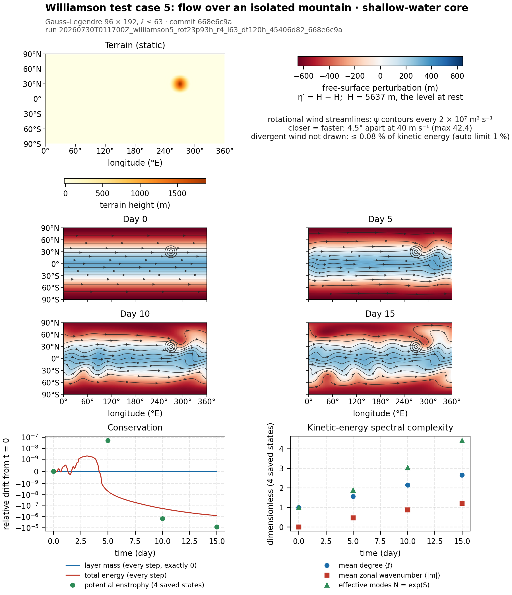
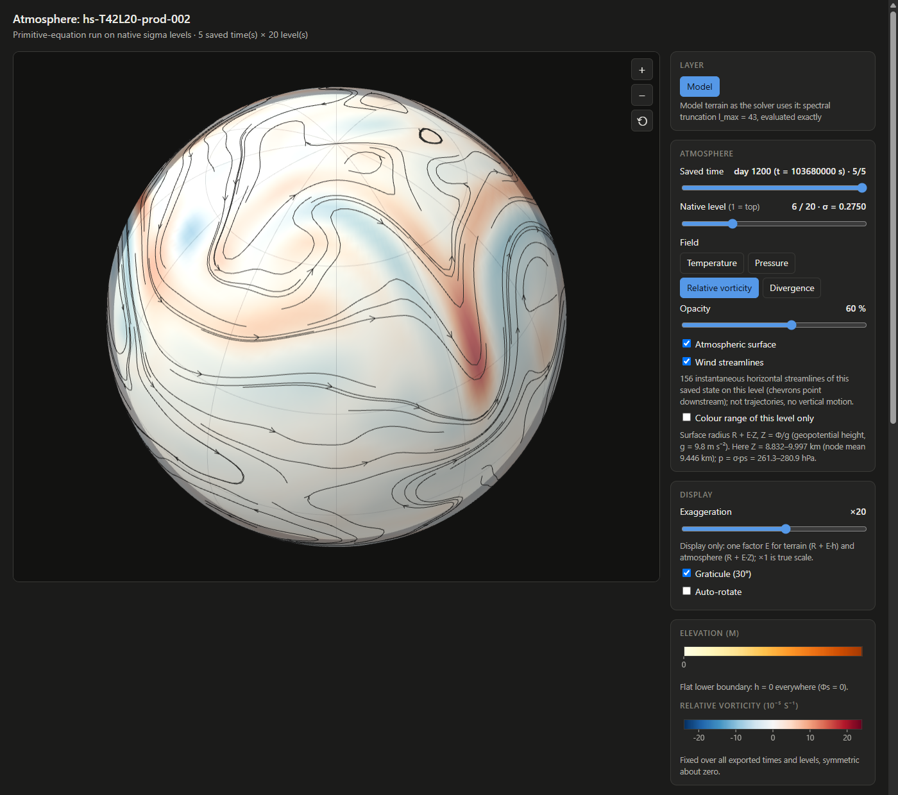
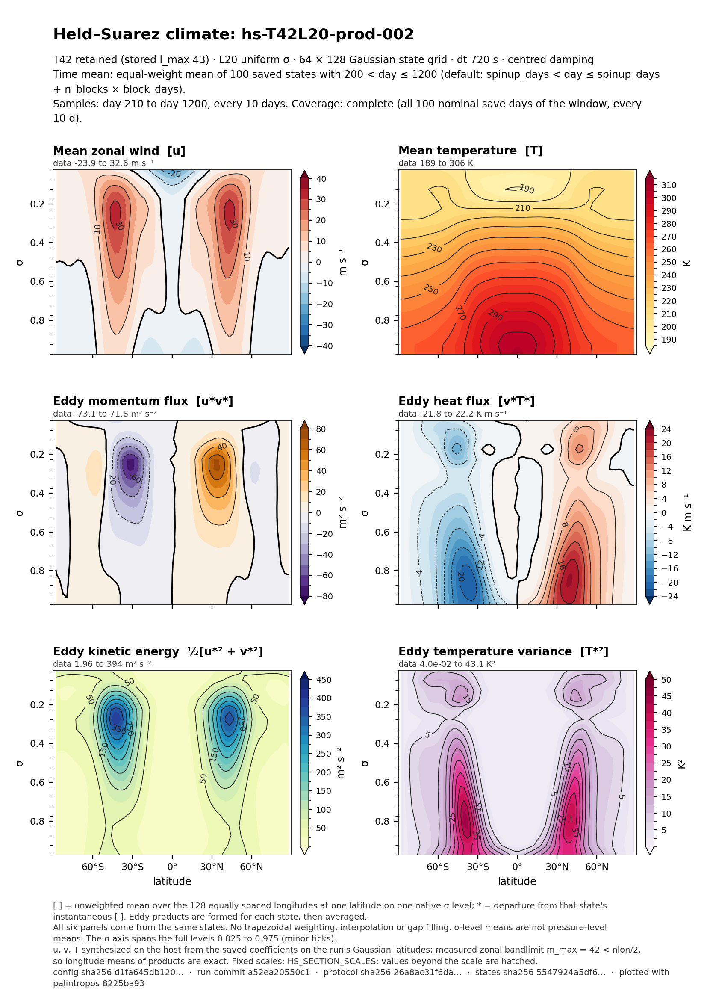
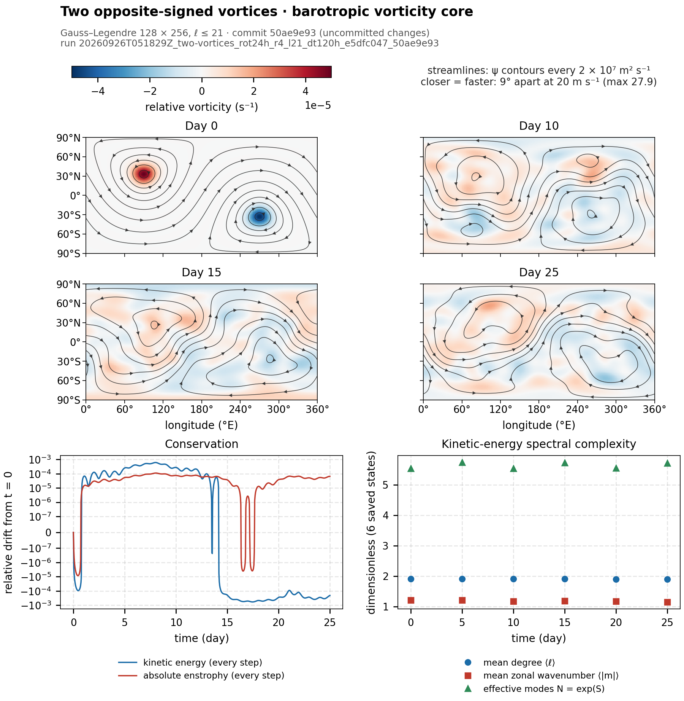

# Palintropos

**A GPU spectral laboratory for idealized flow on a rotating sphere.**

Put a thin layer of fluid on a spinning sphere and it does not stay smooth.
Rotation, curvature, and the variation of the Coriolis parameter with latitude
organize it into jets, long-lived vortices, and planetary-scale waves.
Palintropos is research software for watching that organization come out of
the equations themselves: idealized dynamical cores written in spherical
harmonics, with conservation diagnostics and run provenance, so each claim can
be traced back to a recorded run.

It is **not** a climate or weather model. Its solvers are idealized: no
moisture, no radiation, and the only forcing is the analytic Held–Suarez
benchmark in the primitive-equation core. Terrain can be analytic or read from
an elevation file (for example Mars from MOLA), but it is fixed bottom
topography only; running over real terrain does not make a run a model of
that planet's atmosphere.



*Williamson test case 5, flow over an isolated mountain, from the canonical T63
run (Gauss–Legendre grid 96 × 192, ℓ ≤ 63, inviscid; commit `668e6c9a`,
2026-07-30, one GPU run). A zonal jet meets a conical mountain (top left: the
band-limited terrain) and sets up a global wave train over 15 days. The maps
share one colour scale for the free-surface perturbation η′ = H − H̄ (blue
above the resting level H̄ = 5637 m, red below; the blue band is the
equatorial bulge of the balanced jet). The lines are evenly spaced contours of
the streamfunction ψ, closer where the flow is faster; they omit the divergent
wind, which carries at most 0.08 % of the kinetic energy. The circles are the terrain at 500, 1000 and
1500 m. Layer mass stays bit-identical to day 0 at every step. Over 15 days,
total energy drifts by −7.9 × 10⁻⁷ (recorded every step) and potential
enstrophy by −8.5 × 10⁻⁶ (evaluated at the four saved states only). In
kinetic-energy mode space, the flow starts as a single mode (mean degree
⟨ℓ⟩ = 1) and spreads to ⟨ℓ⟩ ≈ 2.7 and about 4.4 effective modes by day 15.
[Definitions and full evidence →](docs/validation/williamson5_mri_2026-07-30.md#41-spectral-complexity-of-the-t63-snapshots)*

The figure is an asset of the run it draws, which is published with a
checksum receipt in [docs/runs](docs/runs/README.md). It is drawn by a
pinned recipe, and every number it shows is in
[overview.json](docs/runs/20260730T011700Z_williamson5_rot23p93h_r4_l63_dt120h_45406d82_668e6c9a/assets/overview.json).
To redraw it (needs CUDA), or to draw the same kind of overview for any saved
run:

```powershell
python docs/figures/williamson5_t63_overview.py   # this figure, from its recipe
tropoi plot RUN_PATH                               # default overview of any saved run
```

### Real terrain in the interactive viewer


*Mars topography from NASA PDS MOLA MEGDR (4 px/deg), resolved at ℓ ≤ 42 on a
Gauss grid and shown in the self-contained terrain viewer (browser capture).
Layer: Model, the coefficients the solver uses. Relief exaggerated ×20 for
display only. The colour bar is in metres and spans both layers. Details and
provenance:
[docs/validation/mola_terrain_2026-10-22](docs/validation/mola_terrain_2026-10-22/README.md).*

```bash
python examples/mola_mars.py show mola/megt_4ppd.nc --lmax 42 --units m --centre 0 -95 --exaggeration 20 --out mola --open
```

The command needs CUDA and the converted MOLA grid; see
[src/tropoi/spatial/terrain/IMPORT.md](src/tropoi/spatial/terrain/IMPORT.md#real-data-mars-from-mola).

Terrain for your own planet can also come from a formula or from a function
in your own Python file. Sampling is done on the CPU and preparation on CUDA:

```bash
tropoi terrain prepare --expression "1200*cos(radians(lat))**2*cos(2*radians(lon))" --resolution-deg 2 --lmax 21 --solver pe --out terrain/my_planet
tropoi terrain prepare --function "./my_terrain.py:height" --resolution-deg 2 --lmax 21 --solver pe --out terrain/my_planet
```

See [src/tropoi/spatial/terrain/IMPORT.md](src/tropoi/spatial/terrain/IMPORT.md#a-height-expression-or-a-python-function).

## What you can study with it today

- **How rotating flow organizes itself.** Vortex interaction, Rossby–Haurwitz
  waves, and mountain-forced wave trains, all measured against the
  invariants the continuous equations conserve.
- **How energy moves between scales.** Saved states and per-step diagnostics
  show spectral redistribution and measured invariant drift. Small drift in
  a documented benchmark is not a guarantee for every flow.
- **How much the grid itself affects the result.** The same model can run on
  two grids that share one spectral layout, which exposes quadrature and
  grid-orientation error that a single grid would hide.

The dry PE core also supports controlled studies of forced circulation and
eddy heat transport: its 1200-day Held–Suarez baseline passed the declared
comparison with Dinosaur. That establishes a dry benchmark under stated
parameters, not predictive climates for arbitrary planets. Moist physics,
radiative heating and general planetary-climate validation remain future work
([radiative-transfer milestone](https://github.com/AlexandreEros/Palintropos/issues/26)).
The standalone sky prototype and expanded architecture coverage remain in
[open PR #22](https://github.com/AlexandreEros/Palintropos/pull/22) and
[#23](https://github.com/AlexandreEros/Palintropos/pull/23); they are outside
the current `main` capabilities described here.

## Model cores

All three cores are spectral (spherical harmonics, `float64`/`complex128`).
BVE and SWE use explicit RK4. PE also has a semi-implicit stepper, used for
the long forced runs ([SEMI_IMPLICIT.md](src/tropoi/temporal/SEMI_IMPLICIT.md)).

| Core | Command | Prognostic state | Evidence so far | Limits |
|---|---|---|---|---|
| **Barotropic vorticity (BVE)** | `tropoi run bve` | relative vorticity | RH4 traveling wave on both grids; conservation and rotation-equivalence tests | Single layer, non-divergent. Optional Laplacian viscosity has no stability control of its own |
| **Rotating shallow water (SWE)** | `tropoi run swe` | vorticity, divergence, perturbation thickness geopotential | Linear gravity-wave dispersion, Williamson 2, exact lake at rest over terrain, Williamson 5 compared with an external model | Inviscid, single layer. Terrain is an analytic Gaussian mountain, the benchmark cone, or imported from an elevation file through a saved initial state ([TERRAIN_IMPORT.md](src/tropoi/spatial/terrain/IMPORT.md)) |
| **Dry hydrostatic primitive equations (PE)** | `tropoi run pe` (RK4); `python -m tropoi.run.held_suarez` (HS experiment) | per-level vorticity, divergence, temperature; ln surface pressure | Exact rest; smooth short evolution; analytic orographic balance (to roundoff on the Gauss grid); **Held–Suarez forced climate, 1200 days at T42L20, all three acceptance tiers passed** ([STATUS.md](docs/held_suarez/STATUS.md)) | Fixed user-chosen step, no CFL controller, no energy-conservation claim. Forcing is Held–Suarez only (Newtonian relaxation + Rayleigh friction, ∇⁸ hyperdiffusion); no moisture or radiation |

BVE and SWE recompute their timestep ceiling after every accepted state;
SWE includes the gravity-wave speed. The PE command uses a fixed RK4 step;
the separate Held–Suarez driver uses fixed-step semi-implicit integration.
Details: [SHALLOW_WATER.md](src/tropoi/temporal/tendencies/SHALLOW_WATER.md),
[PE runner guide](src/tropoi/run/pe/GUIDE.md),
[numerical conventions](src/tropoi/spatial/CONVENTIONS.md).

**Two grids, one coefficient layout.** Every core runs on either grid, chosen
with `--backend`:

- **`gauss-latlon`: the reference grid.** A Gauss–Legendre latitude–longitude
  grid. It transforms band-limited fields exactly to floating-point precision:
  in one measured round trip at `L = 21`, the relative L2 residual was
  ≈ 7 × 10⁻¹⁵.
- **`geodesic` (default): experimental.** An icosahedral grid. Its quadrature
  is approximate and depends on how the grid is oriented: the same round trip
  left a residual of ≈ 1 × 10⁻².

## Install

You need Python 3.12, Git, and an NVIDIA GPU with a working CUDA driver and
toolkit. **There is no production CPU solver.** Without CUDA you can still
open, inspect, and read saved runs, but you cannot run a model.

The local numerical-test environment is Windows, Python 3.12.12, CuPy 13.4.0,
CUDA 11.8 and an NVIDIA GeForce MX110. The completed Held–Suarez runs also
record Colab Tesla T4 / CuPy 14.0.1 / CUDA 12.9–13.0 environments in their
[provenance](docs/held_suarez/STATUS.md). These are measured configurations,
not a hardware compatibility guarantee. The commands below are for PowerShell.

```powershell
git clone https://github.com/AlexandreEros/Palintropos.git
cd Palintropos
py -3.12 -m venv venv
.\venv\Scripts\Activate.ps1
pip install -r requirements.txt
pip install -e .
tropoi --help
```

`requirements.txt` pins `cupy-cuda11x==13.4.0`. For a CUDA 12.x installation,
the corresponding package is `cupy-cuda12x==13.4.0`; install only one CuPy
package. That exact alternative dependency combination is not established
by the recorded Colab benchmarks above. Reading NetCDF elevation
files ([src/tropoi/spatial/terrain/IMPORT.md](src/tropoi/spatial/terrain/IMPORT.md)) also needs
`pip install -e ".[terrain]"` (netCDF4). If PowerShell blocks venv
activation, run `Set-ExecutionPolicy -Scope Process -ExecutionPolicy Bypass`,
which applies to the current session only, and activate again.

Package names:

| What | Name |
|---|---|
| Distribution | `palintropos` |
| Python import | `tropoi` |
| Command-line tool | `tropoi` |

Use `tropoi` for all commands. The former `aeolus` and `psx-*` commands and
the pre-reorganization Python import paths have been retired; see the
[current import conventions](docs/ARCHITECTURE.md#imports-and-persisted-historical-names).

## Quick start

This runs a short two-vortex BVE smoke test: `l_max = 8`, about half an hour of
simulated time.

```powershell
tropoi run bve --preset two-vortices-quick
```

On an MX110 the whole run took about 30 s (measured 2026-09-23). The command
prints the absolute path of the run it wrote under `runs/` and updates
`runs/latest_run.txt`.

Other ready-made runs:

```powershell
tropoi run bve --preset two-vortices-quick --backend gauss-latlon   # same run, reference grid
tropoi run bve --preset rh4          # one-day Rossby–Haurwitz wave-4 validation configuration
tropoi run swe                       # one-day Williamson 2 (steady zonal flow)
tropoi run pe                        # tiny dry primitive-equation thermal-wave demo
tropoi list presets
tropoi list scenarios
```

`tropoi run <bve|swe|pe> --help` lists every option. Flags you pass explicitly
override the preset's values.

## Outputs and saved runs

Each run writes a self-contained directory containing:

- `manifest.json` and `config.json`: the full configuration plus provenance
  (Git commit and worktree state, GPU, library versions).
- `diagnostics/timeseries.csv`: the conservation diagnostics, one row per
  accepted step.
- `diagnostics/spectra.npz` (BVE runs only): degree spectra of energy and
  enstrophy, every tenth recorded step.
- Saved spectral states and their time axis.

A run renders no images. Draw them afterwards with `tropoi plot RUN`
(written to `RUN/assets/`), or ask the run for its older image products with
`--plot diagnostics`, `--plot snapshots`, `--plot summary` or `--plot all`.

How many states are saved is controlled by `--n-snapshots N` (default 5,
including `t = 0` and the end). States and diagnostics are always written,
whatever `--plot` selects.

Each solver saves its states under its own file names:

| Solver | Spectral states | Time axis | Also saved |
|---|---|---|---|
| BVE | `vorticity_coeffs.npy` | `bve_snapshot_times.npy` | `vorticity_grid.npy` (gridded vorticity) |
| SWE | `swe_coeffs.npy` | `swe_snapshot_times.npy` | |
| PE | `pe_coeffs.npy` | `pe_snapshot_times.npy` | |

**Inspect a run from the shell.** This works without a GPU and never
initializes CUDA:

```powershell
tropoi inspect runs                              # summary of the latest run
tropoi inspect runs --snapshot -1 --field zeta   # one saved state: time, units, shape, convention checks
```

**Read a run from Python.** The Simulation/Snapshot API is read-only. Opening a
run memory-maps its arrays without CUDA:

```python
from tropoi.representation.archive import open_simulation

sim = open_simulation("runs")                # a run directory, or a base dir with latest_run.txt
sim.times                                    # saved times in seconds
snap = sim[-1]                               # index of a saved output, not a time
snap.state["zeta"].coeffs                    # read-only (l, m) coefficient view
snap.plot(output_path="zeta_last.png")       # renders the same figure the run produced
```

**Draw a run.** `Simulation.plot` and `tropoi plot` draw any saved BVE, SWE or
PE run; you choose the filled quantity, contours, the wind overlay, the saved
times and the diagnostics panels:

```python
from tropoi.representation.visual.views import Map, StreamfunctionContours

sim.plot()                                   # default overview -> RUN/assets/overview.png
sim[-1].plot("flow.png", Map(None, vectors=StreamfunctionContours()))  # streamlines alone
sim.quantities()                             # what this run can draw: meaning, units, cadence
```

**Look at a PE atmosphere in 3D.** `sim.view()` writes one self-contained HTML
page that opens offline. It shows the terrain globe and a translucent native σ
surface placed at its hydrostatic geopotential height, coloured by temperature,
pressure, vorticity or divergence, with optional horizontal streamlines and
sliders over saved times, levels, exaggeration and opacity. It runs on the CPU
and also opens Held–Suarez experiment directories:

```python
sim = open_simulation("runs/hs-T42L20-prod-002")
sim.view("hs.html", times=[0, -1], levels=[0, 10, 19])
```



*Held–Suarez run 002 at day 1200: relative vorticity on σ = 0.275 (8.8–10.0 km),
×20, in the exported page (browser capture). See
[src/tropoi/representation/visual/ATMOSPHERE_VIEW.md](src/tropoi/representation/visual/ATMOSPHERE_VIEW.md).*

**Draw a Held–Suarez climate.** On a Held–Suarez experiment, `sim.plot()` draws
the six latitude–σ sections from the saved states, on the CPU, as a PNG plus a
PDF beside it. A strip under the sections shows the run's daily mass drift,
kinetic energy and temperature:

```python
sim = open_simulation("runs/hs-T42L20-prod-002")
png = sim.plot()                                   # RUN/assets/overview.png + overview.pdf
png = sim.plot("hs.png", interval=(1000, 1200), sidecar=True)   # 1000 < day <= 1200; numbers in hs.json
```



Held–Suarez run 002 (T42L20). The sections are equal-weight means of the 100
saved states in 200 < day ≤ 1200. [ ] is the zonal mean on a native σ level and
\* the departure from it in each state; eddy products are formed before
averaging. The bottom strip draws every simulated day (grey: the averaging
window):
- mass, which the dry forcing conserves, drifts by 2.0 × 10⁻⁶ over 1200 days;
- kinetic energy and temperature, which are not conserved, have settled
  before the window.

This is a description of the run's climate, not validation evidence. Its
acceptance verdicts are in [STATUS.md](docs/held_suarez/STATUS.md).
Definitions, sampling, scales, and the round-off match with the production
statistics are in
[climate figure reference](src/tropoi/representation/visual/HELD_SUAREZ_CLIMATE.md).
[PDF](docs/validation/held_suarez_climate_2026-11-04/hs-T42L20-prod-002_climate.pdf).

```powershell
tropoi plot runs                                            # -> <latest run>/assets/overview.png
tropoi plot runs --list-quantities                          # no GPU needed
tropoi plot runs --map vorticity --vectors arrows --snapshots 0,-1
tropoi plot runs --vectors streamfunction                   # psi contours (SWE/PE: rotational wind)
```

- The fields are `zeta` (BVE), `zeta`/`delta`/`phi` (SWE), and
  `zeta`/`delta`/`temperature`/`ln_ps` (PE).
- `Snapshot.plot` and `Simulation.plot` build nothing until you call them.
  Maps of physical fields need CUDA: the run's model is rebuilt once. Without a
  view, `Snapshot.plot` draws the run's own snapshot figure;
  `representation="spectral"` renders that on the CPU, for BVE and SWE only.
- Figures belong to their run: by default they go to `RUN/assets/`, the only
  place inside a run that plotting writes. `assets/` holds derived,
  reproducible products; it is not part of the run's evidence, identity or
  checksums. `-o PATH` writes elsewhere.
- Values that exist only at saved states, such as potential enstrophy, are
  drawn as markers, never as a per-step line.
- BVE winds are drawn as evenly spaced contours of the streamfunction ψ. They
  are the exact streamlines, and closer lines mean faster flow. SWE and PE
  overviews use ψ contours too when the divergent wind carries at most 1 %
  of the kinetic energy in every map shown. Otherwise they draw streamlines
  integrated through the full wind, where line width, not line density,
  shows speed. The key states which was chosen and why.
- SWE overviews colour the free-surface perturbation η′ = H − H̄: white at
  the level the same volume would have at rest, blue above it, red below.
- The API does not interpolate in time or restart runs.

Full reference: [src/tropoi/temporal/SAVED_RUNS.md](src/tropoi/temporal/SAVED_RUNS.md).

**Run your own planet and initial state (BVE, SWE).** Define a planet,
discretization, and resolved spectral state in Python, save them as
versioned JSON plus `.npy` arrays, reload them in any process (no GPU
needed), and run them through the same lifecycle as the presets:

```python
from tropoi.run.custom import load_initial_state, run_initial_state

state = load_initial_state("my_state")      # CPU only: validated, verified, digest-checked
run_dir = run_initial_state(state, duration_days=1.0, n_snapshots=5)
```

or, from the shell, `tropoi run bve|swe --initial-state my_state --days 1`.

States are prepared from callables `f(lat, lon)`, sampled arrays or
spherical-harmonic coefficients, with projection residuals, mean modes and
(SWE) positive thickness checked and reported. See
[src/tropoi/run/custom/INITIAL_STATES.md](src/tropoi/run/custom/INITIAL_STATES.md) and the
runnable examples in [examples/](examples).

**Terrain from elevation files.** Read a global NetCDF, 16-bit PNG or TIFF
elevation map, resolve it on the model grid, and look at exactly what the
solver will use before running anything: `world.plot()` for a static figure,
`world.view()` for an interactive 3D globe (one self-contained HTML file).
The resolved terrain and its source provenance go into SWE initial states
and the runs made from them, and into PE runs (`tropoi run pe --terrain DIR`).
See [src/tropoi/spatial/terrain/IMPORT.md](src/tropoi/spatial/terrain/IMPORT.md),
[examples/terrain_planet.py](examples/terrain_planet.py) (synthetic terrain),
and [examples/mola_mars.py](examples/mola_mars.py) (real Mars topography from
MOLA).



*A BVE example: two compact vortices of opposite sign on a sphere with a
24 h rotation break up into a turbulent, planetary-scale flow over 25 days.
This is the published run
[`20260926T051829Z_two-vortices_…`](docs/runs/20260926T051829Z_two-vortices_rot24h_r4_l21_dt120h_e5dfc047_50ae9e93)
(Gauss–Legendre grid 128 × 256, ℓ ≤ 21, inviscid), drawn by the default
`tropoi plot`. The lines are contours of the streamfunction ψ, the exact
streamlines of this non-divergent flow, and closer lines mean faster flow.
Recorded every step, the kinetic energy stays within 6.1 × 10⁻⁴ of its
initial value and the absolute enstrophy within 1.1 × 10⁻⁴.*

## Validation: measured, not guaranteed

The numbers below are measurements of the discrete solvers in specific
configurations. They are not analytic guarantees. Conservation is measured, not
proven: the saved state keeps modes above the cut at which nonlinear tendencies
are truncated.

| Evidence | Result | When and where |
|---|---|---|
| Williamson 5 vs the MRI-JMA reference model, day-0 check with tolerances fixed in advance (T42, T63) | **passed** by 3–4 orders of magnitude | commit `668e6c9a`, 2026-07-30; Gauss grid; NVIDIA RTX PRO 6000 Blackwell on Google Colab |
| Williamson 5, 15-day inviscid runs (T42, T63) | completed; mass drift **0.0** (bit-identical); energy drift **+3.4 × 10⁻⁷ / −7.9 × 10⁻⁷** | same |
| Williamson 5, day-15 free surface vs MRI-JMA | weighted RMS difference **5.6 m / 4.7 m**, on a layer about 5620 m deep | same |
| RH4, 5 days, matched timestep | relative energy drift: geodesic **−4.46 × 10⁻⁴**, Gauss **−1.34 × 10⁻¹⁰** | `feat/latlon-grid` review, 2026-07-12; MX110 |
| Held–Suarez forced climate, 1200 days, T42L20, semi-implicit, criteria fixed in advance (run `hs-T42L20-prod-002`) | **A PASS, B PASS, C PASS** | solver `a52ea20`, 2026-10-03/04; Colab Tesla T4; 1200 days in 9.9 h wall |
| Held–Suarez, the earlier run `hs-T42L20-prod-001` (lagged damping, Δt 900 s) | A PASS, **B FAIL** (B2 only; cause measured), C PASS | solver `206ef25`, 2026-09-30/10-01. Kept in the record: verdicts as reported, never edited |

**Williamson 5 is a comparison between two numerical models.** Williamson 5
has no exact solution: the reference is another model's high-resolution
output, which has its own discretization error. The results do not claim
agreement with truth, identical agreement with MRI-JMA, or a convergence
order (two resolutions cannot measure one).
[Full report →](docs/validation/williamson5_mri_2026-07-30.md)

The day-zero field contract checks that the MRI reference and solver use
the same free surface, fluid depth and mountain before comparing evolved
states. The source-cited [field semantics](notebooks/W5_MRI_SEMANTIC_AUDIT.md)
and [pinned notebooks](notebooks/README.md) preserve that reproducible contract.

**Tests.** [CPU CI](.github/workflows/tests.yml) runs configuration, storage,
host reconstruction, visualization and architecture checks without CuPy;
CUDA numerical tests skip there. For routine GPU regression use
`python -m pytest -m "not slow"`; run the long convergence selection when
its numerical dependencies change, and the full suite before releases.
[Test instructions](docs/ARCHITECTURE.md#tests) explain the selections and
environment boundaries. Historical suite counts are not current coverage.

## Limitations

- No moisture, radiation, or time-varying terrain in any solver. Real
  terrain can be imported (SWE initial states, `tropoi run pe --terrain`), but
  only as fixed band-limited bottom topography. The only forcing is
  Held–Suarez in the PE core; BVE and SWE are unforced. The terrain from
  `Planet.generate` is decorative only.
- BVE and SWE are single-layer.
- The semi-implicit stepper exists for PE and was used for the Held–Suarez
  runs; BVE and SWE are explicit RK4 only. There is no stability control for
  explicit viscosity. The PE core has no CFL control.
- The geodesic grid's quadrature is approximate and depends on how the grid is
  oriented. The Gauss grid is the reference.
- Numerical integration requires CUDA/CuPy; saved-run reading, host
  synthesis, many views and CPU CI work without it. There is no independent
  CPU dynamical core to cross-check the GPU solver.
- The default dense transforms limit resolution on small GPUs. Windows display
  GPUs can hit driver timeouts (TDR) on large kernels.

Details: [current limitations](docs/KNOWN_LIMITATIONS.md).

## Navigating the repository

The [technical reference index](docs/README.md) connects current capability
claims to equations, code, tests and dated evidence. The [source index](src/tropoi/README.md)
explains each layer and leads to concise directory READMEs and subsystem guides:

- [Spatial numerics](src/tropoi/spatial/README.md): coefficient conventions,
  grids, transforms, operators, terrain and states.
- [Temporal models](src/tropoi/temporal/README.md): BVE/SWE/PE formulations,
  steppers and the saved-run interface.
- [Representation](src/tropoi/representation/README.md): archives, diagnostics,
  saved-atmosphere playback and climate figures.
- [Run orchestration](src/tropoi/run/README.md): configuration, fixed-step PE,
  custom preparation and the Held–Suarez experiment driver.
- [Architecture](docs/ARCHITECTURE.md) and [generated diagrams](docs/architecture/README.md):
  layer contracts, execution boundaries and static structure.
- [Validation](docs/VALIDATION.md), [Held–Suarez](docs/held_suarez/README.md)
  and [measurement records](docs/validation/README.md): accepted results,
  frozen criteria, scientific limits and reproducibility assets.
- [Examples](examples/README.md), [notebooks](notebooks/README.md) and
  [figure recipes](docs/figures/README.md): reproducible workflows.

Directories are meaningful navigation nodes when imported into a wiki.
Historical plans and resolved reviews remain in Git history; supporting
measurements, protocols, published capsules and figure recipes stay in the tree.
