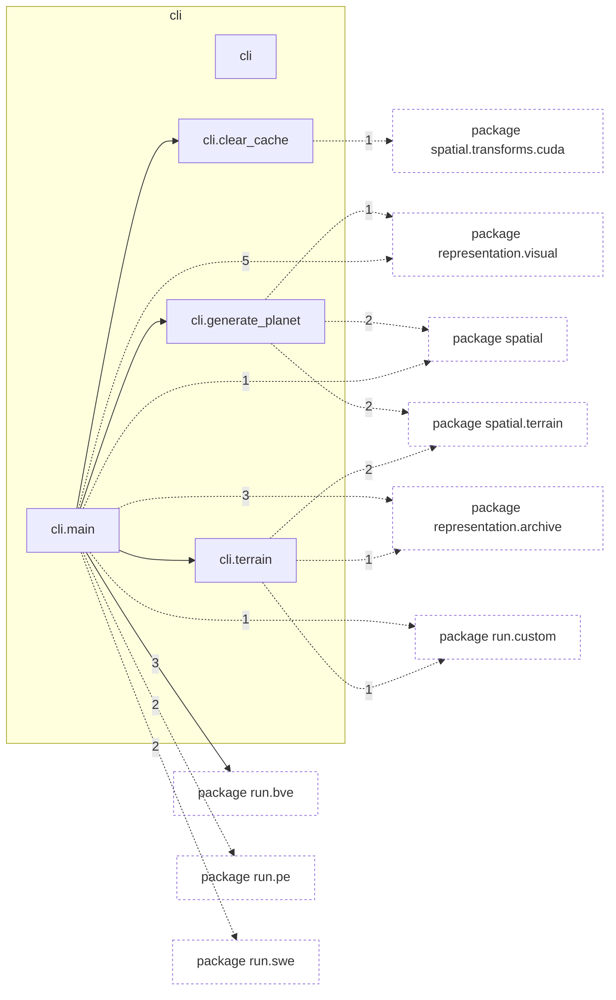

# Package `tropoi.cli`

Generated by `tools.architecture`; do not edit. Every module, class and public module-level function of this package is listed here (subpackages have their own pages). Relations shown are extracted from the source, not inferred.

Index: [all packages](../index.md) · parent [`tropoi`](tropoi.md)

## Modules

| Module | Category | Classes | Public functions |
|---|---|---|---|
| `tropoi.cli` | empty | – | – |
| `tropoi.cli.clear_cache` | code | – | `add_arguments`, `clear_cupy_cache`, `run`, `verify_kernel_source` |
| `tropoi.cli.generate_planet` | code | – | `add_arguments`, `resolve_output_path`, `run` |
| `tropoi.cli.main` | code | – | `add_bve_arguments`, `add_pe_arguments`, `add_swe_arguments`, `build_parser`, `main`, `run_bve_command`, `run_initial_state_command` |
| `tropoi.cli.terrain` | code | – | `add_arguments`, `add_prepare_arguments`, `build_raster`, `default_gauss_grid`, `run_prepare` |

Files shipped in this directory that are **not Python and not analysed** (templates, data): `README.md`. Their contents (for example JavaScript in an HTML template) are invisible to every graph here.

## Imports

This package's modules and the import edges between them; every other package is collapsed to one dashed node (edge label: module edges merged). A dashed arrow is made only of function-scope or `TYPE_CHECKING` imports.

## Classes

No classes.

## Entry paths through this package

* [`calls/cli-gen.mmd`](../calls/cli-gen.mmd)
* [`calls/cli-inspect.mmd`](../calls/cli-inspect.mmd)
* [`calls/cli-list-presets.mmd`](../calls/cli-list-presets.mmd)
* [`calls/cli-list-scenarios.mmd`](../calls/cli-list-scenarios.mmd)
* [`calls/cli-plot.mmd`](../calls/cli-plot.mmd)
* [`calls/cli-recompile.mmd`](../calls/cli-recompile.mmd)
* [`calls/cli-run-bve.mmd`](../calls/cli-run-bve.mmd)
* [`calls/cli-run-pe.mmd`](../calls/cli-run-pe.mmd)
* [`calls/cli-run-swe.mmd`](../calls/cli-run-swe.mmd)
* [`calls/cli-terrain-run-prepare.mmd`](../calls/cli-terrain-run-prepare.mmd)
