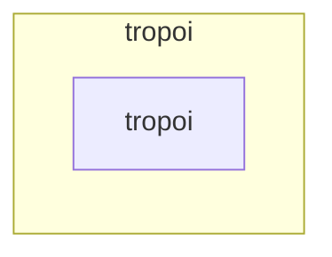

# Package `tropoi`

Generated by `tools.architecture`; do not edit. Every module, class and public module-level function of this package is listed here (subpackages have their own pages). Relations shown are extracted from the source, not inferred.

Index: [all packages](../index.md) · [`tropoi.cli`](tropoi.cli.md) · [`tropoi.representation`](tropoi.representation.md) · [`tropoi.run`](tropoi.run.md) · [`tropoi.spatial`](tropoi.spatial.md) · [`tropoi.temporal`](tropoi.temporal.md)

## Modules

| Module | Category | Classes | Public functions |
|---|---|---|---|
| `tropoi` | empty | – | – |

## Imports

This package's modules and the import edges between them; every other package is collapsed to one dashed node (edge label: module edges merged). A dashed arrow is made only of function-scope or `TYPE_CHECKING` imports.

## Classes

No classes.

## Entry paths through this package

None of the scoped call graphs reaches this package.
