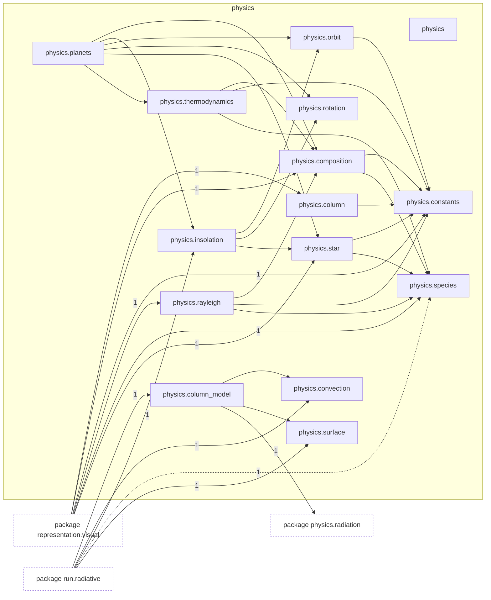

# Package `tropoi.physics`

Generated by `tools.architecture`; do not edit. Every module, class and public module-level function of this package is listed here (subpackages have their own pages). Relations shown are extracted from the source, not inferred.

Index: [all packages](../index.md) · parent [`tropoi`](tropoi.md) · [`tropoi.physics.radiation`](tropoi.physics.radiation.md)

## Modules

| Module | Category | Classes | Public functions |
|---|---|---|---|
| `tropoi.physics` | empty | – | – |
| `tropoi.physics.column` | code | `AtmosphericColumn`, `ColumnError` | `thin_atmosphere_mass_kg`, `thin_atmosphere_surface_pressure_pa` |
| `tropoi.physics.column_model` | code | `ColumnPhysics`, `PhysicsOutput`, `RadiativeConvectiveColumn` | – |
| `tropoi.physics.composition` | code | `Composition`, `CompositionError` | `gas_constant_report` |
| `tropoi.physics.constants` | code | – | – |
| `tropoi.physics.convection` | code | `DryConvectiveAdjustment` | `neutral_profile` |
| `tropoi.physics.insolation` | code | `DiurnalMeanInsolation`, `InstantaneousInsolation`, `PrescribedInsolation`, `StellarIllumination`, `TidallyLockedInsolation` | `frierson_net_surface_flux` |
| `tropoi.physics.orbit` | code | `KeplerOrbit` | `eccentric_from_true`, `mean_from_true`, `true_from_eccentric`, `true_from_mean` |
| `tropoi.physics.planets` | code | `PlanetaryBody`, `VerticalGridSpec` | – |
| `tropoi.physics.rayleigh` | code | `OpticalRecord` | `composition_cross_section`, `optical_records`, `rayleigh_cross_section` |
| `tropoi.physics.rotation` | code | `Rotation` | – |
| `tropoi.physics.species` | code | `Species` | `dataset_identities`, `load_dataset` |
| `tropoi.physics.star` | code | `ApparentStar`, `Star` | `planck_radiance` |
| `tropoi.physics.surface` | code | `SlabSurface` | `drag_coefficient`, `sensible_heat_flux` |
| `tropoi.physics.thermodynamics` | code | `ThermoRecord` | `cp_molar`, `heat_capacity`, `heat_capacity_range`, `hydrogen_rotational_cv`, `kappa` |

Files shipped in this directory that are **not Python and not analysed** (templates, data): `README.md`. Their contents (for example JavaScript in an HTML template) are invisible to every graph here.

## Imports

This package's modules and the import edges between them; every other package is collapsed to one dashed node (edge label: module edges merged). A dashed arrow is made only of function-scope or `TYPE_CHECKING` imports.

## Classes

23 classes, each with the functions defined in its body (`$`: class/static method; no parentheses: property). Edges: inheritance (`<|--`) and nesting (`*--`) only.

```mermaid
%% Generated by tools.architecture 2.3.0. Do not edit by hand.
%% Classes of tropoi.physics
classDiagram
    direction LR
    class c_tropoi_ophysics_ocolumn_oAtmosphericColumn["AtmosphericColumn (physics.column)"]
    c_tropoi_ophysics_ocolumn_oAtmosphericColumn : +#95;#95;post#95;init#95;#95;()
    c_tropoi_ophysics_ocolumn_oAtmosphericColumn : +#95;check#95;z()
    c_tropoi_ophysics_ocolumn_oAtmosphericColumn : +altitude#95;at()
    c_tropoi_ophysics_ocolumn_oAtmosphericColumn : +base#95;m
    c_tropoi_ophysics_ocolumn_oAtmosphericColumn : +from#95;levels()$
    c_tropoi_ophysics_ocolumn_oAtmosphericColumn : +hypothetical()$
    c_tropoi_ophysics_ocolumn_oAtmosphericColumn : +number#95;density()
    c_tropoi_ophysics_ocolumn_oAtmosphericColumn : +observer#95;altitude()
    c_tropoi_ophysics_ocolumn_oAtmosphericColumn : +pressure#95;at()
    c_tropoi_ophysics_ocolumn_oAtmosphericColumn : +surface#95;pressure#95;pa
    c_tropoi_ophysics_ocolumn_oAtmosphericColumn : +temperature#95;at()
    c_tropoi_ophysics_ocolumn_oAtmosphericColumn : +to#95;dict()
    c_tropoi_ophysics_ocolumn_oAtmosphericColumn : +top#95;m
    class c_tropoi_ophysics_ocolumn_oColumnError["ColumnError (physics.column)"]
    c_tropoi_ophysics_ocolumn_oColumnError : external base ValueError
    class c_tropoi_ophysics_ocolumn__model_oColumnPhysics["ColumnPhysics (physics.column#95;model)"]
    c_tropoi_ophysics_ocolumn__model_oColumnPhysics : +#95;#95;init#95;#95;()
    c_tropoi_ophysics_ocolumn__model_oColumnPhysics : +adjust()
    c_tropoi_ophysics_ocolumn__model_oColumnPhysics : +compute()
    c_tropoi_ophysics_ocolumn__model_oColumnPhysics : +reset()
    c_tropoi_ophysics_ocolumn__model_oColumnPhysics : +signature()
    class c_tropoi_ophysics_ocolumn__model_oPhysicsOutput["PhysicsOutput (physics.column#95;model)"]
    c_tropoi_ophysics_ocolumn__model_oPhysicsOutput : +column#95;energy#95;tendency
    class c_tropoi_ophysics_ocolumn__model_oRadiativeConvectiveColumn["RadiativeConvectiveColumn (physics.column#95;model)"]
    c_tropoi_ophysics_ocolumn__model_oRadiativeConvectiveColumn : +#95;#95;init#95;#95;()
    c_tropoi_ophysics_ocolumn__model_oRadiativeConvectiveColumn : +#95;stable#95;step()
    c_tropoi_ophysics_ocolumn__model_oRadiativeConvectiveColumn : +equilibrate()
    c_tropoi_ophysics_ocolumn__model_oRadiativeConvectiveColumn : +evaluate()
    c_tropoi_ophysics_ocolumn__model_oRadiativeConvectiveColumn : +step()
    class c_tropoi_ophysics_ocomposition_oComposition["Composition (physics.composition)"]
    c_tropoi_ophysics_ocomposition_oComposition : +#95;#95;post#95;init#95;#95;()
    c_tropoi_ophysics_ocomposition_oComposition : +describe()
    c_tropoi_ophysics_ocomposition_oComposition : +from#95;mass#95;fractions()$
    c_tropoi_ophysics_ocomposition_oComposition : +gas#95;constant
    c_tropoi_ophysics_ocomposition_oComposition : +mass#95;fraction()
    c_tropoi_ophysics_ocomposition_oComposition : +mass#95;fractions
    c_tropoi_ophysics_ocomposition_oComposition : +molar#95;mass
    c_tropoi_ophysics_ocomposition_oComposition : +molar#95;mass#95;g#95;per#95;mol
    c_tropoi_ophysics_ocomposition_oComposition : +molar#95;mass#95;kg#95;per#95;mol
    c_tropoi_ophysics_ocomposition_oComposition : +mole#95;fraction()
    c_tropoi_ophysics_ocomposition_oComposition : +normalized()$
    c_tropoi_ophysics_ocomposition_oComposition : +of()$
    c_tropoi_ophysics_ocomposition_oComposition : +require#95;coverage()
    c_tropoi_ophysics_ocomposition_oComposition : +sources()
    c_tropoi_ophysics_ocomposition_oComposition : +species#95;names
    c_tropoi_ophysics_ocomposition_oComposition : +to#95;dict()
    class c_tropoi_ophysics_ocomposition_oCompositionError["CompositionError (physics.composition)"]
    c_tropoi_ophysics_ocomposition_oCompositionError : external base ValueError
    class c_tropoi_ophysics_oconvection_oDryConvectiveAdjustment["DryConvectiveAdjustment (physics.convection)"]
    c_tropoi_ophysics_oconvection_oDryConvectiveAdjustment : +#95;#95;init#95;#95;()
    c_tropoi_ophysics_oconvection_oDryConvectiveAdjustment : +adjust()
    c_tropoi_ophysics_oconvection_oDryConvectiveAdjustment : +signature()
    class c_tropoi_ophysics_oinsolation_oDiurnalMeanInsolation["DiurnalMeanInsolation (physics.insolation)"]
    c_tropoi_ophysics_oinsolation_oDiurnalMeanInsolation : +#95;#95;call#95;#95;()
    c_tropoi_ophysics_oinsolation_oDiurnalMeanInsolation : +#95;#95;init#95;#95;()
    c_tropoi_ophysics_oinsolation_oDiurnalMeanInsolation : +signature()
    class c_tropoi_ophysics_oinsolation_oInstantaneousInsolation["InstantaneousInsolation (physics.insolation)"]
    c_tropoi_ophysics_oinsolation_oInstantaneousInsolation : +#95;#95;call#95;#95;()
    c_tropoi_ophysics_oinsolation_oInstantaneousInsolation : +#95;#95;init#95;#95;()
    c_tropoi_ophysics_oinsolation_oInstantaneousInsolation : +signature()
    class c_tropoi_ophysics_oinsolation_oPrescribedInsolation["PrescribedInsolation (physics.insolation)"]
    c_tropoi_ophysics_oinsolation_oPrescribedInsolation : +#95;#95;call#95;#95;()
    c_tropoi_ophysics_oinsolation_oPrescribedInsolation : +#95;#95;init#95;#95;()
    c_tropoi_ophysics_oinsolation_oPrescribedInsolation : +signature()
    class c_tropoi_ophysics_oinsolation_oStellarIllumination["StellarIllumination (physics.insolation)"]
    c_tropoi_ophysics_oinsolation_oStellarIllumination : +#95;#95;post#95;init#95;#95;()
    c_tropoi_ophysics_oinsolation_oStellarIllumination : +as#95;dict()
    c_tropoi_ophysics_oinsolation_oStellarIllumination : +declination()
    c_tropoi_ophysics_oinsolation_oStellarIllumination : +flux#95;at()
    c_tropoi_ophysics_oinsolation_oStellarIllumination : +from#95;components()$
    c_tropoi_ophysics_oinsolation_oStellarIllumination : +obliquity#95;deg
    c_tropoi_ophysics_oinsolation_oStellarIllumination : +prescribed()$
    c_tropoi_ophysics_oinsolation_oStellarIllumination : +solar#95;longitude()
    c_tropoi_ophysics_oinsolation_oStellarIllumination : +true#95;anomaly()
    class c_tropoi_ophysics_oinsolation_oTidallyLockedInsolation["TidallyLockedInsolation (physics.insolation)"]
    c_tropoi_ophysics_oinsolation_oTidallyLockedInsolation : +#95;#95;call#95;#95;()
    c_tropoi_ophysics_oinsolation_oTidallyLockedInsolation : +#95;#95;init#95;#95;()
    c_tropoi_ophysics_oinsolation_oTidallyLockedInsolation : +signature()
    class c_tropoi_ophysics_oorbit_oKeplerOrbit["KeplerOrbit (physics.orbit)"]
    c_tropoi_ophysics_oorbit_oKeplerOrbit : +#95;#95;post#95;init#95;#95;()
    c_tropoi_ophysics_oorbit_oKeplerOrbit : +apoapsis#95;m
    c_tropoi_ophysics_oorbit_oKeplerOrbit : +argument#95;of#95;periapsis#95;rad
    c_tropoi_ophysics_oorbit_oKeplerOrbit : +from#95;apsides()$
    c_tropoi_ophysics_oorbit_oKeplerOrbit : +from#95;au()$
    c_tropoi_ophysics_oorbit_oKeplerOrbit : +from#95;irradiance()$
    c_tropoi_ophysics_oorbit_oKeplerOrbit : +from#95;period()$
    c_tropoi_ophysics_oorbit_oKeplerOrbit : +mean#95;anomaly#95;epoch#95;rad
    c_tropoi_ophysics_oorbit_oKeplerOrbit : +mean#95;motion()
    c_tropoi_ophysics_oorbit_oKeplerOrbit : +periapsis#95;m
    c_tropoi_ophysics_oorbit_oKeplerOrbit : +period()
    c_tropoi_ophysics_oorbit_oKeplerOrbit : +position#95;at()
    c_tropoi_ophysics_oorbit_oKeplerOrbit : +radius#95;at()
    c_tropoi_ophysics_oorbit_oKeplerOrbit : +radius#95;at#95;time()
    c_tropoi_ophysics_oorbit_oKeplerOrbit : +to#95;dict()
    c_tropoi_ophysics_oorbit_oKeplerOrbit : +true#95;anomaly#95;at()
    c_tropoi_ophysics_oorbit_oKeplerOrbit : +with#95;()
    class c_tropoi_ophysics_oplanets_oPlanetaryBody["PlanetaryBody (physics.planets)"]
    c_tropoi_ophysics_oplanets_oPlanetaryBody : +cp
    c_tropoi_ophysics_oplanets_oPlanetaryBody : +gas#95;constant
    c_tropoi_ophysics_oplanets_oPlanetaryBody : +kappa
    c_tropoi_ophysics_oplanets_oPlanetaryBody : +regime()
    c_tropoi_ophysics_oplanets_oPlanetaryBody : +rotation#95;rate
    c_tropoi_ophysics_oplanets_oPlanetaryBody : +scale#95;height
    c_tropoi_ophysics_oplanets_oPlanetaryBody : +with#95;()
    class c_tropoi_ophysics_oplanets_oVerticalGridSpec["VerticalGridSpec (physics.planets)"]
    c_tropoi_ophysics_oplanets_oVerticalGridSpec : +as#95;dict()
    class c_tropoi_ophysics_orayleigh_oOpticalRecord["OpticalRecord (physics.rayleigh)"]
    c_tropoi_ophysics_orayleigh_oOpticalRecord : +covers()
    c_tropoi_ophysics_orayleigh_oOpticalRecord : +cross#95;section()
    c_tropoi_ophysics_orayleigh_oOpticalRecord : +describe()
    c_tropoi_ophysics_orayleigh_oOpticalRecord : +king#95;factor()
    c_tropoi_ophysics_orayleigh_oOpticalRecord : +refractivity()
    class c_tropoi_ophysics_orotation_oRotation["Rotation (physics.rotation)"]
    c_tropoi_ophysics_orotation_oRotation : +#95;#95;post#95;init#95;#95;()
    c_tropoi_ophysics_orotation_oRotation : +from#95;period()$
    c_tropoi_ophysics_orotation_oRotation : +obliquity#95;deg
    c_tropoi_ophysics_orotation_oRotation : +of()$
    c_tropoi_ophysics_orotation_oRotation : +sidereal#95;period#95;s
    c_tropoi_ophysics_orotation_oRotation : +to#95;dict()
    c_tropoi_ophysics_orotation_oRotation : +with#95;()
    class c_tropoi_ophysics_ospecies_oSpecies["Species (physics.species)"]
    c_tropoi_ophysics_ospecies_oSpecies : +formula#95;dict()
    c_tropoi_ophysics_ospecies_oSpecies : +molar#95;mass#95;g#95;per#95;mol
    class c_tropoi_ophysics_ostar_oApparentStar["ApparentStar (physics.star)"]
    c_tropoi_ophysics_ostar_oApparentStar : +#95;#95;post#95;init#95;#95;()
    c_tropoi_ophysics_ostar_oApparentStar : +bolometric#95;irradiance#95;w#95;m2
    c_tropoi_ophysics_ostar_oApparentStar : +describe()
    c_tropoi_ophysics_ostar_oApparentStar : +irradiance()
    c_tropoi_ophysics_ostar_oApparentStar : +luminosity#95;lsun
    c_tropoi_ophysics_ostar_oApparentStar : +of()$
    c_tropoi_ophysics_ostar_oApparentStar : +radiance()
    c_tropoi_ophysics_ostar_oApparentStar : +solid#95;angle#95;sr
    c_tropoi_ophysics_ostar_oApparentStar : +sun#95;at()$
    c_tropoi_ophysics_ostar_oApparentStar : +sun#95;at#95;1au()$
    c_tropoi_ophysics_ostar_oApparentStar : +to#95;dict()
    c_tropoi_ophysics_ostar_oApparentStar : +with#95;sun#95;irradiance#95;at#95;1au()$
    class c_tropoi_ophysics_ostar_oStar["Star (physics.star)"]
    c_tropoi_ophysics_ostar_oStar : +#95;#95;post#95;init#95;#95;()
    c_tropoi_ophysics_ostar_oStar : +angular#95;radius#95;deg#95;at()
    c_tropoi_ophysics_ostar_oStar : +at()
    c_tropoi_ophysics_ostar_oStar : +blackbody()$
    c_tropoi_ophysics_ostar_oStar : +gravitational#95;parameter
    c_tropoi_ophysics_ostar_oStar : +irradiance#95;at()
    c_tropoi_ophysics_ostar_oStar : +luminosity#95;lsun
    c_tropoi_ophysics_ostar_oStar : +radiance()
    c_tropoi_ophysics_ostar_oStar : +radius#95;rsun
    c_tropoi_ophysics_ostar_oStar : +seen#95;from()
    c_tropoi_ophysics_ostar_oStar : +sun()$
    c_tropoi_ophysics_ostar_oStar : +to#95;dict()
    class c_tropoi_ophysics_osurface_oSlabSurface["SlabSurface (physics.surface)"]
    c_tropoi_ophysics_osurface_oSlabSurface : +#95;#95;init#95;#95;()
    c_tropoi_ophysics_osurface_oSlabSurface : +advance()
    c_tropoi_ophysics_osurface_oSlabSurface : +signature()
    class c_tropoi_ophysics_othermodynamics_oThermoRecord["ThermoRecord (physics.thermodynamics)"]
    c_tropoi_ophysics_othermodynamics_oThermoRecord : +cp#95;molar()
```

## Entry paths through this package

* [`calls/sky-hypothetical.mmd`](../calls/sky-hypothetical.mmd)
* [`calls/sky-numpy-reference.mmd`](../calls/sky-numpy-reference.mmd)
* [`calls/sky-saved-column.mmd`](../calls/sky-saved-column.mmd)
