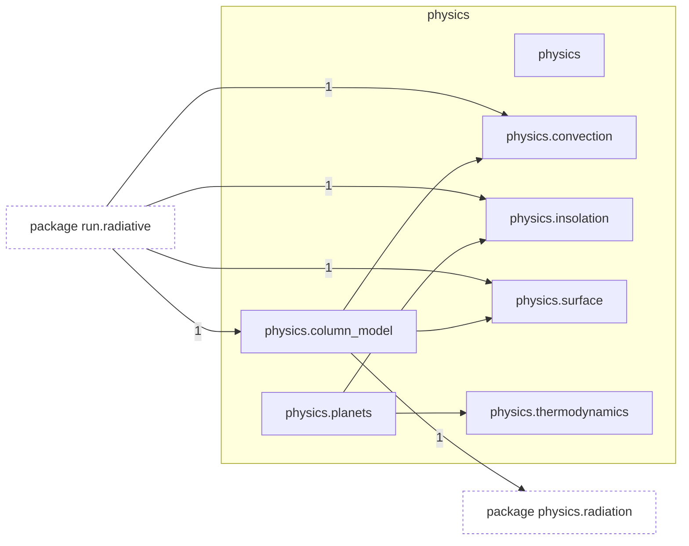

# Package `tropoi.physics`

Generated by `tools.architecture`; do not edit. Every module, class and public module-level function of this package is listed here (subpackages have their own pages). Relations shown are extracted from the source, not inferred.

Index: [all packages](../index.md) · parent [`tropoi`](tropoi.md) · [`tropoi.physics.radiation`](tropoi.physics.radiation.md)

## Modules

| Module | Category | Classes | Public functions |
|---|---|---|---|
| `tropoi.physics` | empty | – | – |
| `tropoi.physics.column_model` | code | `ColumnPhysics`, `PhysicsOutput`, `RadiativeConvectiveColumn` | – |
| `tropoi.physics.convection` | code | `DryConvectiveAdjustment` | `neutral_profile` |
| `tropoi.physics.insolation` | code | `DiurnalMeanInsolation`, `InstantaneousInsolation`, `Orbit`, `PrescribedInsolation`, `TidallyLockedInsolation` | `frierson_net_surface_flux` |
| `tropoi.physics.planets` | code | `PlanetaryBody`, `VerticalGridSpec` | – |
| `tropoi.physics.surface` | code | `SlabSurface` | `drag_coefficient`, `sensible_heat_flux` |
| `tropoi.physics.thermodynamics` | code | `GasMixture`, `Species` | `hydrogen_rotational_cv` |

Files shipped in this directory that are **not Python and not analysed** (templates, data): `README.md`. Their contents (for example JavaScript in an HTML template) are invisible to every graph here.

## Imports

This package's modules and the import edges between them; every other package is collapsed to one dashed node (edge label: module edges merged). A dashed arrow is made only of function-scope or `TYPE_CHECKING` imports.

## Classes

14 classes, each with the functions defined in its body (`$`: class/static method; no parentheses: property). Edges: inheritance (`<|--`) and nesting (`*--`) only.

```mermaid
%% Generated by tools.architecture 2.2.0. Do not edit by hand.
%% Classes of tropoi.physics
classDiagram
    direction LR
    class c_tropoi_ophysics_ocolumn__model_oColumnPhysics["ColumnPhysics (physics.column#95;model)"]
    c_tropoi_ophysics_ocolumn__model_oColumnPhysics : +#95;#95;init#95;#95;()
    c_tropoi_ophysics_ocolumn__model_oColumnPhysics : +adjust()
    c_tropoi_ophysics_ocolumn__model_oColumnPhysics : +compute()
    c_tropoi_ophysics_ocolumn__model_oColumnPhysics : +reset()
    c_tropoi_ophysics_ocolumn__model_oColumnPhysics : +signature()
    class c_tropoi_ophysics_ocolumn__model_oPhysicsOutput["PhysicsOutput (physics.column#95;model)"]
    c_tropoi_ophysics_ocolumn__model_oPhysicsOutput : +column#95;energy#95;tendency
    class c_tropoi_ophysics_ocolumn__model_oRadiativeConvectiveColumn["RadiativeConvectiveColumn (physics.column#95;model)"]
    c_tropoi_ophysics_ocolumn__model_oRadiativeConvectiveColumn : +#95;#95;init#95;#95;()
    c_tropoi_ophysics_ocolumn__model_oRadiativeConvectiveColumn : +#95;stable#95;step()
    c_tropoi_ophysics_ocolumn__model_oRadiativeConvectiveColumn : +equilibrate()
    c_tropoi_ophysics_ocolumn__model_oRadiativeConvectiveColumn : +evaluate()
    c_tropoi_ophysics_ocolumn__model_oRadiativeConvectiveColumn : +step()
    class c_tropoi_ophysics_oconvection_oDryConvectiveAdjustment["DryConvectiveAdjustment (physics.convection)"]
    c_tropoi_ophysics_oconvection_oDryConvectiveAdjustment : +#95;#95;init#95;#95;()
    c_tropoi_ophysics_oconvection_oDryConvectiveAdjustment : +adjust()
    c_tropoi_ophysics_oconvection_oDryConvectiveAdjustment : +signature()
    class c_tropoi_ophysics_oinsolation_oDiurnalMeanInsolation["DiurnalMeanInsolation (physics.insolation)"]
    c_tropoi_ophysics_oinsolation_oDiurnalMeanInsolation : +#95;#95;call#95;#95;()
    c_tropoi_ophysics_oinsolation_oDiurnalMeanInsolation : +#95;#95;init#95;#95;()
    c_tropoi_ophysics_oinsolation_oDiurnalMeanInsolation : +signature()
    class c_tropoi_ophysics_oinsolation_oInstantaneousInsolation["InstantaneousInsolation (physics.insolation)"]
    c_tropoi_ophysics_oinsolation_oInstantaneousInsolation : +#95;#95;call#95;#95;()
    c_tropoi_ophysics_oinsolation_oInstantaneousInsolation : +#95;#95;init#95;#95;()
    c_tropoi_ophysics_oinsolation_oInstantaneousInsolation : +signature()
    class c_tropoi_ophysics_oinsolation_oOrbit["Orbit (physics.insolation)"]
    c_tropoi_ophysics_oinsolation_oOrbit : +#95;#95;post#95;init#95;#95;()
    c_tropoi_ophysics_oinsolation_oOrbit : +as#95;dict()
    c_tropoi_ophysics_oinsolation_oOrbit : +declination()
    c_tropoi_ophysics_oinsolation_oOrbit : +flux#95;at()
    c_tropoi_ophysics_oinsolation_oOrbit : +solar#95;longitude()
    c_tropoi_ophysics_oinsolation_oOrbit : +true#95;anomaly()
    class c_tropoi_ophysics_oinsolation_oPrescribedInsolation["PrescribedInsolation (physics.insolation)"]
    c_tropoi_ophysics_oinsolation_oPrescribedInsolation : +#95;#95;call#95;#95;()
    c_tropoi_ophysics_oinsolation_oPrescribedInsolation : +#95;#95;init#95;#95;()
    c_tropoi_ophysics_oinsolation_oPrescribedInsolation : +signature()
    class c_tropoi_ophysics_oinsolation_oTidallyLockedInsolation["TidallyLockedInsolation (physics.insolation)"]
    c_tropoi_ophysics_oinsolation_oTidallyLockedInsolation : +#95;#95;call#95;#95;()
    c_tropoi_ophysics_oinsolation_oTidallyLockedInsolation : +#95;#95;init#95;#95;()
    c_tropoi_ophysics_oinsolation_oTidallyLockedInsolation : +signature()
    class c_tropoi_ophysics_oplanets_oPlanetaryBody["PlanetaryBody (physics.planets)"]
    c_tropoi_ophysics_oplanets_oPlanetaryBody : +cp
    c_tropoi_ophysics_oplanets_oPlanetaryBody : +gas#95;constant
    c_tropoi_ophysics_oplanets_oPlanetaryBody : +kappa
    c_tropoi_ophysics_oplanets_oPlanetaryBody : +regime()
    c_tropoi_ophysics_oplanets_oPlanetaryBody : +scale#95;height
    c_tropoi_ophysics_oplanets_oPlanetaryBody : +with#95;()
    class c_tropoi_ophysics_oplanets_oVerticalGridSpec["VerticalGridSpec (physics.planets)"]
    c_tropoi_ophysics_oplanets_oVerticalGridSpec : +as#95;dict()
    class c_tropoi_ophysics_osurface_oSlabSurface["SlabSurface (physics.surface)"]
    c_tropoi_ophysics_osurface_oSlabSurface : +#95;#95;init#95;#95;()
    c_tropoi_ophysics_osurface_oSlabSurface : +advance()
    c_tropoi_ophysics_osurface_oSlabSurface : +signature()
    class c_tropoi_ophysics_othermodynamics_oGasMixture["GasMixture (physics.thermodynamics)"]
    c_tropoi_ophysics_othermodynamics_oGasMixture : +#95;#95;post#95;init#95;#95;()
    c_tropoi_ophysics_othermodynamics_oGasMixture : +as#95;dict()
    c_tropoi_ophysics_othermodynamics_oGasMixture : +cp()
    c_tropoi_ophysics_othermodynamics_oGasMixture : +cp#95;range()
    c_tropoi_ophysics_othermodynamics_oGasMixture : +gas#95;constant
    c_tropoi_ophysics_othermodynamics_oGasMixture : +kappa()
    c_tropoi_ophysics_othermodynamics_oGasMixture : +mass#95;fraction()
    c_tropoi_ophysics_othermodynamics_oGasMixture : +molar#95;mass
    class c_tropoi_ophysics_othermodynamics_oSpecies["Species (physics.thermodynamics)"]
    c_tropoi_ophysics_othermodynamics_oSpecies : +cp#95;molar()
```

## Entry paths through this package

None of the scoped call graphs reaches this package.
