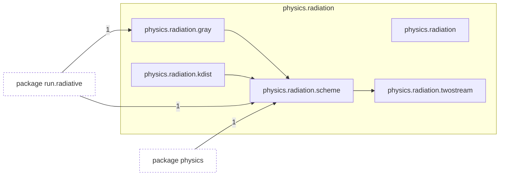

# Package `tropoi.physics.radiation`

Generated by `tools.architecture`; do not edit. Every module, class and public module-level function of this package is listed here (subpackages have their own pages). Relations shown are extracted from the source, not inferred.

Index: [all packages](../index.md) · parent [`tropoi.physics`](tropoi.physics.md)

## Modules

| Module | Category | Classes | Public functions |
|---|---|---|---|
| `tropoi.physics.radiation` | empty | – | – |
| `tropoi.physics.radiation.gray` | code | `GrayLongwave`, `GrayShortwave`, `OpticalDepthProfile`, `SemiInfiniteScatteringShortwave` | `frierson_longwave`, `isca_mars_longwave`, `isca_mars_shortwave`, `schneider_liu_longwave` |
| `tropoi.physics.radiation.kdist` | code | `CorrelatedKLongwave`, `CorrelatedKShortwave`, `KTable`, `_CorrelatedK` | `gauss_legendre_g`, `ktable_from_spectrum`, `planck_band_fraction` |
| `tropoi.physics.radiation.scheme` | code | `Column`, `LowerBoundary`, `Radiation`, `RadiativeFluxes` | `heating_rate`, `interface_temperature` |
| `tropoi.physics.radiation.twostream` | code | – | `adding`, `delta_scale`, `diffuse_layer`, `direct_layer`, `stellar_coefficients`, `stellar_fluxes`, `thermal_coefficients`, `thermal_fluxes`, `thermal_layer_sources` |

## Imports

This package's modules and the import edges between them; every other package is collapsed to one dashed node (edge label: module edges merged). A dashed arrow is made only of function-scope or `TYPE_CHECKING` imports.

## Classes

12 classes, each with the functions defined in its body (`$`: class/static method; no parentheses: property). Edges: inheritance (`<|--`) and nesting (`*--`) only.

```mermaid
%% Generated by tools.architecture 2.2.0. Do not edit by hand.
%% Classes of tropoi.physics.radiation
classDiagram
    direction LR
    class c_tropoi_ophysics_oradiation_ogray_oGrayLongwave["GrayLongwave (physics.radiation.gray)"]
    c_tropoi_ophysics_oradiation_ogray_oGrayLongwave : +#95;#95;init#95;#95;()
    c_tropoi_ophysics_oradiation_ogray_oGrayLongwave : +optical#95;properties()
    c_tropoi_ophysics_oradiation_ogray_oGrayLongwave : +planck()
    c_tropoi_ophysics_oradiation_ogray_oGrayLongwave : +signature()
    class c_tropoi_ophysics_oradiation_ogray_oGrayShortwave["GrayShortwave (physics.radiation.gray)"]
    c_tropoi_ophysics_oradiation_ogray_oGrayShortwave : +#95;#95;init#95;#95;()
    c_tropoi_ophysics_oradiation_ogray_oGrayShortwave : +optical#95;properties()
    c_tropoi_ophysics_oradiation_ogray_oGrayShortwave : +signature()
    c_tropoi_ophysics_oradiation_ogray_oGrayShortwave : +stellar#95;fractions()
    class c_tropoi_ophysics_oradiation_ogray_oOpticalDepthProfile["OpticalDepthProfile (physics.radiation.gray)"]
    c_tropoi_ophysics_oradiation_ogray_oOpticalDepthProfile : +#95;#95;init#95;#95;()
    c_tropoi_ophysics_oradiation_ogray_oOpticalDepthProfile : +cumulative()
    c_tropoi_ophysics_oradiation_ogray_oOpticalDepthProfile : +layers()
    c_tropoi_ophysics_oradiation_ogray_oOpticalDepthProfile : +signature()
    class c_tropoi_ophysics_oradiation_ogray_oSemiInfiniteScatteringShortwave["SemiInfiniteScatteringShortwave (physics.radiation.gray)"]
    c_tropoi_ophysics_oradiation_ogray_oSemiInfiniteScatteringShortwave : +#95;#95;init#95;#95;()
    c_tropoi_ophysics_oradiation_ogray_oSemiInfiniteScatteringShortwave : +analytic#95;fluxes()
    c_tropoi_ophysics_oradiation_ogray_oSemiInfiniteScatteringShortwave : +signature()
    class c_tropoi_ophysics_oradiation_okdist_oCorrelatedKLongwave["CorrelatedKLongwave (physics.radiation.kdist)"]
    c_tropoi_ophysics_oradiation_okdist_oCorrelatedKLongwave : +#95;#95;init#95;#95;()
    c_tropoi_ophysics_oradiation_okdist_oCorrelatedKLongwave : +optical#95;properties()
    c_tropoi_ophysics_oradiation_okdist_oCorrelatedKLongwave : +planck()
    c_tropoi_ophysics_oradiation_okdist_oCorrelatedKLongwave : +signature()
    c_tropoi_ophysics_oradiation_okdist_oCorrelatedKLongwave : +spectral#95;coverage()
    class c_tropoi_ophysics_oradiation_okdist_oCorrelatedKShortwave["CorrelatedKShortwave (physics.radiation.kdist)"]
    c_tropoi_ophysics_oradiation_okdist_oCorrelatedKShortwave : +#95;#95;init#95;#95;()
    c_tropoi_ophysics_oradiation_okdist_oCorrelatedKShortwave : +optical#95;properties()
    c_tropoi_ophysics_oradiation_okdist_oCorrelatedKShortwave : +signature()
    c_tropoi_ophysics_oradiation_okdist_oCorrelatedKShortwave : +stellar#95;fractions()
    class c_tropoi_ophysics_oradiation_okdist_oKTable["KTable (physics.radiation.kdist)"]
    c_tropoi_ophysics_oradiation_okdist_oKTable : +#95;#95;post#95;init#95;#95;()
    c_tropoi_ophysics_oradiation_okdist_oKTable : +load()$
    c_tropoi_ophysics_oradiation_okdist_oKTable : +n#95;band
    c_tropoi_ophysics_oradiation_okdist_oKTable : +n#95;g
    c_tropoi_ophysics_oradiation_okdist_oKTable : +save()
    class c_tropoi_ophysics_oradiation_okdist_o__CorrelatedK["_CorrelatedK (physics.radiation.kdist)"]
    c_tropoi_ophysics_oradiation_okdist_o__CorrelatedK : +#95;#95;init#95;#95;()
    c_tropoi_ophysics_oradiation_okdist_o__CorrelatedK : +#95;layer#95;k()
    c_tropoi_ophysics_oradiation_okdist_o__CorrelatedK : +#95;signature()
    c_tropoi_ophysics_oradiation_okdist_o__CorrelatedK : +#95;table#95;dev()
    c_tropoi_ophysics_oradiation_okdist_o__CorrelatedK : +#95;tau()
    class c_tropoi_ophysics_oradiation_oscheme_oColumn["Column (physics.radiation.scheme)"]
    c_tropoi_ophysics_oradiation_oscheme_oColumn : +#95;#95;post#95;init#95;#95;()
    c_tropoi_ophysics_oradiation_oscheme_oColumn : +layer#95;pressure
    c_tropoi_ophysics_oradiation_oscheme_oColumn : +layer#95;pressure#95;thickness
    c_tropoi_ophysics_oradiation_oscheme_oColumn : +ncol
    c_tropoi_ophysics_oradiation_oscheme_oColumn : +nlay
    c_tropoi_ophysics_oradiation_oscheme_oColumn : +surface#95;pressure
    class c_tropoi_ophysics_oradiation_oscheme_oLowerBoundary["LowerBoundary (physics.radiation.scheme)"]
    c_tropoi_ophysics_oradiation_oscheme_oLowerBoundary : +#95;#95;post#95;init#95;#95;()
    class c_tropoi_ophysics_oradiation_oscheme_oRadiation["Radiation (physics.radiation.scheme)"]
    c_tropoi_ophysics_oradiation_oscheme_oRadiation : +#95;#95;init#95;#95;()
    c_tropoi_ophysics_oradiation_oscheme_oRadiation : +#95;stellar()
    c_tropoi_ophysics_oradiation_oscheme_oRadiation : +#95;thermal()
    c_tropoi_ophysics_oradiation_oscheme_oRadiation : +fluxes()
    c_tropoi_ophysics_oradiation_oscheme_oRadiation : +signature()
    class c_tropoi_ophysics_oradiation_oscheme_oRadiativeFluxes["RadiativeFluxes (physics.radiation.scheme)"]
    c_tropoi_ophysics_oradiation_oscheme_oRadiativeFluxes : +absorbed#95;stellar
    c_tropoi_ophysics_oradiation_oscheme_oRadiativeFluxes : +bottom#95;net#95;down
    c_tropoi_ophysics_oradiation_oscheme_oRadiativeFluxes : +net#95;down
    c_tropoi_ophysics_oradiation_oscheme_oRadiativeFluxes : +olr
    c_tropoi_ophysics_oradiation_oscheme_oRadiativeFluxes : +toa#95;net#95;down
    c_tropoi_ophysics_oradiation_okdist_o__CorrelatedK <|-- c_tropoi_ophysics_oradiation_okdist_oCorrelatedKLongwave
    c_tropoi_ophysics_oradiation_okdist_o__CorrelatedK <|-- c_tropoi_ophysics_oradiation_okdist_oCorrelatedKShortwave
```

## Entry paths through this package

None of the scoped call graphs reaches this package.
