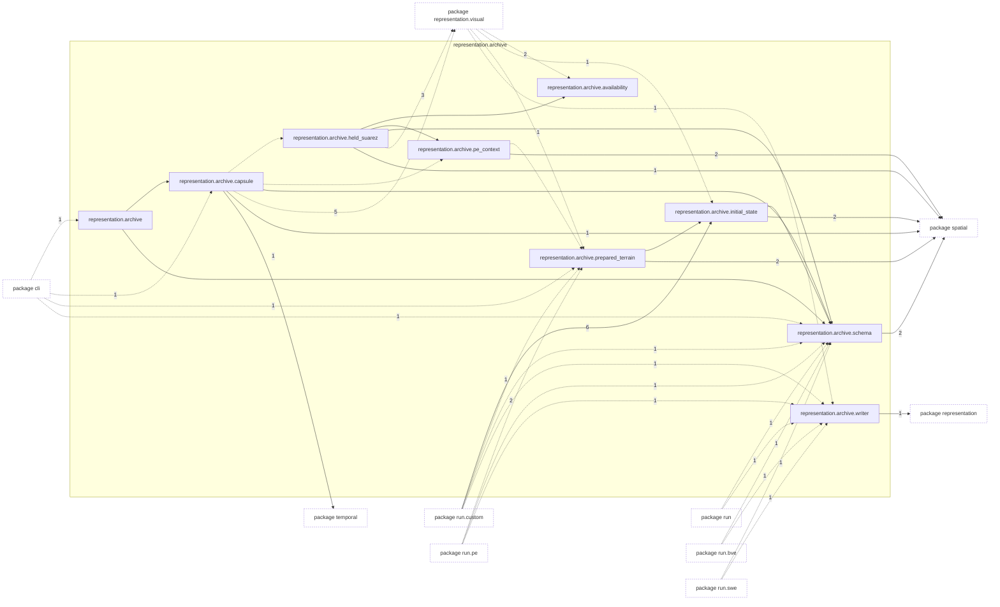

# Package `tropoi.representation.archive`

Generated by `tools.architecture`; do not edit. Every module, class and public module-level function of this package is listed here (subpackages have their own pages). Relations shown are extracted from the source, not inferred.

Index: [all packages](../index.md) · parent [`tropoi.representation`](tropoi.representation.md)

## Modules

| Module | Category | Classes | Public functions |
|---|---|---|---|
| `tropoi.representation.archive` | reexport | – | – |
| `tropoi.representation.archive.availability` | code | `NoSnapshotsError` | `statistics_only_description` |
| `tropoi.representation.archive.capsule` | code | `CapsuleError`, `CapsuleLayoutError`, `CapsuleStorage` | `open_simulation`, `read_capsule_metadata`, `resolve_run_directory` |
| `tropoi.representation.archive.held_suarez` | code | `HeldSuarezPlotError`, `HeldSuarezStorage` | `is_held_suarez_experiment` |
| `tropoi.representation.archive.initial_state` | code | `InitialState`, `InitialStateError` | `array_digest`, `load_initial_state`, `save_initial_state` |
| `tropoi.representation.archive.pe_context` | code | `PEColumnContext`, `PEContextError` | `pe_capsule_context` |
| `tropoi.representation.archive.prepared_terrain` | code | `PreparedTerrainError`, `SavedTerrain` | `is_prepared_terrain`, `load_prepared_terrain`, `save_prepared_terrain`, `summary` |
| `tropoi.representation.archive.schema` | code | `SchemaError`, `StateSchema`, `UnknownSchemaVersionError`, `UnsupportedConventionError` | `canonical_field_layout`, `diagnostic_definitions_for`, `high_l_enstrophy_fraction_definition`, `infer_solver`, `infer_state_schema`, `provenance_blocks`, `state_schema_for` |
| `tropoi.representation.archive.writer` | code | `RunDirectory`, `RunProvenanceError` | `atomic_write_text`, `create_run_dir`, `failure_record`, `make_run_id`, `update_manifest_status`, `write_run_manifest` |

## Imports

This package's modules and the import edges between them; every other package is collapsed to one dashed node (edge label: module edges merged). A dashed arrow is made only of function-scope or `TYPE_CHECKING` imports.

## Classes

18 classes, each with the functions defined in its body (`$`: class/static method; no parentheses: property). Edges: inheritance (`<|--`) and nesting (`*--`) only.

```mermaid
%% Generated by tools.architecture 2.1.0. Do not edit by hand.
%% Classes of tropoi.representation.archive
classDiagram
    direction LR
    class c_tropoi_orepresentation_oarchive_oavailability_oNoSnapshotsError["NoSnapshotsError (representation.archive.availability)"]
    c_tropoi_orepresentation_oarchive_oavailability_oNoSnapshotsError : external base ValueError
    class c_tropoi_orepresentation_oarchive_ocapsule_oCapsuleError["CapsuleError (representation.archive.capsule)"]
    c_tropoi_orepresentation_oarchive_ocapsule_oCapsuleError : external base ValueError
    class c_tropoi_orepresentation_oarchive_ocapsule_oCapsuleLayoutError["CapsuleLayoutError (representation.archive.capsule)"]
    class c_tropoi_orepresentation_oarchive_ocapsule_oCapsuleStorage["CapsuleStorage (representation.archive.capsule)"]
    c_tropoi_orepresentation_oarchive_ocapsule_oCapsuleStorage : +#95;#95;init#95;#95;()
    c_tropoi_orepresentation_oarchive_ocapsule_oCapsuleStorage : +#95;#95;repr#95;#95;()
    c_tropoi_orepresentation_oarchive_ocapsule_oCapsuleStorage : +#95;is#95;legacy#95;interval#95;bve#95;capsule()
    c_tropoi_orepresentation_oarchive_ocapsule_oCapsuleStorage : +#95;load#95;times()
    c_tropoi_orepresentation_oarchive_ocapsule_oCapsuleStorage : +coefficients
    c_tropoi_orepresentation_oarchive_ocapsule_oCapsuleStorage : +field#95;specs
    c_tropoi_orepresentation_oarchive_ocapsule_oCapsuleStorage : +frame()
    c_tropoi_orepresentation_oarchive_ocapsule_oCapsuleStorage : +frame#95;count
    c_tropoi_orepresentation_oarchive_ocapsule_oCapsuleStorage : +level#95;values
    c_tropoi_orepresentation_oarchive_ocapsule_oCapsuleStorage : +metadata
    c_tropoi_orepresentation_oarchive_ocapsule_oCapsuleStorage : +pe#95;context()
    c_tropoi_orepresentation_oarchive_ocapsule_oCapsuleStorage : +plot#95;simulation()
    c_tropoi_orepresentation_oarchive_ocapsule_oCapsuleStorage : +plot#95;snapshot()
    c_tropoi_orepresentation_oarchive_ocapsule_oCapsuleStorage : +quantities()
    c_tropoi_orepresentation_oarchive_ocapsule_oCapsuleStorage : +resource#95;builds
    c_tropoi_orepresentation_oarchive_ocapsule_oCapsuleStorage : +resources()
    c_tropoi_orepresentation_oarchive_ocapsule_oCapsuleStorage : +schema
    c_tropoi_orepresentation_oarchive_ocapsule_oCapsuleStorage : +schema#95;error
    c_tropoi_orepresentation_oarchive_ocapsule_oCapsuleStorage : +sky()
    c_tropoi_orepresentation_oarchive_ocapsule_oCapsuleStorage : +stored#95;array()
    c_tropoi_orepresentation_oarchive_ocapsule_oCapsuleStorage : +time#95;provenance
    c_tropoi_orepresentation_oarchive_ocapsule_oCapsuleStorage : +times
    c_tropoi_orepresentation_oarchive_ocapsule_oCapsuleStorage : +view()
    class c_tropoi_orepresentation_oarchive_oheld__suarez_oHeldSuarezPlotError["HeldSuarezPlotError (representation.archive.held_suarez)"]
    c_tropoi_orepresentation_oarchive_oheld__suarez_oHeldSuarezPlotError : external base RuntimeError
    class c_tropoi_orepresentation_oarchive_oheld__suarez_oHeldSuarezStorage["HeldSuarezStorage (representation.archive.held_suarez)"]
    c_tropoi_orepresentation_oarchive_oheld__suarez_oHeldSuarezStorage : +#95;#95;init#95;#95;()
    c_tropoi_orepresentation_oarchive_oheld__suarez_oHeldSuarezStorage : +#95;#95;repr#95;#95;()
    c_tropoi_orepresentation_oarchive_oheld__suarez_oHeldSuarezStorage : +#95;scan#95;states()
    c_tropoi_orepresentation_oarchive_oheld__suarez_oHeldSuarezStorage : +days
    c_tropoi_orepresentation_oarchive_oheld__suarez_oHeldSuarezStorage : +field#95;specs
    c_tropoi_orepresentation_oarchive_oheld__suarez_oHeldSuarezStorage : +frame()
    c_tropoi_orepresentation_oarchive_oheld__suarez_oHeldSuarezStorage : +frame#95;count
    c_tropoi_orepresentation_oarchive_oheld__suarez_oHeldSuarezStorage : +level#95;values
    c_tropoi_orepresentation_oarchive_oheld__suarez_oHeldSuarezStorage : +metadata
    c_tropoi_orepresentation_oarchive_oheld__suarez_oHeldSuarezStorage : +pe#95;context()
    c_tropoi_orepresentation_oarchive_oheld__suarez_oHeldSuarezStorage : +plot#95;simulation()
    c_tropoi_orepresentation_oarchive_oheld__suarez_oHeldSuarezStorage : +plot#95;snapshot()
    c_tropoi_orepresentation_oarchive_oheld__suarez_oHeldSuarezStorage : +quantities()
    c_tropoi_orepresentation_oarchive_oheld__suarez_oHeldSuarezStorage : +run#95;config
    c_tropoi_orepresentation_oarchive_oheld__suarez_oHeldSuarezStorage : +schema
    c_tropoi_orepresentation_oarchive_oheld__suarez_oHeldSuarezStorage : +sky()
    c_tropoi_orepresentation_oarchive_oheld__suarez_oHeldSuarezStorage : +state#95;path()
    c_tropoi_orepresentation_oarchive_oheld__suarez_oHeldSuarezStorage : +times
    c_tropoi_orepresentation_oarchive_oheld__suarez_oHeldSuarezStorage : +view()
    class c_tropoi_orepresentation_oarchive_oinitial__state_oInitialState["InitialState (representation.archive.initial_state)"]
    c_tropoi_orepresentation_oarchive_oinitial__state_oInitialState : +#95;#95;post#95;init#95;#95;()
    c_tropoi_orepresentation_oarchive_oinitial__state_oInitialState : +#95;#95;repr#95;#95;()
    c_tropoi_orepresentation_oarchive_oinitial__state_oInitialState : +digest
    c_tropoi_orepresentation_oarchive_oinitial__state_oInitialState : +identity()
    c_tropoi_orepresentation_oarchive_oinitial__state_oInitialState : +l#95;max
    c_tropoi_orepresentation_oarchive_oinitial__state_oInitialState : +load()$
    c_tropoi_orepresentation_oarchive_oinitial__state_oInitialState : +run#95;config#95;entries()
    c_tropoi_orepresentation_oarchive_oinitial__state_oInitialState : +save()
    c_tropoi_orepresentation_oarchive_oinitial__state_oInitialState : +schema
    c_tropoi_orepresentation_oarchive_oinitial__state_oInitialState : +state
    c_tropoi_orepresentation_oarchive_oinitial__state_oInitialState : +summary()
    c_tropoi_orepresentation_oarchive_oinitial__state_oInitialState : +to#95;document()
    c_tropoi_orepresentation_oarchive_oinitial__state_oInitialState : +topography#95;modes
    c_tropoi_orepresentation_oarchive_oinitial__state_oInitialState : +validate()
    class c_tropoi_orepresentation_oarchive_oinitial__state_oInitialStateError["InitialStateError (representation.archive.initial_state)"]
    c_tropoi_orepresentation_oarchive_oinitial__state_oInitialStateError : external base ValueError
    class c_tropoi_orepresentation_oarchive_ope__context_oPEColumnContext["PEColumnContext (representation.archive.pe_context)"]
    c_tropoi_orepresentation_oarchive_ope__context_oPEColumnContext : +#95;#95;post#95;init#95;#95;()
    c_tropoi_orepresentation_oarchive_ope__context_oPEColumnContext : +full#95;levels
    c_tropoi_orepresentation_oarchive_ope__context_oPEColumnContext : +is#95;flat
    c_tropoi_orepresentation_oarchive_ope__context_oPEColumnContext : +nlev
    c_tropoi_orepresentation_oarchive_ope__context_oPEColumnContext : +pressure#95;convention
    c_tropoi_orepresentation_oarchive_ope__context_oPEColumnContext : +sigma
    c_tropoi_orepresentation_oarchive_ope__context_oPEColumnContext : +surface#95;geopotential#95;lm()
    c_tropoi_orepresentation_oarchive_ope__context_oPEColumnContext : +with#95;gravity()
    class c_tropoi_orepresentation_oarchive_ope__context_oPEContextError["PEContextError (representation.archive.pe_context)"]
    c_tropoi_orepresentation_oarchive_ope__context_oPEContextError : external base ValueError
    class c_tropoi_orepresentation_oarchive_oprepared__terrain_oPreparedTerrainError["PreparedTerrainError (representation.archive.prepared_terrain)"]
    class c_tropoi_orepresentation_oarchive_oprepared__terrain_oSavedTerrain["SavedTerrain (representation.archive.prepared_terrain)"]
    c_tropoi_orepresentation_oarchive_oprepared__terrain_oSavedTerrain : +#95;#95;post#95;init#95;#95;()
    c_tropoi_orepresentation_oarchive_oprepared__terrain_oSavedTerrain : +digest
    c_tropoi_orepresentation_oarchive_oprepared__terrain_oSavedTerrain : +to#95;document()
    class c_tropoi_orepresentation_oarchive_oschema_oSchemaError["SchemaError (representation.archive.schema)"]
    c_tropoi_orepresentation_oarchive_oschema_oSchemaError : external base ValueError
    class c_tropoi_orepresentation_oarchive_oschema_oStateSchema["StateSchema (representation.archive.schema)"]
    c_tropoi_orepresentation_oarchive_oschema_oStateSchema : +#95;#95;post#95;init#95;#95;()
    c_tropoi_orepresentation_oarchive_oschema_oStateSchema : +#95;check#95;canonical#95;layout()
    c_tropoi_orepresentation_oarchive_oschema_oStateSchema : +check#95;consistency()
    c_tropoi_orepresentation_oarchive_oschema_oStateSchema : +field#95;names
    c_tropoi_orepresentation_oarchive_oschema_oStateSchema : +frame#95;shape
    c_tropoi_orepresentation_oarchive_oschema_oStateSchema : +from#95;manifest#95;dict()$
    c_tropoi_orepresentation_oarchive_oschema_oStateSchema : +inferred
    c_tropoi_orepresentation_oarchive_oschema_oStateSchema : +level#95;values
    c_tropoi_orepresentation_oarchive_oschema_oStateSchema : +support
    c_tropoi_orepresentation_oarchive_oschema_oStateSchema : +to#95;manifest#95;dict()
    class c_tropoi_orepresentation_oarchive_oschema_oUnknownSchemaVersionError["UnknownSchemaVersionError (representation.archive.schema)"]
    class c_tropoi_orepresentation_oarchive_oschema_oUnsupportedConventionError["UnsupportedConventionError (representation.archive.schema)"]
    class c_tropoi_orepresentation_oarchive_owriter_oRunDirectory["RunDirectory (representation.archive.writer)"]
    c_tropoi_orepresentation_oarchive_owriter_oRunDirectory : +#95;pointer#95;content()
    c_tropoi_orepresentation_oarchive_owriter_oRunDirectory : +#95;pointer#95;path()
    c_tropoi_orepresentation_oarchive_owriter_oRunDirectory : +#95;validate#95;completed#95;manifest()
    c_tropoi_orepresentation_oarchive_owriter_oRunDirectory : +clear#95;latest#95;pointer#95;if#95;matches()
    c_tropoi_orepresentation_oarchive_owriter_oRunDirectory : +figure#95;metadata()
    c_tropoi_orepresentation_oarchive_owriter_oRunDirectory : +update#95;latest#95;pointer()
    class c_tropoi_orepresentation_oarchive_owriter_oRunProvenanceError["RunProvenanceError (representation.archive.writer)"]
    c_tropoi_orepresentation_oarchive_owriter_oRunProvenanceError : external base RuntimeError
    c_tropoi_orepresentation_oarchive_ocapsule_oCapsuleError <|-- c_tropoi_orepresentation_oarchive_ocapsule_oCapsuleLayoutError
    c_tropoi_orepresentation_oarchive_oinitial__state_oInitialStateError <|-- c_tropoi_orepresentation_oarchive_oprepared__terrain_oPreparedTerrainError
    c_tropoi_orepresentation_oarchive_oschema_oSchemaError <|-- c_tropoi_orepresentation_oarchive_oschema_oUnknownSchemaVersionError
    c_tropoi_orepresentation_oarchive_oschema_oSchemaError <|-- c_tropoi_orepresentation_oarchive_oschema_oUnsupportedConventionError
```

## Entry paths through this package

* [`calls/cli-inspect.mmd`](../calls/cli-inspect.mmd)
* [`calls/cli-plot.mmd`](../calls/cli-plot.mmd)
* [`calls/cli-run-bve.mmd`](../calls/cli-run-bve.mmd)
* [`calls/cli-run-pe.mmd`](../calls/cli-run-pe.mmd)
* [`calls/cli-run-swe.mmd`](../calls/cli-run-swe.mmd)
* [`calls/cli-terrain-run-prepare.mmd`](../calls/cli-terrain-run-prepare.mmd)
* [`calls/custom-initial-states.mmd`](../calls/custom-initial-states.mmd)
* [`calls/sky-saved-column.mmd`](../calls/sky-saved-column.mmd)
