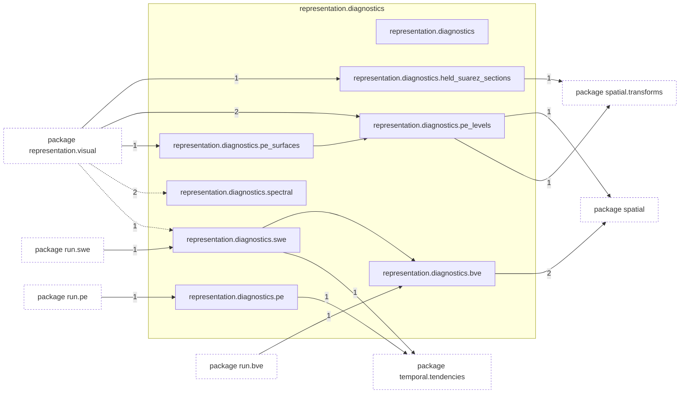

# Package `tropoi.representation.diagnostics`

Generated by `tools.architecture`; do not edit. Every module, class and public module-level function of this package is listed here (subpackages have their own pages). Relations shown are extracted from the source, not inferred.

Index: [all packages](../index.md) · parent [`tropoi.representation`](tropoi.representation.md)

## Modules

| Module | Category | Classes | Public functions |
|---|---|---|---|
| `tropoi.representation.diagnostics` | empty | – | – |
| `tropoi.representation.diagnostics.bve` | code | `DiagnosticsRecorder` | `grid_diagnostics`, `plot_diagnostics`, `spectral_diagnostics` |
| `tropoi.representation.diagnostics.held_suarez_sections` | code | `Bandlimit`, `DailySeries`, `SampleSelection`, `SectionAccumulator`, `SectionError`, `SectionResult` | `daily_series`, `default_window`, `gaussian_latitudes_deg`, `load_state`, `reduce_sections`, `select_samples`, `state_grid` |
| `tropoi.representation.diagnostics.pe` | code | `PEDiagnosticsRecorder` | `plot_pe_diagnostics` |
| `tropoi.representation.diagnostics.pe_levels` | code | `LevelFields` | `level_geopotential_coefficients`, `reconstruct_levels` |
| `tropoi.representation.diagnostics.pe_surfaces` | code | `GeopotentialHeightSurface`, `PressureColumns`, `PressureSurface`, `SigmaSurface`, `SurfaceFields`, `SurfaceUnavailableError` | `interpolate_columns`, `interpolate_geopotential`, `interpolate_log_sigma`, `level_sigma_positions`, `parse_surface`, `pressure_columns`, `pressure_surface` |
| `tropoi.representation.diagnostics.spectral` | code | `SpectralComplexity`, `ZeroKineticEnergyError` | `kinetic_energy_modes`, `mode_power`, `spectral_complexity` |
| `tropoi.representation.diagnostics.swe` | code | `SWEDiagnosticsRecorder` | `plot_swe_diagnostics`, `potential_enstrophy` |

Files shipped in this directory that are **not Python and not analysed** (templates, data): `README.md`. Their contents (for example JavaScript in an HTML template) are invisible to every graph here.

## Imports

This package's modules and the import edges between them; every other package is collapsed to one dashed node (edge label: module edges merged). A dashed arrow is made only of function-scope or `TYPE_CHECKING` imports.

## Classes

18 classes, each with the functions defined in its body (`$`: class/static method; no parentheses: property). Edges: inheritance (`<|--`) and nesting (`*--`) only.

```mermaid
%% Generated by tools.architecture 2.3.0. Do not edit by hand.
%% Classes of tropoi.representation.diagnostics
classDiagram
    direction LR
    class c_tropoi_orepresentation_odiagnostics_obve_oDiagnosticsRecorder["DiagnosticsRecorder (representation.diagnostics.bve)"]
    c_tropoi_orepresentation_odiagnostics_obve_oDiagnosticsRecorder : +#95;#95;enter#95;#95;()
    c_tropoi_orepresentation_odiagnostics_obve_oDiagnosticsRecorder : +#95;#95;exit#95;#95;()
    c_tropoi_orepresentation_odiagnostics_obve_oDiagnosticsRecorder : +#95;#95;init#95;#95;()
    c_tropoi_orepresentation_odiagnostics_obve_oDiagnosticsRecorder : +close()
    c_tropoi_orepresentation_odiagnostics_obve_oDiagnosticsRecorder : +record()
    class c_tropoi_orepresentation_odiagnostics_oheld__suarez__sections_oBandlimit["Bandlimit (representation.diagnostics.held#95;suarez#95;sections)"]
    c_tropoi_orepresentation_odiagnostics_oheld__suarez__sections_oBandlimit : +check#95;longitudes()
    c_tropoi_orepresentation_odiagnostics_oheld__suarez__sections_oBandlimit : +to#95;dict()
    c_tropoi_orepresentation_odiagnostics_oheld__suarez__sections_oBandlimit : +update()
    class c_tropoi_orepresentation_odiagnostics_oheld__suarez__sections_oDailySeries["DailySeries (representation.diagnostics.held#95;suarez#95;sections)"]
    c_tropoi_orepresentation_odiagnostics_oheld__suarez__sections_oDailySeries : +mass#95;drift()
    c_tropoi_orepresentation_odiagnostics_oheld__suarez__sections_oDailySeries : +reference#95;day
    c_tropoi_orepresentation_odiagnostics_oheld__suarez__sections_oDailySeries : +summary()
    c_tropoi_orepresentation_odiagnostics_oheld__suarez__sections_oDailySeries : +to#95;dict()
    class c_tropoi_orepresentation_odiagnostics_oheld__suarez__sections_oSampleSelection["SampleSelection (representation.diagnostics.held#95;suarez#95;sections)"]
    c_tropoi_orepresentation_odiagnostics_oheld__suarez__sections_oSampleSelection : +cadence#95;label()
    c_tropoi_orepresentation_odiagnostics_oheld__suarez__sections_oSampleSelection : +complete
    c_tropoi_orepresentation_odiagnostics_oheld__suarez__sections_oSampleSelection : +count
    c_tropoi_orepresentation_odiagnostics_oheld__suarez__sections_oSampleSelection : +coverage#95;label()
    c_tropoi_orepresentation_odiagnostics_oheld__suarez__sections_oSampleSelection : +regular
    c_tropoi_orepresentation_odiagnostics_oheld__suarez__sections_oSampleSelection : +summary()
    c_tropoi_orepresentation_odiagnostics_oheld__suarez__sections_oSampleSelection : +to#95;dict()
    class c_tropoi_orepresentation_odiagnostics_oheld__suarez__sections_oSectionAccumulator["SectionAccumulator (representation.diagnostics.held#95;suarez#95;sections)"]
    c_tropoi_orepresentation_odiagnostics_oheld__suarez__sections_oSectionAccumulator : +#95;#95;init#95;#95;()
    c_tropoi_orepresentation_odiagnostics_oheld__suarez__sections_oSectionAccumulator : +add()
    c_tropoi_orepresentation_odiagnostics_oheld__suarez__sections_oSectionAccumulator : +means()
    class c_tropoi_orepresentation_odiagnostics_oheld__suarez__sections_oSectionError["SectionError (representation.diagnostics.held#95;suarez#95;sections)"]
    c_tropoi_orepresentation_odiagnostics_oheld__suarez__sections_oSectionError : external base ValueError
    class c_tropoi_orepresentation_odiagnostics_oheld__suarez__sections_oSectionResult["SectionResult (representation.diagnostics.held#95;suarez#95;sections)"]
    c_tropoi_orepresentation_odiagnostics_oheld__suarez__sections_oSectionResult : +#95;#95;getitem#95;#95;()
    c_tropoi_orepresentation_odiagnostics_oheld__suarez__sections_oSectionResult : +states#95;sha256()
    class c_tropoi_orepresentation_odiagnostics_ope_oPEDiagnosticsRecorder["PEDiagnosticsRecorder (representation.diagnostics.pe)"]
    c_tropoi_orepresentation_odiagnostics_ope_oPEDiagnosticsRecorder : +#95;#95;enter#95;#95;()
    c_tropoi_orepresentation_odiagnostics_ope_oPEDiagnosticsRecorder : +#95;#95;exit#95;#95;()
    c_tropoi_orepresentation_odiagnostics_ope_oPEDiagnosticsRecorder : +#95;#95;init#95;#95;()
    c_tropoi_orepresentation_odiagnostics_ope_oPEDiagnosticsRecorder : +close()
    c_tropoi_orepresentation_odiagnostics_ope_oPEDiagnosticsRecorder : +record()
    class c_tropoi_orepresentation_odiagnostics_ope__levels_oLevelFields["LevelFields (representation.diagnostics.pe#95;levels)"]
    c_tropoi_orepresentation_odiagnostics_ope__levels_oLevelFields : +#95;#95;getitem#95;#95;()
    class c_tropoi_orepresentation_odiagnostics_ope__surfaces_oGeopotentialHeightSurface["GeopotentialHeightSurface (representation.diagnostics.pe#95;surfaces)"]
    c_tropoi_orepresentation_odiagnostics_ope__surfaces_oGeopotentialHeightSurface : +#95;#95;post#95;init#95;#95;()
    c_tropoi_orepresentation_odiagnostics_ope__surfaces_oGeopotentialHeightSurface : +label
    c_tropoi_orepresentation_odiagnostics_ope__surfaces_oGeopotentialHeightSurface : +value
    class c_tropoi_orepresentation_odiagnostics_ope__surfaces_oPressureColumns["PressureColumns (representation.diagnostics.pe#95;surfaces)"]
    c_tropoi_orepresentation_odiagnostics_ope__surfaces_oPressureColumns : +nlev
    c_tropoi_orepresentation_odiagnostics_ope__surfaces_oPressureColumns : +sampled#95;height#95;range()
    c_tropoi_orepresentation_odiagnostics_ope__surfaces_oPressureColumns : +sampled#95;pressure#95;range()
    c_tropoi_orepresentation_odiagnostics_ope__surfaces_oPressureColumns : +stacks()
    c_tropoi_orepresentation_odiagnostics_ope__surfaces_oPressureColumns : +surface#95;geopotential()
    c_tropoi_orepresentation_odiagnostics_ope__surfaces_oPressureColumns : +winds
    class c_tropoi_orepresentation_odiagnostics_ope__surfaces_oPressureSurface["PressureSurface (representation.diagnostics.pe#95;surfaces)"]
    c_tropoi_orepresentation_odiagnostics_ope__surfaces_oPressureSurface : +#95;#95;post#95;init#95;#95;()
    c_tropoi_orepresentation_odiagnostics_ope__surfaces_oPressureSurface : +label
    c_tropoi_orepresentation_odiagnostics_ope__surfaces_oPressureSurface : +value
    class c_tropoi_orepresentation_odiagnostics_ope__surfaces_oSigmaSurface["SigmaSurface (representation.diagnostics.pe#95;surfaces)"]
    c_tropoi_orepresentation_odiagnostics_ope__surfaces_oSigmaSurface : +#95;#95;post#95;init#95;#95;()
    c_tropoi_orepresentation_odiagnostics_ope__surfaces_oSigmaSurface : +label
    c_tropoi_orepresentation_odiagnostics_ope__surfaces_oSigmaSurface : +value
    class c_tropoi_orepresentation_odiagnostics_ope__surfaces_oSurfaceFields["SurfaceFields (representation.diagnostics.pe#95;surfaces)"]
    c_tropoi_orepresentation_odiagnostics_ope__surfaces_oSurfaceFields : +#95;#95;getitem#95;#95;()
    c_tropoi_orepresentation_odiagnostics_ope__surfaces_oSurfaceFields : +counts()
    c_tropoi_orepresentation_odiagnostics_ope__surfaces_oSurfaceFields : +valid
    class c_tropoi_orepresentation_odiagnostics_ope__surfaces_oSurfaceUnavailableError["SurfaceUnavailableError (representation.diagnostics.pe#95;surfaces)"]
    c_tropoi_orepresentation_odiagnostics_ope__surfaces_oSurfaceUnavailableError : external base ValueError
    class c_tropoi_orepresentation_odiagnostics_ospectral_oSpectralComplexity["SpectralComplexity (representation.diagnostics.spectral)"]
    c_tropoi_orepresentation_odiagnostics_ospectral_oSpectralComplexity : +as#95;dict()
    class c_tropoi_orepresentation_odiagnostics_ospectral_oZeroKineticEnergyError["ZeroKineticEnergyError (representation.diagnostics.spectral)"]
    c_tropoi_orepresentation_odiagnostics_ospectral_oZeroKineticEnergyError : external base ValueError
    class c_tropoi_orepresentation_odiagnostics_oswe_oSWEDiagnosticsRecorder["SWEDiagnosticsRecorder (representation.diagnostics.swe)"]
    c_tropoi_orepresentation_odiagnostics_oswe_oSWEDiagnosticsRecorder : +#95;#95;enter#95;#95;()
    c_tropoi_orepresentation_odiagnostics_oswe_oSWEDiagnosticsRecorder : +#95;#95;exit#95;#95;()
    c_tropoi_orepresentation_odiagnostics_oswe_oSWEDiagnosticsRecorder : +#95;#95;init#95;#95;()
    c_tropoi_orepresentation_odiagnostics_oswe_oSWEDiagnosticsRecorder : +close()
    c_tropoi_orepresentation_odiagnostics_oswe_oSWEDiagnosticsRecorder : +record()
```

## Entry paths through this package

* [`calls/cli-run-pe.mmd`](../calls/cli-run-pe.mmd)
* [`calls/cli-run-swe.mmd`](../calls/cli-run-swe.mmd)
* [`calls/sky-saved-column.mmd`](../calls/sky-saved-column.mmd)
