# Package `tropoi.representation.visual`

Generated by `tools.architecture`; do not edit. Every module, class and public module-level function of this package is listed here (subpackages have their own pages). Relations shown are extracted from the source, not inferred.

Index: [all packages](../index.md) · parent [`tropoi.representation`](tropoi.representation.md)

## Modules

| Module | Category | Classes | Public functions |
|---|---|---|---|
| `tropoi.representation.visual` | empty | – | – |
| `tropoi.representation.visual.atmosphere` | code | `AtmosphereViewWarning`, `PayloadTooLargeError` | `atmosphere_payload`, `decoded_column_bytes`, `default_resolution_deg`, `dequantize_columns`, `estimate_column_payload_bytes`, `estimate_payload_bytes`, `quantize_columns`, `streamline_cache_bytes`, `surface_height_bytes`, `view_atmosphere` |
| `tropoi.representation.visual.bve` | code | – | `build_bve_snapshot_timeline`, `build_bve_snapshot_timeline_from_data`, `build_bve_snapshot_timelines`, `build_bve_spectral_snapshot_timeline`, `build_bve_spectral_snapshot_timeline_from_data`, `build_bve_summary_spec`, `render_bve_snapshots` |
| `tropoi.representation.visual.complex_encoding` | code | – | `normalized_magnitude_strength`, `phase_hue`, `phase_magnitude_hsv`, `relative_magnitude_db`, `wrapped_phase` |
| `tropoi.representation.visual.compose` | code | – | `compose_view`, `default_output_path`, `default_view`, `elapsed_label`, `pretty_units`, `render_view`, `resolve_level`, `resolve_snapshots` |
| `tropoi.representation.visual.evaluate` | code | `DisplayVectors`, `RunFields`, `SeriesData` | – |
| `tropoi.representation.visual.fields` | code | `ScalarGridField`, `SphericalHarmonicField` | – |
| `tropoi.representation.visual.grid_adapter` | code | – | `map_to_uniform_latlon` |
| `tropoi.representation.visual.held_suarez_climate` | code | `SectionScale` | `describe_run`, `draw_sections`, `panel_facts`, `read_daily_series`, `reduce_experiment`, `render_held_suarez_climate` |
| `tropoi.representation.visual.matplotlib_renderer` | code | `MatplotlibRenderer` | – |
| `tropoi.representation.visual.normalization` | code | `NormalizationKind`, `NormalizationPolicy`, `ResolvedNormalization` | – |
| `tropoi.representation.visual.pe` | code | – | `build_pe_summary_spec`, `render_pe_summary` |
| `tropoi.representation.visual.pe_snapshots` | code | `PESnapshotFields`, `SelectedLevels` | `build_pe_snapshot_figure`, `build_pe_snapshot_timeline`, `build_pe_snapshot_timeline_from_data`, `prepare_pe_snapshot_fields`, `render_pe_snapshots`, `select_snapshot_levels` |
| `tropoi.representation.visual.planet_viewer` | code | `PlanetViewer` | – |
| `tropoi.representation.visual.quantities` | code | `Quantity`, `QuantityUnavailableError` | `available_quantities`, `quantity` |
| `tropoi.representation.visual.renderers` | code | `Renderer` | `get_default_renderer` |
| `tropoi.representation.visual.sky` | code | `HypotheticalColumn`, `SkyPreset`, `SkySpec` | `density_grid`, `optical_depth_diagnostic`, `radiance_table`, `render_page`, `saved_sky_page`, `sky_block`, `standalone_page`, `star_path_column`, `write_sky_page`, `xyz` |
| `tropoi.representation.visual.snapshot` | code | `PlotUnavailableError`, `SnapshotResources` | `build_resources`, `build_snapshot_timeline`, `render_snapshot` |
| `tropoi.representation.visual.specs` | code | `ColorKeySpec`, `ContourLayer`, `FigureSpec`, `LayeredMapSpec`, `LinePanelSpec`, `LineSeriesSpec`, `LineWidthKeySpec`, `PanelGroupSpec`, `PanelPlacement`, `ScalarLayer`, `ScalarMapSpec`, `SpectralCoefficientMapSpec`, `SpectralEncoding`, `StreamfunctionLayer`, `StreamlineMapSpec`, `TextPanelSpec`, `VectorLayer` | – |
| `tropoi.representation.visual.sphere_streamlines` | code | `_MeshSampler` | `cartesian_wind`, `fibonacci_seeds`, `integrate_streamlines` |
| `tropoi.representation.visual.swe` | code | – | `build_swe_snapshot_timeline`, `build_swe_snapshot_timelines`, `build_swe_snapshot_timelines_from_data`, `build_swe_summary_spec`, `render_swe_snapshots`, `render_swe_summary` |
| `tropoi.representation.visual.terrain` | code | `TerrainPreview` | `build_terrain_preview`, `default_exaggeration`, `display_resolution_deg`, `globe_payload`, `plot_terrain`, `write_globe_html`, `write_globe_page` |
| `tropoi.representation.visual.timeline` | code | `FigureFrame`, `FigureTimeline` | `build_timeline_overview`, `render_figure_timeline`, `render_snapshot_product`, `resolve_figure_normalizations`, `select_representative_frame_indices` |
| `tropoi.representation.visual.views` | code | `Arrows`, `AutoVectors`, `Complexity`, `Contours`, `Drift`, `Grid`, `Map`, `Overview`, `Sigma`, `StreamfunctionContours`, `Streamlines`, `Style` | `describe`, `parse_time` |
| `tropoi.representation.visual.vorticity_viewer` | code | `VorticityViewer` | – |

Files shipped in this directory that are **not Python and not analysed** (templates, data): `ATMOSPHERE_VIEW.md`, `HELD_SUAREZ_CLIMATE.md`, `README.md`, `sky_view.html`, `terrain_globe.html`. Their contents (for example JavaScript in an HTML template) are invisible to every graph here.

## Imports

This package's modules and the import edges between them; every other package is collapsed to one dashed node (edge label: module edges merged). A dashed arrow is made only of function-scope or `TYPE_CHECKING` imports.

```mermaid
%% Generated by tools.architecture 2.2.0. Do not edit by hand.
%% Modules of tropoi.representation.visual with imports in and out
flowchart LR
    subgraph g_tropoi_orepresentation_ovisual["representation.visual"]
        n_tropoi_orepresentation_ovisual["representation.visual"]
        n_tropoi_orepresentation_ovisual_oatmosphere["representation.visual.atmosphere"]
        n_tropoi_orepresentation_ovisual_obve["representation.visual.bve"]
        n_tropoi_orepresentation_ovisual_ocomplex__encoding["representation.visual.complex_encoding"]
        n_tropoi_orepresentation_ovisual_ocompose["representation.visual.compose"]
        n_tropoi_orepresentation_ovisual_oevaluate["representation.visual.evaluate"]
        n_tropoi_orepresentation_ovisual_ofields["representation.visual.fields"]
        n_tropoi_orepresentation_ovisual_ogrid__adapter["representation.visual.grid_adapter"]
        n_tropoi_orepresentation_ovisual_oheld__suarez__climate["representation.visual.held_suarez_climate"]
        n_tropoi_orepresentation_ovisual_omatplotlib__renderer["representation.visual.matplotlib_renderer"]
        n_tropoi_orepresentation_ovisual_onormalization["representation.visual.normalization"]
        n_tropoi_orepresentation_ovisual_ope["representation.visual.pe"]
        n_tropoi_orepresentation_ovisual_ope__snapshots["representation.visual.pe_snapshots"]
        n_tropoi_orepresentation_ovisual_oplanet__viewer["representation.visual.planet_viewer"]
        n_tropoi_orepresentation_ovisual_oquantities["representation.visual.quantities"]
        n_tropoi_orepresentation_ovisual_orenderers["representation.visual.renderers"]
        n_tropoi_orepresentation_ovisual_osky["representation.visual.sky"]
        n_tropoi_orepresentation_ovisual_osnapshot["representation.visual.snapshot"]
        n_tropoi_orepresentation_ovisual_ospecs["representation.visual.specs"]
        n_tropoi_orepresentation_ovisual_osphere__streamlines["representation.visual.sphere_streamlines"]
        n_tropoi_orepresentation_ovisual_oswe["representation.visual.swe"]
        n_tropoi_orepresentation_ovisual_oterrain["representation.visual.terrain"]
        n_tropoi_orepresentation_ovisual_otimeline["representation.visual.timeline"]
        n_tropoi_orepresentation_ovisual_oviews["representation.visual.views"]
        n_tropoi_orepresentation_ovisual_ovorticity__viewer["representation.visual.vorticity_viewer"]
    end
    p_tropoi_ocli["package cli"]
    p_tropoi_orepresentation_oarchive["package representation.archive"]
    p_tropoi_orepresentation_odiagnostics["package representation.diagnostics"]
    p_tropoi_orun_obve["package run.bve"]
    p_tropoi_orun_ocustom["package run.custom"]
    p_tropoi_orun_ope["package run.pe"]
    p_tropoi_orun_oswe["package run.swe"]
    p_tropoi_ospatial["package spatial"]
    p_tropoi_ospatial_ogrids["package spatial.grids"]
    p_tropoi_ospatial_ooperators["package spatial.operators"]
    p_tropoi_ospatial_ooptics["package spatial.optics"]
    p_tropoi_ospatial_ostates["package spatial.states"]
    p_tropoi_ospatial_otransforms["package spatial.transforms"]
    p_tropoi_otemporal["package temporal"]
    p_tropoi_otemporal_otendencies["package temporal.tendencies"]
    n_tropoi_orepresentation_ovisual_oatmosphere --> n_tropoi_orepresentation_ovisual_osphere__streamlines
    n_tropoi_orepresentation_ovisual_oatmosphere --> n_tropoi_orepresentation_ovisual_oterrain
    n_tropoi_orepresentation_ovisual_obve --> n_tropoi_orepresentation_ovisual_ofields
    n_tropoi_orepresentation_ovisual_obve --> n_tropoi_orepresentation_ovisual_ogrid__adapter
    n_tropoi_orepresentation_ovisual_obve --> n_tropoi_orepresentation_ovisual_onormalization
    n_tropoi_orepresentation_ovisual_obve --> n_tropoi_orepresentation_ovisual_orenderers
    n_tropoi_orepresentation_ovisual_obve --> n_tropoi_orepresentation_ovisual_ospecs
    n_tropoi_orepresentation_ovisual_obve --> n_tropoi_orepresentation_ovisual_otimeline
    n_tropoi_orepresentation_ovisual_ocomplex__encoding --> n_tropoi_orepresentation_ovisual_onormalization
    n_tropoi_orepresentation_ovisual_ocompose --> n_tropoi_orepresentation_ovisual_oevaluate
    n_tropoi_orepresentation_ovisual_ocompose --> n_tropoi_orepresentation_ovisual_onormalization
    n_tropoi_orepresentation_ovisual_ocompose -.-> n_tropoi_orepresentation_ovisual_ope__snapshots
    n_tropoi_orepresentation_ovisual_ocompose --> n_tropoi_orepresentation_ovisual_oquantities
    n_tropoi_orepresentation_ovisual_ocompose -.-> n_tropoi_orepresentation_ovisual_orenderers
    n_tropoi_orepresentation_ovisual_ocompose --> n_tropoi_orepresentation_ovisual_ospecs
    n_tropoi_orepresentation_ovisual_ocompose --> n_tropoi_orepresentation_ovisual_otimeline
    n_tropoi_orepresentation_ovisual_ocompose --> n_tropoi_orepresentation_ovisual_oviews
    n_tropoi_orepresentation_ovisual_oevaluate --> n_tropoi_orepresentation_ovisual_ofields
    n_tropoi_orepresentation_ovisual_oevaluate -.-> n_tropoi_orepresentation_ovisual_ogrid__adapter
    n_tropoi_orepresentation_ovisual_oevaluate --> n_tropoi_orepresentation_ovisual_oquantities
    n_tropoi_orepresentation_ovisual_oheld__suarez__climate -.-> n_tropoi_orepresentation_ovisual_omatplotlib__renderer
    n_tropoi_orepresentation_ovisual_omatplotlib__renderer --> n_tropoi_orepresentation_ovisual_ocomplex__encoding
    n_tropoi_orepresentation_ovisual_omatplotlib__renderer --> n_tropoi_orepresentation_ovisual_onormalization
    n_tropoi_orepresentation_ovisual_omatplotlib__renderer --> n_tropoi_orepresentation_ovisual_ospecs
    n_tropoi_orepresentation_ovisual_ope --> n_tropoi_orepresentation_ovisual_ofields
    n_tropoi_orepresentation_ovisual_ope --> n_tropoi_orepresentation_ovisual_ogrid__adapter
    n_tropoi_orepresentation_ovisual_ope --> n_tropoi_orepresentation_ovisual_onormalization
    n_tropoi_orepresentation_ovisual_ope --> n_tropoi_orepresentation_ovisual_orenderers
    n_tropoi_orepresentation_ovisual_ope --> n_tropoi_orepresentation_ovisual_ospecs
    n_tropoi_orepresentation_ovisual_ope__snapshots -.-> n_tropoi_orepresentation_ovisual_onormalization
    n_tropoi_orepresentation_ovisual_ope__snapshots -.-> n_tropoi_orepresentation_ovisual_ope
    n_tropoi_orepresentation_ovisual_ope__snapshots -.-> n_tropoi_orepresentation_ovisual_orenderers
    n_tropoi_orepresentation_ovisual_ope__snapshots -.-> n_tropoi_orepresentation_ovisual_ospecs
    n_tropoi_orepresentation_ovisual_ope__snapshots -.-> n_tropoi_orepresentation_ovisual_otimeline
    n_tropoi_orepresentation_ovisual_oplanet__viewer --> n_tropoi_orepresentation_ovisual_ocomplex__encoding
    n_tropoi_orepresentation_ovisual_oplanet__viewer --> n_tropoi_orepresentation_ovisual_ofields
    n_tropoi_orepresentation_ovisual_oplanet__viewer --> n_tropoi_orepresentation_ovisual_onormalization
    n_tropoi_orepresentation_ovisual_orenderers -.-> n_tropoi_orepresentation_ovisual_omatplotlib__renderer
    n_tropoi_orepresentation_ovisual_orenderers --> n_tropoi_orepresentation_ovisual_ospecs
    n_tropoi_orepresentation_ovisual_osky -.-> n_tropoi_orepresentation_ovisual_oatmosphere
    n_tropoi_orepresentation_ovisual_osnapshot -.-> n_tropoi_orepresentation_ovisual_obve
    n_tropoi_orepresentation_ovisual_osnapshot -.-> n_tropoi_orepresentation_ovisual_ope__snapshots
    n_tropoi_orepresentation_ovisual_osnapshot -.-> n_tropoi_orepresentation_ovisual_orenderers
    n_tropoi_orepresentation_ovisual_osnapshot -.-> n_tropoi_orepresentation_ovisual_oswe
    n_tropoi_orepresentation_ovisual_ospecs --> n_tropoi_orepresentation_ovisual_ofields
    n_tropoi_orepresentation_ovisual_ospecs --> n_tropoi_orepresentation_ovisual_onormalization
    n_tropoi_orepresentation_ovisual_oswe --> n_tropoi_orepresentation_ovisual_ofields
    n_tropoi_orepresentation_ovisual_oswe --> n_tropoi_orepresentation_ovisual_ogrid__adapter
    n_tropoi_orepresentation_ovisual_oswe --> n_tropoi_orepresentation_ovisual_onormalization
    n_tropoi_orepresentation_ovisual_oswe --> n_tropoi_orepresentation_ovisual_orenderers
    n_tropoi_orepresentation_ovisual_oswe --> n_tropoi_orepresentation_ovisual_ospecs
    n_tropoi_orepresentation_ovisual_oswe --> n_tropoi_orepresentation_ovisual_otimeline
    n_tropoi_orepresentation_ovisual_oterrain -.-> n_tropoi_orepresentation_ovisual_omatplotlib__renderer
    n_tropoi_orepresentation_ovisual_otimeline --> n_tropoi_orepresentation_ovisual_onormalization
    n_tropoi_orepresentation_ovisual_otimeline --> n_tropoi_orepresentation_ovisual_orenderers
    n_tropoi_orepresentation_ovisual_otimeline --> n_tropoi_orepresentation_ovisual_ospecs
    n_tropoi_orepresentation_ovisual_ovorticity__viewer -.-> n_tropoi_orepresentation_ovisual_obve
    p_tropoi_ocli -.->|1| n_tropoi_orepresentation_ovisual_ocompose
    p_tropoi_ocli -.->|1| n_tropoi_orepresentation_ovisual_oevaluate
    p_tropoi_ocli -.->|1| n_tropoi_orepresentation_ovisual_oplanet__viewer
    p_tropoi_ocli -.->|1| n_tropoi_orepresentation_ovisual_oquantities
    p_tropoi_ocli -.->|1| n_tropoi_orepresentation_ovisual_osnapshot
    p_tropoi_ocli -.->|1| n_tropoi_orepresentation_ovisual_oviews
    p_tropoi_orepresentation_oarchive -.->|2| n_tropoi_orepresentation_ovisual_oatmosphere
    p_tropoi_orepresentation_oarchive -.->|1| n_tropoi_orepresentation_ovisual_ocompose
    p_tropoi_orepresentation_oarchive -.->|1| n_tropoi_orepresentation_ovisual_oheld__suarez__climate
    p_tropoi_orepresentation_oarchive -.->|1| n_tropoi_orepresentation_ovisual_oquantities
    p_tropoi_orepresentation_oarchive -.->|2| n_tropoi_orepresentation_ovisual_osky
    p_tropoi_orepresentation_oarchive -.->|1| n_tropoi_orepresentation_ovisual_osnapshot
    p_tropoi_orun_obve -->|1| n_tropoi_orepresentation_ovisual_obve
    p_tropoi_orun_obve -->|1| n_tropoi_orepresentation_ovisual_orenderers
    p_tropoi_orun_obve -->|1| n_tropoi_orepresentation_ovisual_ovorticity__viewer
    p_tropoi_orun_ocustom -.->|1| n_tropoi_orepresentation_ovisual_oterrain
    p_tropoi_orun_ope -.->|1| n_tropoi_orepresentation_ovisual_ope
    p_tropoi_orun_ope -.->|1| n_tropoi_orepresentation_ovisual_ope__snapshots
    p_tropoi_orun_oswe -->|1| n_tropoi_orepresentation_ovisual_oswe
    n_tropoi_orepresentation_ovisual_oatmosphere -.->|1| p_tropoi_orepresentation_oarchive
    n_tropoi_orepresentation_ovisual_oatmosphere -->|2| p_tropoi_orepresentation_odiagnostics
    n_tropoi_orepresentation_ovisual_ocompose -.->|1| p_tropoi_orepresentation_odiagnostics
    n_tropoi_orepresentation_ovisual_ocompose -.->|1| p_tropoi_ospatial
    n_tropoi_orepresentation_ovisual_oevaluate -.->|2| p_tropoi_orepresentation_odiagnostics
    n_tropoi_orepresentation_ovisual_oevaluate -.->|2| p_tropoi_ospatial_ogrids
    n_tropoi_orepresentation_ovisual_oevaluate -.->|1| p_tropoi_ospatial_ostates
    n_tropoi_orepresentation_ovisual_oevaluate -.->|1| p_tropoi_ospatial_otransforms
    n_tropoi_orepresentation_ovisual_oevaluate -.->|1| p_tropoi_otemporal_otendencies
    n_tropoi_orepresentation_ovisual_ogrid__adapter -.->|2| p_tropoi_ospatial_ogrids
    n_tropoi_orepresentation_ovisual_oheld__suarez__climate -.->|2| p_tropoi_orepresentation_oarchive
    n_tropoi_orepresentation_ovisual_oheld__suarez__climate -->|1| p_tropoi_orepresentation_odiagnostics
    n_tropoi_orepresentation_ovisual_oheld__suarez__climate -.->|1| p_tropoi_ospatial
    n_tropoi_orepresentation_ovisual_ope__snapshots -->|1| p_tropoi_ospatial
    n_tropoi_orepresentation_ovisual_oplanet__viewer -->|1| p_tropoi_ospatial
    n_tropoi_orepresentation_ovisual_oplanet__viewer -->|3| p_tropoi_ospatial_ogrids
    n_tropoi_orepresentation_ovisual_oplanet__viewer -->|1| p_tropoi_ospatial_ooperators
    n_tropoi_orepresentation_ovisual_osky -.->|1| p_tropoi_orepresentation_odiagnostics
    n_tropoi_orepresentation_ovisual_osky -->|7| p_tropoi_ospatial_ooptics
    n_tropoi_orepresentation_ovisual_osky -.->|1| p_tropoi_ospatial_otransforms
    n_tropoi_orepresentation_ovisual_osnapshot -.->|2| p_tropoi_orepresentation_oarchive
    n_tropoi_orepresentation_ovisual_osnapshot -.->|1| p_tropoi_otemporal
    n_tropoi_orepresentation_ovisual_oswe -.->|1| p_tropoi_otemporal_otendencies
    n_tropoi_orepresentation_ovisual_oterrain -->|1| p_tropoi_ospatial_otransforms
    n_tropoi_orepresentation_ovisual_ovorticity__viewer -->|1| p_tropoi_ospatial
    n_tropoi_orepresentation_ovisual_ovorticity__viewer -->|2| p_tropoi_ospatial_ogrids
    classDef other fill:none,stroke-dasharray:3 3
    class p_tropoi_ocli other
    class p_tropoi_orepresentation_oarchive other
    class p_tropoi_orepresentation_odiagnostics other
    class p_tropoi_orun_obve other
    class p_tropoi_orun_ocustom other
    class p_tropoi_orun_ope other
    class p_tropoi_orun_oswe other
    class p_tropoi_ospatial other
    class p_tropoi_ospatial_ogrids other
    class p_tropoi_ospatial_ooperators other
    class p_tropoi_ospatial_ooptics other
    class p_tropoi_ospatial_ostates other
    class p_tropoi_ospatial_otransforms other
    class p_tropoi_otemporal other
    class p_tropoi_otemporal_otendencies other
```



## Classes

57 classes, each with the functions defined in its body (`$`: class/static method; no parentheses: property). Edges: inheritance (`<|--`) and nesting (`*--`) only.

```mermaid
%% Generated by tools.architecture 2.2.0. Do not edit by hand.
%% Classes of tropoi.representation.visual
classDiagram
    direction LR
    class c_tropoi_orepresentation_ovisual_oatmosphere_oAtmosphereViewWarning["AtmosphereViewWarning (representation.visual.atmosphere)"]
    c_tropoi_orepresentation_ovisual_oatmosphere_oAtmosphereViewWarning : external base UserWarning
    class c_tropoi_orepresentation_ovisual_oatmosphere_oPayloadTooLargeError["PayloadTooLargeError (representation.visual.atmosphere)"]
    c_tropoi_orepresentation_ovisual_oatmosphere_oPayloadTooLargeError : external base ValueError
    class c_tropoi_orepresentation_ovisual_oevaluate_oDisplayVectors["DisplayVectors (representation.visual.evaluate)"]
    class c_tropoi_orepresentation_ovisual_oevaluate_oRunFields["RunFields (representation.visual.evaluate)"]
    c_tropoi_orepresentation_ovisual_oevaluate_oRunFields : +#95;#95;init#95;#95;()
    c_tropoi_orepresentation_ovisual_oevaluate_oRunFields : +#95;check()
    c_tropoi_orepresentation_ovisual_oevaluate_oRunFields : +#95;display()
    c_tropoi_orepresentation_ovisual_oevaluate_oRunFields : +#95;energy#95;modes()
    c_tropoi_orepresentation_ovisual_oevaluate_oRunFields : +#95;frame()
    c_tropoi_orepresentation_ovisual_oevaluate_oRunFields : +#95;grid()
    c_tropoi_orepresentation_ovisual_oevaluate_oRunFields : +#95;inverse#95;laplacian()
    c_tropoi_orepresentation_ovisual_oevaluate_oRunFields : +#95;model()
    c_tropoi_orepresentation_ovisual_oevaluate_oRunFields : +#95;resources()
    c_tropoi_orepresentation_ovisual_oevaluate_oRunFields : +#95;synthesize()
    c_tropoi_orepresentation_ovisual_oevaluate_oRunFields : +#95;table()
    c_tropoi_orepresentation_ovisual_oevaluate_oRunFields : +#95;terrain#95;state()
    c_tropoi_orepresentation_ovisual_oevaluate_oRunFields : +#95;transform()
    c_tropoi_orepresentation_ovisual_oevaluate_oRunFields : +#95;view#95;grid()
    c_tropoi_orepresentation_ovisual_oevaluate_oRunFields : +#95;view#95;synthesis()
    c_tropoi_orepresentation_ovisual_oevaluate_oRunFields : +#95;vorticity#95;divergence()
    c_tropoi_orepresentation_ovisual_oevaluate_oRunFields : +area#95;mean()
    c_tropoi_orepresentation_ovisual_oevaluate_oRunFields : +diagnostics#95;path
    c_tropoi_orepresentation_ovisual_oevaluate_oRunFields : +display#95;is#95;native
    c_tropoi_orepresentation_ovisual_oevaluate_oRunFields : +display#95;streamfunction()
    c_tropoi_orepresentation_ovisual_oevaluate_oRunFields : +display#95;wind()
    c_tropoi_orepresentation_ovisual_oevaluate_oRunFields : +divergent#95;fraction()
    c_tropoi_orepresentation_ovisual_oevaluate_oRunFields : +free#95;surface#95;reference()
    c_tropoi_orepresentation_ovisual_oevaluate_oRunFields : +has#95;terrain
    c_tropoi_orepresentation_ovisual_oevaluate_oRunFields : +helmholtz#95;rms#95;speeds()
    c_tropoi_orepresentation_ovisual_oevaluate_oRunFields : +host#95;radius#95;estimate
    c_tropoi_orepresentation_ovisual_oevaluate_oRunFields : +nlev
    c_tropoi_orepresentation_ovisual_oevaluate_oRunFields : +potential#95;enstrophy()
    c_tropoi_orepresentation_ovisual_oevaluate_oRunFields : +radius
    c_tropoi_orepresentation_ovisual_oevaluate_oRunFields : +recorded()
    c_tropoi_orepresentation_ovisual_oevaluate_oRunFields : +recorded#95;at#95;snapshots()
    c_tropoi_orepresentation_ovisual_oevaluate_oRunFields : +rms#95;speed()
    c_tropoi_orepresentation_ovisual_oevaluate_oRunFields : +run#95;config
    c_tropoi_orepresentation_ovisual_oevaluate_oRunFields : +scalar#95;field()
    c_tropoi_orepresentation_ovisual_oevaluate_oRunFields : +sigma#95;levels
    c_tropoi_orepresentation_ovisual_oevaluate_oRunFields : +solver
    c_tropoi_orepresentation_ovisual_oevaluate_oRunFields : +spectral#95;complexity()
    c_tropoi_orepresentation_ovisual_oevaluate_oRunFields : +state#95;values()
    c_tropoi_orepresentation_ovisual_oevaluate_oRunFields : +state#95;weights()
    c_tropoi_orepresentation_ovisual_oevaluate_oRunFields : +state#95;wind()
    c_tropoi_orepresentation_ovisual_oevaluate_oRunFields : +storage
    c_tropoi_orepresentation_ovisual_oevaluate_oRunFields : +times
    class c_tropoi_orepresentation_ovisual_oevaluate_oSeriesData["SeriesData (representation.visual.evaluate)"]
    class c_tropoi_orepresentation_ovisual_ofields_oScalarGridField["ScalarGridField (representation.visual.fields)"]
    c_tropoi_orepresentation_ovisual_ofields_oScalarGridField : +#95;#95;post#95;init#95;#95;()
    c_tropoi_orepresentation_ovisual_ofields_oScalarGridField : +select#95;time()
    c_tropoi_orepresentation_ovisual_ofields_oScalarGridField : +state#95;count
    c_tropoi_orepresentation_ovisual_ofields_oScalarGridField : +values#95;at()
    class c_tropoi_orepresentation_ovisual_ofields_oSphericalHarmonicField["SphericalHarmonicField (representation.visual.fields)"]
    c_tropoi_orepresentation_ovisual_ofields_oSphericalHarmonicField : +#95;#95;post#95;init#95;#95;()
    c_tropoi_orepresentation_ovisual_ofields_oSphericalHarmonicField : +coefficients#95;at()
    c_tropoi_orepresentation_ovisual_ofields_oSphericalHarmonicField : +l#95;max
    c_tropoi_orepresentation_ovisual_ofields_oSphericalHarmonicField : +select#95;time()
    c_tropoi_orepresentation_ovisual_ofields_oSphericalHarmonicField : +state#95;count
    c_tropoi_orepresentation_ovisual_ofields_oSphericalHarmonicField : +valid#95;mask
    class c_tropoi_orepresentation_ovisual_oheld__suarez__climate_oSectionScale["SectionScale (representation.visual.held_suarez_climate)"]
    c_tropoi_orepresentation_ovisual_oheld__suarez__climate_oSectionScale : +#95;#95;post#95;init#95;#95;()
    c_tropoi_orepresentation_ovisual_oheld__suarez__climate_oSectionScale : +step
    c_tropoi_orepresentation_ovisual_oheld__suarez__climate_oSectionScale : +to#95;dict()
    class c_tropoi_orepresentation_ovisual_omatplotlib__renderer_oMatplotlibRenderer["MatplotlibRenderer (representation.visual.matplotlib_renderer)"]
    c_tropoi_orepresentation_ovisual_omatplotlib__renderer_oMatplotlibRenderer : +#95;#95;init#95;#95;()
    c_tropoi_orepresentation_ovisual_omatplotlib__renderer_oMatplotlibRenderer : +#95;color#95;map()$
    c_tropoi_orepresentation_ovisual_omatplotlib__renderer_oMatplotlibRenderer : +#95;draw#95;arrows()
    c_tropoi_orepresentation_ovisual_omatplotlib__renderer_oMatplotlibRenderer : +#95;draw#95;background()
    c_tropoi_orepresentation_ovisual_omatplotlib__renderer_oMatplotlibRenderer : +#95;draw#95;contours()$
    c_tropoi_orepresentation_ovisual_omatplotlib__renderer_oMatplotlibRenderer : +#95;draw#95;streamfunction()$
    c_tropoi_orepresentation_ovisual_omatplotlib__renderer_oMatplotlibRenderer : +#95;draw#95;streamlines()
    c_tropoi_orepresentation_ovisual_omatplotlib__renderer_oMatplotlibRenderer : +#95;label#95;spectral#95;axes()$
    c_tropoi_orepresentation_ovisual_omatplotlib__renderer_oMatplotlibRenderer : +#95;mpl#95;normalization()$
    c_tropoi_orepresentation_ovisual_omatplotlib__renderer_oMatplotlibRenderer : +#95;render#95;color#95;key()
    c_tropoi_orepresentation_ovisual_omatplotlib__renderer_oMatplotlibRenderer : +#95;render#95;figure()
    c_tropoi_orepresentation_ovisual_omatplotlib__renderer_oMatplotlibRenderer : +#95;render#95;layered#95;map()
    c_tropoi_orepresentation_ovisual_omatplotlib__renderer_oMatplotlibRenderer : +#95;render#95;line#95;panel()$
    c_tropoi_orepresentation_ovisual_omatplotlib__renderer_oMatplotlibRenderer : +#95;render#95;panel()
    c_tropoi_orepresentation_ovisual_omatplotlib__renderer_oMatplotlibRenderer : +#95;render#95;panel#95;groups()$
    c_tropoi_orepresentation_ovisual_omatplotlib__renderer_oMatplotlibRenderer : +#95;render#95;phase#95;legend()$
    c_tropoi_orepresentation_ovisual_omatplotlib__renderer_oMatplotlibRenderer : +#95;render#95;scalar#95;panel()
    c_tropoi_orepresentation_ovisual_omatplotlib__renderer_oMatplotlibRenderer : +#95;render#95;spectral#95;panel()
    c_tropoi_orepresentation_ovisual_omatplotlib__renderer_oMatplotlibRenderer : +#95;render#95;streamline#95;panel()
    c_tropoi_orepresentation_ovisual_omatplotlib__renderer_oMatplotlibRenderer : +#95;render#95;width#95;key()
    c_tropoi_orepresentation_ovisual_omatplotlib__renderer_oMatplotlibRenderer : +#95;save#95;atomic()$
    c_tropoi_orepresentation_ovisual_omatplotlib__renderer_oMatplotlibRenderer : +#95;vector#95;scale()
    c_tropoi_orepresentation_ovisual_omatplotlib__renderer_oMatplotlibRenderer : +render#95;figure()
    c_tropoi_orepresentation_ovisual_omatplotlib__renderer_oMatplotlibRenderer : +render#95;scalar#95;map()
    c_tropoi_orepresentation_ovisual_omatplotlib__renderer_oMatplotlibRenderer : +render#95;spectral#95;coefficient#95;map()
    c_tropoi_orepresentation_ovisual_omatplotlib__renderer_oMatplotlibRenderer : +render#95;streamline#95;map()
    class c_tropoi_orepresentation_ovisual_onormalization_oNormalizationKind["NormalizationKind (representation.visual.normalization)"]
    c_tropoi_orepresentation_ovisual_onormalization_oNormalizationKind : external base str
    c_tropoi_orepresentation_ovisual_onormalization_oNormalizationKind : external base enum.Enum
    class c_tropoi_orepresentation_ovisual_onormalization_oNormalizationPolicy["NormalizationPolicy (representation.visual.normalization)"]
    c_tropoi_orepresentation_ovisual_onormalization_oNormalizationPolicy : +#95;#95;post#95;init#95;#95;()
    c_tropoi_orepresentation_ovisual_onormalization_oNormalizationPolicy : +automatic()$
    c_tropoi_orepresentation_ovisual_onormalization_oNormalizationPolicy : +fixed()$
    c_tropoi_orepresentation_ovisual_onormalization_oNormalizationPolicy : +from#95;resolved()$
    c_tropoi_orepresentation_ovisual_onormalization_oNormalizationPolicy : +logarithmic#95;magnitude()$
    c_tropoi_orepresentation_ovisual_onormalization_oNormalizationPolicy : +resolve()
    c_tropoi_orepresentation_ovisual_onormalization_oNormalizationPolicy : +symmetric()$
    class c_tropoi_orepresentation_ovisual_onormalization_oResolvedNormalization["ResolvedNormalization (representation.visual.normalization)"]
    c_tropoi_orepresentation_ovisual_onormalization_oResolvedNormalization : +#95;#95;post#95;init#95;#95;()
    class c_tropoi_orepresentation_ovisual_ope__snapshots_oPESnapshotFields["PESnapshotFields (representation.visual.pe_snapshots)"]
    class c_tropoi_orepresentation_ovisual_ope__snapshots_oSelectedLevels["SelectedLevels (representation.visual.pe_snapshots)"]
    class c_tropoi_orepresentation_ovisual_oplanet__viewer_oPlanetViewer["PlanetViewer (representation.visual.planet_viewer)"]
    c_tropoi_orepresentation_ovisual_oplanet__viewer_oPlanetViewer : +#95;#95;init#95;#95;()
    c_tropoi_orepresentation_ovisual_oplanet__viewer_oPlanetViewer : +plot#95;coefficient#95;complex#95;visualization()$
    c_tropoi_orepresentation_ovisual_oplanet__viewer_oPlanetViewer : +plot#95;scalar()$
    c_tropoi_orepresentation_ovisual_oplanet__viewer_oPlanetViewer : +plot#95;summary()
    class c_tropoi_orepresentation_ovisual_oquantities_oQuantity["Quantity (representation.visual.quantities)"]
    c_tropoi_orepresentation_ovisual_oquantities_oQuantity : +#95;#95;post#95;init#95;#95;()
    c_tropoi_orepresentation_ovisual_oquantities_oQuantity : +check#95;solver()
    class c_tropoi_orepresentation_ovisual_oquantities_oQuantityUnavailableError["QuantityUnavailableError (representation.visual.quantities)"]
    c_tropoi_orepresentation_ovisual_oquantities_oQuantityUnavailableError : external base ValueError
    class c_tropoi_orepresentation_ovisual_orenderers_oRenderer["Renderer (representation.visual.renderers)"]
    c_tropoi_orepresentation_ovisual_orenderers_oRenderer : +render#95;figure()
    c_tropoi_orepresentation_ovisual_orenderers_oRenderer : +render#95;scalar#95;map()
    c_tropoi_orepresentation_ovisual_orenderers_oRenderer : +render#95;spectral#95;coefficient#95;map()
    c_tropoi_orepresentation_ovisual_orenderers_oRenderer : +render#95;streamline#95;map()
    c_tropoi_orepresentation_ovisual_orenderers_oRenderer : external base typing.Protocol
    class c_tropoi_orepresentation_ovisual_osky_oHypotheticalColumn["HypotheticalColumn (representation.visual.sky)"]
    c_tropoi_orepresentation_ovisual_osky_oHypotheticalColumn : +#95;#95;post#95;init#95;#95;()
    c_tropoi_orepresentation_ovisual_osky_oHypotheticalColumn : +build()
    c_tropoi_orepresentation_ovisual_osky_oHypotheticalColumn : +gas#95;constant#95;for()
    c_tropoi_orepresentation_ovisual_osky_oHypotheticalColumn : +to#95;dict()
    class c_tropoi_orepresentation_ovisual_osky_oSkyPreset["SkyPreset (representation.visual.sky)"]
    c_tropoi_orepresentation_ovisual_osky_oSkyPreset : +#95;#95;post#95;init#95;#95;()
    c_tropoi_orepresentation_ovisual_osky_oSkyPreset : +to#95;dict()
    class c_tropoi_orepresentation_ovisual_osky_oSkySpec["SkySpec (representation.visual.sky)"]
    c_tropoi_orepresentation_ovisual_osky_oSkySpec : +#95;#95;post#95;init#95;#95;()
    class c_tropoi_orepresentation_ovisual_osnapshot_oPlotUnavailableError["PlotUnavailableError (representation.visual.snapshot)"]
    c_tropoi_orepresentation_ovisual_osnapshot_oPlotUnavailableError : external base RuntimeError
    class c_tropoi_orepresentation_ovisual_osnapshot_oSnapshotResources["SnapshotResources (representation.visual.snapshot)"]
    c_tropoi_orepresentation_ovisual_osnapshot_oSnapshotResources : +grid
    c_tropoi_orepresentation_ovisual_osnapshot_oSnapshotResources : +transform
    class c_tropoi_orepresentation_ovisual_ospecs_oColorKeySpec["ColorKeySpec (representation.visual.specs)"]
    c_tropoi_orepresentation_ovisual_ospecs_oColorKeySpec : +#95;#95;post#95;init#95;#95;()
    class c_tropoi_orepresentation_ovisual_ospecs_oContourLayer["ContourLayer (representation.visual.specs)"]
    c_tropoi_orepresentation_ovisual_ospecs_oContourLayer : +#95;#95;post#95;init#95;#95;()
    class c_tropoi_orepresentation_ovisual_ospecs_oFigureSpec["FigureSpec (representation.visual.specs)"]
    c_tropoi_orepresentation_ovisual_ospecs_oFigureSpec : +#95;#95;post#95;init#95;#95;()
    class c_tropoi_orepresentation_ovisual_ospecs_oLayeredMapSpec["LayeredMapSpec (representation.visual.specs)"]
    c_tropoi_orepresentation_ovisual_ospecs_oLayeredMapSpec : +#95;#95;post#95;init#95;#95;()
    class c_tropoi_orepresentation_ovisual_ospecs_oLinePanelSpec["LinePanelSpec (representation.visual.specs)"]
    c_tropoi_orepresentation_ovisual_ospecs_oLinePanelSpec : +#95;#95;post#95;init#95;#95;()
    class c_tropoi_orepresentation_ovisual_ospecs_oLineSeriesSpec["LineSeriesSpec (representation.visual.specs)"]
    c_tropoi_orepresentation_ovisual_ospecs_oLineSeriesSpec : +#95;#95;post#95;init#95;#95;()
    class c_tropoi_orepresentation_ovisual_ospecs_oLineWidthKeySpec["LineWidthKeySpec (representation.visual.specs)"]
    c_tropoi_orepresentation_ovisual_ospecs_oLineWidthKeySpec : +#95;#95;post#95;init#95;#95;()
    class c_tropoi_orepresentation_ovisual_ospecs_oPanelGroupSpec["PanelGroupSpec (representation.visual.specs)"]
    c_tropoi_orepresentation_ovisual_ospecs_oPanelGroupSpec : +#95;#95;post#95;init#95;#95;()
    c_tropoi_orepresentation_ovisual_ospecs_oPanelGroupSpec : +contains()
    class c_tropoi_orepresentation_ovisual_ospecs_oPanelPlacement["PanelPlacement (representation.visual.specs)"]
    class c_tropoi_orepresentation_ovisual_ospecs_oScalarLayer["ScalarLayer (representation.visual.specs)"]
    c_tropoi_orepresentation_ovisual_ospecs_oScalarLayer : +#95;#95;post#95;init#95;#95;()
    c_tropoi_orepresentation_ovisual_ospecs_oScalarLayer : +display#95;label
    class c_tropoi_orepresentation_ovisual_ospecs_oScalarMapSpec["ScalarMapSpec (representation.visual.specs)"]
    c_tropoi_orepresentation_ovisual_ospecs_oScalarMapSpec : +#95;#95;post#95;init#95;#95;()
    c_tropoi_orepresentation_ovisual_ospecs_oScalarMapSpec : +display#95;units
    class c_tropoi_orepresentation_ovisual_ospecs_oSpectralCoefficientMapSpec["SpectralCoefficientMapSpec (representation.visual.specs)"]
    c_tropoi_orepresentation_ovisual_ospecs_oSpectralCoefficientMapSpec : +#95;#95;post#95;init#95;#95;()
    c_tropoi_orepresentation_ovisual_ospecs_oSpectralCoefficientMapSpec : +convention#95;metadata
    c_tropoi_orepresentation_ovisual_ospecs_oSpectralCoefficientMapSpec : +display#95;units
    c_tropoi_orepresentation_ovisual_ospecs_oSpectralCoefficientMapSpec : +encoding#95;label
    class c_tropoi_orepresentation_ovisual_ospecs_oSpectralEncoding["SpectralEncoding (representation.visual.specs)"]
    c_tropoi_orepresentation_ovisual_ospecs_oSpectralEncoding : external base str
    c_tropoi_orepresentation_ovisual_ospecs_oSpectralEncoding : external base enum.Enum
    class c_tropoi_orepresentation_ovisual_ospecs_oStreamfunctionLayer["StreamfunctionLayer (representation.visual.specs)"]
    c_tropoi_orepresentation_ovisual_ospecs_oStreamfunctionLayer : +#95;#95;post#95;init#95;#95;()
    c_tropoi_orepresentation_ovisual_ospecs_oStreamfunctionLayer : +levels()
    class c_tropoi_orepresentation_ovisual_ospecs_oStreamlineMapSpec["StreamlineMapSpec (representation.visual.specs)"]
    c_tropoi_orepresentation_ovisual_ospecs_oStreamlineMapSpec : +#95;#95;post#95;init#95;#95;()
    class c_tropoi_orepresentation_ovisual_ospecs_oTextPanelSpec["TextPanelSpec (representation.visual.specs)"]
    class c_tropoi_orepresentation_ovisual_ospecs_oVectorLayer["VectorLayer (representation.visual.specs)"]
    c_tropoi_orepresentation_ovisual_ospecs_oVectorLayer : +#95;#95;post#95;init#95;#95;()
    c_tropoi_orepresentation_ovisual_ospecs_oVectorLayer : +speed
    class c_tropoi_orepresentation_ovisual_osphere__streamlines_o__MeshSampler["_MeshSampler (representation.visual.sphere_streamlines)"]
    c_tropoi_orepresentation_ovisual_osphere__streamlines_o__MeshSampler : +#95;#95;call#95;#95;()
    c_tropoi_orepresentation_ovisual_osphere__streamlines_o__MeshSampler : +#95;#95;init#95;#95;()
    class c_tropoi_orepresentation_ovisual_oterrain_oTerrainPreview["TerrainPreview (representation.visual.terrain)"]
    c_tropoi_orepresentation_ovisual_oterrain_oTerrainPreview : +highest#95;point()
    c_tropoi_orepresentation_ovisual_oterrain_oTerrainPreview : +resolution#95;deg
    c_tropoi_orepresentation_ovisual_oterrain_oTerrainPreview : +value#95;range()
    class c_tropoi_orepresentation_ovisual_otimeline_oFigureFrame["FigureFrame (representation.visual.timeline)"]
    c_tropoi_orepresentation_ovisual_otimeline_oFigureFrame : +#95;#95;post#95;init#95;#95;()
    class c_tropoi_orepresentation_ovisual_otimeline_oFigureTimeline["FigureTimeline (representation.visual.timeline)"]
    c_tropoi_orepresentation_ovisual_otimeline_oFigureTimeline : +#95;#95;post#95;init#95;#95;()
    c_tropoi_orepresentation_ovisual_otimeline_oFigureTimeline : +filename#95;for()
    c_tropoi_orepresentation_ovisual_otimeline_oFigureTimeline : +from#95;figures()$
    c_tropoi_orepresentation_ovisual_otimeline_oFigureTimeline : +matches#95;filename()
    c_tropoi_orepresentation_ovisual_otimeline_oFigureTimeline : +overview#95;specification()
    c_tropoi_orepresentation_ovisual_otimeline_oFigureTimeline : +representative#95;indices()
    c_tropoi_orepresentation_ovisual_otimeline_oFigureTimeline : +resolve#95;normalizations()
    c_tropoi_orepresentation_ovisual_otimeline_oFigureTimeline : +specifications
    c_tropoi_orepresentation_ovisual_otimeline_oFigureTimeline : +times#95;seconds
    class c_tropoi_orepresentation_ovisual_oviews_oArrows["Arrows (representation.visual.views)"]
    class c_tropoi_orepresentation_ovisual_oviews_oAutoVectors["AutoVectors (representation.visual.views)"]
    c_tropoi_orepresentation_ovisual_oviews_oAutoVectors : +#95;#95;post#95;init#95;#95;()
    class c_tropoi_orepresentation_ovisual_oviews_oComplexity["Complexity (representation.visual.views)"]
    class c_tropoi_orepresentation_ovisual_oviews_oContours["Contours (representation.visual.views)"]
    class c_tropoi_orepresentation_ovisual_oviews_oDrift["Drift (representation.visual.views)"]
    class c_tropoi_orepresentation_ovisual_oviews_oGrid["Grid (representation.visual.views)"]
    c_tropoi_orepresentation_ovisual_oviews_oGrid : +#95;#95;post#95;init#95;#95;()
    class c_tropoi_orepresentation_ovisual_oviews_oMap["Map (representation.visual.views)"]
    c_tropoi_orepresentation_ovisual_oviews_oMap : +#95;#95;post#95;init#95;#95;()
    class c_tropoi_orepresentation_ovisual_oviews_oOverview["Overview (representation.visual.views)"]
    c_tropoi_orepresentation_ovisual_oviews_oOverview : +#95;#95;post#95;init#95;#95;()
    class c_tropoi_orepresentation_ovisual_oviews_oSigma["Sigma (representation.visual.views)"]
    c_tropoi_orepresentation_ovisual_oviews_oSigma : +#95;#95;post#95;init#95;#95;()
    class c_tropoi_orepresentation_ovisual_oviews_oStreamfunctionContours["StreamfunctionContours (representation.visual.views)"]
    c_tropoi_orepresentation_ovisual_oviews_oStreamfunctionContours : +#95;#95;post#95;init#95;#95;()
    class c_tropoi_orepresentation_ovisual_oviews_oStreamlines["Streamlines (representation.visual.views)"]
    class c_tropoi_orepresentation_ovisual_oviews_oStyle["Style (representation.visual.views)"]
    class c_tropoi_orepresentation_ovisual_ovorticity__viewer_oVorticityViewer["VorticityViewer (representation.visual.vorticity_viewer)"]
    c_tropoi_orepresentation_ovisual_ovorticity__viewer_oVorticityViewer : +#95;#95;init#95;#95;()
    c_tropoi_orepresentation_ovisual_ovorticity__viewer_oVorticityViewer : +#95;build#95;summary#95;text()$
    c_tropoi_orepresentation_ovisual_ovorticity__viewer_oVorticityViewer : +#95;map#95;scalar#95;to#95;view()
    c_tropoi_orepresentation_ovisual_ovorticity__viewer_oVorticityViewer : +#95;map#95;vector#95;to#95;view()
    c_tropoi_orepresentation_ovisual_ovorticity__viewer_oVorticityViewer : +summary#95;spec()
```

## Entry paths through this package

* [`calls/cli-gen.mmd`](../calls/cli-gen.mmd)
* [`calls/cli-plot.mmd`](../calls/cli-plot.mmd)
* [`calls/cli-run-pe.mmd`](../calls/cli-run-pe.mmd)
* [`calls/cli-run-swe.mmd`](../calls/cli-run-swe.mmd)
* [`calls/sky-hypothetical.mmd`](../calls/sky-hypothetical.mmd)
* [`calls/sky-numpy-reference.mmd`](../calls/sky-numpy-reference.mmd)
* [`calls/sky-saved-column.mmd`](../calls/sky-saved-column.mmd)
