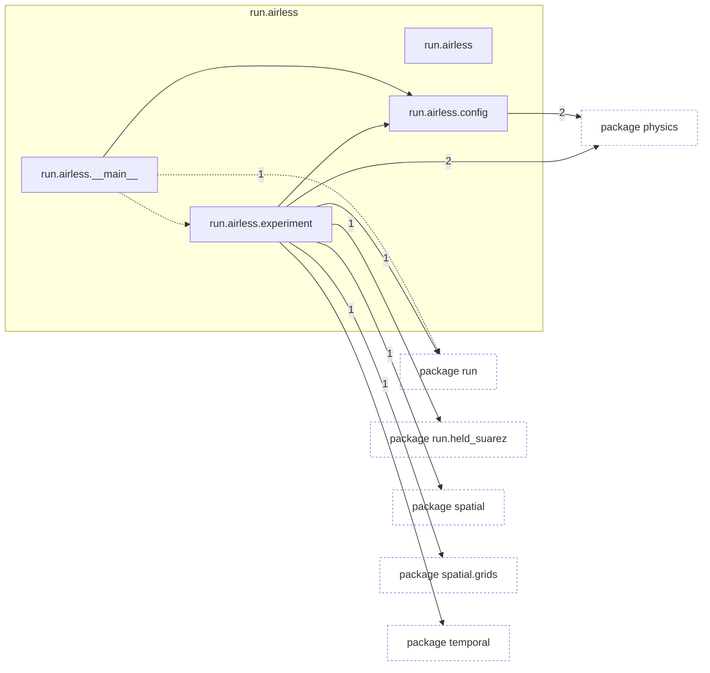
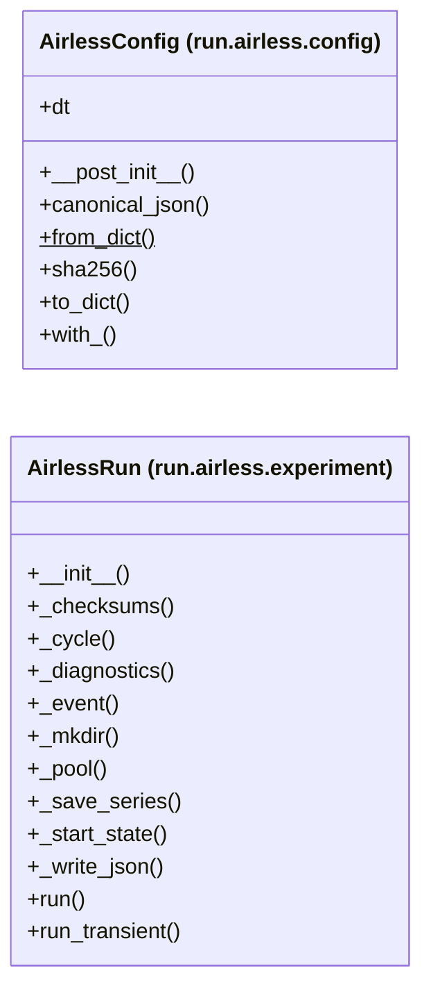

# Package `tropoi.run.airless`

Generated by `tools.architecture`; do not edit. Every module, class and public module-level function of this package is listed here (subpackages have their own pages). Relations shown are extracted from the source, not inferred.

Index: [all packages](../index.md) · parent [`tropoi.run`](tropoi.run.md)

## Modules

| Module | Category | Classes | Public functions |
|---|---|---|---|
| `tropoi.run.airless` | empty | – | – |
| `tropoi.run.airless.__main__` | code | – | `main` |
| `tropoi.run.airless.config` | code | `AirlessConfig` | `config_from_document`, `load_config_document`, `mercury_hayne_analogue`, `mercury_vpw99`, `strata_from_dicts`, `vpw99_strata` |
| `tropoi.run.airless.experiment` | code | `AirlessRun` | `accumulate`, `accumulate_reference`, `aitken`, `build_columns`, `build_substrate`, `load_tier2`, `run_block`, `transient_steps` |

## Imports

This package's modules and the import edges between them; every other package is collapsed to one dashed node (edge label: module edges merged). A dashed arrow is made only of function-scope or `TYPE_CHECKING` imports.

## Classes

2 classes, each with the functions defined in its body (`$`: class/static method; no parentheses: property). Edges: inheritance (`<|--`) and nesting (`*--`) only.

## Entry paths through this package

* [`calls/airless-mercury.mmd`](../calls/airless-mercury.mmd)
