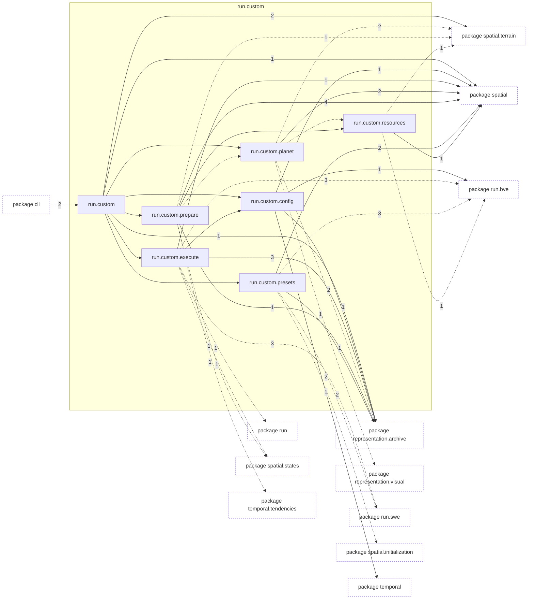

# Package `tropoi.run.custom`

Generated by `tools.architecture`; do not edit. Every module, class and public module-level function of this package is listed here (subpackages have their own pages). Relations shown are extracted from the source, not inferred.

Index: [all packages](../index.md) · parent [`tropoi.run`](tropoi.run.md)

## Modules

| Module | Category | Classes | Public functions |
|---|---|---|---|
| `tropoi.run.custom` | reexport | – | – |
| `tropoi.run.custom.config` | code | `CustomRunConfig` | – |
| `tropoi.run.custom.execute` | code | – | `execute_custom_run`, `run_initial_state` |
| `tropoi.run.custom.planet` | code | `PreparedPlanet` | `prepare_planet` |
| `tropoi.run.custom.prepare` | code | `FieldReport`, `PreparationReport`, `PreparedState`, `ProjectionPolicy`, `SampledField`, `SampledFunction`, `SpectralCoefficients`, `StateSampling`, `_Resources` | `pad_coefficients`, `prepare_bve_state`, `prepare_swe_state`, `state_sampling` |
| `tropoi.run.custom.presets` | code | – | `initial_state_from_config`, `initial_state_from_preset`, `planet_spec_for_run_config`, `topography_spec_for_run_config` |
| `tropoi.run.custom.resources` | code | `PreparationError` | `base_config`, `build_spec_planet`, `check_specs`, `resolve_topography` |

Files shipped in this directory that are **not Python and not analysed** (templates, data): `INITIAL_STATES.md`, `README.md`. Their contents (for example JavaScript in an HTML template) are invisible to every graph here.

## Imports

This package's modules and the import edges between them; every other package is collapsed to one dashed node (edge label: module edges merged). A dashed arrow is made only of function-scope or `TYPE_CHECKING` imports.

## Classes

12 classes, each with the functions defined in its body (`$`: class/static method; no parentheses: property). Edges: inheritance (`<|--`) and nesting (`*--`) only.

```mermaid
%% Generated by tools.architecture 2.2.0. Do not edit by hand.
%% Classes of tropoi.run.custom
classDiagram
    direction LR
    class c_tropoi_orun_ocustom_oconfig_oCustomRunConfig["CustomRunConfig (run.custom.config)"]
    c_tropoi_orun_ocustom_oconfig_oCustomRunConfig : +resolve()$
    c_tropoi_orun_ocustom_oconfig_oCustomRunConfig : +scenario
    c_tropoi_orun_ocustom_oconfig_oCustomRunConfig : +scientific#95;config#95;dict()
    c_tropoi_orun_ocustom_oconfig_oCustomRunConfig : +snapshot#95;times#95;seconds()
    c_tropoi_orun_ocustom_oconfig_oCustomRunConfig : +solver
    c_tropoi_orun_ocustom_oconfig_oCustomRunConfig : +summary#95;lines()
    c_tropoi_orun_ocustom_oconfig_oCustomRunConfig : +to#95;run#95;config#95;dict()
    class c_tropoi_orun_ocustom_oplanet_oPreparedPlanet["PreparedPlanet (run.custom.planet)"]
    c_tropoi_orun_ocustom_oplanet_oPreparedPlanet : +#95;#95;post#95;init#95;#95;()
    c_tropoi_orun_ocustom_oplanet_oPreparedPlanet : +#95;slug()
    c_tropoi_orun_ocustom_oplanet_oPreparedPlanet : +describe()
    c_tropoi_orun_ocustom_oplanet_oPreparedPlanet : +details()
    c_tropoi_orun_ocustom_oplanet_oPreparedPlanet : +from#95;initial#95;state()$
    c_tropoi_orun_ocustom_oplanet_oPreparedPlanet : +is#95;flat
    c_tropoi_orun_ocustom_oplanet_oPreparedPlanet : +load()$
    c_tropoi_orun_ocustom_oplanet_oPreparedPlanet : +plot()
    c_tropoi_orun_ocustom_oplanet_oPreparedPlanet : +preview()
    c_tropoi_orun_ocustom_oplanet_oPreparedPlanet : +save()
    c_tropoi_orun_ocustom_oplanet_oPreparedPlanet : +view()
    class c_tropoi_orun_ocustom_oprepare_oFieldReport["FieldReport (run.custom.prepare)"]
    c_tropoi_orun_ocustom_oprepare_oFieldReport : +to#95;dict()
    class c_tropoi_orun_ocustom_oprepare_oPreparationReport["PreparationReport (run.custom.prepare)"]
    c_tropoi_orun_ocustom_oprepare_oPreparationReport : +lines()
    c_tropoi_orun_ocustom_oprepare_oPreparationReport : +to#95;dict()
    class c_tropoi_orun_ocustom_oprepare_oPreparedState["PreparedState (run.custom.prepare)"]
    c_tropoi_orun_ocustom_oprepare_oPreparedState : +save()
    class c_tropoi_orun_ocustom_oprepare_oProjectionPolicy["ProjectionPolicy (run.custom.prepare)"]
    c_tropoi_orun_ocustom_oprepare_oProjectionPolicy : +#95;#95;post#95;init#95;#95;()
    c_tropoi_orun_ocustom_oprepare_oProjectionPolicy : +to#95;dict()
    class c_tropoi_orun_ocustom_oprepare_oSampledField["SampledField (run.custom.prepare)"]
    c_tropoi_orun_ocustom_oprepare_oSampledField : +#95;#95;post#95;init#95;#95;()
    class c_tropoi_orun_ocustom_oprepare_oSampledFunction["SampledFunction (run.custom.prepare)"]
    c_tropoi_orun_ocustom_oprepare_oSampledFunction : +#95;#95;post#95;init#95;#95;()
    class c_tropoi_orun_ocustom_oprepare_oSpectralCoefficients["SpectralCoefficients (run.custom.prepare)"]
    c_tropoi_orun_ocustom_oprepare_oSpectralCoefficients : +#95;#95;post#95;init#95;#95;()
    c_tropoi_orun_ocustom_oprepare_oSpectralCoefficients : +l#95;max
    class c_tropoi_orun_ocustom_oprepare_oStateSampling["StateSampling (run.custom.prepare)"]
    class c_tropoi_orun_ocustom_oprepare_o__Resources["#95;Resources (run.custom.prepare)"]
    c_tropoi_orun_ocustom_oprepare_o__Resources : +#95;#95;init#95;#95;()
    c_tropoi_orun_ocustom_oprepare_o__Resources : +planet
    c_tropoi_orun_ocustom_oprepare_o__Resources : +sampling
    class c_tropoi_orun_ocustom_oresources_oPreparationError["PreparationError (run.custom.resources)"]
    c_tropoi_orun_ocustom_oresources_oPreparationError : +#95;#95;init#95;#95;()
    c_tropoi_orun_ocustom_oresources_oPreparationError : external base ValueError
```

## Entry paths through this package

* [`calls/cli-run-bve.mmd`](../calls/cli-run-bve.mmd)
* [`calls/cli-run-swe.mmd`](../calls/cli-run-swe.mmd)
* [`calls/cli-terrain-run-prepare.mmd`](../calls/cli-terrain-run-prepare.mmd)
* [`calls/custom-initial-states.mmd`](../calls/custom-initial-states.mmd)
