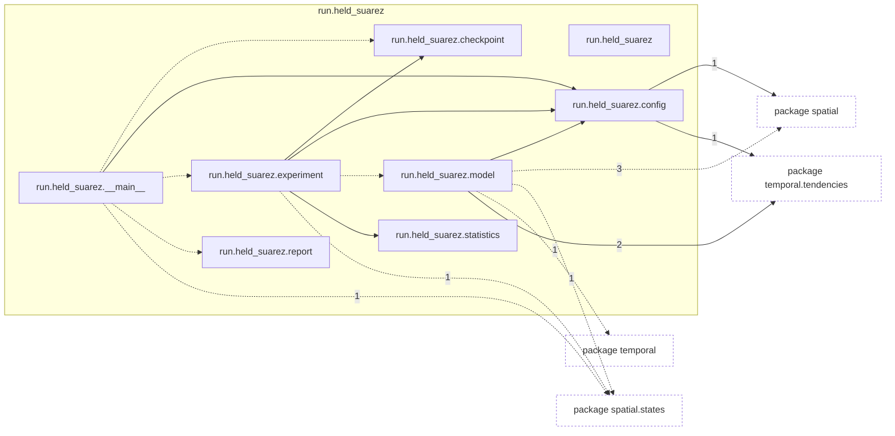

# Package `tropoi.run.held_suarez`

Generated by `tools.architecture`; do not edit. Every module, class and public module-level function of this package is listed here (subpackages have their own pages). Relations shown are extracted from the source, not inferred.

Index: [all packages](../index.md) · parent [`tropoi.run`](tropoi.run.md)

## Modules

| Module | Category | Classes | Public functions |
|---|---|---|---|
| `tropoi.run.held_suarez` | empty | – | – |
| `tropoi.run.held_suarez.__main__` | code | – | `main` |
| `tropoi.run.held_suarez.checkpoint` | code | `CheckpointError` | `array_sha256`, `atomic_copy`, `atomic_write_bytes`, `backup_files`, `checkpoint_name`, `list_checkpoints`, `prune_checkpoints`, `read_checkpoint`, `write_checkpoint` |
| `tropoi.run.held_suarez.config` | code | `HeldSuarezConfig` | `development_config`, `legacy_production_config`, `production_config`, `smoke_config` |
| `tropoi.run.held_suarez.experiment` | code | `HeldSuarezRun`, `RunError` | `benchmark`, `code_identity`, `daily_sample`, `environment_identity`, `protocol_sha256` |
| `tropoi.run.held_suarez.model` | code | – | `build_model`, `build_physics`, `build_stepper`, `initial_state`, `perturbation_coefficients` |
| `tropoi.run.held_suarez.report` | code | – | `build_report`, `config_mismatches`, `load_run`, `reference_summary`, `reference_tier_b`, `render_markdown`, `tier_a`, `tier_b`, `tier_c`, `worst`, `write_report` |
| `tropoi.run.held_suarez.statistics` | code | `OnlineStatistics` | – |

## Imports

This package's modules and the import edges between them; every other package is collapsed to one dashed node (edge label: module edges merged). A dashed arrow is made only of function-scope or `TYPE_CHECKING` imports.

## Classes

5 classes, each with the functions defined in its body (`$`: class/static method; no parentheses: property). Edges: inheritance (`<|--`) and nesting (`*--`) only.

```mermaid
%% Generated by tools.architecture 2.1.0. Do not edit by hand.
%% Classes of tropoi.run.held_suarez
classDiagram
    direction LR
    class c_tropoi_orun_oheld__suarez_ocheckpoint_oCheckpointError["CheckpointError (run.held_suarez.checkpoint)"]
    c_tropoi_orun_oheld__suarez_ocheckpoint_oCheckpointError : external base RuntimeError
    class c_tropoi_orun_oheld__suarez_oconfig_oHeldSuarezConfig["HeldSuarezConfig (run.held_suarez.config)"]
    c_tropoi_orun_oheld__suarez_oconfig_oHeldSuarezConfig : +#95;#95;post#95;init#95;#95;()
    c_tropoi_orun_oheld__suarez_oconfig_oHeldSuarezConfig : +canonical#95;json()
    c_tropoi_orun_oheld__suarez_oconfig_oHeldSuarezConfig : +from#95;dict()$
    c_tropoi_orun_oheld__suarez_oconfig_oHeldSuarezConfig : +hyperdiffusion#95;degree
    c_tropoi_orun_oheld__suarez_oconfig_oHeldSuarezConfig : +n#95;blocks
    c_tropoi_orun_oheld__suarez_oconfig_oHeldSuarezConfig : +product#95;cut
    c_tropoi_orun_oheld__suarez_oconfig_oHeldSuarezConfig : +r#95;dry
    c_tropoi_orun_oheld__suarez_oconfig_oHeldSuarezConfig : +retained#95;cut
    c_tropoi_orun_oheld__suarez_oconfig_oHeldSuarezConfig : +sha256()
    c_tropoi_orun_oheld__suarez_oconfig_oHeldSuarezConfig : +steps#95;per#95;day
    c_tropoi_orun_oheld__suarez_oconfig_oHeldSuarezConfig : +to#95;dict()
    c_tropoi_orun_oheld__suarez_oconfig_oHeldSuarezConfig : +total#95;steps
    c_tropoi_orun_oheld__suarez_oconfig_oHeldSuarezConfig : +with#95;()
    class c_tropoi_orun_oheld__suarez_oexperiment_oHeldSuarezRun["HeldSuarezRun (run.held_suarez.experiment)"]
    c_tropoi_orun_oheld__suarez_oexperiment_oHeldSuarezRun : +#95;#95;init#95;#95;()
    c_tropoi_orun_oheld__suarez_oexperiment_oHeldSuarezRun : +#95;backup()
    c_tropoi_orun_oheld__suarez_oexperiment_oHeldSuarezRun : +#95;check#95;backup#95;dir()
    c_tropoi_orun_oheld__suarez_oexperiment_oHeldSuarezRun : +#95;event()
    c_tropoi_orun_oheld__suarez_oexperiment_oHeldSuarezRun : +#95;export()
    c_tropoi_orun_oheld__suarez_oexperiment_oHeldSuarezRun : +#95;open()
    c_tropoi_orun_oheld__suarez_oexperiment_oHeldSuarezRun : +#95;progress()
    c_tropoi_orun_oheld__suarez_oexperiment_oHeldSuarezRun : +#95;resume()
    c_tropoi_orun_oheld__suarez_oexperiment_oHeldSuarezRun : +#95;sample()
    c_tropoi_orun_oheld__suarez_oexperiment_oHeldSuarezRun : +#95;write#95;checkpoint()
    c_tropoi_orun_oheld__suarez_oexperiment_oHeldSuarezRun : +day
    c_tropoi_orun_oheld__suarez_oexperiment_oHeldSuarezRun : +events()
    c_tropoi_orun_oheld__suarez_oexperiment_oHeldSuarezRun : +run()
    c_tropoi_orun_oheld__suarez_oexperiment_oHeldSuarezRun : +step
    class c_tropoi_orun_oheld__suarez_oexperiment_oRunError["RunError (run.held_suarez.experiment)"]
    c_tropoi_orun_oheld__suarez_oexperiment_oRunError : external base RuntimeError
    class c_tropoi_orun_oheld__suarez_ostatistics_oOnlineStatistics["OnlineStatistics (run.held_suarez.statistics)"]
    c_tropoi_orun_oheld__suarez_ostatistics_oOnlineStatistics : +#95;#95;init#95;#95;()
    c_tropoi_orun_oheld__suarez_ostatistics_oOnlineStatistics : +add()
    c_tropoi_orun_oheld__suarez_ostatistics_oOnlineStatistics : +block#95;means()
    c_tropoi_orun_oheld__suarez_ostatistics_oOnlineStatistics : +block#95;of()
    c_tropoi_orun_oheld__suarez_ostatistics_oOnlineStatistics : +for#95;config()$
    c_tropoi_orun_oheld__suarez_ostatistics_oOnlineStatistics : +from#95;arrays()$
    c_tropoi_orun_oheld__suarez_ostatistics_oOnlineStatistics : +last#95;day
    c_tropoi_orun_oheld__suarez_ostatistics_oOnlineStatistics : +meta()
    c_tropoi_orun_oheld__suarez_ostatistics_oOnlineStatistics : +series#95;arrays()
    c_tropoi_orun_oheld__suarez_ostatistics_oOnlineStatistics : +to#95;arrays()
```

## Entry paths through this package

None of the scoped call graphs reaches this package.
