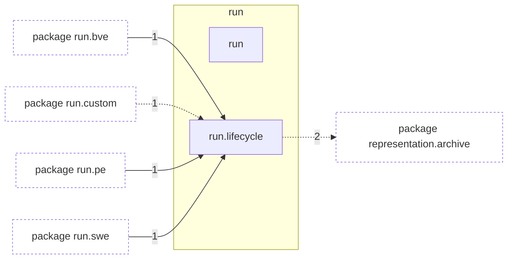

# Package `tropoi.run`

Generated by `tools.architecture`; do not edit. Every module, class and public module-level function of this package is listed here (subpackages have their own pages). Relations shown are extracted from the source, not inferred.

Index: [all packages](../index.md) · parent [`tropoi`](tropoi.md) · [`tropoi.run.bve`](tropoi.run.bve.md) · [`tropoi.run.custom`](tropoi.run.custom.md) · [`tropoi.run.held_suarez`](tropoi.run.held_suarez.md) · [`tropoi.run.pe`](tropoi.run.pe.md) · [`tropoi.run.swe`](tropoi.run.swe.md)

## Modules

| Module | Category | Classes | Public functions |
|---|---|---|---|
| `tropoi.run` | empty | – | – |
| `tropoi.run.lifecycle` | code | – | `execute_with_provenance`, `resolve_writable_base_dir` |

## Imports

This package's modules and the import edges between them; every other package is collapsed to one dashed node (edge label: module edges merged). A dashed arrow is made only of function-scope or `TYPE_CHECKING` imports.

## Classes

No classes.

## Entry paths through this package

* [`calls/cli-run-bve.mmd`](../calls/cli-run-bve.mmd)
* [`calls/cli-run-pe.mmd`](../calls/cli-run-pe.mmd)
* [`calls/cli-run-swe.mmd`](../calls/cli-run-swe.mmd)
* [`calls/custom-initial-states.mmd`](../calls/custom-initial-states.mmd)
