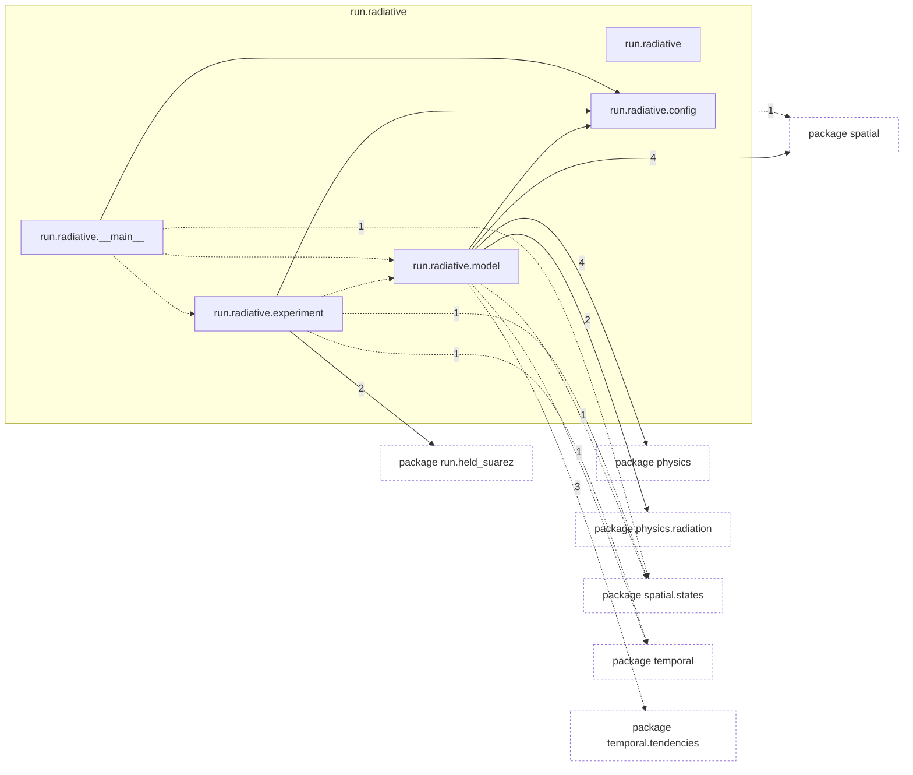
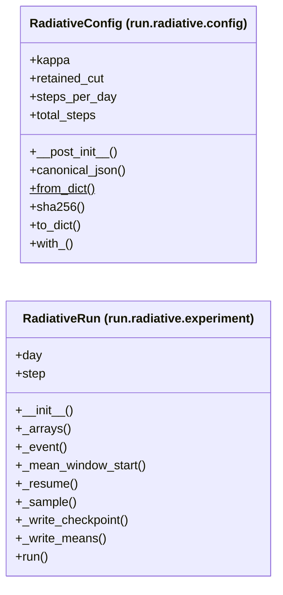

# Package `tropoi.run.radiative`

Generated by `tools.architecture`; do not edit. Every module, class and public module-level function of this package is listed here (subpackages have their own pages). Relations shown are extracted from the source, not inferred.

Index: [all packages](../index.md) · parent [`tropoi.run`](tropoi.run.md)

## Modules

| Module | Category | Classes | Public functions |
|---|---|---|---|
| `tropoi.run.radiative` | empty | – | – |
| `tropoi.run.radiative.__main__` | code | – | `main` |
| `tropoi.run.radiative.config` | code | `RadiativeConfig` | `earth_gray_dry`, `jupiter_schneider_liu` |
| `tropoi.run.radiative.experiment` | code | `RadiativeRun` | – |
| `tropoi.run.radiative.model` | code | – | `build_insolation`, `build_model`, `build_physics`, `build_radiation`, `build_sigma`, `build_stepper`, `initial_state`, `reference_column` |

Files shipped in this directory that are **not Python and not analysed** (templates, data): `README.md`. Their contents (for example JavaScript in an HTML template) are invisible to every graph here.

## Imports

This package's modules and the import edges between them; every other package is collapsed to one dashed node (edge label: module edges merged). A dashed arrow is made only of function-scope or `TYPE_CHECKING` imports.

## Classes

2 classes, each with the functions defined in its body (`$`: class/static method; no parentheses: property). Edges: inheritance (`<|--`) and nesting (`*--`) only.

## Entry paths through this package

None of the scoped call graphs reaches this package.
