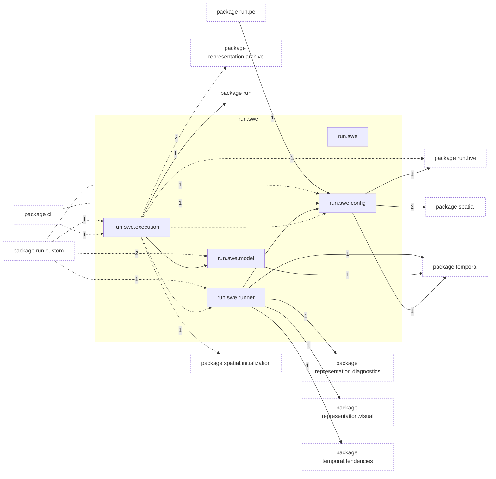
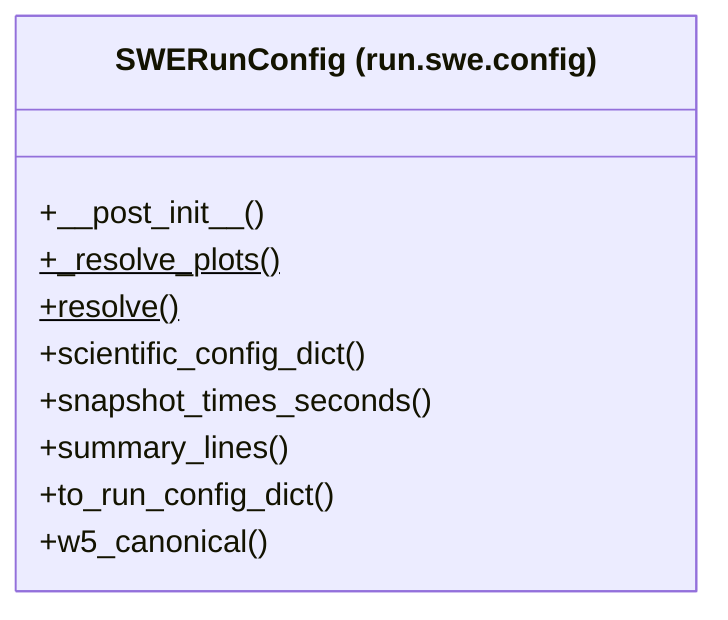

# Package `tropoi.run.swe`

Generated by `tools.architecture`; do not edit. Every module, class and public module-level function of this package is listed here (subpackages have their own pages). Relations shown are extracted from the source, not inferred.

Index: [all packages](../index.md) · parent [`tropoi.run`](tropoi.run.md)

## Modules

| Module | Category | Classes | Public functions |
|---|---|---|---|
| `tropoi.run.swe` | empty | – | – |
| `tropoi.run.swe.config` | code | `SWERunConfig` | – |
| `tropoi.run.swe.execution` | code | – | `execute_run` |
| `tropoi.run.swe.model` | reexport | – | – |
| `tropoi.run.swe.runner` | code | – | `run_swe` |

## Imports

This package's modules and the import edges between them; every other package is collapsed to one dashed node (edge label: module edges merged). A dashed arrow is made only of function-scope or `TYPE_CHECKING` imports.

## Classes

1 class, each with the functions defined in its body (`$`: class/static method; no parentheses: property). Edges: inheritance (`<|--`) and nesting (`*--`) only.

## Entry paths through this package

* [`calls/cli-run-swe.mmd`](../calls/cli-run-swe.mmd)
* [`calls/custom-initial-states.mmd`](../calls/custom-initial-states.mmd)
