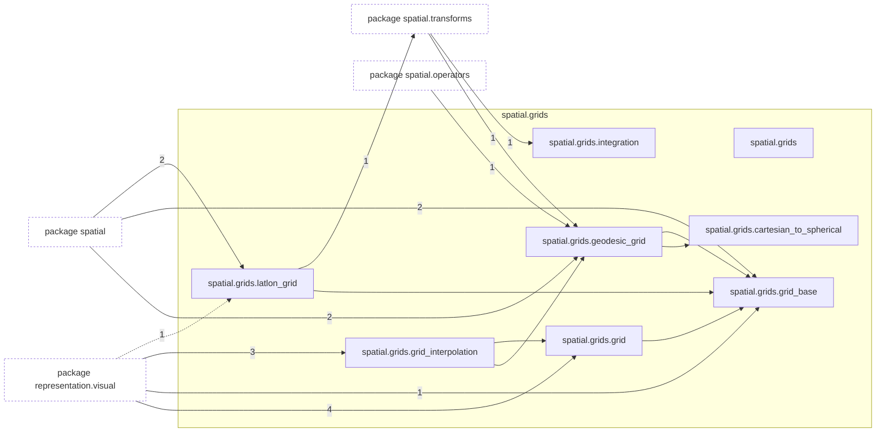
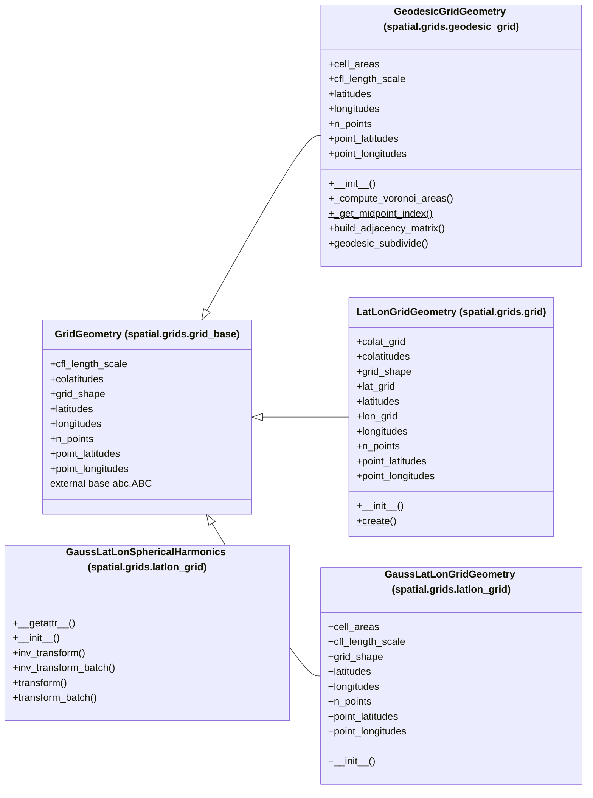

# Package `tropoi.spatial.grids`

Generated by `tools.architecture`; do not edit. Every module, class and public module-level function of this package is listed here (subpackages have their own pages). Relations shown are extracted from the source, not inferred.

Index: [all packages](../index.md) · parent [`tropoi.spatial`](tropoi.spatial.md)

## Modules

| Module | Category | Classes | Public functions |
|---|---|---|---|
| `tropoi.spatial.grids` | empty | – | – |
| `tropoi.spatial.grids.cartesian_to_spherical` | code | – | `cartesian_to_spherical` |
| `tropoi.spatial.grids.geodesic_grid` | code | `GeodesicGridGeometry` | – |
| `tropoi.spatial.grids.grid` | code | `LatLonGridGeometry` | – |
| `tropoi.spatial.grids.grid_base` | code | `GridGeometry` | – |
| `tropoi.spatial.grids.grid_interpolation` | code | – | `geodesic_to_latlon_grid`, `latlon_to_geodesic_grid` |
| `tropoi.spatial.grids.integration` | code | – | `simpson_2d` |
| `tropoi.spatial.grids.latlon_grid` | code | `GaussLatLonGridGeometry`, `GaussLatLonSphericalHarmonics` | – |

Files shipped in this directory that are **not Python and not analysed** (templates, data): `README.md`. Their contents (for example JavaScript in an HTML template) are invisible to every graph here.

## Imports

This package's modules and the import edges between them; every other package is collapsed to one dashed node (edge label: module edges merged). A dashed arrow is made only of function-scope or `TYPE_CHECKING` imports.

## Classes

5 classes, each with the functions defined in its body (`$`: class/static method; no parentheses: property). Edges: inheritance (`<|--`) and nesting (`*--`) only.

## Entry paths through this package

* [`calls/cli-gen.mmd`](../calls/cli-gen.mmd)
* [`calls/custom-initial-states.mmd`](../calls/custom-initial-states.mmd)
