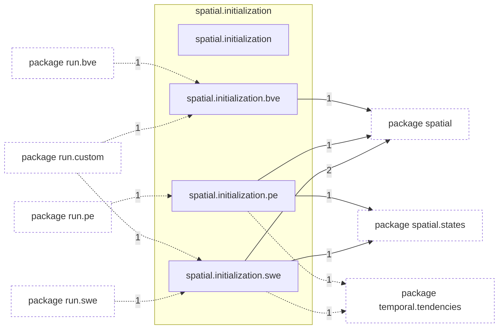

# Package `tropoi.spatial.initialization`

Generated by `tools.architecture`; do not edit. Every module, class and public module-level function of this package is listed here (subpackages have their own pages). Relations shown are extracted from the source, not inferred.

Index: [all packages](../index.md) · parent [`tropoi.spatial`](tropoi.spatial.md)

## Modules

| Module | Category | Classes | Public functions |
|---|---|---|---|
| `tropoi.spatial.initialization` | empty | – | – |
| `tropoi.spatial.initialization.bve` | code | – | `make_ic` |
| `tropoi.spatial.initialization.pe` | code | – | `make_pe_ic`, `thermal_wave_peak` |
| `tropoi.spatial.initialization.swe` | code | – | `make_swe_ic` |

## Imports

This package's modules and the import edges between them; every other package is collapsed to one dashed node (edge label: module edges merged). A dashed arrow is made only of function-scope or `TYPE_CHECKING` imports.

## Classes

No classes.

## Entry paths through this package

* [`calls/cli-run-bve.mmd`](../calls/cli-run-bve.mmd)
* [`calls/cli-run-pe.mmd`](../calls/cli-run-pe.mmd)
* [`calls/cli-run-swe.mmd`](../calls/cli-run-swe.mmd)
* [`calls/custom-initial-states.mmd`](../calls/custom-initial-states.mmd)
