# Package `tropoi.spatial`

Generated by `tools.architecture`; do not edit. Every module, class and public module-level function of this package is listed here (subpackages have their own pages). Relations shown are extracted from the source, not inferred.

Index: [all packages](../index.md) · parent [`tropoi`](tropoi.md) · [`tropoi.spatial.grids`](tropoi.spatial.grids.md) · [`tropoi.spatial.initialization`](tropoi.spatial.initialization.md) · [`tropoi.spatial.operators`](tropoi.spatial.operators.md) · [`tropoi.spatial.states`](tropoi.spatial.states.md) · [`tropoi.spatial.terrain`](tropoi.spatial.terrain.md) · [`tropoi.spatial.transforms`](tropoi.spatial.transforms.md)

## Modules

| Module | Category | Classes | Public functions |
|---|---|---|---|
| `tropoi.spatial` | empty | – | – |
| `tropoi.spatial.environment` | code | `PlanetaryParameters` | – |
| `tropoi.spatial.laplacian` | code | – | `invert_laplacian`, `laplacian_eigenvalues` |
| `tropoi.spatial.modes` | code | `FieldSpec`, `SpectralConventionError`, `SpectralModes`, `SpectralState` | – |
| `tropoi.spatial.planet` | code | `Planet` | – |
| `tropoi.spatial.sigma_coordinate` | code | `SigmaGrid`, `SigmaGridError` | `column_energy_conversion`, `column_mass_tendency`, `column_pressure_work`, `energy_exchange`, `hydrostatic_geopotential`, `interface_mean`, `interface_sigma_dot`, `layer_mass_residual`, `omega_over_p`, `vertical_advection`, `vertical_flux_divergence`, `vertical_sbp` |
| `tropoi.spatial.specification` | code | `DiscretizationSpec`, `FluidLayerSpec`, `PlanetSpec`, `SpecificationError`, `TopographySpec` | – |
| `tropoi.spatial.spherical_backend` | code | `GeodesicBackend`, `LatLonBackend`, `PointSetBackend`, `ProductSpace`, `SphericalGridBackend` | `make_backend` |
| `tropoi.spatial.truncation` | code | – | `product_truncation_cut`, `require_scenario_support`, `require_thermal_wave_support` |
| `tropoi.spatial.williamson5` | code | – | – |

Files shipped in this directory that are **not Python and not analysed** (templates, data): `CONVENTIONS.md`, `README.md`. Their contents (for example JavaScript in an HTML template) are invisible to every graph here.

## Imports

This package's modules and the import edges between them; every other package is collapsed to one dashed node (edge label: module edges merged). A dashed arrow is made only of function-scope or `TYPE_CHECKING` imports.

```mermaid
%% Generated by tools.architecture 2.1.0. Do not edit by hand.
%% Modules of tropoi.spatial with imports in and out
flowchart LR
    subgraph g_tropoi_ospatial["spatial"]
        n_tropoi_ospatial["spatial"]
        n_tropoi_ospatial_oenvironment["spatial.environment"]
        n_tropoi_ospatial_olaplacian["spatial.laplacian"]
        n_tropoi_ospatial_omodes["spatial.modes"]
        n_tropoi_ospatial_oplanet["spatial.planet"]
        n_tropoi_ospatial_osigma__coordinate["spatial.sigma_coordinate"]
        n_tropoi_ospatial_ospecification["spatial.specification"]
        n_tropoi_ospatial_ospherical__backend["spatial.spherical_backend"]
        n_tropoi_ospatial_otruncation["spatial.truncation"]
        n_tropoi_ospatial_owilliamson5["spatial.williamson5"]
    end
    p_tropoi_ocli["package cli"]
    p_tropoi_orepresentation_oarchive["package representation.archive"]
    p_tropoi_orepresentation_odiagnostics["package representation.diagnostics"]
    p_tropoi_orepresentation_ovisual["package representation.visual"]
    p_tropoi_orun_obve["package run.bve"]
    p_tropoi_orun_ocustom["package run.custom"]
    p_tropoi_orun_oheld__suarez["package run.held_suarez"]
    p_tropoi_orun_ope["package run.pe"]
    p_tropoi_orun_oradiative["package run.radiative"]
    p_tropoi_orun_oswe["package run.swe"]
    p_tropoi_ospatial_ogrids["package spatial.grids"]
    p_tropoi_ospatial_oinitialization["package spatial.initialization"]
    p_tropoi_ospatial_ooperators["package spatial.operators"]
    p_tropoi_ospatial_oterrain["package spatial.terrain"]
    p_tropoi_ospatial_otransforms["package spatial.transforms"]
    p_tropoi_otemporal["package temporal"]
    p_tropoi_otemporal_otendencies["package temporal.tendencies"]
    n_tropoi_ospatial_oplanet --> n_tropoi_ospatial_oenvironment
    n_tropoi_ospatial_oplanet -.-> n_tropoi_ospatial_ospherical__backend
    n_tropoi_ospatial_ospecification -.-> n_tropoi_ospatial_oenvironment
    n_tropoi_ospatial_ospecification --> n_tropoi_ospatial_owilliamson5
    p_tropoi_ocli -.->|1| n_tropoi_ospatial_oenvironment
    p_tropoi_ocli -.->|1| n_tropoi_ospatial_omodes
    p_tropoi_ocli -.->|1| n_tropoi_ospatial_oplanet
    p_tropoi_orepresentation_oarchive -.->|1| n_tropoi_ospatial_oenvironment
    p_tropoi_orepresentation_oarchive -->|5| n_tropoi_ospatial_omodes
    p_tropoi_orepresentation_oarchive -->|1| n_tropoi_ospatial_osigma__coordinate
    p_tropoi_orepresentation_oarchive -->|2| n_tropoi_ospatial_ospecification
    p_tropoi_orepresentation_oarchive -->|1| n_tropoi_ospatial_otruncation
    p_tropoi_orepresentation_odiagnostics -->|1| n_tropoi_ospatial_olaplacian
    p_tropoi_orepresentation_odiagnostics -->|1| n_tropoi_ospatial_osigma__coordinate
    p_tropoi_orepresentation_odiagnostics -->|1| n_tropoi_ospatial_otruncation
    p_tropoi_orepresentation_ovisual -->|2| n_tropoi_ospatial_oplanet
    p_tropoi_orepresentation_ovisual -->|2| n_tropoi_ospatial_osigma__coordinate
    p_tropoi_orepresentation_ovisual -.->|1| n_tropoi_ospatial_otruncation
    p_tropoi_orun_obve -->|1| n_tropoi_ospatial_oplanet
    p_tropoi_orun_ocustom -->|1| n_tropoi_ospatial_olaplacian
    p_tropoi_orun_ocustom -->|1| n_tropoi_ospatial_omodes
    p_tropoi_orun_ocustom -->|7| n_tropoi_ospatial_ospecification
    p_tropoi_orun_ocustom -->|2| n_tropoi_ospatial_otruncation
    p_tropoi_orun_ocustom -->|1| n_tropoi_ospatial_owilliamson5
    p_tropoi_orun_oheld__suarez -.->|1| n_tropoi_ospatial_oenvironment
    p_tropoi_orun_oheld__suarez -.->|1| n_tropoi_ospatial_oplanet
    p_tropoi_orun_oheld__suarez -.->|1| n_tropoi_ospatial_osigma__coordinate
    p_tropoi_orun_oheld__suarez -->|1| n_tropoi_ospatial_otruncation
    p_tropoi_orun_ope -->|1| n_tropoi_ospatial_osigma__coordinate
    p_tropoi_orun_ope -->|1| n_tropoi_ospatial_otruncation
    p_tropoi_orun_oradiative -.->|1| n_tropoi_ospatial_oenvironment
    p_tropoi_orun_oradiative -.->|1| n_tropoi_ospatial_olaplacian
    p_tropoi_orun_oradiative -.->|1| n_tropoi_ospatial_oplanet
    p_tropoi_orun_oradiative -->|1| n_tropoi_ospatial_osigma__coordinate
    p_tropoi_orun_oradiative -.->|1| n_tropoi_ospatial_otruncation
    p_tropoi_orun_oswe -->|1| n_tropoi_ospatial_otruncation
    p_tropoi_orun_oswe -->|1| n_tropoi_ospatial_owilliamson5
    p_tropoi_ospatial_oinitialization -->|1| n_tropoi_ospatial_oplanet
    p_tropoi_ospatial_oinitialization -->|2| n_tropoi_ospatial_otruncation
    p_tropoi_ospatial_oinitialization -->|1| n_tropoi_ospatial_owilliamson5
    p_tropoi_ospatial_ooperators -->|1| n_tropoi_ospatial_olaplacian
    p_tropoi_ospatial_ooperators -.->|1| n_tropoi_ospatial_ospherical__backend
    p_tropoi_ospatial_ooperators -->|1| n_tropoi_ospatial_otruncation
    p_tropoi_otemporal -.->|1| n_tropoi_ospatial_oenvironment
    p_tropoi_otemporal -->|1| n_tropoi_ospatial_olaplacian
    p_tropoi_otemporal -->|1| n_tropoi_ospatial_omodes
    p_tropoi_otemporal -.->|1| n_tropoi_ospatial_oplanet
    p_tropoi_otemporal -->|2| n_tropoi_ospatial_osigma__coordinate
    p_tropoi_otemporal -.->|1| n_tropoi_ospatial_ospecification
    p_tropoi_otemporal -->|1| n_tropoi_ospatial_otruncation
    p_tropoi_otemporal -.->|1| n_tropoi_ospatial_owilliamson5
    p_tropoi_otemporal_otendencies -->|4| n_tropoi_ospatial_olaplacian
    p_tropoi_otemporal_otendencies -->|3| n_tropoi_ospatial_oplanet
    p_tropoi_otemporal_otendencies -->|1| n_tropoi_ospatial_osigma__coordinate
    p_tropoi_otemporal_otendencies -->|2| n_tropoi_ospatial_otruncation
    n_tropoi_ospatial_oplanet -->|3| p_tropoi_ospatial_ogrids
    n_tropoi_ospatial_oplanet -->|1| p_tropoi_ospatial_ooperators
    n_tropoi_ospatial_oplanet -->|3| p_tropoi_ospatial_oterrain
    n_tropoi_ospatial_oplanet -->|1| p_tropoi_ospatial_otransforms
    n_tropoi_ospatial_ospherical__backend -->|3| p_tropoi_ospatial_ogrids
    n_tropoi_ospatial_ospherical__backend -->|1| p_tropoi_ospatial_otransforms
    classDef other fill:none,stroke-dasharray:3 3
    class p_tropoi_ocli other
    class p_tropoi_orepresentation_oarchive other
    class p_tropoi_orepresentation_odiagnostics other
    class p_tropoi_orepresentation_ovisual other
    class p_tropoi_orun_obve other
    class p_tropoi_orun_ocustom other
    class p_tropoi_orun_oheld__suarez other
    class p_tropoi_orun_ope other
    class p_tropoi_orun_oradiative other
    class p_tropoi_orun_oswe other
    class p_tropoi_ospatial_ogrids other
    class p_tropoi_ospatial_oinitialization other
    class p_tropoi_ospatial_ooperators other
    class p_tropoi_ospatial_oterrain other
    class p_tropoi_ospatial_otransforms other
    class p_tropoi_otemporal other
    class p_tropoi_otemporal_otendencies other
```

## Classes

18 classes, each with the functions defined in its body (`$`: class/static method; no parentheses: property). Edges: inheritance (`<|--`) and nesting (`*--`) only.

```mermaid
%% Generated by tools.architecture 2.1.0. Do not edit by hand.
%% Classes of tropoi.spatial
classDiagram
    direction LR
    class c_tropoi_ospatial_oenvironment_oPlanetaryParameters["PlanetaryParameters (spatial.environment)"]
    c_tropoi_ospatial_oenvironment_oPlanetaryParameters : +#95;#95;post#95;init#95;#95;()
    c_tropoi_ospatial_oenvironment_oPlanetaryParameters : +#95;calculate#95;oblateness()
    c_tropoi_ospatial_oenvironment_oPlanetaryParameters : +from#95;earth#95;like()$
    c_tropoi_ospatial_oenvironment_oPlanetaryParameters : +from#95;si()$
    c_tropoi_ospatial_oenvironment_oPlanetaryParameters : +ideal#95;sphere()$
    class c_tropoi_ospatial_omodes_oFieldSpec["FieldSpec (spatial.modes)"]
    c_tropoi_ospatial_omodes_oFieldSpec : +#95;#95;post#95;init#95;#95;()
    c_tropoi_ospatial_omodes_oFieldSpec : +dimensions
    c_tropoi_ospatial_omodes_oFieldSpec : +from#95;dict()$
    c_tropoi_ospatial_omodes_oFieldSpec : +nlev
    c_tropoi_ospatial_omodes_oFieldSpec : +select()
    c_tropoi_ospatial_omodes_oFieldSpec : +to#95;dict()
    class c_tropoi_ospatial_omodes_oSpectralConventionError["SpectralConventionError (spatial.modes)"]
    c_tropoi_ospatial_omodes_oSpectralConventionError : external base ValueError
    class c_tropoi_ospatial_omodes_oSpectralModes["SpectralModes (spatial.modes)"]
    c_tropoi_ospatial_omodes_oSpectralModes : +#95;#95;post#95;init#95;#95;()
    c_tropoi_ospatial_omodes_oSpectralModes : +description
    c_tropoi_ospatial_omodes_oSpectralModes : +dimensions
    c_tropoi_ospatial_omodes_oSpectralModes : +l#95;max
    c_tropoi_ospatial_omodes_oSpectralModes : +level()
    c_tropoi_ospatial_omodes_oSpectralModes : +name
    c_tropoi_ospatial_omodes_oSpectralModes : +nlev
    c_tropoi_ospatial_omodes_oSpectralModes : +shape
    c_tropoi_ospatial_omodes_oSpectralModes : +summary()
    c_tropoi_ospatial_omodes_oSpectralModes : +units
    c_tropoi_ospatial_omodes_oSpectralModes : +valid#95;mask
    c_tropoi_ospatial_omodes_oSpectralModes : +validate()
    class c_tropoi_ospatial_omodes_oSpectralState["SpectralState (spatial.modes)"]
    c_tropoi_ospatial_omodes_oSpectralState : +#95;#95;getitem#95;#95;()
    c_tropoi_ospatial_omodes_oSpectralState : +#95;#95;init#95;#95;()
    c_tropoi_ospatial_omodes_oSpectralState : +#95;#95;iter#95;#95;()
    c_tropoi_ospatial_omodes_oSpectralState : +#95;#95;len#95;#95;()
    c_tropoi_ospatial_omodes_oSpectralState : +#95;#95;repr#95;#95;()
    c_tropoi_ospatial_omodes_oSpectralState : +packed
    c_tropoi_ospatial_omodes_oSpectralState : +specs
    c_tropoi_ospatial_omodes_oSpectralState : external base collections.abc.Mapping
    class c_tropoi_ospatial_oplanet_oPlanet["Planet (spatial.planet)"]
    c_tropoi_ospatial_oplanet_oPlanet : +#95;#95;init#95;#95;()
    c_tropoi_ospatial_oplanet_oPlanet : +#95;#95;repr#95;#95;()
    c_tropoi_ospatial_oplanet_oPlanet : +#95;calculate#95;radial#95;distances()$
    c_tropoi_ospatial_oplanet_oPlanet : +#95;compute#95;power#95;spectrum()$
    c_tropoi_ospatial_oplanet_oPlanet : +generate()$
    c_tropoi_ospatial_oplanet_oPlanet : +reconstruct#95;surface()
    class c_tropoi_ospatial_osigma__coordinate_oSigmaGrid["SigmaGrid (spatial.sigma_coordinate)"]
    c_tropoi_ospatial_osigma__coordinate_oSigmaGrid : +#95;#95;post#95;init#95;#95;()
    c_tropoi_ospatial_osigma__coordinate_oSigmaGrid : +alpha()
    c_tropoi_ospatial_osigma__coordinate_oSigmaGrid : +frierson()$
    c_tropoi_ospatial_osigma__coordinate_oSigmaGrid : +full#95;levels()
    c_tropoi_ospatial_osigma__coordinate_oSigmaGrid : +full#95;levels#95;array()
    c_tropoi_ospatial_osigma__coordinate_oSigmaGrid : +hydrostatic#95;full#95;levels()
    c_tropoi_ospatial_osigma__coordinate_oSigmaGrid : +interface#95;log#95;ratios()
    c_tropoi_ospatial_osigma__coordinate_oSigmaGrid : +interfaces#95;array()
    c_tropoi_ospatial_osigma__coordinate_oSigmaGrid : +nlev
    c_tropoi_ospatial_osigma__coordinate_oSigmaGrid : +stretched()$
    c_tropoi_ospatial_osigma__coordinate_oSigmaGrid : +thickness()
    c_tropoi_ospatial_osigma__coordinate_oSigmaGrid : +thickness#95;array()
    c_tropoi_ospatial_osigma__coordinate_oSigmaGrid : +uniform()$
    class c_tropoi_ospatial_osigma__coordinate_oSigmaGridError["SigmaGridError (spatial.sigma_coordinate)"]
    c_tropoi_ospatial_osigma__coordinate_oSigmaGridError : external base ValueError
    class c_tropoi_ospatial_ospecification_oDiscretizationSpec["DiscretizationSpec (spatial.specification)"]
    c_tropoi_ospatial_ospecification_oDiscretizationSpec : +#95;#95;post#95;init#95;#95;()
    c_tropoi_ospatial_ospecification_oDiscretizationSpec : +describe()
    c_tropoi_ospatial_ospecification_oDiscretizationSpec : +from#95;dict()$
    c_tropoi_ospatial_ospecification_oDiscretizationSpec : +gauss#95;latlon()$
    c_tropoi_ospatial_ospecification_oDiscretizationSpec : +geodesic()$
    c_tropoi_ospatial_ospecification_oDiscretizationSpec : +run#95;config#95;entries()
    c_tropoi_ospatial_ospecification_oDiscretizationSpec : +to#95;dict()
    class c_tropoi_ospatial_ospecification_oFluidLayerSpec["FluidLayerSpec (spatial.specification)"]
    c_tropoi_ospatial_ospecification_oFluidLayerSpec : +#95;#95;post#95;init#95;#95;()
    c_tropoi_ospatial_ospecification_oFluidLayerSpec : +from#95;dict()$
    c_tropoi_ospatial_ospecification_oFluidLayerSpec : +phi0
    c_tropoi_ospatial_ospecification_oFluidLayerSpec : +to#95;dict()
    class c_tropoi_ospatial_ospecification_oPlanetSpec["PlanetSpec (spatial.specification)"]
    c_tropoi_ospatial_ospecification_oPlanetSpec : +#95;#95;post#95;init#95;#95;()
    c_tropoi_ospatial_ospecification_oPlanetSpec : +angular#95;velocity#95;rad#95;s
    c_tropoi_ospatial_ospecification_oPlanetSpec : +day#95;hours
    c_tropoi_ospatial_ospecification_oPlanetSpec : +derived()
    c_tropoi_ospatial_ospecification_oPlanetSpec : +describe()
    c_tropoi_ospatial_ospecification_oPlanetSpec : +dynamical#95;radius#95;m
    c_tropoi_ospatial_ospecification_oPlanetSpec : +earth#95;like()$
    c_tropoi_ospatial_ospecification_oPlanetSpec : +from#95;dict()$
    c_tropoi_ospatial_ospecification_oPlanetSpec : +ideal#95;sphere()$
    c_tropoi_ospatial_ospecification_oPlanetSpec : +oblate()$
    c_tropoi_ospatial_ospecification_oPlanetSpec : +rotating
    c_tropoi_ospatial_ospecification_oPlanetSpec : +to#95;dict()
    c_tropoi_ospatial_ospecification_oPlanetSpec : +to#95;parameters()
    class c_tropoi_ospatial_ospecification_oSpecificationError["SpecificationError (spatial.specification)"]
    c_tropoi_ospatial_ospecification_oSpecificationError : external base ValueError
    class c_tropoi_ospatial_ospecification_oTopographySpec["TopographySpec (spatial.specification)"]
    c_tropoi_ospatial_ospecification_oTopographySpec : +#95;#95;post#95;init#95;#95;()
    c_tropoi_ospatial_ospecification_oTopographySpec : +flat()$
    c_tropoi_ospatial_ospecification_oTopographySpec : +from#95;dict()$
    c_tropoi_ospatial_ospecification_oTopographySpec : +imported()$
    c_tropoi_ospatial_ospecification_oTopographySpec : +is#95;flat
    c_tropoi_ospatial_ospecification_oTopographySpec : +mountain()$
    c_tropoi_ospatial_ospecification_oTopographySpec : +run#95;config#95;entries()
    c_tropoi_ospatial_ospecification_oTopographySpec : +to#95;dict()
    c_tropoi_ospatial_ospecification_oTopographySpec : +williamson5#95;cone()$
    class c_tropoi_ospatial_ospherical__backend_oGeodesicBackend["GeodesicBackend (spatial.spherical_backend)"]
    c_tropoi_ospatial_ospherical__backend_oGeodesicBackend : +#95;#95;init#95;#95;()
    c_tropoi_ospatial_ospherical__backend_oGeodesicBackend : +#95;build#95;product#95;space()
    c_tropoi_ospatial_ospherical__backend_oGeodesicBackend : +supported#95;product#95;quadratures()
    class c_tropoi_ospatial_ospherical__backend_oLatLonBackend["LatLonBackend (spatial.spherical_backend)"]
    c_tropoi_ospatial_ospherical__backend_oLatLonBackend : +#95;#95;init#95;#95;()
    c_tropoi_ospatial_ospherical__backend_oLatLonBackend : +#95;build#95;product#95;space()
    c_tropoi_ospatial_ospherical__backend_oLatLonBackend : +supported#95;product#95;quadratures()
    class c_tropoi_ospatial_ospherical__backend_oPointSetBackend["PointSetBackend (spatial.spherical_backend)"]
    c_tropoi_ospatial_ospherical__backend_oPointSetBackend : +#95;build#95;product#95;space()
    c_tropoi_ospatial_ospherical__backend_oPointSetBackend : +supported#95;product#95;quadratures()
    class c_tropoi_ospatial_ospherical__backend_oProductSpace["ProductSpace (spatial.spherical_backend)"]
    class c_tropoi_ospatial_ospherical__backend_oSphericalGridBackend["SphericalGridBackend (spatial.spherical_backend)"]
    c_tropoi_ospatial_ospherical__backend_oSphericalGridBackend : +#95;#95;init#95;#95;()
    c_tropoi_ospatial_ospherical__backend_oSphericalGridBackend : +#95;build#95;product#95;space()
    c_tropoi_ospatial_ospherical__backend_oSphericalGridBackend : +#95;coarse#95;coslat()
    c_tropoi_ospatial_ospherical__backend_oSphericalGridBackend : +describe()
    c_tropoi_ospatial_ospherical__backend_oSphericalGridBackend : +product#95;space()
    c_tropoi_ospatial_ospherical__backend_oSphericalGridBackend : +supported#95;product#95;quadratures()
    c_tropoi_ospatial_ospherical__backend_oSphericalGridBackend : external base abc.ABC
    c_tropoi_ospatial_ospherical__backend_oSphericalGridBackend <|-- c_tropoi_ospatial_ospherical__backend_oGeodesicBackend
    c_tropoi_ospatial_ospherical__backend_oSphericalGridBackend <|-- c_tropoi_ospatial_ospherical__backend_oLatLonBackend
    c_tropoi_ospatial_ospherical__backend_oSphericalGridBackend <|-- c_tropoi_ospatial_ospherical__backend_oPointSetBackend
```

## Entry paths through this package

* [`calls/cli-gen.mmd`](../calls/cli-gen.mmd)
* [`calls/cli-inspect.mmd`](../calls/cli-inspect.mmd)
* [`calls/cli-plot.mmd`](../calls/cli-plot.mmd)
* [`calls/cli-run-bve.mmd`](../calls/cli-run-bve.mmd)
* [`calls/cli-run-pe.mmd`](../calls/cli-run-pe.mmd)
* [`calls/cli-run-swe.mmd`](../calls/cli-run-swe.mmd)
* [`calls/cli-terrain-run-prepare.mmd`](../calls/cli-terrain-run-prepare.mmd)
* [`calls/custom-initial-states.mmd`](../calls/custom-initial-states.mmd)
* [`calls/sky-saved-column.mmd`](../calls/sky-saved-column.mmd)
