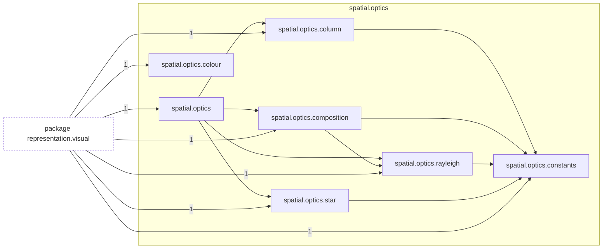

# Package `tropoi.spatial.optics`

Generated by `tools.architecture`; do not edit. Every module, class and public module-level function of this package is listed here (subpackages have their own pages). Relations shown are extracted from the source, not inferred.

Index: [all packages](../index.md) · parent [`tropoi.spatial`](tropoi.spatial.md)

## Modules

| Module | Category | Classes | Public functions |
|---|---|---|---|
| `tropoi.spatial.optics` | reexport | – | – |
| `tropoi.spatial.optics.colour` | code | – | `bin_weights`, `cie_1931`, `omitted_fraction`, `srgb_encode` |
| `tropoi.spatial.optics.column` | code | `AtmosphericColumn`, `ColumnError` | `thin_atmosphere_mass_kg`, `thin_atmosphere_surface_pressure_pa` |
| `tropoi.spatial.optics.composition` | code | `Composition`, `CompositionError` | `gas_constant_report` |
| `tropoi.spatial.optics.constants` | code | – | – |
| `tropoi.spatial.optics.rayleigh` | code | `Species` | `rayleigh_cross_section` |
| `tropoi.spatial.optics.star` | code | `Star`, `StellarBody` | `planck_radiance` |

## Imports

This package's modules and the import edges between them; every other package is collapsed to one dashed node (edge label: module edges merged). A dashed arrow is made only of function-scope or `TYPE_CHECKING` imports.

## Classes

7 classes, each with the functions defined in its body (`$`: class/static method; no parentheses: property). Edges: inheritance (`<|--`) and nesting (`*--`) only.

```mermaid
%% Generated by tools.architecture 2.2.0. Do not edit by hand.
%% Classes of tropoi.spatial.optics
classDiagram
    direction LR
    class c_tropoi_ospatial_ooptics_ocolumn_oAtmosphericColumn["AtmosphericColumn (spatial.optics.column)"]
    c_tropoi_ospatial_ooptics_ocolumn_oAtmosphericColumn : +#95;#95;post#95;init#95;#95;()
    c_tropoi_ospatial_ooptics_ocolumn_oAtmosphericColumn : +#95;check#95;z()
    c_tropoi_ospatial_ooptics_ocolumn_oAtmosphericColumn : +altitude#95;at()
    c_tropoi_ospatial_ooptics_ocolumn_oAtmosphericColumn : +base#95;m
    c_tropoi_ospatial_ooptics_ocolumn_oAtmosphericColumn : +from#95;levels()$
    c_tropoi_ospatial_ooptics_ocolumn_oAtmosphericColumn : +hypothetical()$
    c_tropoi_ospatial_ooptics_ocolumn_oAtmosphericColumn : +number#95;density()
    c_tropoi_ospatial_ooptics_ocolumn_oAtmosphericColumn : +observer#95;altitude()
    c_tropoi_ospatial_ooptics_ocolumn_oAtmosphericColumn : +pressure#95;at()
    c_tropoi_ospatial_ooptics_ocolumn_oAtmosphericColumn : +surface#95;pressure#95;pa
    c_tropoi_ospatial_ooptics_ocolumn_oAtmosphericColumn : +temperature#95;at()
    c_tropoi_ospatial_ooptics_ocolumn_oAtmosphericColumn : +to#95;dict()
    c_tropoi_ospatial_ooptics_ocolumn_oAtmosphericColumn : +top#95;m
    class c_tropoi_ospatial_ooptics_ocolumn_oColumnError["ColumnError (spatial.optics.column)"]
    c_tropoi_ospatial_ooptics_ocolumn_oColumnError : external base ValueError
    class c_tropoi_ospatial_ooptics_ocomposition_oComposition["Composition (spatial.optics.composition)"]
    c_tropoi_ospatial_ooptics_ocomposition_oComposition : +#95;#95;post#95;init#95;#95;()
    c_tropoi_ospatial_ooptics_ocomposition_oComposition : +cross#95;section()
    c_tropoi_ospatial_ooptics_ocomposition_oComposition : +describe()
    c_tropoi_ospatial_ooptics_ocomposition_oComposition : +from#95;mass#95;fractions()$
    c_tropoi_ospatial_ooptics_ocomposition_oComposition : +gas#95;constant
    c_tropoi_ospatial_ooptics_ocomposition_oComposition : +mass#95;fractions
    c_tropoi_ospatial_ooptics_ocomposition_oComposition : +molar#95;mass#95;kg#95;per#95;mol
    c_tropoi_ospatial_ooptics_ocomposition_oComposition : +of()$
    c_tropoi_ospatial_ooptics_ocomposition_oComposition : +sources()
    c_tropoi_ospatial_ooptics_ocomposition_oComposition : +to#95;dict()
    class c_tropoi_ospatial_ooptics_ocomposition_oCompositionError["CompositionError (spatial.optics.composition)"]
    c_tropoi_ospatial_ooptics_ocomposition_oCompositionError : external base ValueError
    class c_tropoi_ospatial_ooptics_orayleigh_oSpecies["Species (spatial.optics.rayleigh)"]
    c_tropoi_ospatial_ooptics_orayleigh_oSpecies : +cross#95;section()
    c_tropoi_ospatial_ooptics_orayleigh_oSpecies : +describe()
    c_tropoi_ospatial_ooptics_orayleigh_oSpecies : +king#95;factor()
    c_tropoi_ospatial_ooptics_orayleigh_oSpecies : +refractivity()
    class c_tropoi_ospatial_ooptics_ostar_oStar["Star (spatial.optics.star)"]
    c_tropoi_ospatial_ooptics_ostar_oStar : +#95;#95;post#95;init#95;#95;()
    c_tropoi_ospatial_ooptics_ostar_oStar : +bolometric#95;irradiance#95;w#95;m2
    c_tropoi_ospatial_ooptics_ostar_oStar : +describe()
    c_tropoi_ospatial_ooptics_ostar_oStar : +irradiance()
    c_tropoi_ospatial_ooptics_ostar_oStar : +luminosity#95;lsun
    c_tropoi_ospatial_ooptics_ostar_oStar : +of()$
    c_tropoi_ospatial_ooptics_ostar_oStar : +radiance()
    c_tropoi_ospatial_ooptics_ostar_oStar : +solid#95;angle#95;sr
    c_tropoi_ospatial_ooptics_ostar_oStar : +sun#95;at()$
    c_tropoi_ospatial_ooptics_ostar_oStar : +sun#95;at#95;1au()$
    c_tropoi_ospatial_ooptics_ostar_oStar : +to#95;dict()
    c_tropoi_ospatial_ooptics_ostar_oStar : +with#95;sun#95;irradiance#95;at#95;1au()$
    class c_tropoi_ospatial_ooptics_ostar_oStellarBody["StellarBody (spatial.optics.star)"]
    c_tropoi_ospatial_ooptics_ostar_oStellarBody : +at()
    c_tropoi_ospatial_ooptics_ostar_oStellarBody : +from#95;luminosity()$
    c_tropoi_ospatial_ooptics_ostar_oStellarBody : +to#95;dict()
```

## Entry paths through this package

* [`calls/sky-hypothetical.mmd`](../calls/sky-hypothetical.mmd)
* [`calls/sky-numpy-reference.mmd`](../calls/sky-numpy-reference.mmd)
* [`calls/sky-saved-column.mmd`](../calls/sky-saved-column.mmd)
