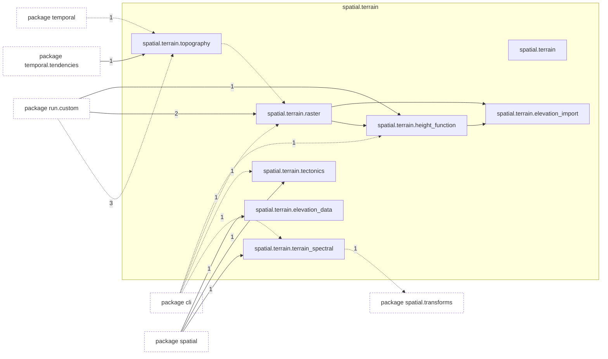
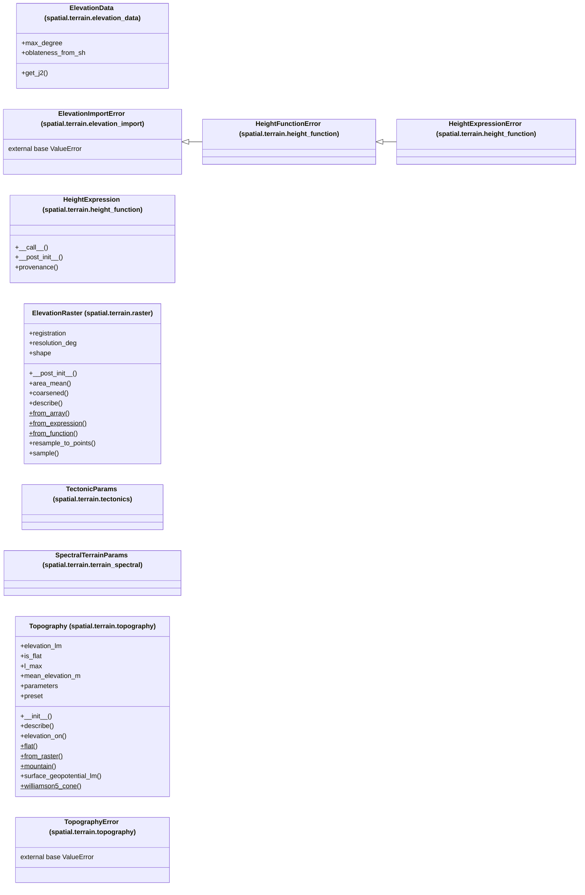

# Package `tropoi.spatial.terrain`

Generated by `tools.architecture`; do not edit. Every module, class and public module-level function of this package is listed here (subpackages have their own pages). Relations shown are extracted from the source, not inferred.

Index: [all packages](../index.md) · parent [`tropoi.spatial`](tropoi.spatial.md)

## Modules

| Module | Category | Classes | Public functions |
|---|---|---|---|
| `tropoi.spatial.terrain` | empty | – | – |
| `tropoi.spatial.terrain.elevation_data` | code | `ElevationData` | – |
| `tropoi.spatial.terrain.elevation_import` | code | `ElevationImportError` | – |
| `tropoi.spatial.terrain.height_function` | code | `HeightExpression`, `HeightExpressionError`, `HeightFunctionError` | `load_height_function`, `sample_height_function`, `sampling_grid` |
| `tropoi.spatial.terrain.raster` | code | `ElevationRaster` | `encode_grey16`, `read_elevation`, `working_resolution_deg` |
| `tropoi.spatial.terrain.tectonics` | code | `TectonicParams` | – |
| `tropoi.spatial.terrain.terrain_spectral` | code | `SpectralTerrainParams` | `generate_spectral_terrain_gpu` |
| `tropoi.spatial.terrain.topography` | code | `Topography`, `TopographyError` | `smoothing_record`, `spectral_smoothing_factors`, `williamson5_cone_elevation` |

Files shipped in this directory that are **not Python and not analysed** (templates, data): `IMPORT.md`, `README.md`. Their contents (for example JavaScript in an HTML template) are invisible to every graph here.

## Imports

This package's modules and the import edges between them; every other package is collapsed to one dashed node (edge label: module edges merged). A dashed arrow is made only of function-scope or `TYPE_CHECKING` imports.

## Classes

10 classes, each with the functions defined in its body (`$`: class/static method; no parentheses: property). Edges: inheritance (`<|--`) and nesting (`*--`) only.

## Entry paths through this package

* [`calls/cli-gen.mmd`](../calls/cli-gen.mmd)
* [`calls/cli-run-pe.mmd`](../calls/cli-run-pe.mmd)
* [`calls/cli-run-swe.mmd`](../calls/cli-run-swe.mmd)
* [`calls/cli-terrain-run-prepare.mmd`](../calls/cli-terrain-run-prepare.mmd)
* [`calls/custom-initial-states.mmd`](../calls/custom-initial-states.mmd)
* [`calls/terrain-raster.mmd`](../calls/terrain-raster.mmd)
