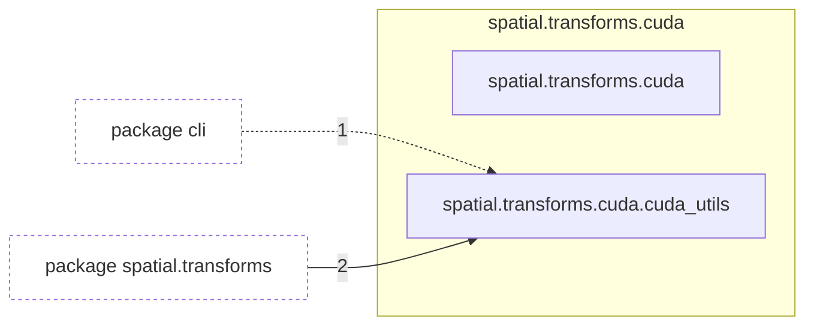

# Package `tropoi.spatial.transforms.cuda`

Generated by `tools.architecture`; do not edit. Every module, class and public module-level function of this package is listed here (subpackages have their own pages). Relations shown are extracted from the source, not inferred.

Index: [all packages](../index.md) · parent [`tropoi.spatial.transforms`](tropoi.spatial.transforms.md)

## Modules

| Module | Category | Classes | Public functions |
|---|---|---|---|
| `tropoi.spatial.transforms.cuda` | namespace | – | – |
| `tropoi.spatial.transforms.cuda.cuda_utils` | code | – | `load_cuda_source`, `raw_module_from_cuda` |

Files shipped in this directory that are **not Python and not analysed** (templates, data): `README.md`, `legendre.cu`, `sh_matrix.cu`. Their contents (for example JavaScript in an HTML template) are invisible to every graph here.

## Imports

This package's modules and the import edges between them; every other package is collapsed to one dashed node (edge label: module edges merged). A dashed arrow is made only of function-scope or `TYPE_CHECKING` imports.

## Classes

No classes.

## Entry paths through this package

* [`calls/cli-recompile.mmd`](../calls/cli-recompile.mmd)
