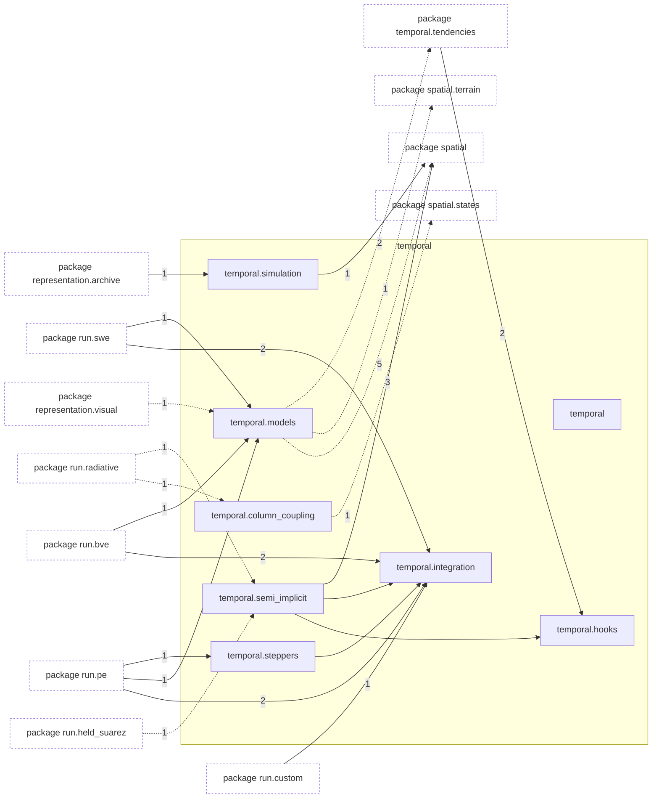

# Package `tropoi.temporal`

Generated by `tools.architecture`; do not edit. Every module, class and public module-level function of this package is listed here (subpackages have their own pages). Relations shown are extracted from the source, not inferred.

Index: [all packages](../index.md) · parent [`tropoi`](tropoi.md) · [`tropoi.temporal.tendencies`](tropoi.temporal.tendencies.md)

## Modules

| Module | Category | Classes | Public functions |
|---|---|---|---|
| `tropoi.temporal` | empty | – | – |
| `tropoi.temporal.column_coupling` | code | `ColumnPhysicsCoupling` | `global_energy` |
| `tropoi.temporal.hooks` | code | `DiagonalDamping` | `complete_tendency`, `hook_signatures`, `rk4_real_axis_limit` |
| `tropoi.temporal.integration` | code | `IntegrationScheduler` | `advective_cfl_timestep`, `count_snapshot_times`, `integrate`, `integration_plan`, `interval_snapshot_times`, `rk4_step_array`, `scheduler_tolerance`, `validate_snapshot_schedule` |
| `tropoi.temporal.models` | code | – | `build_pe_model`, `build_planet`, `build_swe_model` |
| `tropoi.temporal.semi_implicit` | code | `SemiImplicitLeapfrogStepper`, `SemiImplicitOperator`, `SemiImplicitSolver` | `rk4_gain`, `rk4_imaginary_axis_gain` |
| `tropoi.temporal.simulation` | code | `Simulation`, `Snapshot`, `SnapshotStorage` | – |
| `tropoi.temporal.steppers` | code | `RK4Stepper`, `TimeStepper` | – |

Files shipped in this directory that are **not Python and not analysed** (templates, data): `README.md`, `SAVED_RUNS.md`, `SEMI_IMPLICIT.md`. Their contents (for example JavaScript in an HTML template) are invisible to every graph here.

## Imports

This package's modules and the import edges between them; every other package is collapsed to one dashed node (edge label: module edges merged). A dashed arrow is made only of function-scope or `TYPE_CHECKING` imports.

## Classes

11 classes, each with the functions defined in its body (`$`: class/static method; no parentheses: property). Edges: inheritance (`<|--`) and nesting (`*--`) only.

```mermaid
%% Generated by tools.architecture 2.3.0. Do not edit by hand.
%% Classes of tropoi.temporal
classDiagram
    direction LR
    class c_tropoi_otemporal_ocolumn__coupling_oColumnPhysicsCoupling["ColumnPhysicsCoupling (temporal.column#95;coupling)"]
    c_tropoi_otemporal_ocolumn__coupling_oColumnPhysicsCoupling : +#95;#95;call#95;#95;()
    c_tropoi_otemporal_ocolumn__coupling_oColumnPhysicsCoupling : +#95;#95;init#95;#95;()
    c_tropoi_otemporal_ocolumn__coupling_oColumnPhysicsCoupling : +#95;lowest#95;wind#95;speed()
    c_tropoi_otemporal_ocolumn__coupling_oColumnPhysicsCoupling : +budget#95;means()
    c_tropoi_otemporal_ocolumn__coupling_oColumnPhysicsCoupling : +columns()
    c_tropoi_otemporal_ocolumn__coupling_oColumnPhysicsCoupling : +load#95;state#95;dict()
    c_tropoi_otemporal_ocolumn__coupling_oColumnPhysicsCoupling : +signature()
    c_tropoi_otemporal_ocolumn__coupling_oColumnPhysicsCoupling : +state#95;dict()
    class c_tropoi_otemporal_ohooks_oDiagonalDamping["DiagonalDamping (temporal.hooks)"]
    c_tropoi_otemporal_ohooks_oDiagonalDamping : +#95;#95;init#95;#95;()
    c_tropoi_otemporal_ohooks_oDiagonalDamping : +#95;check()
    c_tropoi_otemporal_ohooks_oDiagonalDamping : +#95;table()
    c_tropoi_otemporal_ohooks_oDiagonalDamping : +apply#95;implicit()
    c_tropoi_otemporal_ohooks_oDiagonalDamping : +factor()
    c_tropoi_otemporal_ohooks_oDiagonalDamping : +max#95;rate
    c_tropoi_otemporal_ohooks_oDiagonalDamping : +signature()
    c_tropoi_otemporal_ohooks_oDiagonalDamping : +tendency()
    class c_tropoi_otemporal_ointegration_oIntegrationScheduler["IntegrationScheduler (temporal.integration)"]
    c_tropoi_otemporal_ointegration_oIntegrationScheduler : +#95;#95;init#95;#95;()
    c_tropoi_otemporal_ointegration_oIntegrationScheduler : +next#95;event()
    class c_tropoi_otemporal_osemi__implicit_oSemiImplicitLeapfrogStepper["SemiImplicitLeapfrogStepper (temporal.semi#95;implicit)"]
    c_tropoi_otemporal_osemi__implicit_oSemiImplicitLeapfrogStepper : +#95;#95;init#95;#95;()
    c_tropoi_otemporal_osemi__implicit_oSemiImplicitLeapfrogStepper : +#95;hook#95;signatures()
    c_tropoi_otemporal_osemi__implicit_oSemiImplicitLeapfrogStepper : +#95;leapfrog()
    c_tropoi_otemporal_osemi__implicit_oSemiImplicitLeapfrogStepper : +#95;stable#95;startup#95;substeps()
    c_tropoi_otemporal_osemi__implicit_oSemiImplicitLeapfrogStepper : +#95;startup()
    c_tropoi_otemporal_osemi__implicit_oSemiImplicitLeapfrogStepper : +initialize()
    c_tropoi_otemporal_osemi__implicit_oSemiImplicitLeapfrogStepper : +load#95;state#95;dict()
    c_tropoi_otemporal_osemi__implicit_oSemiImplicitLeapfrogStepper : +state
    c_tropoi_otemporal_osemi__implicit_oSemiImplicitLeapfrogStepper : +state#95;dict()
    c_tropoi_otemporal_osemi__implicit_oSemiImplicitLeapfrogStepper : +step()
    c_tropoi_otemporal_osemi__implicit_oSemiImplicitLeapfrogStepper : +step#95;count
    c_tropoi_otemporal_osemi__implicit_oSemiImplicitLeapfrogStepper : +t
    c_tropoi_otemporal_osemi__implicit_oSemiImplicitLeapfrogStepper : +x#95;prev
    class c_tropoi_otemporal_osemi__implicit_oSemiImplicitOperator["SemiImplicitOperator (temporal.semi#95;implicit)"]
    c_tropoi_otemporal_osemi__implicit_oSemiImplicitOperator : +#95;#95;init#95;#95;()
    c_tropoi_otemporal_osemi__implicit_oSemiImplicitOperator : +#95;dev()
    c_tropoi_otemporal_osemi__implicit_oSemiImplicitOperator : +apply()
    c_tropoi_otemporal_osemi__implicit_oSemiImplicitOperator : +dense#95;matrix()
    c_tropoi_otemporal_osemi__implicit_oSemiImplicitOperator : +frequencies()
    c_tropoi_otemporal_osemi__implicit_oSemiImplicitOperator : +from#95;model()$
    c_tropoi_otemporal_osemi__implicit_oSemiImplicitOperator : +gravity#95;wave#95;speeds()
    c_tropoi_otemporal_osemi__implicit_oSemiImplicitOperator : +max#95;frequency()
    c_tropoi_otemporal_osemi__implicit_oSemiImplicitOperator : +signature()
    class c_tropoi_otemporal_osemi__implicit_oSemiImplicitSolver["SemiImplicitSolver (temporal.semi#95;implicit)"]
    c_tropoi_otemporal_osemi__implicit_oSemiImplicitSolver : +#95;#95;init#95;#95;()
    c_tropoi_otemporal_osemi__implicit_oSemiImplicitSolver : +#95;advance#95;centred()
    c_tropoi_otemporal_osemi__implicit_oSemiImplicitSolver : +#95;centred#95;tables()
    c_tropoi_otemporal_osemi__implicit_oSemiImplicitSolver : +#95;minv()
    c_tropoi_otemporal_osemi__implicit_oSemiImplicitSolver : +advance()
    c_tropoi_otemporal_osemi__implicit_oSemiImplicitSolver : +cayley#95;matrix()
    c_tropoi_otemporal_osemi__implicit_oSemiImplicitSolver : +implicit#95;matrix()
    c_tropoi_otemporal_osemi__implicit_oSemiImplicitSolver : +inverse()
    c_tropoi_otemporal_osemi__implicit_oSemiImplicitSolver : +matrix()
    class c_tropoi_otemporal_osimulation_oSimulation["Simulation (temporal.simulation)"]
    c_tropoi_otemporal_osimulation_oSimulation : +#95;#95;getitem#95;#95;()
    c_tropoi_otemporal_osimulation_oSimulation : +#95;#95;init#95;#95;()
    c_tropoi_otemporal_osimulation_oSimulation : +#95;#95;iter#95;#95;()
    c_tropoi_otemporal_osimulation_oSimulation : +#95;#95;len#95;#95;()
    c_tropoi_otemporal_osimulation_oSimulation : +#95;#95;repr#95;#95;()
    c_tropoi_otemporal_osimulation_oSimulation : +field#95;names
    c_tropoi_otemporal_osimulation_oSimulation : +metadata
    c_tropoi_otemporal_osimulation_oSimulation : +plot()
    c_tropoi_otemporal_osimulation_oSimulation : +quantities()
    c_tropoi_otemporal_osimulation_oSimulation : +sky()
    c_tropoi_otemporal_osimulation_oSimulation : +snapshot()
    c_tropoi_otemporal_osimulation_oSimulation : +solver
    c_tropoi_otemporal_osimulation_oSimulation : +storage
    c_tropoi_otemporal_osimulation_oSimulation : +times
    c_tropoi_otemporal_osimulation_oSimulation : +view()
    class c_tropoi_otemporal_osimulation_oSnapshot["Snapshot (temporal.simulation)"]
    c_tropoi_otemporal_osimulation_oSnapshot : +#95;#95;init#95;#95;()
    c_tropoi_otemporal_osimulation_oSnapshot : +#95;#95;repr#95;#95;()
    c_tropoi_otemporal_osimulation_oSnapshot : +index
    c_tropoi_otemporal_osimulation_oSnapshot : +metadata
    c_tropoi_otemporal_osimulation_oSnapshot : +packed
    c_tropoi_otemporal_osimulation_oSnapshot : +plot()
    c_tropoi_otemporal_osimulation_oSnapshot : +solver
    c_tropoi_otemporal_osimulation_oSnapshot : +state
    c_tropoi_otemporal_osimulation_oSnapshot : +time
    c_tropoi_otemporal_osimulation_oSnapshot : +view()
    class c_tropoi_otemporal_osimulation_oSnapshotStorage["SnapshotStorage (temporal.simulation)"]
    c_tropoi_otemporal_osimulation_oSnapshotStorage : +field#95;specs
    c_tropoi_otemporal_osimulation_oSnapshotStorage : +frame()
    c_tropoi_otemporal_osimulation_oSnapshotStorage : +level#95;values
    c_tropoi_otemporal_osimulation_oSnapshotStorage : +metadata
    c_tropoi_otemporal_osimulation_oSnapshotStorage : +plot#95;simulation()
    c_tropoi_otemporal_osimulation_oSnapshotStorage : +plot#95;snapshot()
    c_tropoi_otemporal_osimulation_oSnapshotStorage : +quantities()
    c_tropoi_otemporal_osimulation_oSnapshotStorage : +solver
    c_tropoi_otemporal_osimulation_oSnapshotStorage : +times
    c_tropoi_otemporal_osimulation_oSnapshotStorage : external base typing.Protocol
    class c_tropoi_otemporal_osteppers_oRK4Stepper["RK4Stepper (temporal.steppers)"]
    c_tropoi_otemporal_osteppers_oRK4Stepper : +#95;#95;init#95;#95;()
    c_tropoi_otemporal_osteppers_oRK4Stepper : +initialize()
    c_tropoi_otemporal_osteppers_oRK4Stepper : +load#95;state#95;dict()
    c_tropoi_otemporal_osteppers_oRK4Stepper : +state
    c_tropoi_otemporal_osteppers_oRK4Stepper : +state#95;dict()
    c_tropoi_otemporal_osteppers_oRK4Stepper : +step()
    c_tropoi_otemporal_osteppers_oRK4Stepper : +step#95;count
    c_tropoi_otemporal_osteppers_oRK4Stepper : +t
    class c_tropoi_otemporal_osteppers_oTimeStepper["TimeStepper (temporal.steppers)"]
    c_tropoi_otemporal_osteppers_oTimeStepper : +initialize()
    c_tropoi_otemporal_osteppers_oTimeStepper : +load#95;state#95;dict()
    c_tropoi_otemporal_osteppers_oTimeStepper : +state
    c_tropoi_otemporal_osteppers_oTimeStepper : +state#95;dict()
    c_tropoi_otemporal_osteppers_oTimeStepper : +step()
    c_tropoi_otemporal_osteppers_oTimeStepper : +step#95;count
    c_tropoi_otemporal_osteppers_oTimeStepper : +t
    c_tropoi_otemporal_osteppers_oTimeStepper : external base typing.Protocol
```

## Entry paths through this package

* [`calls/cli-inspect.mmd`](../calls/cli-inspect.mmd)
* [`calls/cli-plot.mmd`](../calls/cli-plot.mmd)
* [`calls/cli-run-bve.mmd`](../calls/cli-run-bve.mmd)
* [`calls/cli-run-pe.mmd`](../calls/cli-run-pe.mmd)
* [`calls/cli-run-swe.mmd`](../calls/cli-run-swe.mmd)
* [`calls/cli-terrain-run-prepare.mmd`](../calls/cli-terrain-run-prepare.mmd)
* [`calls/custom-initial-states.mmd`](../calls/custom-initial-states.mmd)
* [`calls/sky-saved-column.mmd`](../calls/sky-saved-column.mmd)
