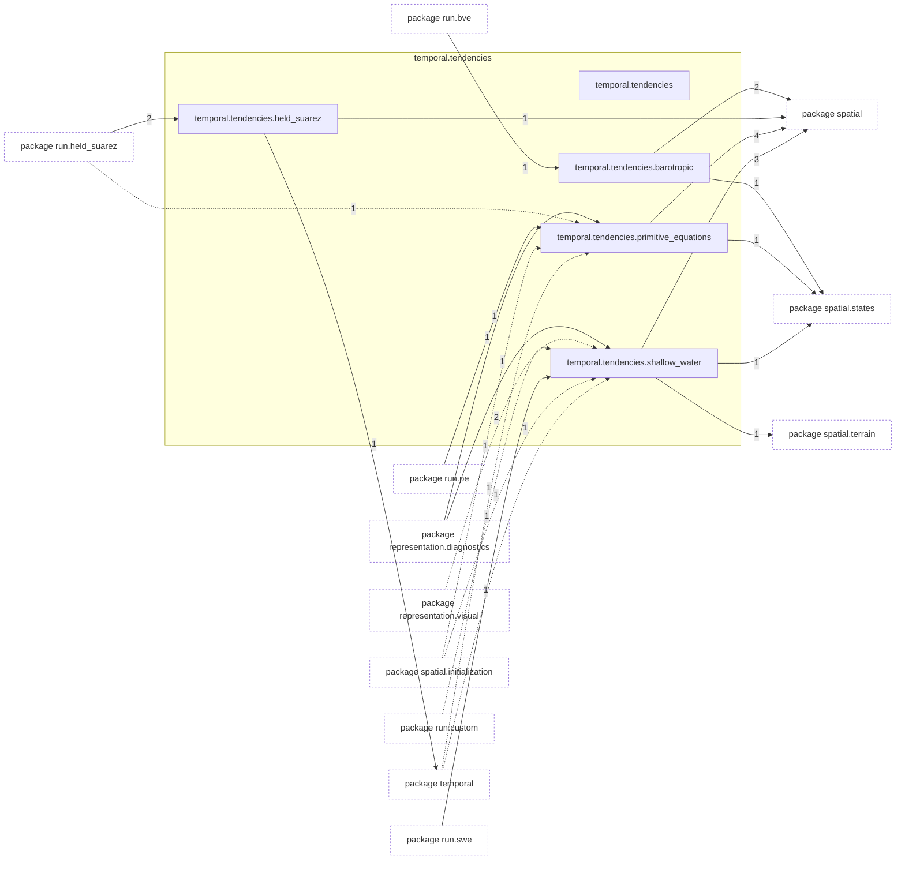

# Package `tropoi.temporal.tendencies`

Generated by `tools.architecture`; do not edit. Every module, class and public module-level function of this package is listed here (subpackages have their own pages). Relations shown are extracted from the source, not inferred.

Index: [all packages](../index.md) · parent [`tropoi.temporal`](tropoi.temporal.md)

## Modules

| Module | Category | Classes | Public functions |
|---|---|---|---|
| `tropoi.temporal.tendencies` | empty | – | – |
| `tropoi.temporal.tendencies.barotropic` | code | `BarotropicVorticity` | – |
| `tropoi.temporal.tendencies.held_suarez` | code | `HeldSuarezParameters`, `NewtonianRelaxation` | `equilibrium_temperature`, `hyperdiffusion_coefficient`, `hyperdiffusion_damping`, `newtonian_rate`, `newtonian_tendency_grid`, `rayleigh_drag_damping`, `rayleigh_rate` |
| `tropoi.temporal.tendencies.primitive_equations` | code | `PrimitiveEquationsModel` | – |
| `tropoi.temporal.tendencies.shallow_water` | code | `ShallowWaterModel` | – |

Files shipped in this directory that are **not Python and not analysed** (templates, data): `PRIMITIVE_EQUATIONS.md`, `README.md`, `RETAINED_TRUNCATION.md`, `SHALLOW_WATER.md`. Their contents (for example JavaScript in an HTML template) are invisible to every graph here.

## Imports

This package's modules and the import edges between them; every other package is collapsed to one dashed node (edge label: module edges merged). A dashed arrow is made only of function-scope or `TYPE_CHECKING` imports.

## Classes

5 classes, each with the functions defined in its body (`$`: class/static method; no parentheses: property). Edges: inheritance (`<|--`) and nesting (`*--`) only.

```mermaid
%% Generated by tools.architecture 2.1.0. Do not edit by hand.
%% Classes of tropoi.temporal.tendencies
classDiagram
    direction LR
    class c_tropoi_otemporal_otendencies_obarotropic_oBarotropicVorticity["BarotropicVorticity (temporal.tendencies.barotropic)"]
    c_tropoi_otemporal_otendencies_obarotropic_oBarotropicVorticity : +#95;#95;init#95;#95;()
    c_tropoi_otemporal_otendencies_obarotropic_oBarotropicVorticity : +tendency()
    c_tropoi_otemporal_otendencies_obarotropic_oBarotropicVorticity : +vorticity#95;to#95;streamfunction()
    class c_tropoi_otemporal_otendencies_oheld__suarez_oHeldSuarezParameters["HeldSuarezParameters (temporal.tendencies.held_suarez)"]
    c_tropoi_otemporal_otendencies_oheld__suarez_oHeldSuarezParameters : +#95;#95;post#95;init#95;#95;()
    c_tropoi_otemporal_otendencies_oheld__suarez_oHeldSuarezParameters : +as#95;dict()
    class c_tropoi_otemporal_otendencies_oheld__suarez_oNewtonianRelaxation["NewtonianRelaxation (temporal.tendencies.held_suarez)"]
    c_tropoi_otemporal_otendencies_oheld__suarez_oNewtonianRelaxation : +#95;#95;call#95;#95;()
    c_tropoi_otemporal_otendencies_oheld__suarez_oNewtonianRelaxation : +#95;#95;init#95;#95;()
    c_tropoi_otemporal_otendencies_oheld__suarez_oNewtonianRelaxation : +grid#95;fields()
    c_tropoi_otemporal_otendencies_oheld__suarez_oNewtonianRelaxation : +signature()
    class c_tropoi_otemporal_otendencies_oprimitive__equations_oPrimitiveEquationsModel["PrimitiveEquationsModel (temporal.tendencies.primitive_equations)"]
    c_tropoi_otemporal_otendencies_oprimitive__equations_oPrimitiveEquationsModel : +#95;#95;init#95;#95;()
    c_tropoi_otemporal_otendencies_oprimitive__equations_oPrimitiveEquationsModel : +#95;deriv#95;fields()
    c_tropoi_otemporal_otendencies_oprimitive__equations_oPrimitiveEquationsModel : +#95;inv#95;laplacian()
    c_tropoi_otemporal_otendencies_oprimitive__equations_oPrimitiveEquationsModel : +#95;momentum#95;tendencies()
    c_tropoi_otemporal_otendencies_oprimitive__equations_oPrimitiveEquationsModel : +#95;stack#95;derivs()
    c_tropoi_otemporal_otendencies_oprimitive__equations_oPrimitiveEquationsModel : +#95;tendency#95;batched()
    c_tropoi_otemporal_otendencies_oprimitive__equations_oPrimitiveEquationsModel : +#95;tendency#95;product#95;fields()
    c_tropoi_otemporal_otendencies_oprimitive__equations_oPrimitiveEquationsModel : +#95;thermo#95;mass#95;tendencies()
    c_tropoi_otemporal_otendencies_oprimitive__equations_oPrimitiveEquationsModel : +#95;truncate()
    c_tropoi_otemporal_otendencies_oprimitive__equations_oPrimitiveEquationsModel : +#95;wind#95;from()
    c_tropoi_otemporal_otendencies_oprimitive__equations_oPrimitiveEquationsModel : +continuity#95;diagnostics()
    c_tropoi_otemporal_otendencies_oprimitive__equations_oPrimitiveEquationsModel : +energy#95;exchange#95;diagnostics()
    c_tropoi_otemporal_otendencies_oprimitive__equations_oPrimitiveEquationsModel : +geopotential#95;fields()
    c_tropoi_otemporal_otendencies_oprimitive__equations_oPrimitiveEquationsModel : +max#95;characteristic#95;speed()
    c_tropoi_otemporal_otendencies_oprimitive__equations_oPrimitiveEquationsModel : +surface#95;pressure#95;on#95;state#95;grid()
    c_tropoi_otemporal_otendencies_oprimitive__equations_oPrimitiveEquationsModel : +temperature#95;extrema()
    c_tropoi_otemporal_otendencies_oprimitive__equations_oPrimitiveEquationsModel : +temperature#95;on#95;state#95;grid()
    c_tropoi_otemporal_otendencies_oprimitive__equations_oPrimitiveEquationsModel : +tendency()
    c_tropoi_otemporal_otendencies_oprimitive__equations_oPrimitiveEquationsModel : +tendency#95;state()
    c_tropoi_otemporal_otendencies_oprimitive__equations_oPrimitiveEquationsModel : +validate#95;state()
    c_tropoi_otemporal_otendencies_oprimitive__equations_oPrimitiveEquationsModel : +vertical#95;transport#95;diagnostics()
    c_tropoi_otemporal_otendencies_oprimitive__equations_oPrimitiveEquationsModel : +wind#95;on#95;state#95;grid()
    class c_tropoi_otemporal_otendencies_oshallow__water_oShallowWaterModel["ShallowWaterModel (temporal.tendencies.shallow_water)"]
    c_tropoi_otemporal_otendencies_oshallow__water_oShallowWaterModel : +#95;#95;init#95;#95;()
    c_tropoi_otemporal_otendencies_oshallow__water_oShallowWaterModel : +#95;deriv#95;fields()
    c_tropoi_otemporal_otendencies_oshallow__water_oShallowWaterModel : +#95;inv#95;laplacian()
    c_tropoi_otemporal_otendencies_oshallow__water_oShallowWaterModel : +#95;truncate()
    c_tropoi_otemporal_otendencies_oshallow__water_oShallowWaterModel : +#95;wind#95;from()
    c_tropoi_otemporal_otendencies_oshallow__water_oShallowWaterModel : +characteristic#95;fields()
    c_tropoi_otemporal_otendencies_oshallow__water_oShallowWaterModel : +helmholtz()
    c_tropoi_otemporal_otendencies_oshallow__water_oShallowWaterModel : +max#95;characteristic#95;speed()
    c_tropoi_otemporal_otendencies_oshallow__water_oShallowWaterModel : +surface#95;geopotential#95;on#95;state#95;grid()
    c_tropoi_otemporal_otendencies_oshallow__water_oShallowWaterModel : +tendency()
    c_tropoi_otemporal_otendencies_oshallow__water_oShallowWaterModel : +tendency#95;state()
    c_tropoi_otemporal_otendencies_oshallow__water_oShallowWaterModel : +total#95;geopotential#95;extrema()
    c_tropoi_otemporal_otendencies_oshallow__water_oShallowWaterModel : +validate#95;state()
    c_tropoi_otemporal_otendencies_oshallow__water_oShallowWaterModel : +wind#95;on#95;state#95;grid()
```

## Entry paths through this package

* [`calls/cli-run-pe.mmd`](../calls/cli-run-pe.mmd)
* [`calls/cli-run-swe.mmd`](../calls/cli-run-swe.mmd)
* [`calls/custom-initial-states.mmd`](../calls/custom-initial-states.mmd)
