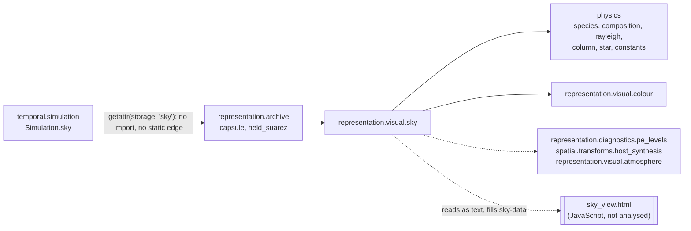

# Sky subsystem: architecture

Hand-written narrative, reconciled with the generated views at the commit
that introduced this page (PR #22). **Authority:** where this page and the
generated files disagree, the generated files are right about structure
(modules, classes, imports, statically resolvable calls); this page explains
what they cannot show. User documentation is [docs/SKY_VIEW.md](../../SKY_VIEW.md).

Generated views:

* packages: [`physics`](../current/packages/tropoi.physics.md) ·
  [`representation.visual`](../current/packages/tropoi.representation.visual.md)
  (module `sky`) ·
  [`representation.archive`](../current/packages/tropoi.representation.archive.md)
  (`CapsuleStorage.sky`, `HeldSuarezStorage.sky`)
* entry paths: [`calls/sky-hypothetical.mmd`](../current/calls/sky-hypothetical.mmd) ·
  [`calls/sky-saved-column.mmd`](../current/calls/sky-saved-column.mmd) ·
  [`calls/sky-numpy-reference.mmd`](../current/calls/sky-numpy-reference.mmd)
  (declared in [`entry-points.toml`](../entry-points.toml))

## What it is

A standalone offline HTML page that shows Rayleigh single scattering of a
blackbody star by an explicit gas mixture, seen by an observer in one
horizontally uniform column. It is a visual prototype. Nothing here is a
radiative-transfer model, no solver reads any of it, and it writes nothing
into a run.

## Where each part lives

| Part | Location | Role | Depends on |
|---|---|---|---|
| Shared physical world | `tropoi.physics` (`species`, `composition`, `rayleigh`, `column`, `star`, `constants`) | `Composition` (stated mole fractions; mole↔mass conversion), `Species`/`SPECIES` and the packaged TOML data, Rayleigh optical records and `composition_cross_section`, `AtmosphericColumn` (hypothetical or from saved levels), `Star` (intrinsic) and `ApparentStar` (seen from a distance), exact SI and IAU constants. The same package holds the radiation schemes and column physics; the sky uses only the modules listed here | NumPy (or CuPy) and the standard library; no other `tropoi` package |
| Colour | `tropoi.representation.visual.colour` | CIE 1931 colour-matching data, bin weights, XYZ → sRGB | NumPy |
| Page assembly and NumPy reference | `tropoi.representation.visual.sky` | `SkySpec`, `HypotheticalColumn`, `SkyPreset`/`SKY_PRESETS`; `sky_block` builds the page's JSON data; `render_page`/`write_sky_page`/`saved_sky_page`/`standalone_page` write the HTML; `radiance_table`, `star_path_column`, `optical_depth_diagnostic` are the NumPy reference of the page's arithmetic | `physics` and `representation.visual.colour` at import time; for a saved column only, function-scope imports of `representation.diagnostics.pe_levels`, `representation.visual.atmosphere` and `spatial.transforms.host_synthesis` |
| The page itself | `src/tropoi/representation/visual/sky_view.html` | HTML template with the whole interactive implementation in JavaScript: it rebuilds the hypothetical column, mixes cross sections, integrates the radiance table, exposes, draws the sky and the star disk, applies presets, and keeps settings in the address | a `sky-data` JSON block written by Python; nothing at run time (offline, one file) |
| Committed standalone copy | `docs/sky.html` | `standalone_page()` output, regenerated by `python -m tools.sky_page` (`--check` in the test suite) | the template and `SKY_PRESETS` |
| Saved-run access | `tropoi.representation.archive` | `CapsuleStorage.sky` / `HeldSuarezStorage.sky` call `saved_sky_page` (function-scope import) | `representation.visual.sky` |

Import boundaries (from `graph/modules.json`; solid = module-scope, dashed =
function-scope import):

The two edges labelled with text are not import edges: `Simulation.sky`
looks the method up with `getattr` on its storage, and the HTML template is
read by `importlib.resources` and filled by string replacement. Static
analysis sees neither, which is why this page draws them.

## Entry paths

**Hypothetical atmosphere** ([`calls/sky-hypothetical.mmd`](../current/calls/sky-hypothetical.mmd)).
`write_sky_page(SkySpec(..., hypothetical=HypotheticalColumn(...)))` builds
the column, `sky_block` assembles composition, star, presets, star catalogue,
optics tables and notes, and `render_page` fills the template.
`standalone_page()` is the same path with the Earth preset, for
`docs/sky.html`. No run, prepared planet, terrain, archive or CUDA is
imported. The graph does not show `HypotheticalColumn.build` →
`AtmosphericColumn.hypothetical`, because `hyp.build(...)` is a call on an
object, which static analysis does not resolve.

**Saved primitive-equation column** ([`calls/sky-saved-column.mmd`](../current/calls/sky-saved-column.mmd)).
`open_simulation(run)` returns a `Simulation`; `Simulation.sky(spec, ...)`
forwards to its storage's `sky` through `getattr`, so the graph starts again
at `CapsuleStorage.sky` and `HeldSuarezStorage.sky`. Both call
`saved_sky_page`, which reconstructs one column exactly on the CPU
(`reconstruct_levels`, `synthesize_latlon` for the surface height,
`AtmosphericColumn.from_levels`) and writes the same page with the column
fixed. `_check_outside_run` refuses to write inside the run directory.
Opening a run is not drawn here (it is shared by every saved-run view).

**NumPy reference** ([`calls/sky-numpy-reference.mmd`](../current/calls/sky-numpy-reference.mmd)).
`radiance_table`, `star_path_column`, `optical_depth_diagnostic`, the mixture
cross section `composition_cross_section` (in `tropoi.physics.rayleigh`) and the
thin-atmosphere mass/pressure functions (in `tropoi.physics.column`) repeat in NumPy what the page's
JavaScript computes. No page writer calls them: the page computes in the
browser. Browser tests (`tests/test_sky_view_browser.py`) compare the two to
a relative 1e-9. That agreement shows the two implementations of the same
formulas match; it is **not** independent physical validation. The physical
checks are separate (`tests/test_sky_view.py`: analytic hydrostatics, the
King factors and air cross section against Bodhaine et al. 1999, numerical
convergence).

## What Python static analysis cannot describe

* Everything inside `sky_view.html`: the JavaScript functions, their call
  structure, the URL-address state, the presets menu, the drawing. The
  generator lists the file under *not analysed* on the
  `representation.visual` page and in `coverage.json`; it never reads it.
* The `getattr` forwarding from `Simulation.sky` to a storage, and calls on
  objects such as `hyp.build(...)`.
* The data contract between Python and the page (the keys of `sky_block`):
  it is a JSON object, tested by the page tests, not a typed interface.

## Boundaries

* **Simulation:** none from the sky. The page never feeds anything back
  into a run, and the composition chosen on it is a view setting. The
  *package* it draws on is shared, though: `tropoi.physics` also holds the
  radiation schemes and column physics that `temporal.column_coupling` couples
  to the primitive-equation core. A change in `tropoi.physics` can therefore
  affect both the sky page and radiative runs.
* **Archives:** read-only. A saved column is read from a capsule or a
  Held–Suarez directory; nothing is written into the run.
* **Reconstruction:** exact on the CPU, at the observer's point only, through
  the same `reconstruct_levels` used by the atmosphere globe page.
* **Browser rendering:** all numerics after `sky_block` happen in the page,
  in float64 JavaScript, offline. Python never renders the sky image.

## Not current behaviour

The sky page does not use the radiation schemes in `tropoi.physics.radiation`
or any radiative state of a run: it remains a single-scattering Rayleigh
visual prototype over one column, with its own optical-depth verdict.
Coupling the two (for example, drawing a sky from a radiative run's
profiles) is not implemented, and no diagram here shows it.
