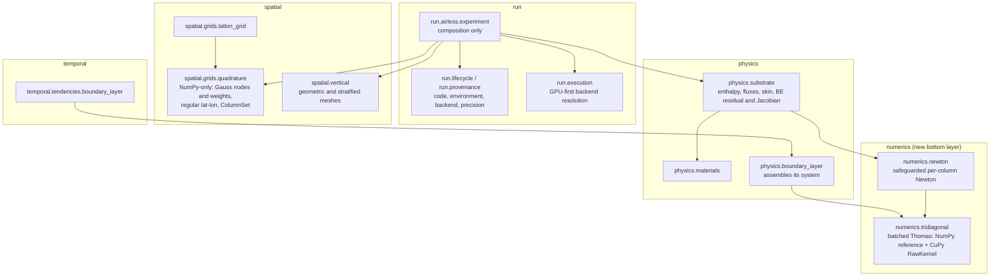

# Architectural consolidation and GPU-native substrate: audit and plan

Status (2026-11-27): **the audit is complete and the consolidation it planned
is implemented.** The audit, its measurements and the owner decisions
(D1-D9, U1-U9 and the integration ruling of section 17) are kept here as the
decision record; section 16 maps each stage to the pull request and the
commit on `main` that implemented it, and lists the acceptance items still
open. The audit baseline was `be623c7` (PR #72 merged).

Sections M to 12 are the audit as written before the implementation:
everything there is labelled **confirmed** (read in the code or measured),
a **proposal**, or an **uncertainty**, and the proposals were superseded
where sections 14 and 15 say so. The measurement tools and prototypes the
audit used are not on `main`: they target the code before the
consolidation, and one of them (`tools/cxx_proto/`) is a prototype copy of
what is now the canonical C++. They remain at the audit commits (section 13).

## M. Measurements (Tesla T4, Colab)

All production figures were taken on **Google Colab, Tesla T4** (CC 7.5, 40 SMs,
15 GiB, driver 580.82.07, CUDA 13.0, CuPy 14.0.1, NumPy 2.4.6, Python 3.13.16).
The host was an Intel Xeon @ 2.00 GHz with **2 vCPUs**. Precision is FP64
throughout, and nothing else ran on the machine. Machine-readable results
are in [`consolidation-evidence/`](consolidation-evidence/). The local GeForce
MX110 was used only for correctness checks, and none of its timings are
quoted.

**Representative state.** The Mercury VPW99 TWO production configuration
(`config_sha256 df71eaea…`) on 90 x 180 columns x 51 layers, spun up from the
configured 350 K isothermal start: 3 coarse cycles of 720 steps, then 432
production steps. State SHA-256
`ef413855553df37ba5aa1d23121526375bcbe38b1727407de8cb62b814964998`, skin
84-631 K. Every timing below starts from it, and the tools regenerate it
bitwise at the same commit.

### M1. Baseline (commit `9f8c0fb`)

`9f8c0fb` differs from `be623c7` in `src/` only by PR #73's configuration and
CLI validation (`run/airless/config.py`, `run/airless/__main__.py`). The timed
numerics (`physics/`, `run/airless/experiment.py`, insolation) are identical.

| Quantity (production grid, warm, uninstrumented) | Value |
| --- | --- |
| `run_block` (the production per-step path) | **0.1091 s/step**, median of 5 x 60 steps (0.1070-0.1122) |
| bare `ConductiveSubstrate.step` | 0.1089 s/step |
| time outside the step (insolation, accumulators, sampling) | 0.2 %, smaller than the 5 % run-to-run spread, so read it as "not resolved here", not as zero |
| Newton iterations per step | 3.73 |
| throughput | **148,000 column-steps/s**; 7.86 min per 4320-step production cycle |
| memory pool after `run_block` | 357 MB reserved (state is 6.6 MB) |
| cold first step (empty `CUPY_CACHE_DIR`) | +6.80 s compilation |
| first step with a warm on-disk cache | +0.26 s |

The historical record (`gpu-t4-2026-11-24.json`, 0.0846 s/step) is not
comparable. It used random points five steps from isothermal, at a commit
before per-step stratum extents.

### M2. Where the time goes

**Calls per step** (counted without adding synchronization):

| Per step | Count |
| --- | --- |
| residual + Jacobian assemblies | 4.73, of which 1 is never used and 3.73 recompute a residual the line search has just evaluated |
| trial residuals | 3.73 |
| tridiagonal solves | 3.73 |
| host synchronizations | 9.47 in the step (10.85 per `run_block` step, measured by Nsight) |

**Kernel census** (Nsight Systems, 20 production `run_block` steps; tracing
inflates the wall time):

| Per step | Baseline | With compiled Thomas |
| --- | --- | --- |
| kernel launches | 3,857 | 2,307 |
| device-to-device copies | 272 | 74 |
| summed kernel execution time | **75.7 ms** | **73.8 ms** |
| GPU busy / traced wall | 58 % | 84 % |

The most expensive kernels are CuPy elementwise multiply/add/divide over full
(51 x 16200) arrays: 1,008 multiplies at 17.4 ms and 322 adds at 11.9 ms.
These are memory-bound passes over materialized intermediates of the
residual/Jacobian assembly.

**Synchronized component costs** (ms/step, inclusive). The raw
`components` field of `t4-benchmark-9f8c0fb.json` is doubled by a divisor
bug fixed in `c0811f6`; the values below are halved, which is exact.

| Component | ms/step |
| --- | --- |
| Jacobian assembly | 47 |
| trial residual | 24 |
| tridiagonal | 28 |
| forcing | 0.5 |

CUDA-event spans agree within 1 ms. These are costs, not shares; their sum
is not the uninstrumented step.

**Reading.**
* At production size the step is bound by **GPU memory traffic of unfused
  elementwise assembly**, with launch overhead on top.
* At up to about 8k columns it is launch-bound. The time per Newton
  iteration stays at about 18-23 ms from 256 to 8192 columns (31-51
  layers) and rises only beyond (16200 x 51: about 1.3x; 32768 x 85: about
  3.5x).
* The fit `a + bL + cnL` misfits by up to 33 % on this 2-vCPU host. The
  measured rows in `scaling`, not the fit, are the evidence.
* Terminator batches need 3.1 Newton iterations against 2.05 for smooth
  ones (VPW99 TWO). Constant properties cost about half as much per
  iteration as VPW99.

### M3. Compiled Thomas prototype (one thread per column, `tools/colab/thomas_prototype.py`)

* **Numerics:** with contraction off it is bitwise identical to both the CuPy
  and the NumPy Thomas solves on 26 of 26 Newton systems captured from
  production and terminator steps. The patched `run_block` end state is
  bitwise identical. With FMA on, solutions differ by up to 4.1e-11
  relative.
* **Isolated solve:** 6.70 ms -> 0.461 ms (14.5x). FMA on: 0.405 ms
  (another 12 %).
* **Production `run_block`:** 0.1115 -> 0.0840 s/step (**1.33x**). As the
  census shows, it removes launch gaps but not GPU work, so it is necessary
  but not sufficient (D7).
* **Atmospheric diffusion** (the current CuPy Thomas): 9.5 ms per solve at
  both T21L40 and T42L40 (launch-bound), and 6.0 ms at T21L25. That is
  three solves per boundary-layer call; u and v share one matrix.

### M4. Fusion and single-source feasibility (D4, D7, D9)

**Finding F1: `cupy.fuse` is unusable for equivalence.** It contracts
`a - b*c` into an FMA (23 % of outputs differ from separate operations), and
CuPy exposes no option to disable that. `ElementwiseKernel(...,
options=("--fmad=false",))` is bitwise identical.

**Finding F2: `--fmad=false` changes libdevice `pow`.** Compiled that way,
`pow(x, 4.0)` and `pow(x, 3.0)` differ from CuPy's `x ** 4` / `x ** 3` in about
1 of 10^5 inputs on both the MX110 and the T4. The robust rule is to keep
CuPy's default flags and write every product as `__dmul_rn` (IEEE
round-to-nearest, never contracted). That makes the absence of FMA
explicit and independent of the flags. `--fmad=false` alone is **not** a
sufficient guarantee; this refines D5.

**Single-source laws (`tools/colab/trace_prototype.py`).** The
*unmodified* methods of `physics/materials.py` are called once with a
stand-in value that records each operation as one SSA C statement, in
Python's order. Products are emitted as `__dmul_rn`; `exp`, `expm1`, `where`,
`minimum`, `maximum` and comparisons use CuPy's own definitions, NaN
propagation included. Anything else raises `TypeError`. There is no parser,
no symbolic algebra and no simplification. On the T4, over all 826,200
production cells including breakpoint-straddling and nearly equal pairs,
**all 7 traced laws are bitwise identical to CuPy evaluating the same
methods**, under both flag settings. The laws traced are Ledlow
c_p/enthalpy, Hayne c_p/enthalpy, conductivity, its derivative and the
Kirchhoff difference. The traced kernels run 3-9x faster than the ufunc
chains. CuPy itself differs from NumPy in about 0.25 % of Ledlow values
(host libm against libdevice `exp`/`expm1`). That difference predates the
prototype and is covered by the G-GPU bound.

**Device-resident Newton (`tools/colab/fused_newton_prototype.py`).** One
kernel launch per step, one thread per column, holds the whole safeguarded
Newton iteration: assembly, the convergence test, the Thomas solve, the
positivity bound and the 30-halving line search. The laws are generated by
the tracer. The face conductance, face flux, **backward-Euler storage rate**
and cell conservation residual are written as plain Python pointwise
functions, outside the substrate in the form proposed for `physics` and
`temporal.implicit`. They are traced into the same kernel (commit `c9cb62f`).
This is the D4 demonstration: the temporal term is owned separately and
still costs no extra launch or array. The skin equation, residual
tolerances and Jacobian rows are still restated by hand, and that is the
remaining duplication. The global loop of `ConductiveSubstrate.step` is
per-column separable: converged columns are frozen by `lambda = 0`, and a
column's line search sees only its own trial. T4 results, 200 consecutive
steps each:

| Case | Production step | Fused step | Speedup | Bitwise steps | Newton counts |
| --- | --- | --- | --- | --- | --- |
| production 90 x 180 x 51 (representative state) | 111.6 ms | **20.1 ms** | **5.6x** | 200/200 | identical |
| terminator, VPW99 TWO, 16200 x 51 | 93.9 ms | 21.1 ms | 4.4x | 200/200 | identical |
| terminator, constant properties, 16200 x 31 | 31.2 ms | 4.7 ms | 6.7x | 200/200 | identical |

**Atmospheric Gauss column counts** (commit `c9cb62f`, with the traced
pointwise conservation terms; a second T4 session with the same driver
580.82.07; 200 steps each, all **bitwise for 200/200 steps with identical
Newton counts**):

| Case (terminator forcing) | Production step | Fused step | Speedup |
| --- | --- | --- | --- |
| VPW99 TWO, 2048 columns (T21 32 x 64) | 75.2 ms | **4.06 ms** | **18.5x** |
| constant, 2048 columns | 29.0 ms | 1.02 ms | 28x |
| VPW99 TWO, 8192 columns (T42 64 x 128) | 73.9 ms | 10.4 ms | 7.1x |
| constant, 8192 columns | 26.5 ms | 2.27 ms | 11.7x |
| VPW99 TWO 90 x 180, **isothermal start** (no saved state in that session; not the representative-state comparison) | 89 ms | 17.6 ms | 5.1x |

On the launch-bound atmospheric grids the gain is largest. A cold NVRTC
compile of the fused kernel takes 4.3-4.7 s (VPW99, two strata) or 2.4 s
(constant). The fused step's memory pool is 40-43 MB on the production
grid, against 357 MB for the baseline `run_block`.

The fused production step corresponds to about 810,000 column-steps/s and
1.45 min per production cycle, against 7.9 min. The kernel uses 255
registers and 6.4 KB of local memory per thread, so it is register-limited;
block size matters little (19.4-20.5 ms for 32-256 threads). Not yet done:

* the redundant assemblies are kept, deliberately, to match the
  production order bit for bit;
* the per-step report sums are not produced;
* the error flag is read back by the host once per step.

So 5.6x is a feasibility lower bound.

### M5. Proposed performance acceptance criteria (D7, for approval)

All criteria are on a Tesla T4 (Colab), at the production grid, from the
recorded representative state, with medians of at least 5 repeats. Results
from any other GPU model are reported separately and never compared with
these.

| ID | Stage | Criterion | Basis |
| --- | --- | --- | --- |
| P1 | 5 (compiled Thomas) | `run_block` <= 0.088 s/step (>= 1.25x the 0.109 baseline), bitwise end state | **measured** end to end: 1.33x, bitwise |
| P2 | 6 (device-resident Newton) | `run_block` <= **0.025 s/step** (>= 4.4x; >= 650,000 column-steps/s; <= 1.8 min per production cycle) | **extrapolated**: bare fused step measured at 18.7-20.1 ms; device-side report sums, accumulators and sampling are not yet implemented; their budget (about 5 ms) is an estimate, not a measurement |
| P3 | 6 | <= 2 host synchronizations and <= 20 kernel launches per production step (baseline 10.85 and 3,857) | **by construction** of the prototype (1 kernel plus a few CuPy forcing ops; 1 flag read-back); not yet counted by Nsight for the fused path |
| P4 | 6 | memory pool <= 120 MB after a production segment (baseline 357 MB) | **partly measured**: the fused step alone uses 40-43 MB (`t4-fused-newton-c9cb62f-*.json`); `run_block` accumulators not included |
| P5 | 5, 6 | cold-start compilation <= 10 s (baseline 6.8 s); warm cache <= 1 s | baseline **measured**; fused kernel cold compile **measured** at 4.3-4.7 s (`t4-fused-newton-c9cb62f-*.json`) (the earlier `compile_s` in `t4-fused-newton-057fe4a.json` is not a compile time; `RawKernel` compiles lazily) |
| P6 | 5 (atmosphere, after D3 equivalence) | `implicit_column_diffusion` at T21L40 <= 1.0 ms per solve (baseline 9.5 ms); u and v from one factorization | **extrapolated** from the substrate solve (0.46 ms at 52 x 16200) |
| N1 | all | bitwise state and identical per-step Newton counts against the reference CuPy path over >= 200 production steps, the terminator and constant cases, the Ceres fixture and the G-gate fixtures; where an approved decision changes the operation order, the existing bounds only (G-GPU 1e-6 K with identical Newton counts; G-B tolerances); no new thresholds | prototype **measured** bitwise for 200/200 steps (production, terminator, constant) |

A stretch figure of about 12 ms/step (removing the redundant assemblies and
tuning registers) is a goal, not a gate.


## 1. Current ownership (confirmed)

| Responsibility | Current owner | Notes |
| --- | --- | --- |
| Physical system specification (airless) | `run/airless/config.py` (`AirlessConfig`, presets) | Mercury constants and THAI-free; good |
| Constitutive laws | `physics/materials.py` (`Stratum`, heat-capacity laws, `CellMaterials`) | Cancellation-resistant divided differences; good |
| Vertical mesh generation | split: `physics/substrate.py::geometric_interfaces` and `physics/materials.py::stratified_interfaces` | Import cycle `materials -> substrate` (function scope), already reported in `docs/architecture/current/modules-cycles.mmd` |
| Horizontal columns (airless) | `run/airless/experiment.py::build_columns` | Private regular lat-lon, south to north, cell-centred lon; unit weights for points |
| Horizontal grids (atmosphere) | `spatial/grids/latlon_grid.py::GaussLatLonGridGeometry` | Gauss nodes north to south, lon nodes from 0; **imports CuPy at module load** |
| Gauss-Legendre nodes | `np.polynomial.legendre.leggauss` called in 6 places | `latlon_grid.py`, `held_suarez_sections.py`, `viewer_fields.py`, `viewer_diagnostics.py`, `held_suarez/report.py`, and `radiation/kdist.py` (g-space, a different use) |
| Time discretization (substrate) | inside `ConductiveSubstrate._system` | Backward Euler hard-wired into the residual |
| Nonlinear solve | inside `ConductiveSubstrate.step` | Newton, positivity bound, 30-halving line search, per-column masks, `SubstrateSolveError` |
| Tridiagonal solve | `physics/substrate.py::_tridiagonal` and `physics/boundary_layer.py::implicit_column_diffusion` | Two Thomas implementations in different elimination forms |
| CUDA kernels | `spatial/transforms/cuda/*.cu` (RawModule), `physics/monin_obukhov_cuda.py` (RawKernel, opt-in, physics restated in CUDA) | No numerical-solver CUDA code |
| Execution backend | `run/airless/experiment.py::_backend`; atmospheric runners import CuPy unconditionally | Airless defaults to NumPy everywhere |
| Run provenance | `run/held_suarez/experiment.py::code_identity, environment_identity` | Imported by the airless and radiative runners |

## 2. Confirmed duplications and defects

1. **Two batched Thomas solvers.** `substrate._tridiagonal` (general
   `lower/diag/upper/rhs`, forward `c', d'` form) and
   `boundary_layer.implicit_column_diffusion` (assembles a symmetric M-matrix
   from conductances, then eliminates with `b', d'` multipliers). Both are
   Python loops over levels launching several CuPy kernels per level. Their
   arithmetic differs, so one canonical solver **changes the rounding of one of
   them** (see decision D3).
2. **u and v factorize the same matrix twice** in
   `temporal/tendencies/boundary_layer.py` (`implicit_column_diffusion` is
   called separately for u and v with `conductance_m`).
3. **Vertical mesh code split across two physics modules** with a
   function-scope import cycle.
4. **Gauss nodes recomputed in five places** outside the grid class, each with
   its own ordering conversion (`argsort(-x)`, `[::-1]`, `arcsin` vs `arccos`).
5. **Redundant Newton work (measured counts, section M2).** Each Newton pass
   re-assembles the residual at the point the line search has just evaluated,
   and the final pass assembles a Jacobian that is never used.
6. **Provenance records the wrong hardware for CPU runs.**
   `environment_identity()` imports CuPy, initializes CUDA and records the GPU
   name even for a NumPy-backend run, and records no precision. A CPU
   verification run on a GPU machine is labelled with the GPU.
7. **Run helpers owned by an experiment.** Airless and radiative runners import
   `RunError`, `code_identity`, `environment_identity` from
   `run/held_suarez/experiment.py`. `run/lifecycle.py` exists and is the
   natural owner.
8. **The historical T4 profile treats instrumented components as shares.**
   `gpu-t4-2026-11-24.json` decides against a CUDA solver because the Thomas
   solve is "~31% of the instrumented step"; its own figures sum to more than
   the uninstrumented step (0.0659 + 0.0338 > 0.0846 s). It also profiled
   random points five steps from an isothermal start, and the step has since
   gained per-step stratum extents. It is superseded by section M.

9. **Diagnostic points are reported as global quantities.** See section 11;
   every weighted airless diagnostic is affected for point runs.

## 3. Implicit and experiment-specific defaults (confirmed)

Classification: 1 universal constant, 2 mathematical/numerical invariant,
3 constitutive-law parameter, 4 material-specific empirical, 5
experiment-specific physical, 6 discretization/solver configuration, 7 internal
reference.

| Where | Default | Class | Proposal |
| --- | --- | --- | --- |
| `ConductiveSubstrate.constant` | C = 2e6 J m^-3 K^-1 | 4/5 (THAI sand) | remove default; THAI config owns it |
| `ConductiveSubstrate.constant` | I = 2000 (k = 2) | 4/5 (THAI) | remove default |
| `ConductiveSubstrate.constant` | depth 3.5 m, top 2 cm, 30 layers | 5/6 (THAI/Ben 2 plan) | remove defaults; mesh is an explicit argument |
| `ConductiveSubstrate.__init__` | albedo 0, emissivity 1 | 5 | required |
| `ConductiveSubstrate.__init__` | bottom_heat_flux 0 | 5 | required (0 is a legitimate explicit value) |
| `ConductiveSubstrate.__init__` | initial_temperature 300 K | 5, **coincides with** the class-7 enthalpy reference | required; moves to the experiment; never inferred from the reference |
| `ConductiveSubstrate.__init__` | max_iterations 50 | 6 | solver configuration object with explicit defaults recorded in the signature |
| `ENERGY_REFERENCE_TEMPERATURE` | 300 K | 7 | keep (internal; anomalies are relative to it) |
| `TOLERANCE_FLOOR`, `TOLERANCE_ROUNDOFF` | 1e-9 W m^-2, 64 eps | 6, frozen by G-B | keep values; move to the solver configuration |
| line search | 30 halvings, factor 1/2 positivity bound | 6/2 | keep; solver configuration |
| `_MAX_STRETCH` | 1.5 | 6 (regolith spec) | keep in the mesh generator |
| `Stratum.radiative_reference_temperature` | 350 K | 3/4 (VPW99/Hayne T_r convention) | required; `strata_from_dicts` must not fill it silently |
| `Stratum.volumetric` | density 1, c_p = C | 2 (only rho c_p enters) | keep, documented |
| `SIGMA_SB`, `AU_M`, `L_SUN_W`, `GM_SUN` | | 1 | keep |
| `_mercury` | 90 x 180 columns, periodicity thresholds, 720/180 samples, R | 5/6 Mercury experiment | already experiment-owned (preset) |
| `SlabSurface` | albedo 0, emissivity 1 | 5 | required |
| `run/radiative/config.py` THAI/Mars | slab `heat_capacity` 2e6 / 1e7 / 2 rho c_p | 5 | unchanged here; a substrate option is §11 work |

Only tests call `ConductiveSubstrate.constant` (`test_substrate.py`,
`test_substrate_gpu.py`, `audit_substrate_gates.py`); one test relies on all
its defaults (`test_substrate.py:185`).

## 4. Dependency constraints (confirmed)

* Declared layers, top first: `cli > run > representation > temporal > spatial
  > physics` (`tools/architecture/layers.py`, enforced for run-time imports by
  `tests/test_layout.py`). **Physics is the bottom layer and imports nothing
  from `tropoi` outside `physics`.** A canonical solver or mesh placed in
  `spatial` or `temporal` cannot be called from `physics.substrate`.
* `tropoi.spatial` and `tropoi.spatial.grids` import without CuPy;
  `spatial/grids/latlon_grid.py`, `spherical_backend.py`, `planet.py` and the
  transforms import CuPy at module load.
* CPU CI installs no CuPy. Import-light modules (`physics/*`, `run/airless/*`,
  `spatial/grids/__init__`) must stay importable and must not initialize CUDA.

### Before (relevant modules; solid = module-level import, dashed = function scope)

```mermaid
flowchart TB
  subgraph run
    AM[run.airless.__main__] --> AE[run.airless.experiment]
    AM --> AC[run.airless.config]
    AE --> AC
    AE --> HS[run.held_suarez.experiment<br/>code/environment identity]
    RE[run.radiative.experiment] --> HS
  end
  subgraph temporal
    TBL[temporal.tendencies.boundary_layer]
    CC[temporal.column_coupling]
  end
  subgraph spatial
    GLL[spatial.grids.latlon_grid<br/>Gauss nodes, imports CuPy]
  end
  subgraph physics
    SUB[physics.substrate<br/>mesh + backward Euler + Newton + Thomas]
    MAT[physics.materials<br/>laws + stratified mesh]
    BL[physics.boundary_layer<br/>second Thomas]
    MOC[physics.monin_obukhov_cuda<br/>RawKernel]
    INS[physics.insolation]
    SURF[physics.surface<br/>SlabSurface]
  end
  AE --> SUB
  AE --> INS
  AC --> MAT
  SUB --> MAT
  MAT -.-> SUB
  TBL --> BL
  TBL --> MOC
  CC -. physics.surface.advance .-> SURF
  AE -. private build_columns .-> AE
```

## 5. Proposed canonical owners and interfaces (proposal)

The diagram shows the first proposal. After decisions D1-D9 and the M4
feasibility results, the final structure (adding `numerics.codegen`,
`numerics/cuda` and `temporal.implicit`) is in section 12.



* **D1 `tropoi.numerics`, a new bottom layer.** It is import-light (NumPy at
  import, CuPy only inside the CUDA implementation) and knows nothing about
  physics. `numerics.tridiagonal.solve(lower, diag, upper, rhs)` is the one
  batched solver. Its contract: axis 0 is the vertical and columns are
  contiguous along axis 1, FP64, no pivoting, and the caller guarantees
  stability (diagonal dominance or an M-matrix). Arrays go through a NumPy
  reference or a compiled CUDA kernel chosen by the array type. Callers never
  see CUDA. Multiple right-hand sides share one factorization, which the u/v
  diffusion needs. `numerics.newton` owns the iteration, the positivity bound,
  the backtracking, the per-column masks and the convergence-failure report.
  The physics supplies `residual(x) -> (r, tau, cache)` and
  `jacobian(cache) -> (l, d, u)`, so the Jacobian is only assembled when a
  step is taken, from intermediates already computed for the residual.
  The alternative, keeping the solvers in `physics`, contradicts the
  assignment's first principle.
* **Spatial.** `spatial/grids/quadrature.py` (NumPy-only) owns
  Gauss-Legendre nodes and weights (one `leggauss` call site), regular
  cell-centred lat-lon cells and their exact areas, and a `ColumnSet` with lat,
  lon, ordering, `kind = "global" | "diagnostic"`, and physical weights
  `W_ij = R^2 (2 pi / N_lon) w_i` (sum 4 pi R^2) or none at all for diagnostic
  points. `GaussLatLonGridGeometry` takes its nodes from there. The airless
  `columns` spec gains `{"kind": "gauss", "nlat", "nlon"}` with exactly the
  atmosphere's ordering (north to south, lon nodes from 0) and no spectral
  truncation. Diagnostic point runs report no "global" integrals; today they
  silently use unit weights.
* **Vertical mesh.** `geometric_interfaces` and `stratified_interfaces` move
  to `spatial/vertical.py`. `ConductiveSubstrate` takes explicit `interfaces`
  only, and the run layer builds them. This removes the import cycle.
* **Temporal boundary (section 8; see D4 and section 12).** Superseded by
  the generated-fusion design in section 12. The physics owns pointwise
  storage, flux and skin functions; the backward-Euler composition is owned
  outside physics; both are traced into one kernel. Logically separate,
  computationally fused.
* **Backend policy (section 7).** One resolver `run/execution.py` with
  production default CuPy/CUDA. It fails promptly with an explanation when
  CUDA is unavailable and never falls back. The CPU path stays: the airless
  CLI keeps a developer flag hidden from `--help` (`argparse.SUPPRESS`) and
  documented in `tests/README.md` and the developer section of
  `docs/ARCHITECTURE.md`; the Python API keeps `backend="numpy"` as an
  explicit argument; and `TROPOI_EXECUTION=cpu-verification` serves
  subprocess tests. The flag name must not be `--backend`, which the main
  `tropoi` CLI already uses for the grid family (D6). Provenance records the
  actual backend, the device only when the backend is CUDA, the CPU model
  for CPU runs, and `precision: float64`. `environment_identity` must not
  initialize CUDA for a CPU run.

## 6. Files and implementations to remove (proposal)

`physics/substrate.py::_tridiagonal`; the elimination loop of
`physics/boundary_layer.implicit_column_diffusion`, which keeps only its
assembly; `geometric_interfaces`/`stratified_interfaces` in physics (moved);
`ConductiveSubstrate.constant`'s defaults, or the constructor itself if a
`Stratum.volumetric` plus explicit mesh covers every caller; the
`top_thickness/max_stretch` path of `ConductiveSubstrate.__init__`; private
`build_columns` grid code (moved to `spatial`); the five ad hoc `leggauss`
call sites; and `tools/planet_one/gpu_profile.py`, superseded by
`tools/colab/substrate_benchmark.py`.

## 7. Migration and verification strategy (proposal)

Stages as in the assignment. Each is a separate PR with its own evidence.

1. Correctness fixes: **PR #73** (done; awaiting merge approval).
2. Consolidation without arithmetic change. Newton and Thomas move to
   `numerics` with identical operation order, as does the mesh. Gate: bitwise
   equal end states for the G-gate fixtures, the Ceres fixture, the VPW99
   point runs and the CPU/GPU parity tests. The redundant-assembly removal
   (M2) belongs here. It is arithmetic-preserving, so it is also gated
   bitwise.
3. Spatial `quadrature`/`ColumnSet`/`gauss` columns. Gates: the weights sum
   to 4 pi R^2 to round-off, `GaussLatLonGridGeometry` is bitwise unchanged,
   and existing lat-lon airless runs are bitwise unchanged.
4. Defaults removal; callers migrated. Gate: the THAI-constant tests take
   explicit values and their results are bitwise unchanged.
5. Compiled CUDA tridiagonal solver behind `numerics.tridiagonal`, with
   no contraction: every product is `__dmul_rn`, under default flags
   (F2). Gate: bitwise against the NumPy reference and the old
   CuPy path on captured systems and on full runs. The boundary layer follows
   only after decision D3.
6. Fusion and synchronization reduction (section M4). Gate: for kernels
   that restate physics in CUDA, bitwise where the operation order is kept,
   otherwise the existing G-GPU bound (1e-6 K, and identical Newton counts);
   no new thresholds.
7. GPU-first defaults; tests, docs and the CLI migrated together.
8. Final regression: full CPU suite, the GPU suite on the T4 via the CUDA
   regression notebook, G-gates, Ceres replay, VPW99 point runs and a T4
   benchmark rerun.

## 8. Future atmosphere-substrate coupling (findings and constraints, no implementation)

Confirmed in `physics/column_model.py`, `physics/surface.py` and
`temporal/column_coupling.py`:

* The surface contract is explicit: `surface.advance(T_s, surface_net, dt)`
  (`SlabSurface`: `T_s + dt/C * F`). The substrate's
  `step(state, dt, shortwave_down, longwave_down, flux, flux_derivative)` is
  already the implicit, linearized-flux form that coupling needs.
* The implicit sensible exchange `F' = F / (1 + k (w/Ca + s/Cs))` reads
  `self.surface.heat_capacity`, a slab-only quantity. A substrate has no
  single heat capacity. Its implicit response is the skin row of its Newton
  system, `flux_derivative = -k`, and the flux it actually absorbs is
  `F_0 + a (T_s^{n+1} - T_ref)`. For equal and opposite exchange, the air
  must receive that realized flux. That fixes the order: substrate step,
  then air heating. A coupled implicit solve is the alternative; it would
  border the tridiagonal system and is why `numerics.tridiagonal` must not
  be assumed to be the final coupled solver.
* Radiation computes the upwelling longwave from `eps sigma T_s^4` at the
  **old** skin temperature, while the substrate emits `eps sigma T_s^4` at the
  **new** one. Coupled naively, the energy the atmosphere receives and the
  energy the surface loses differ by `eps sigma (T_s^{n+1,4} - T_s^{n,4})`.
  A conservative coupling must either pass the substrate's realized emission
  to the atmosphere as its lower-boundary source, or linearize the emission
  and account for the difference. This is a design decision for the coupling
  stage (D8), not a defect today.
* `SlabSurface` validates `emissivity in (0, 1]`, the substrate `[0, 1]`.
* Columns: the atmosphere's surface state lives on its state grid
  (`GaussLatLonGridGeometry`, north to south, lon nodes from 0, lat-major
  C order). A substrate on the same `ColumnSet` therefore needs no
  reordering and no host transfer. Both arrays are CuPy (L, npts) with
  npts contiguous.
* Shortwave and longwave are needed separately (albedo and emissivity
  apply to each). The radiation scheme already holds both at the surface in
  `fluxes`.

## 9. Owner decisions (2026-11-27) and how they change the plan

| | Ruling | Approved principle | Conditionally approved / open detail |
| --- | --- | --- | --- |
| D1 | **Approved** | `tropoi.numerics` is a new import-light bottom layer, independent of planetary physics, owning reusable algorithms and their hardware-specific implementations | module layout (section 12) |
| D2 | **Approved** | vertical meshes move to canonical spatial infrastructure; the substrate receives explicit interfaces | - |
| D3 | **Approved in principle** | one canonical Thomas implementation; historical experiments stay with their commits | numerical equivalence must be established and documented **before** atmospheric callers migrate |
| D4 | **Conditional** | temporal discretization is logically separate from physics; no elaborate integrator framework; the Newton solver receives admissibility constraints from its caller | how to separate it while staying fused: section 12 proposes generated fusion, which M4 shows is feasible |
| D5 | **Approved, FMA off initially** | equivalence and performance first without contraction; FMA later as a separately justified optimization | refined by F2: "FMA off" is implemented as explicit `__dmul_rn` products with default flags |
| D6 | **Approved** | GPU default production experience; hidden `--device cpu` plus `TROPOI_EXECUTION=cpu-verification`; actual execution recorded; no silent fallback | precedence rule (section 12) |
| D7 | **Pending** | device-resident Newton and fused assembly to be investigated: done (M4) | criteria M5 await approval |
| D8 | **Approved as a conservation requirement** | equal and opposite realized fluxes with consistent temporal integration; the radiation emission mismatch is an explicit acceptance requirement of the coupling stage | no coupling algorithm is chosen; coupled implicit, iterative and partitioned schemes all stay open |
| D9 | **Further investigation** | no two independently maintained definitions of constitutive physics | answered by M4: single-source generation from the existing Python methods is practical and bitwise; the remaining question is its production form (section 12) |

## 10. Risks

* **Scientific:** the G-gates and VPW99 point evidence rely on bitwise
  reproduction. Every stage that keeps the operation order must be gated
  bitwise. Stages that change it (D3, D5, fusion) need explicit,
  pre-registered parity criteria taken from existing bounds; none are
  invented here.
* **Computational:** the T4 host has 2 vCPUs. A launch-bound step is
  sensitive to host load and to the Colab image, so timings are only
  comparable on the same GPU model and image, and repeats are reported as
  median and range.
* **Sunrise:** terminator columns need more Newton iterations and
  line-search trials. Under per-column masks the whole batch waits for the
  slowest column. Fusion moves that wait to the device but does not
  remove it.

## 11. Global quadrature: correctness finding and proposed fix (separate PR)

**Confirmed.** A point collection gets unit weights (`build_columns`), and
every weighted diagnostic then presents an unweighted sum or average under a
global name:

| Where | Quantity | What it is for points |
| --- | --- | --- |
| `run_block` -> `series/cycle-*.npz` | `energy_tendency`, `net`, `residual`, `tolerance` ("per-step area-weighted global scalars") | a plain **sum** of W m^-2 over points (neither a mean nor an integral) |
| `_cycle` | the same four, summed over blocks | the same |
| `_diagnostics` -> `cycles.json`, `events.jsonl` | `mean_absorbed_W_m2`, `mean_emitted_W_m2` | the unweighted point average, named a mean |
| `_diagnostics` | `global_residual_over_tolerance` | a ratio of unweighted sums, named global |
| `grid.npz` | `weights` ("area weights") | ones |
| `tools/planet_one/build_view.py` | `mean_absorbed`, `mean_emitted` | the unweighted average |

Lat-lon runs are correct: the exact cell areas sum to 4 pi R^2 to 1 ulp, and
the Gauss weights `R^2 (2 pi/N_lon) w_i` likewise (verified for 32 x 64,
64 x 128, 90 x 180). No committed evidence quotes a point-run mean; the
quoted global values (`global2-gpu-t4.json`) are from a 90 x 180 lat-lon run.

**Proposed fix (stage 1b, its own PR, before stage 2).**

* A column collection has `kind = "global"` (area weights that sum to
  4 pi R^2, verified at construction) or `kind = "diagnostic"` (no weights).
* For diagnostic points:
  * `grid.npz` stores no `weights` and records the kind;
  * the series are stored **per point**, which is cheap for a few points;
  * `cycles.json` carries per-point absorbed, emitted and residual/tolerance
    and no `mean_*` or `global_*` keys;
  * `build_view.py` refuses to compute or label a mean.
* Global runs keep the same names, and their values stay bitwise
  unchanged.
* Analytical regression tests:
  1. a uniform field has weighted mean equal to the field value and
     integral equal to 4 pi R^2 times it, exactly, on regular and Gauss
     grids;
  2. `f = sin(phi)` integrates to zero (to round-off);
  3. `f = sin^2(phi)` has mean exactly 1/3 on a Gauss grid (a degree-2
     polynomial in sin(phi)); on the regular midpoint grid its error matches
     the closed-form O(dphi^2) value;
  4. a point run writes no global keys and per-point series that equal the
     per-column integrals;
  5. a lat-lon run's `cycles.json` and series are bitwise unchanged.

## 12. Final implementation plan (for approval; not yet authorized)

**Canonical structure.**

```text
tropoi/numerics/                 (new bottom layer, D1; NumPy at import)
  tridiagonal.py                 solve(lower, diag, upper, rhs[, nrhs]) NumPy reference + CUDA
  newton.py                      per-column safeguarded Newton (NumPy reference driver)
  cuda/columns.py                column-kernel driver template (Thomas, Newton, backtracking)
  codegen.py                     the tracer: Python pointwise functions -> __device__ code
tropoi/spatial/grids/quadrature.py   Gauss and regular nodes, weights, ColumnSet (NumPy only)
tropoi/spatial/vertical.py           geometric and stratified interfaces (D2)
tropoi/physics/materials.py          laws (unchanged arithmetic; traced, never restated)
tropoi/physics/substrate.py          pointwise storage/face/skin functions + Jacobian partials;
                                     an admissibility function (positivity of absolute T)
tropoi/temporal/implicit.py          backward-Euler composition of a pointwise conservation
                                     law (one small function, traced into the same kernel)
tropoi/run/execution.py              backend resolution and provenance (D6)
```

**How D4 and D9 would be met (proposed; partly demonstrated).** M4
demonstrates two things, both bitwise. The tracer generates the seven
material laws, and it generates four pointwise conservation-law functions,
the backward-Euler storage term among them. Still undemonstrated:

* the skin and Jacobian functions in pointwise form;
* the NumPy/CuPy path rewritten over those same functions (today the
  production `_system` is untouched);
* a production `numerics.codegen` with defined coverage and failure
  modes.

* The substrate's `_system` is rewritten as pointwise functions of a cell
  or a face: storage `C [h(T) - h(T^n)]`, face flux and its two partials,
  the skin balance and its partials. Each is written once in Python.
* The NumPy/CuPy path applies them to shifted array views. The same
  arithmetic, in the same order, therefore stays the CPU reference and
  the CuPy reference.
* `numerics.codegen` traces the same functions into `__device__` code for
  the column kernel, so no physics is written in CUDA. The CUDA in
  `numerics/cuda` is the generic driver: level loops, Thomas, Newton
  passes, and backtracking against a caller-supplied admissible step
  fraction. It contains no physics.
* The backward-Euler composition lives in `temporal/implicit.py`, outside
  physics, and is traced into the same kernel. That gives logical
  separation without extra launches or materialized arrays.
* Positivity is supplied by the substrate as its admissibility function, not
  assumed by the solver.

The one hand-written piece that remains is the driver template. It belongs
to numerics and is verified against `numerics.newton`, its NumPy
reference, bitwise.

**Stages** (each its own PR, gated as in section 7 and criterion N1):

1. Done: PR #73 (PR #72 review fixes). **1b:** the global-quadrature fix
   (section 11).
2. `numerics` layer. Move Newton and Thomas with identical arithmetic.
   Admissibility comes from the caller. Remove the redundant assemblies.
   Gate: bitwise.
3. `spatial.grids.quadrature`, `ColumnSet`, `{"kind": "gauss"}` airless
   columns, `spatial.vertical`, and `GaussLatLonGridGeometry` taking its
   nodes from quadrature. Gates: bitwise; sums of 4 pi R^2;
   airless/atmosphere coordinate, ordering and weight identity.
4. Defaults removed (section 3); `Stratum.radiative_reference_temperature`
   required; callers migrated. Gate: bitwise.
5. Compiled Thomas behind `numerics.tridiagonal` (P1, N1). Boundary layer
   after its equivalence study (D3, P6).
6. Pointwise substrate physics, `numerics.codegen`, the device-resident
   Newton column kernel, device-side report sums, and 1 synchronization per
   step (P2-P5, N1).
7. GPU-first execution policy (D6). Tests, docs, notebooks and the CLI
   migrated together; provenance records backend, device and precision;
   `environment_identity` does not initialize CUDA for CPU runs.
8. Final regression: full CPU suite, the T4 CUDA regression notebook,
   G-gates, the Ceres replay, VPW99 point runs, and a T4 benchmark rerun
   against M1.

**Remaining decisions for the owner.**

* **U1 (D4/D9 production form).** Approve the generated-fusion design
  above: pointwise physics, `numerics.codegen` and a physics-free CUDA
  driver. It is demonstrated bitwise for the laws and four pointwise
  conservation terms; the skin, Jacobian and vectorized-path rewrite
  remain to be shown. The alternative is a controlled hand restatement with
  parity tests (the `monin_obukhov_cuda` precedent). Recommended: generated,
  with the stage 6 gate as the proof.
* **U2 (failure detection).** The device-resident step reads a per-column
  failure flag once per step: 1 synchronization, and the error is raised
  at the same step as today. Deferring the check to segment end saves that
  synchronization, but raises the error late. Recommended: once per step.
* **U3 (report sums).** The per-step energy-identity sums
  (`energy_tendency`, `residual_sum`, `tolerance_sum`) summed in level
  order on the device are not bitwise equal to CuPy's tree reductions.
  The options are to accept them under the existing identity bound
  `|residual_sum| <= tolerance_sum` (no new threshold), or to keep CuPy
  reductions over kernel-written arrays (a few more launches, bitwise).
  Recommended: bitwise first, then measure.
* **U4.** The performance criteria P1-P6 and N1 (D7).
* **U5.** The global-quadrature fix interface (section 11): per-point
  series and no global keys for diagnostic points.
* **U6 (D6 precedence).** Explicit `--device`, then
  `TROPOI_EXECUTION=cpu-verification`, then the CUDA default. A conflict
  between the flag and the environment variable is an error, and there is
  never a fallback.

## 13. Tools and evidence index

The tools are at the audit commit `6e55235` (reachable through this pull
request's head, `refs/pull/74/head`; for example `git show
6e55235:tools/colab/substrate_benchmark.py`). They use the APIs from before
the consolidation and do not run at later commits. The current tools are
`tools/colab/substrate_gate.py` and `tools/colab/substrate_nsys.py`.

| File (at `6e55235`) | Purpose |
| --- | --- |
| `tools/colab/substrate_benchmark.py` | baseline, counts, components, scaling, compile, Thomas, diffusion |
| `tools/colab/substrate_benchmark_colab.py`, `notebooks/substrate_benchmark_colab.ipynb` | commit-pinned Colab launch (asserts HEAD); the notebook is kept on `main` |
| `tools/colab/substrate_nsys.py` (the M2 version, at `f5ec2b0`) | Nsight Systems kernel census; superseded by the differencing census of section 15 |
| `tools/colab/thomas_prototype.py` | compiled Thomas (non-production) |
| `tools/colab/trace_prototype.py`, `trace_check.py` | single-source law tracing and its bitwise check |
| `tools/colab/fused_newton_prototype.py`, `fused_check.py` | device-resident Newton step and its bitwise check |
| `tools/cxx_proto/` (at `61cf94f`) | the portable C++ feasibility prototype of section 14 |

| Evidence (`docs/validation/consolidation-evidence/`) | Purpose |
| --- | --- |
| `t4-benchmark-9f8c0fb.json` | M1-M3 (the `components` field is doubled; see M2) |
| `t4-nsys-*-f5ec2b0.json` | M2 census |
| `t4-trace-057fe4a.json`, `t4-fused-newton-057fe4a.json` | M4 (its `compile_s` values are **not** compile times: `RawKernel` compiled lazily, outside the timer; fixed in `c9cb62f`) |
| `t4-fused-newton-c9cb62f-{2048,8192}.json` | M4 at the T21/T42 Gauss column counts, with the traced pointwise terms, cold compile and the memory pool |
| `t4-cxx-61cf94f-{2048,8192}.json`, `mx110-cxx-correctness-61cf94f.json` | section 14: the C++ prototype on the T4 and its correctness on the MX110 |

The implementation's own evidence (the migration gates, censuses and
timings of each stage) is listed in that directory's `README.md`.

The representative state itself (6.6 MB) is regenerated by the gate
(`tools/colab/substrate_gate.py`); a local copy is kept under the ignored
`runs/consolidation/`.

## 14. U1 reopened: tracer, portable C++ or hybrid (2026-11-27)

The owner asked for portable C++ as a candidate canonical language for the
substrate's computational physics and numerical algorithms. The feasibility
prototype is in `tools/cxx_proto/` (commit `61cf94f`; not on `main`, see section 13). It is not production
code, and nothing in `src/` changed.

### 14.1 What the prototype is

```text
include/pt/portable.h            65 lines: host/device macros, a `real` type whose `*`
                                 is __dmul_rn on the device and a plain IEEE product on
                                 a host built with -ffp-contract=off; exp/expm1/pow/abs,
                                 NaN-propagating minimum/maximum, where
include/pt/numerics/thomas.h     batched-column Thomas (no physics)
include/pt/numerics/newton.h     safeguarded per-column Newton; the Problem supplies the
                                 residual, Jacobian and the admissible step fraction
include/pt/physics/materials.h   Poly<N>, SatExp, Piecewise<Low, High>; conductivity, its
                                 derivative, the Kirchhoff difference
include/pt/physics/substrate.h   pointwise substrate terms, tolerances, partials, and the
                                 substrate's own admissibility (positivity of absolute T)
include/pt/temporal/backward_euler.h  BE composition of the finite-volume conservation
                                 law with the skin: the Problem given to Newton
drivers/column_step.h, cuda_driver.cu, host_driver.cpp.in   one column; CUDA (one thread
                                 per column, NVRTC via CuPy) and host (a loop) drivers
cxx_substrate.py                 Python glue: law objects -> template type + flat
                                 coefficients; compile, cache, launch
```

The header include structure keeps the dependency direction: numerics
includes only `portable.h`; physics includes materials; temporal knows its
Physics only as a template parameter; and the drivers compose all three.
Python generates no source. It only names a specialization, for example
`substrate_step<51, pt::Piecewise<pt::Poly<5>, pt::SatExp>, ...>`, with the
law coefficients passed at run time.

### 14.2 Results

**GPU (Tesla T4, Colab; empty kernel caches; 200 steps per case)**

| Case | CuPy production | Tracer kernel | **C++ CUDA** | C++ / tracer | C++ CUDA vs CuPy |
| --- | --- | --- | --- | --- | --- |
| 90 x 180 x 51, isothermal start | 90.3 ms | 20.4 ms | **21.2 ms** | 1.04 | bitwise 200/200, Newton counts identical |
| VPW99 terminator, 2048 columns (T21) | 58.8 ms | 4.40 ms | **4.48 ms** | 1.02 | bitwise 200/200 |
| VPW99 terminator, 8192 columns (T42) | 59.7 ms | 10.6 ms | **11.2 ms** | 1.06 | bitwise 200/200 |
| constant, 2048 columns | 25.7 ms | 1.20 ms | 1.36 ms | 1.14 | bitwise 200/200 |
| constant, 8192 columns | 25.2 ms | 2.50 ms | 2.87 ms | 1.15 | bitwise 200/200 |

Both kernels use 255 registers. The C++ kernel uses slightly more local
memory: 6,752 bytes against 6,400 (3,184 against 2,720 for constant
properties). The generic Newton driver keeps separate trial, right-hand-side
and step buffers, and that explains the 2-15 % difference. Cold NVRTC
compilation per specialization takes 3.5-5.8 s for C++ and 2.3-5.6 s for the
tracer.

**Native CPU** (no CUDA headers or libraries; `-O2 -std=c++14
-ffp-contract=off`)

| Environment | C++ host vs NumPy production | C++ host vs C++ CUDA |
| --- | --- | --- |
| WSL; clang 22 (`ziglang`, pip-installed: the machine has no system C++ compiler); NumPy 2.2.6; CPU without AVX-512 | **bitwise** in all 3 cases (3 steps each, MX110 run) | differs by <= 1.7e-13 K |
| Colab T4 VM; g++ 13.3; NumPy 2.4.6 | differs by <= 1.7e-13 K in every step (10 steps per case); **Newton counts identical** | <= 1.7e-13 K |

Single-threaded, the host build is 2.4-3.4x faster than the NumPy
production step (for example 600 ms against 1,456 ms on the production
grid).

### 14.3 Numerical equivalence, classified as the owner asked

* **Mathematical equivalence: established by construction.** The same
  formulas appear in the same operation order, line by line against
  `materials.py` and `ConductiveSubstrate._system`.
* **Bitwise reproducibility in a pinned environment: established.** The
  CUDA build matches the CuPy production path bit for bit on a T4, and on
  the MX110 for all cases. The host build matches NumPy bit for bit on the
  WSL environment.
* **Numerical equivalence within approved bounds, across host
  environments: established.** C++ host against NumPy on the Colab VM, and
  C++ host against C++ CUDA everywhere, differ by at most 1.7e-13 K (a few
  ulp at 300-700 K) with identical Newton counts. That is about 7 orders of
  magnitude inside the G-GPU bound (1e-6 K). A state difference of a few
  ulp cannot move a residual across the G-B tolerances (floor 1e-9
  W m^-2).
* **Origin of the Colab host difference: not an implementation error.**
  The same build is bitwise against NumPy on WSL, and the CUDA build is
  bitwise against CuPy. The remaining candidates are host math-library
  rounding or dispatch (NumPy 2.4 against 2.2; the glibc version) and
  compiler code generation (g++ 13 against clang 22).
  * A CPU-only Colab runtime (no AVX-512) showed NumPy `exp`, `expm1` and
    `x**4` identical to glibc on 200,000 inputs.
  * The same check on a T4 VM did not finish within its time limit.
  * Which of these paths differs on the T4 VM is therefore **not
    established**. Per the owner's instruction it is not pursued further.
  * No NumPy-specific emulation is proposed.
* **CuPy against NumPy (existing).** These already differ in about 0.25 %
  of Ledlow values (`exp`/`expm1` in libdevice against libm). The C++
  host/CUDA difference is the same phenomenon, not a new one.

### 14.4 Comparison

| Criterion | 1. Python-to-CUDA tracer | 2. Portable C++, CPU and CUDA drivers | 3. Hybrid (C++ only for hot subsystems) |
| --- | --- | --- | --- |
| Numerical equivalence and FP control | bitwise against CuPy (laws, 4 pointwise terms, full step); FP control through emitted `__dmul_rn` | bitwise against CuPy (full step) and against NumPy in a pinned host environment; FP control is explicit in 65 lines (`real`, `-ffp-contract=off`) | as 2, for the C++ parts |
| End-to-end GPU performance | 4.40-20.4 ms (reference) | 2-15 % slower than the tracer; meets P2 on the bare step (21.2 ms < 25 ms budget) | as 2 |
| Specialization and fusion | trace-time: one kernel per configuration | compile time: templates on L and law types, one kernel per configuration; no source generation | as 2 |
| Material-law extensibility | a new law is a Python method, traced automatically if it uses only supported operations; anything else fails at trace time | a new law **family** is a C++ struct (about 20-40 lines) plus a Python descriptor; new **coefficients** need nothing | as 2 |
| Native CPU without CUDA | no: the generated code is CUDA only; the CPU path is the separate NumPy code (two implementations of the physics) | **yes**: the same headers; no CUDA dependency | as 2 |
| Python bindings and CuPy interoperability | none needed (CuPy RawKernel) | device: none (NVRTC through CuPy, raw pointers); host: a small C ABI (ctypes in the prototype; an extension module in production) | as 2 |
| Installation, packaging, CI | pure Python | **device needs no build**: headers ship as package data and NVRTC compiles them at run time. The host needs a compiled library, so a build backend and platform wheels or a compiler at install. CI (ubuntu, g++) can build and test the host path without a GPU | as 2, but two build styles side by side |
| Colab compatibility | yes | yes: Colab has g++ 13 and NVRTC; nothing to install | yes |
| Compilation caching, reproducibility | CuPy cache keyed by generated source | CuPy cache keyed by source and options. **Included headers are not part of CuPy's key**, so the glue hashes them into the source (done in the prototype). Host builds are keyed by sources, flags and compiler identity | as 2 |
| Independent verification | the NumPy path stays an independent second implementation, at the price of maintaining two | CPU and GPU share one source, so CPU/GPU parity no longer checks the physics independently. Independence must come from the analytical, manufactured-solution, energy-identity and VPW99 checks, all of which stay in Python | as 2 |
| Complexity and maintenance | a custom tracer (operator interception, NumPy dispatch, coverage rules); physics in a restricted Python subset; the hand-written CUDA driver and skin/Jacobian still to be made pointwise | ordinary C++ in about 500 lines of headers; a 65-line portability layer; conventional tooling (compilers, sanitizers, debuggers) | the most moving parts: two languages, plus rules for what goes where |

### 14.5 Recommendation

**Adopt portable C++ (alternative 2) as the canonical implementation of
the substrate's computational physics and of the shared numerical
algorithms (Thomas, safeguarded Newton, backward-Euler composition). Keep
Python for composition, configuration, orchestration, diagnostics and
visualization.** At the repository level this is a scoped hybrid
(alternative 3), not a C++ rewrite. Everything outside the substrate and
`numerics` stays as it is.

Why:

* It is the only candidate with one definition of the physics on both CPU
  and GPU.
* It needs no custom compiler.
* Its floating-point contract is explicit, small and conventional.
* It reproduces the production CuPy path bit for bit.
* Its 2-15 % cost against the tracer is a modest price, and the absolute
  target P2 still holds on the bare step.

The tracer is retired. Its two findings are kept: F1 (`cupy.fuse`
contracts) and F2 (`--fmad=false` changes libdevice).

**Decisions this needs (new):**

* **U7 (host build).** The host library is built at install time through a
  standard backend (scikit-build-core or meson-python), with a plain C ABI
  and NumPy arrays passed by pointer. A compiler at run time is not required.
  Platform wheels come later if needed.
* **U8 (host specialization).** Compile-time specialization of layer count
  and law families explodes on the host, where speed is secondary. The
  proposal is that headers take a compile-time **capacity** and a run-time
  count, and the host build compiles one capacity (for example 256 layers)
  with run-time law selection. The device keeps exact compile-time
  specialization for fusion. It is still one source.
* **U9 (verification independence).** Once the Python implementation is
  removed, independence rests on the analytical and conservation checks.
  Approve that this suffices, together with the G-gates and the VPW99
  reference.

**Remaining optimization opportunities** (none attempted):

* Remove the redundant Jacobian and residual assemblies (4.73 -> 3.73 per
  step; bitwise-preserving).
* Reuse buffers in `newton.h` to bring local memory back to or below the
  tracer's.
* Cut register pressure below 255 (occupancy).
* Sum the per-step reports on the device (U3).
* Evaluate forcing in the kernel, and fuse the `run_block` accumulators.
* FMA, only later and separately justified (D5).

**Migration (within the approved scope):**

1. Move `tools/cxx_proto` to `src/tropoi/numerics/cxx/` (portable layer,
   Thomas, Newton) and `src/tropoi/physics/cxx/`, `temporal/cxx/` (substrate
   and BE headers), keeping the layer direction. Add the host build (U7).
2. `ConductiveSubstrate.step` delegates to the C++ CUDA kernel on CuPy
   arrays and to the C++ host library on NumPy arrays. The Python
   implementation stays temporarily, as a migration reference behind a test
   flag.
3. Gates, in this order:
   * bitwise against the Python/CuPy reference on the GPU for >= 200
     production steps, the terminator and constant cases, the Ceres
     fixture and the G-gate fixtures;
   * the host build within the approved bounds against NumPy (bitwise
     where the environment is pinned);
   * all analytical and manufactured-solution tests, unchanged.
4. After the gates pass, delete the superseded Python numerics:
   `_tridiagonal`, `_system`, the Newton loop, and the duplicated law
   arithmetic, which shrinks to descriptors that serialize coefficients.
   Keep the analytical references in the tests.
5. The boundary-layer tridiagonal moves to `numerics` after its D3
   equivalence study.

## 15. Owner decisions on the portable C++ direction (2026-11-27) and the adapted stage order

**Decisions.**

| | Ruling | Binding details |
| --- | --- | --- |
| U1 | **superseded by portable C++** | C++ is canonical for the migrated physics and numerical algorithms; Python keeps composition, configuration, orchestration, arrays, diagnostics and visualization; CuPy keeps GPU arrays and kernel launch. The tracer stays as feasibility evidence only, never as a production path. Scope: the conductive substrate and the shared numerics only |
| U7 | **approved** | standard native build backend at install or packaging; small C ABI; the CPU path needs no CUDA, CuPy or CUDA compiler and no run-time C++ compilation; GPU through CuPy/NVRTC at run time; documented editable and CI builds; native sources, headers, options, specialization and toolchain identities in cache keys and provenance; no permanent Zig dependency; prebuilt wheels where practical |
| U8 | **approved in principle** | GPU keeps exact compile-time specialization; the CPU may select laws at run time using the same canonical functions. A fixed capacity must be documented and validated before execution, **never silently truncating** a configuration |
| U9 | **approved** | the Python production implementation is removed after verification. Independence comes from analytical, manufactured and convergence, independent reference, constitutive-law and Jacobian-derivative, conservation and energy-identity tests, the G-gates, VPW99, Ceres transient and replay, and hard forcing, stratification and failure cases. A test that computes its expectation with the canonical implementation is **not** independent. CPU/GPU comparison detects hardware, compiler and driver discrepancies; it is **not** independent verification of shared equations |
| U2 | **approved** | convergence failure is detected every step; an unconverged or invalid state is never accepted, propagated or published; diagnostics are kept |
| U3 | **approved** | report sums keep the reference reduction arithmetic, bitwise; any later reordering is characterized and justified separately; the energy-identity bound alone is not sufficient |
| U4 | **approved** | P1-P5 and N1 as stated in M5; P6 provisional pending the diffusion equivalence study. P2 is measured with the **complete production runner** (forcing, convergence checks, diagnostics, accumulation, configured sampling) from the representative state, never from the isothermal prototype figure |
| U5 | **approved** | the section 11 correction as its own PR: per-point diagnostics with units and column identities for diagnostic collections; area-weighted diagnostics only for global discretizations; an output-schema distinction; historical evidence stays interpretable |
| U6 | **approved** | explicit device, then `TROPOI_EXECUTION=cpu-verification`, then the CUDA default; conflicts are errors; no fallback; CPU hidden from production controls; provenance records backend, hardware and precision; CPU-only imports never initialize CUDA |

**P3 counting protocol (definition requested by the owner; corrected
2026-11-27).** The figures come from Nsight Systems over two warm segments of
N1 and N2 production steps (24 and 96), with tier-2 output sampled only at
the end of each segment. The per-step figure is (count(N2) - count(N1)) /
(N2 - N1), so the segment's setup and teardown cancel. Counted per step:

* *kernel launches*: `cuLaunchKernel` plus `cudaLaunchKernel`;
* *host synchronizations*: synchronization events. A CuPy device-to-host
  copy is itself a stream synchronization, so a copy and its
  synchronization count once, not twice. The first census
  (`0c00121`) double-counted them and included setup and teardown.

Scheduled output operations are counted **separately**: they are the
difference between a production-cadence run and an end-only run, reported
per step beside the figure between outputs. This is
`tools/colab/substrate_nsys.py` on the production branch.

**Adapted stage order.** The native build is a dependency of the language
migration, and spatial and defaults work is pure Python. So the order
becomes:

| PR | Stage | Kind | Gate |
| --- | --- | --- | --- |
| A | global-quadrature correction (U5) | correctness | analytical quadrature identities; global runs bitwise unchanged |
| B | canonical spatial infrastructure: `spatial.grids.quadrature`, `ColumnSet`, Gauss airless columns, `spatial.vertical`; the substrate takes explicit interfaces (D2) | architecture, no arithmetic change | bitwise |
| C | removal of experiment-specific defaults (section 3) | architecture | bitwise |
| D | native build (U7) plus canonical C++ `numerics`, substrate physics and backward Euler; `ConductiveSubstrate.step` delegates to C++ (CUDA and CPU); the Python implementation kept as a test-only migration reference | **language migration** | GPU bitwise against the Python/CuPy reference (N1); CPU within the approved bounds, discrepancies characterized; all independent tests unchanged |
| E | performance: no redundant assemblies, device-resident step with bitwise report sums (U3), per-step failure detection (U2), `run_block` accumulation; T4 acceptance P1-P5 with the full runner | **performance** (arithmetic-preserving) | N1 bitwise; P1-P5 |
| F | GPU-first execution policy and provenance (D6/U6) | product policy | CLI/API tests; no CUDA initialization in CPU-only imports |
| G | removal of the superseded Python implementation (U9); final regression | removal | all gates of D and E; full CPU suite; T4 CUDA regression; G-gates; Ceres; VPW99 |
| H | boundary-layer diffusion through `numerics` (D3 equivalence study, P6) | arithmetic change (approved in principle) | documented equivalence before migration |

## 16. Implementation status (2026-11-27, reconciled with `main`)

| PR | Stage | On `main` | Evidence |
| --- | --- | --- | --- |
| #73 | 1: PR #72 review fixes | `fff9d4b` | CI |
| #75 | A: diagnostic point collections (U5) | `aca766d` | lat-lon runs bitwise against the previous `main`; analytical quadrature tests |
| #76 | B: canonical quadrature and vertical meshes (D2) | `6d69a54` | bitwise; `GaussLatLonGridGeometry` bitwise against the previous `main` (36 arrays); the import cycle removed |
| #77 | C: experiment defaults removed | `7e61b6e` | bitwise; preset hashes unchanged |
| #78 | D1: the step moved to `temporal`; the `numerics` layer (D1, D4) | `af7794e` | bitwise |
| #79 | D2: portable C++ canonical step (U1, U7, U8) | `12c644e` | T4: the representative state regenerated bitwise (`ef413855…`); 200 steps bitwise against the CuPy reference |
| #80 | E1: each Newton residual evaluated once; per-substrate caching | `afa4588` | T4: full N1 bitwise (production, terminator, constant, Ceres); G-gates identical; `run_block` 21.0 ms/step |
| #81 | E2: fused validation, forcing, report, extents and accumulation; cached kernel | `d4cf351` | T4 at `92c883d`: N1 bitwise (extents and runner outputs included); `run_block` **19.4 ms/step**; **1 synchronization and 40 launches per step**; memory pool 102 MB; warm-cache load **0.027 s** |
| #82 | F: GPU-first execution policy (D6, U6) | `6eb7849` | CLI/API tests; a CPU verification run never imports CuPy |
| #83 | G: the Python migration reference removed (U9) | see the pull request | T4 regression at `7622a74`: state bitwise; `run_block` 19.5 ms/step; warm-cache load 0.037 s; CPU against CUDA within 1.1e-13 K |
| (study) | H: the D3 equivalence study of the boundary-layer solve | not merged | `tools/colab/bl_thomas_equivalence.py`; see "Outstanding" |

The evidence files and the map from each evidence commit to its pull
request and squash commit are in `docs/validation/consolidation-evidence/`.

**Acceptance criteria (T4, complete production runner, after #81 and #83).**

| | Criterion | Result |
| --- | --- | --- |
| P1 | ≤ 88 ms/step | **met**: 19.4-19.5 ms (reference 110.1 ms) |
| P2 | ≤ 25 ms/step | **met** |
| P3 | ≤ 2 synchronizations per step | **met**: 1 |
| P3 | ≤ 20 kernel launches per step | **not met: 40**. Outstanding; integration was authorized with it outstanding (section 17), not satisfied or weakened |
| P4 | ≤ 120 MB memory pool | **met**: 93-102 MB |
| P5 | ≤ 10 s cold compile; ≤ 1 s warm cache | **met**: 2.8-3.2 s cold; 0.027-0.037 s warm |
| P6 | boundary-layer solve ≤ 1.0 ms at T21L40 | provisional; not migrated (stage H) |
| N1 | bitwise against the reference over the listed cases | **met**, at `92c883d`, before the reference was removed |

**Outstanding.**

* **P3 launches (40 > 20).** Of the 40, the forcing launches 14. On the
  T4 the insolation costs no measurable wall-clock time: the runner with
  the forcing replayed from precomputed arrays takes the same time (19.46
  against 19.39 ms), because its launches overlap the native kernel. As the
  owner directed, native insolation is not pursued for P3 alone. The other
  launches are the report's order-dependent CuPy sums (U3), two segmented
  extent reductions, the per-step area integrals and small runner
  operations.
* **Stage H (D3, P6).** The equivalence study measures the boundary
  layer's elimination against the canonical `pt::thomas` on captured T21L40
  systems, and the per-solve time. Migrating needs two owner decisions: whether
  the measured differences are acceptable (no tolerance is agreed for
  atmospheric arithmetic), and where the CPU path of a canonical
  `numerics` solve lives (the native CPU library is the substrate's,
  in `temporal`).
* **Audit finding 7** (the airless and radiative runners import run
  helpers from `run/held_suarez/experiment.py`) is not addressed.
* **CPU bitwise status.** The CPU build agrees with the CUDA build within
  1.1e-13 K with identical Newton counts; it is bitwise with Clang on the
  development machine and not with Colab's g++. The cause (math library or
  compiler) is unresolved; the owner accepted the G-GPU bound for the CPU.
* **Device dependence of the representative state (uncertainty).** The
  same code gives the audit's state hash on the T4 and a different one on
  the MX110. The cause has not been established. The native step's
  arithmetic is fixed by `__dmul_rn` and libdevice, so the device-side
  CuPy forcing and reductions are the likely source; that is unverified.
  The audit hash is therefore a T4 regression value only.

## 17. Owner decisions on integration (2026-11-27)

| Decision | Binding details |
| --- | --- |
| Merge authorization | #75-#80, then later pull requests within the approved consolidation scope, may be merged without individual approval when each satisfies its scientific, numerical, architectural and CI requirements: the latest diff and findings reviewed, substantive findings resolved, the exact candidate's checks green, bottom-up with dependent branches re-synced, `main` and its architecture snapshot consistent, evidence and provenance preserved. Stop on a substantive regression |
| P3 | the outstanding launch criterion does not block integration of verified improvements; it is documented as outstanding, never marked satisfied or weakened |
| Insolation | not to be moved into native code solely for P3; its wall-clock cost to be measured after the other optimizations (done: none measurable) |
| P5 | the warm-cache measurement to be completed (done: 0.027-0.037 s, after the cache fix of #81) |
| Stages F, G, H | to proceed under their approved scope; the Python reference removed once the independent verification is complete |
| Hardware | the MX110 for small correctness checks; the T4 for production performance |
| Next | after consolidation, a clean atmospheric T4 baseline of the complete primitive-equation step, with measured bottlenecks and proposed priorities presented before any broader atmospheric refactor |
| Unchanged | changes to governing equations, numerical acceptance thresholds or architectural policy still need the owner's approval |
