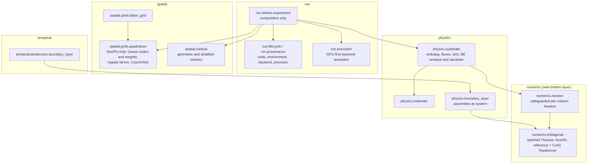

# Architectural consolidation and GPU-native substrate: audit and plan

Status: **audit complete; owner decisions D1-D9 recorded (2026-11-27); the
production refactor is not yet authorized** (section 12 lists what remains
open). Baseline:
`origin/main` = `be623c7` (PR #72 merged). Worktree
`Palintropos-consolidation`; branches `fix/airless-pr72-review` (PR #73,
stage 1) and `audit/gpu-consolidation` (this report and measurement tools).

Nothing in `src/` is changed by the audit branch. The stage-1 correctness
fixes are in PR #73. Everything else below is either **confirmed** (read in
the code or measured), a **proposal**, or an **uncertainty**, and is labelled
as such.

## M. Measurements (Tesla T4, Colab)

All production figures were taken on **Google Colab, Tesla T4** (CC 7.5, 40 SMs,
15 GiB, driver 580.82.07, CUDA 13.0, CuPy 14.0.1, NumPy 2.4.6, Python 3.13.16).
The host was an Intel Xeon @ 2.00 GHz with **2 vCPUs**. Precision is FP64
throughout, and nothing else ran on the machine. Machine-readable results
are in [`consolidation-evidence/`](consolidation-evidence/). The local GeForce
MX110 was used only for correctness checks, and none of its timings are
quoted.

**Representative state.** The Mercury VPW99 TWO production configuration
(`config_sha256 df71eaea…`) on 90 x 180 columns x 51 layers, spun up from the
configured 350 K isothermal start: 3 coarse cycles of 720 steps, then 432
production steps. State SHA-256
`ef413855553df37ba5aa1d23121526375bcbe38b1727407de8cb62b814964998`, skin
84-631 K. Every timing below starts from it, and the tools regenerate it
bitwise at the same commit.

### M1. Baseline (commit `9f8c0fb`; `src/` identical to `be623c7`)

| Quantity (production grid, warm, uninstrumented) | Value |
| --- | --- |
| `run_block` (the production per-step path) | **0.1091 s/step**, median of 5 x 60 steps (0.1070-0.1122) |
| bare `ConductiveSubstrate.step` | 0.1089 s/step |
| time outside the step (insolation, accumulators, sampling) | 0.2 % |
| Newton iterations per step | 3.73 |
| throughput | **148,000 column-steps/s**; 7.86 min per 4320-step production cycle |
| memory pool after `run_block` | 357 MB reserved (state is 6.6 MB) |
| cold first step (empty `CUPY_CACHE_DIR`) | +6.80 s compilation |
| first step with a warm on-disk cache | +0.26 s |

The historical record (`gpu-t4-2026-11-24.json`, 0.0846 s/step) is not
comparable. It used random points five steps from isothermal, at a commit
before per-step stratum extents.

### M2. Where the time goes

**Calls per step** (counted without adding synchronization):

| Per step | Count |
| --- | --- |
| residual + Jacobian assemblies | 4.73, of which 1 is never used and 3.73 recompute a residual the line search has just evaluated |
| trial residuals | 3.73 |
| tridiagonal solves | 3.73 |
| host synchronizations | 9.47 in the step (10.85 per `run_block` step, measured by Nsight) |

**Kernel census** (Nsight Systems, 20 production `run_block` steps; tracing
inflates the wall time):

| Per step | Baseline | With compiled Thomas |
| --- | --- | --- |
| kernel launches | 3,857 | 2,307 |
| device-to-device copies | 272 | 74 |
| summed kernel execution time | **75.7 ms** | **73.8 ms** |
| GPU busy / traced wall | 58 % | 84 % |

The most expensive kernels are CuPy elementwise multiply/add/divide over full
(51 x 16200) arrays: 1,008 multiplies at 17.4 ms and 322 adds at 11.9 ms.
These are memory-bound passes over materialized intermediates of the
residual/Jacobian assembly.

**Synchronized component costs** (ms/step, inclusive). The raw
`components` field of `t4-benchmark-9f8c0fb.json` is doubled by a divisor
bug fixed in `c0811f6`; the values below are halved, which is exact.

| Component | ms/step |
| --- | --- |
| Jacobian assembly | 47 |
| trial residual | 24 |
| tridiagonal | 28 |
| forcing | 0.5 |

CUDA-event spans agree within 1 ms. These are costs, not shares; their sum
is not the uninstrumented step.

**Reading.**
* At production size the step is bound by **GPU memory traffic of unfused
  elementwise assembly**, with launch overhead on top.
* At up to about 8k columns it is launch-bound. The time per Newton
  iteration stays at about 18-23 ms from 256 to 8192 columns (31-51
  layers) and rises only beyond (16200 x 51: about 1.3x; 32768 x 85: about
  3.5x).
* The fit `a + bL + cnL` misfits by up to 33 % on this 2-vCPU host. The
  measured rows in `scaling`, not the fit, are the evidence.
* Terminator batches need 3.1 Newton iterations against 2.05 for smooth
  ones (VPW99 TWO). Constant properties cost about half as much per
  iteration as VPW99.

### M3. Compiled Thomas prototype (one thread per column, `tools/colab/thomas_prototype.py`)

* **Numerics:** with contraction off it is bitwise identical to both the CuPy
  and the NumPy Thomas solves on 26 of 26 Newton systems captured from
  production and terminator steps. The patched `run_block` end state is
  bitwise identical. With FMA on, solutions differ by up to 4.1e-11
  relative.
* **Isolated solve:** 6.70 ms -> 0.461 ms (14.5x). FMA on: 0.405 ms
  (another 12 %).
* **Production `run_block`:** 0.1115 -> 0.0840 s/step (**1.33x**). As the
  census shows, it removes launch gaps but not GPU work, so it is necessary
  but not sufficient (D7).
* **Atmospheric diffusion** (the current CuPy Thomas): 9.5 ms per solve at
  both T21L40 and T42L40 (launch-bound), and 6.0 ms at T21L25. That is
  three solves per boundary-layer call; u and v share one matrix.

### M4. Fusion and single-source feasibility (D4, D7, D9)

**Finding F1: `cupy.fuse` is unusable for equivalence.** It contracts
`a - b*c` into an FMA (23 % of outputs differ from separate operations), and
CuPy exposes no option to disable that. `ElementwiseKernel(...,
options=("--fmad=false",))` is bitwise identical.

**Finding F2: `--fmad=false` changes libdevice `pow`.** Compiled that way,
`pow(x, 4.0)` and `pow(x, 3.0)` differ from CuPy's `x ** 4` / `x ** 3` in about
1 of 10^5 inputs on both the MX110 and the T4. The robust rule is to keep
CuPy's default flags and write every product as `__dmul_rn` (IEEE
round-to-nearest, never contracted). That makes the absence of FMA
explicit and independent of the flags. `--fmad=false` alone is **not** a
sufficient guarantee; this refines D5.

**Single-source laws (`tools/colab/trace_prototype.py`).** The
*unmodified* methods of `physics/materials.py` are called once with a
stand-in value that records each operation as one SSA C statement, in
Python's order. Products are emitted as `__dmul_rn`; `exp`, `expm1`, `where`,
`minimum`, `maximum` and comparisons use CuPy's own definitions, NaN
propagation included. Anything else raises `TypeError`. There is no parser,
no symbolic algebra and no simplification. On the T4, over all 826,200
production cells including breakpoint-straddling and nearly equal pairs,
**all 7 traced laws are bitwise identical to CuPy evaluating the same
methods**, under both flag settings. The laws traced are Ledlow
c_p/enthalpy, Hayne c_p/enthalpy, conductivity, its derivative and the
Kirchhoff difference. The traced kernels run 3-9x faster than the ufunc
chains. CuPy itself differs from NumPy in about 0.25 % of Ledlow values
(host libm against libdevice `exp`/`expm1`). That difference predates the
prototype and is covered by the G-GPU bound.

**Device-resident Newton (`tools/colab/fused_newton_prototype.py`).** One
kernel launch per step, one thread per column, holds the whole safeguarded
Newton iteration: assembly, the convergence test, the Thomas solve, the
positivity bound and the 30-halving line search. The laws are generated by
the tracer. The substrate's cell, face and skin arithmetic is restated by
hand in this prototype, and that is the duplication the production design
removes (section 12). The global loop of `ConductiveSubstrate.step` is
per-column separable: converged columns are frozen by `lambda = 0`, and a
column's line search sees only its own trial. T4 results, 200 consecutive
steps each:

| Case | Production step | Fused step | Speedup | Bitwise steps | Newton counts |
| --- | --- | --- | --- | --- | --- |
| production 90 x 180 x 51 (representative state) | 111.6 ms | **20.1 ms** | **5.6x** | 200/200 | identical |
| terminator, VPW99 TWO, 16200 x 51 | 93.9 ms | 21.1 ms | 4.4x | 200/200 | identical |
| terminator, constant properties, 16200 x 31 | 31.2 ms | 4.7 ms | 6.7x | 200/200 | identical |

The fused production step corresponds to about 810,000 column-steps/s and
1.45 min per production cycle, against 7.9 min. The kernel uses 255
registers and 6.4 KB of local memory per thread, so it is register-limited;
block size matters little (19.4-20.5 ms for 32-256 threads). Not yet done:

* the redundant assemblies are kept, deliberately, to match the
  production order bit for bit;
* the per-step report sums are not produced;
* the error flag is read back by the host once per step.

So 5.6x is a feasibility lower bound.

### M5. Proposed performance acceptance criteria (D7, for approval)

All criteria are on a Tesla T4 (Colab), at the production grid, from the
recorded representative state, with medians of at least 5 repeats. Results
from any other GPU model are reported separately and never compared with
these.

| ID | Stage | Criterion |
| --- | --- | --- |
| P1 | 5 (compiled Thomas) | `run_block` <= 0.088 s/step (>= 1.25x the 0.109 baseline; measured 1.33x), bitwise end state |
| P2 | 6 (device-resident Newton) | `run_block` <= **0.025 s/step** (>= 4.4x; >= 650,000 column-steps/s; <= 1.8 min per production cycle) |
| P3 | 6 | <= 2 host synchronizations and <= 20 kernel launches per production step (baseline 10.85 and 3,857) |
| P4 | 6 | memory pool <= 120 MB after a production segment (baseline 357 MB) |
| P5 | 5, 6 | cold-start compilation overhead <= 10 s (baseline 6.8 s); warm cache <= 1 s |
| P6 | 5 (atmosphere, after D3 equivalence) | `implicit_column_diffusion` at T21L40 <= 1.0 ms per solve (baseline 9.5 ms); u and v solved with one factorization |
| N1 | all | bitwise state and identical per-step Newton counts against the reference CuPy path, over >= 200 production steps, the terminator and constant cases, the Ceres fixture and the G-gate fixtures. Where the operation order changes by an approved decision, the existing bounds apply: G-GPU 1e-6 K with identical Newton counts, and G-B tolerances. No new thresholds. |

A stretch figure of about 12 ms/step (removing the redundant assemblies and
tuning registers) is a goal, not a gate.


## 1. Current ownership (confirmed)

| Responsibility | Current owner | Notes |
| --- | --- | --- |
| Physical system specification (airless) | `run/airless/config.py` (`AirlessConfig`, presets) | Mercury constants and THAI-free; good |
| Constitutive laws | `physics/materials.py` (`Stratum`, heat-capacity laws, `CellMaterials`) | Cancellation-resistant divided differences; good |
| Vertical mesh generation | split: `physics/substrate.py::geometric_interfaces` and `physics/materials.py::stratified_interfaces` | Import cycle `materials -> substrate` (function scope), already reported in `docs/architecture/current/modules-cycles.mmd` |
| Horizontal columns (airless) | `run/airless/experiment.py::build_columns` | Private regular lat-lon, south to north, cell-centred lon; unit weights for points |
| Horizontal grids (atmosphere) | `spatial/grids/latlon_grid.py::GaussLatLonGridGeometry` | Gauss nodes north to south, lon nodes from 0; **imports CuPy at module load** |
| Gauss-Legendre nodes | `np.polynomial.legendre.leggauss` called in 6 places | `latlon_grid.py`, `held_suarez_sections.py`, `viewer_fields.py`, `viewer_diagnostics.py`, `held_suarez/report.py`, and `radiation/kdist.py` (g-space, a different use) |
| Time discretization (substrate) | inside `ConductiveSubstrate._system` | Backward Euler hard-wired into the residual |
| Nonlinear solve | inside `ConductiveSubstrate.step` | Newton, positivity bound, 30-halving line search, per-column masks, `SubstrateSolveError` |
| Tridiagonal solve | `physics/substrate.py::_tridiagonal` and `physics/boundary_layer.py::implicit_column_diffusion` | Two Thomas implementations in different elimination forms |
| CUDA kernels | `spatial/transforms/cuda/*.cu` (RawModule), `physics/monin_obukhov_cuda.py` (RawKernel, opt-in, physics restated in CUDA) | No numerical-solver CUDA code |
| Execution backend | `run/airless/experiment.py::_backend`; atmospheric runners import CuPy unconditionally | Airless defaults to NumPy everywhere |
| Run provenance | `run/held_suarez/experiment.py::code_identity, environment_identity` | Imported by the airless and radiative runners |

## 2. Confirmed duplications and defects

1. **Two batched Thomas solvers.** `substrate._tridiagonal` (general
   `lower/diag/upper/rhs`, forward `c', d'` form) and
   `boundary_layer.implicit_column_diffusion` (assembles a symmetric M-matrix
   from conductances, then eliminates with `b', d'` multipliers). Both are
   Python loops over levels launching several CuPy kernels per level. Their
   arithmetic differs, so one canonical solver **changes the rounding of one of
   them** (see decision D3).
2. **u and v factorize the same matrix twice** in
   `temporal/tendencies/boundary_layer.py` (`implicit_column_diffusion` is
   called separately for u and v with `conductance_m`).
3. **Vertical mesh code split across two physics modules** with a
   function-scope import cycle.
4. **Gauss nodes recomputed in five places** outside the grid class, each with
   its own ordering conversion (`argsort(-x)`, `[::-1]`, `arcsin` vs `arccos`).
5. **Redundant Newton work (measured counts, section M2).** Each Newton pass
   re-assembles the residual at the point the line search has just evaluated,
   and the final pass assembles a Jacobian that is never used.
6. **Provenance records the wrong hardware for CPU runs.**
   `environment_identity()` imports CuPy, initializes CUDA and records the GPU
   name even for a NumPy-backend run, and records no precision. A CPU
   verification run on a GPU machine is labelled with the GPU.
7. **Run helpers owned by an experiment.** Airless and radiative runners import
   `RunError`, `code_identity`, `environment_identity` from
   `run/held_suarez/experiment.py`. `run/lifecycle.py` exists and is the
   natural owner.
8. **The historical T4 profile treats instrumented components as shares.**
   `gpu-t4-2026-11-24.json` decides against a CUDA solver because the Thomas
   solve is "~31% of the instrumented step"; its own figures sum to more than
   the uninstrumented step (0.0659 + 0.0338 > 0.0846 s). It also profiled
   random points five steps from an isothermal start, and the step has since
   gained per-step stratum extents. It is superseded by section M.

9. **Diagnostic points are reported as global quantities.** See section 11;
   every weighted airless diagnostic is affected for point runs.

## 3. Implicit and experiment-specific defaults (confirmed)

Classification: 1 universal constant, 2 mathematical/numerical invariant,
3 constitutive-law parameter, 4 material-specific empirical, 5
experiment-specific physical, 6 discretization/solver configuration, 7 internal
reference.

| Where | Default | Class | Proposal |
| --- | --- | --- | --- |
| `ConductiveSubstrate.constant` | C = 2e6 J m^-3 K^-1 | 4/5 (THAI sand) | remove default; THAI config owns it |
| `ConductiveSubstrate.constant` | I = 2000 (k = 2) | 4/5 (THAI) | remove default |
| `ConductiveSubstrate.constant` | depth 3.5 m, top 2 cm, 30 layers | 5/6 (THAI/Ben 2 plan) | remove defaults; mesh is an explicit argument |
| `ConductiveSubstrate.__init__` | albedo 0, emissivity 1 | 5 | required |
| `ConductiveSubstrate.__init__` | bottom_heat_flux 0 | 5 | required (0 is a legitimate explicit value) |
| `ConductiveSubstrate.__init__` | initial_temperature 300 K | 5, **coincides with** the class-7 enthalpy reference | required; moves to the experiment; never inferred from the reference |
| `ConductiveSubstrate.__init__` | max_iterations 50 | 6 | solver configuration object with explicit defaults recorded in the signature |
| `ENERGY_REFERENCE_TEMPERATURE` | 300 K | 7 | keep (internal; anomalies are relative to it) |
| `TOLERANCE_FLOOR`, `TOLERANCE_ROUNDOFF` | 1e-9 W m^-2, 64 eps | 6, frozen by G-B | keep values; move to the solver configuration |
| line search | 30 halvings, factor 1/2 positivity bound | 6/2 | keep; solver configuration |
| `_MAX_STRETCH` | 1.5 | 6 (regolith spec) | keep in the mesh generator |
| `Stratum.radiative_reference_temperature` | 350 K | 3/4 (VPW99/Hayne T_r convention) | required; `strata_from_dicts` must not fill it silently |
| `Stratum.volumetric` | density 1, c_p = C | 2 (only rho c_p enters) | keep, documented |
| `SIGMA_SB`, `AU_M`, `L_SUN_W`, `GM_SUN` | | 1 | keep |
| `_mercury` | 90 x 180 columns, periodicity thresholds, 720/180 samples, R | 5/6 Mercury experiment | already experiment-owned (preset) |
| `SlabSurface` | albedo 0, emissivity 1 | 5 | required |
| `run/radiative/config.py` THAI/Mars | slab `heat_capacity` 2e6 / 1e7 / 2 rho c_p | 5 | unchanged here; a substrate option is §11 work |

Only tests call `ConductiveSubstrate.constant` (`test_substrate.py`,
`test_substrate_gpu.py`, `audit_substrate_gates.py`); one test relies on all
its defaults (`test_substrate.py:185`).

## 4. Dependency constraints (confirmed)

* Declared layers, top first: `cli > run > representation > temporal > spatial
  > physics` (`tools/architecture/layers.py`, enforced for run-time imports by
  `tests/test_layout.py`). **Physics is the bottom layer and imports nothing
  from `tropoi` outside `physics`.** A canonical solver or mesh placed in
  `spatial` or `temporal` cannot be called from `physics.substrate`.
* `tropoi.spatial` and `tropoi.spatial.grids` import without CuPy;
  `spatial/grids/latlon_grid.py`, `spherical_backend.py`, `planet.py` and the
  transforms import CuPy at module load.
* CPU CI installs no CuPy. Import-light modules (`physics/*`, `run/airless/*`,
  `spatial/grids/__init__`) must stay importable and must not initialize CUDA.

### Before (relevant modules; solid = module-level import, dashed = function scope)

```mermaid
flowchart TB
  subgraph run
    AM[run.airless.__main__] --> AE[run.airless.experiment]
    AM --> AC[run.airless.config]
    AE --> AC
    AE --> HS[run.held_suarez.experiment<br/>code/environment identity]
    RE[run.radiative.experiment] --> HS
  end
  subgraph temporal
    TBL[temporal.tendencies.boundary_layer]
    CC[temporal.column_coupling]
  end
  subgraph spatial
    GLL[spatial.grids.latlon_grid<br/>Gauss nodes, imports CuPy]
  end
  subgraph physics
    SUB[physics.substrate<br/>mesh + backward Euler + Newton + Thomas]
    MAT[physics.materials<br/>laws + stratified mesh]
    BL[physics.boundary_layer<br/>second Thomas]
    MOC[physics.monin_obukhov_cuda<br/>RawKernel]
    INS[physics.insolation]
    SURF[physics.surface<br/>SlabSurface]
  end
  AE --> SUB
  AE --> INS
  AC --> MAT
  SUB --> MAT
  MAT -.-> SUB
  TBL --> BL
  TBL --> MOC
  CC -. physics.surface.advance .-> SURF
  AE -. private build_columns .-> AE
```

## 5. Proposed canonical owners and interfaces (proposal)

The diagram shows the first proposal. After decisions D1-D9 and the M4
feasibility results, the final structure (adding `numerics.codegen`,
`numerics/cuda` and `temporal.implicit`) is in section 12.



* **D1 `tropoi.numerics`, a new bottom layer.** It is import-light (NumPy at
  import, CuPy only inside the CUDA implementation) and knows nothing about
  physics. `numerics.tridiagonal.solve(lower, diag, upper, rhs)` is the one
  batched solver. Its contract: axis 0 is the vertical and columns are
  contiguous along axis 1, FP64, no pivoting, and the caller guarantees
  stability (diagonal dominance or an M-matrix). Arrays go through a NumPy
  reference or a compiled CUDA kernel chosen by the array type. Callers never
  see CUDA. Multiple right-hand sides share one factorization, which the u/v
  diffusion needs. `numerics.newton` owns the iteration, the positivity bound,
  the backtracking, the per-column masks and the convergence-failure report.
  The physics supplies `residual(x) -> (r, tau, cache)` and
  `jacobian(cache) -> (l, d, u)`, so the Jacobian is only assembled when a
  step is taken, from intermediates already computed for the residual.
  The alternative, keeping the solvers in `physics`, contradicts the
  assignment's first principle.
* **Spatial.** `spatial/grids/quadrature.py` (NumPy-only) owns
  Gauss-Legendre nodes and weights (one `leggauss` call site), regular
  cell-centred lat-lon cells and their exact areas, and a `ColumnSet` with lat,
  lon, ordering, `kind = "global" | "diagnostic"`, and physical weights
  `W_ij = R^2 (2 pi / N_lon) w_i` (sum 4 pi R^2) or none at all for diagnostic
  points. `GaussLatLonGridGeometry` takes its nodes from there. The airless
  `columns` spec gains `{"kind": "gauss", "nlat", "nlon"}` with exactly the
  atmosphere's ordering (north to south, lon nodes from 0) and no spectral
  truncation. Diagnostic point runs report no "global" integrals; today they
  silently use unit weights.
* **Vertical mesh.** `geometric_interfaces` and `stratified_interfaces` move
  to `spatial/vertical.py`. `ConductiveSubstrate` takes explicit `interfaces`
  only, and the run layer builds them. This removes the import cycle.
* **Temporal boundary (section 8; see D4 and section 12).** Superseded by
  the generated-fusion design in section 12. The physics owns pointwise
  storage, flux and skin functions; the backward-Euler composition is owned
  outside physics; both are traced into one kernel. Logically separate,
  computationally fused.
* **Backend policy (section 7).** One resolver `run/execution.py` with
  production default CuPy/CUDA. It fails promptly with an explanation when
  CUDA is unavailable and never falls back. The CPU path stays: the airless
  CLI keeps a developer flag hidden from `--help` (`argparse.SUPPRESS`) and
  documented in `tests/README.md` and the developer section of
  `docs/ARCHITECTURE.md`; the Python API keeps `backend="numpy"` as an
  explicit argument; and `TROPOI_EXECUTION=cpu-verification` serves
  subprocess tests. The flag name must not be `--backend`, which the main
  `tropoi` CLI already uses for the grid family (D6). Provenance records the
  actual backend, the device only when the backend is CUDA, the CPU model
  for CPU runs, and `precision: float64`. `environment_identity` must not
  initialize CUDA for a CPU run.

## 6. Files and implementations to remove (proposal)

`physics/substrate.py::_tridiagonal`; the elimination loop of
`physics/boundary_layer.implicit_column_diffusion`, which keeps only its
assembly; `geometric_interfaces`/`stratified_interfaces` in physics (moved);
`ConductiveSubstrate.constant`'s defaults, or the constructor itself if a
`Stratum.volumetric` plus explicit mesh covers every caller; the
`top_thickness/max_stretch` path of `ConductiveSubstrate.__init__`; private
`build_columns` grid code (moved to `spatial`); the five ad hoc `leggauss`
call sites; and `tools/planet_one/gpu_profile.py`, superseded by
`tools/colab/substrate_benchmark.py`.

## 7. Migration and verification strategy (proposal)

Stages as in the assignment. Each is a separate PR with its own evidence.

1. Correctness fixes: **PR #73** (done; awaiting merge approval).
2. Consolidation without arithmetic change. Newton and Thomas move to
   `numerics` with identical operation order, as does the mesh. Gate: bitwise
   equal end states for the G-gate fixtures, the Ceres fixture, the VPW99
   point runs and the CPU/GPU parity tests. The redundant-assembly removal
   (M2) belongs here. It is arithmetic-preserving, so it is also gated
   bitwise.
3. Spatial `quadrature`/`ColumnSet`/`gauss` columns. Gates: the weights sum
   to 4 pi R^2 to round-off, `GaussLatLonGridGeometry` is bitwise unchanged,
   and existing lat-lon airless runs are bitwise unchanged.
4. Defaults removal; callers migrated. Gate: the THAI-constant tests take
   explicit values and their results are bitwise unchanged.
5. Compiled CUDA tridiagonal solver behind `numerics.tridiagonal`
   (`--fmad=false`). Gate: bitwise against the NumPy reference and the old
   CuPy path on captured systems and on full runs. The boundary layer follows
   only after decision D3.
6. Fusion and synchronization reduction (section M4). Gate: for kernels
   that restate physics in CUDA, bitwise where the operation order is kept,
   otherwise the existing G-GPU bound (1e-6 K, and identical Newton counts);
   no new thresholds.
7. GPU-first defaults; tests, docs and the CLI migrated together.
8. Final regression: full CPU suite, the GPU suite on the T4 via the CUDA
   regression notebook, G-gates, Ceres replay, VPW99 point runs and a T4
   benchmark rerun.

## 8. Future atmosphere-substrate coupling (findings and constraints, no implementation)

Confirmed in `physics/column_model.py`, `physics/surface.py` and
`temporal/column_coupling.py`:

* The surface contract is explicit: `surface.advance(T_s, surface_net, dt)`
  (`SlabSurface`: `T_s + dt/C * F`). The substrate's
  `step(state, dt, shortwave_down, longwave_down, flux, flux_derivative)` is
  already the implicit, linearized-flux form that coupling needs.
* The implicit sensible exchange `F' = F / (1 + k (w/Ca + s/Cs))` reads
  `self.surface.heat_capacity`, a slab-only quantity. A substrate has no
  single heat capacity. Its implicit response is the skin row of its Newton
  system, `flux_derivative = -k`, and the flux it actually absorbs is
  `F_0 + a (T_s^{n+1} - T_ref)`. For equal and opposite exchange, the air
  must receive that realized flux. That fixes the order: substrate step,
  then air heating. A coupled implicit solve is the alternative; it would
  border the tridiagonal system and is why `numerics.tridiagonal` must not
  be assumed to be the final coupled solver.
* Radiation computes the upwelling longwave from `eps sigma T_s^4` at the
  **old** skin temperature, while the substrate emits `eps sigma T_s^4` at the
  **new** one. Coupled naively, the energy the atmosphere receives and the
  energy the surface loses differ by `eps sigma (T_s^{n+1,4} - T_s^{n,4})`.
  A conservative coupling must either pass the substrate's realized emission
  to the atmosphere as its lower-boundary source, or linearize the emission
  and account for the difference. This is a design decision for the coupling
  stage (D8), not a defect today.
* `SlabSurface` validates `emissivity in (0, 1]`, the substrate `[0, 1]`.
* Columns: the atmosphere's surface state lives on its state grid
  (`GaussLatLonGridGeometry`, north to south, lon nodes from 0, lat-major
  C order). A substrate on the same `ColumnSet` therefore needs no
  reordering and no host transfer. Both arrays are CuPy (L, npts) with
  npts contiguous.
* Shortwave and longwave are needed separately (albedo and emissivity
  apply to each). The radiation scheme already holds both at the surface in
  `fluxes`.

## 9. Owner decisions (2026-11-27) and how they change the plan

| | Ruling | Approved principle | Conditionally approved / open detail |
| --- | --- | --- | --- |
| D1 | **Approved** | `tropoi.numerics` is a new import-light bottom layer, independent of planetary physics, owning reusable algorithms and their hardware-specific implementations | module layout (section 12) |
| D2 | **Approved** | vertical meshes move to canonical spatial infrastructure; the substrate receives explicit interfaces | - |
| D3 | **Approved in principle** | one canonical Thomas implementation; historical experiments stay with their commits | numerical equivalence must be established and documented **before** atmospheric callers migrate |
| D4 | **Conditional** | temporal discretization is logically separate from physics; no elaborate integrator framework; the Newton solver receives admissibility constraints from its caller | how to separate it while staying fused: section 12 proposes generated fusion, which M4 shows is feasible |
| D5 | **Approved, FMA off initially** | equivalence and performance first without contraction; FMA later as a separately justified optimization | refined by F2: "FMA off" is implemented as explicit `__dmul_rn` products with default flags |
| D6 | **Approved** | GPU default production experience; hidden `--device cpu` plus `TROPOI_EXECUTION=cpu-verification`; actual execution recorded; no silent fallback | precedence rule (section 12) |
| D7 | **Pending** | device-resident Newton and fused assembly to be investigated: done (M4) | criteria M5 await approval |
| D8 | **Approved as a conservation requirement** | equal and opposite realized fluxes with consistent temporal integration; the radiation emission mismatch is an explicit acceptance requirement of the coupling stage | no coupling algorithm is chosen; coupled implicit, iterative and partitioned schemes all stay open |
| D9 | **Further investigation** | no two independently maintained definitions of constitutive physics | answered by M4: single-source generation from the existing Python methods is practical and bitwise; the remaining question is its production form (section 12) |

## 10. Risks

* **Scientific:** the G-gates and VPW99 point evidence rely on bitwise
  reproduction. Every stage that keeps the operation order must be gated
  bitwise. Stages that change it (D3, D5, fusion) need explicit,
  pre-registered parity criteria taken from existing bounds; none are
  invented here.
* **Computational:** the T4 host has 2 vCPUs. A launch-bound step is
  sensitive to host load and to the Colab image, so timings are only
  comparable on the same GPU model and image, and repeats are reported as
  median and range.
* **Sunrise:** terminator columns need more Newton iterations and
  line-search trials. Under per-column masks the whole batch waits for the
  slowest column. Fusion moves that wait to the device but does not
  remove it.

## 11. Global quadrature: correctness finding and proposed fix (separate PR)

**Confirmed.** A point collection gets unit weights (`build_columns`), and
every weighted diagnostic then presents an unweighted sum or average under a
global name:

| Where | Quantity | What it is for points |
| --- | --- | --- |
| `run_block` -> `series/cycle-*.npz` | `energy_tendency`, `net`, `residual`, `tolerance` ("per-step area-weighted global scalars") | a plain **sum** of W m^-2 over points (neither a mean nor an integral) |
| `_cycle` | the same four, summed over blocks | the same |
| `_diagnostics` -> `cycles.json`, `events.jsonl` | `mean_absorbed_W_m2`, `mean_emitted_W_m2` | the unweighted point average, named a mean |
| `_diagnostics` | `global_residual_over_tolerance` | a ratio of unweighted sums, named global |
| `grid.npz` | `weights` ("area weights") | ones |
| `tools/planet_one/build_view.py` | `mean_absorbed`, `mean_emitted` | the unweighted average |

Lat-lon runs are correct: the exact cell areas sum to 4 pi R^2 to 1 ulp, and
the Gauss weights `R^2 (2 pi/N_lon) w_i` likewise (verified for 32 x 64,
64 x 128, 90 x 180). No committed evidence quotes a point-run mean; the
quoted global values (`global2-gpu-t4.json`) are from a 90 x 180 lat-lon run.

**Proposed fix (stage 1b, its own PR, before stage 2).**

* A column collection has `kind = "global"` (area weights that sum to
  4 pi R^2, verified at construction) or `kind = "diagnostic"` (no weights).
* For diagnostic points:
  * `grid.npz` stores no `weights` and records the kind;
  * the series are stored **per point**, which is cheap for a few points;
  * `cycles.json` carries per-point absorbed, emitted and residual/tolerance
    and no `mean_*` or `global_*` keys;
  * `build_view.py` refuses to compute or label a mean.
* Global runs keep the same names, and their values stay bitwise
  unchanged.
* Analytical regression tests:
  1. a uniform field has weighted mean equal to the field value and
     integral equal to 4 pi R^2 times it, exactly, on regular and Gauss
     grids;
  2. `f = sin(phi)` integrates to zero (to round-off);
  3. `f = sin^2(phi)` has mean exactly 1/3 on a Gauss grid (a degree-2
     polynomial in sin(phi)); on the regular midpoint grid its error matches
     the closed-form O(dphi^2) value;
  4. a point run writes no global keys and per-point series that equal the
     per-column integrals;
  5. a lat-lon run's `cycles.json` and series are bitwise unchanged.

## 12. Final implementation plan (for approval; not yet authorized)

**Canonical structure.**

```text
tropoi/numerics/                 (new bottom layer, D1; NumPy at import)
  tridiagonal.py                 solve(lower, diag, upper, rhs[, nrhs]) NumPy reference + CUDA
  newton.py                      per-column safeguarded Newton (NumPy reference driver)
  cuda/columns.py                column-kernel driver template (Thomas, Newton, backtracking)
  codegen.py                     the tracer: Python pointwise functions -> __device__ code
tropoi/spatial/grids/quadrature.py   Gauss and regular nodes, weights, ColumnSet (NumPy only)
tropoi/spatial/vertical.py           geometric and stratified interfaces (D2)
tropoi/physics/materials.py          laws (unchanged arithmetic; traced, never restated)
tropoi/physics/substrate.py          pointwise storage/face/skin functions + Jacobian partials;
                                     an admissibility function (positivity of absolute T)
tropoi/temporal/implicit.py          backward-Euler composition of a pointwise conservation
                                     law (one small function, traced into the same kernel)
tropoi/run/execution.py              backend resolution and provenance (D6)
```

**How D4 and D9 are met.** M4 shows the generated route is bitwise and
fast.

* The substrate's `_system` is rewritten as pointwise functions of a cell
  or a face: storage `C [h(T) - h(T^n)]`, face flux and its two partials,
  the skin balance and its partials. Each is written once in Python.
* The NumPy/CuPy path applies them to shifted array views. The same
  arithmetic, in the same order, therefore stays the CPU reference and
  the CuPy reference.
* `numerics.codegen` traces the same functions into `__device__` code for
  the column kernel, so no physics is written in CUDA. The CUDA in
  `numerics/cuda` is the generic driver: level loops, Thomas, Newton
  passes, and backtracking against a caller-supplied admissible step
  fraction. It contains no physics.
* The backward-Euler composition lives in `temporal/implicit.py`, outside
  physics, and is traced into the same kernel. That gives logical
  separation without extra launches or materialized arrays.
* Positivity is supplied by the substrate as its admissibility function, not
  assumed by the solver.

The one hand-written piece that remains is the driver template. It belongs
to numerics and is verified against `numerics.newton`, its NumPy
reference, bitwise.

**Stages** (each its own PR, gated as in section 7 and criterion N1):

1. Done: PR #73 (PR #72 review fixes). **1b:** the global-quadrature fix
   (section 11).
2. `numerics` layer. Move Newton and Thomas with identical arithmetic.
   Admissibility comes from the caller. Remove the redundant assemblies.
   Gate: bitwise.
3. `spatial.grids.quadrature`, `ColumnSet`, `{"kind": "gauss"}` airless
   columns, `spatial.vertical`, and `GaussLatLonGridGeometry` taking its
   nodes from quadrature. Gates: bitwise; sums of 4 pi R^2;
   airless/atmosphere coordinate, ordering and weight identity.
4. Defaults removed (section 3); `Stratum.radiative_reference_temperature`
   required; callers migrated. Gate: bitwise.
5. Compiled Thomas behind `numerics.tridiagonal` (P1, N1). Boundary layer
   after its equivalence study (D3, P6).
6. Pointwise substrate physics, `numerics.codegen`, the device-resident
   Newton column kernel, device-side report sums, and 1 synchronization per
   step (P2-P5, N1).
7. GPU-first execution policy (D6). Tests, docs, notebooks and the CLI
   migrated together; provenance records backend, device and precision;
   `environment_identity` does not initialize CUDA for CPU runs.
8. Final regression: full CPU suite, the T4 CUDA regression notebook,
   G-gates, the Ceres replay, VPW99 point runs, and a T4 benchmark rerun
   against M1.

**Remaining decisions for the owner.**

* **U1 (D4/D9 production form).** Approve the generated-fusion design
  above: pointwise physics, `numerics.codegen` and a physics-free CUDA
  driver. The alternative is a controlled hand restatement with parity
  tests (the `monin_obukhov_cuda` precedent). Recommended: generated.
* **U2 (failure detection).** The device-resident step reads a per-column
  failure flag once per step: 1 synchronization, and the error is raised
  at the same step as today. Deferring the check to segment end saves that
  synchronization, but raises the error late. Recommended: once per step.
* **U3 (report sums).** The per-step energy-identity sums
  (`energy_tendency`, `residual_sum`, `tolerance_sum`) summed in level
  order on the device are not bitwise equal to CuPy's tree reductions.
  The options are to accept them under the existing identity bound
  `|residual_sum| <= tolerance_sum` (no new threshold), or to keep CuPy
  reductions over kernel-written arrays (a few more launches, bitwise).
  Recommended: bitwise first, then measure.
* **U4.** The performance criteria P1-P6 and N1 (D7).
* **U5.** The global-quadrature fix interface (section 11): per-point
  series and no global keys for diagnostic points.
* **U6 (D6 precedence).** Explicit `--device`, then
  `TROPOI_EXECUTION=cpu-verification`, then the CUDA default. A conflict
  between the flag and the environment variable is an error, and there is
  never a fallback.

## 13. Tools and evidence index

| File | Purpose |
| --- | --- |
| `tools/colab/substrate_benchmark.py` | baseline, counts, components, scaling, compile, Thomas, diffusion |
| `tools/colab/substrate_benchmark_colab.py`, `notebooks/substrate_benchmark_colab.ipynb` | commit-pinned Colab launch (asserts HEAD) |
| `tools/colab/substrate_nsys.py` | Nsight Systems kernel census |
| `tools/colab/thomas_prototype.py` | compiled Thomas (non-production) |
| `tools/colab/trace_prototype.py`, `trace_check.py` | single-source law tracing and its bitwise check |
| `tools/colab/fused_newton_prototype.py`, `fused_check.py` | device-resident Newton step and its bitwise check |
| `consolidation-evidence/t4-benchmark-9f8c0fb.json` | M1-M3 (the `components` field is doubled; see M2) |
| `consolidation-evidence/t4-nsys-*-f5ec2b0.json` | M2 census |
| `consolidation-evidence/t4-trace-057fe4a.json`, `t4-fused-newton-057fe4a.json` | M4 |

The representative state itself (6.6 MB) is regenerated by the benchmark
(`--state-file`); a local copy is kept under the ignored
`runs/consolidation/`.
