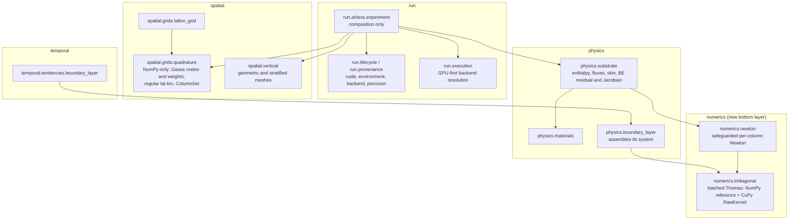

# Architectural consolidation and GPU-native substrate: audit and plan

Status: **audit delivered, awaiting owner approval** (2026-11-27). Baseline:
`origin/main` = `be623c7` (PR #72 merged). Worktree
`Palintropos-consolidation`; branches `fix/airless-pr72-review` (PR #73,
stage 1) and `audit/gpu-consolidation` (this report and measurement tools).

Nothing in `src/` is changed by the audit branch. The stage-1 correctness
fixes are in PR #73. Everything else below is either **confirmed** (read in
the code or measured), a **proposal**, or an **uncertainty**, and is labelled
as such.

<!-- MEASUREMENTS -->

## 1. Current ownership (confirmed)

| Responsibility | Current owner | Notes |
| --- | --- | --- |
| Physical system specification (airless) | `run/airless/config.py` (`AirlessConfig`, presets) | Mercury constants and THAI-free; good |
| Constitutive laws | `physics/materials.py` (`Stratum`, heat-capacity laws, `CellMaterials`) | Cancellation-resistant divided differences; good |
| Vertical mesh generation | split: `physics/substrate.py::geometric_interfaces` and `physics/materials.py::stratified_interfaces` | Import cycle `materials -> substrate` (function scope), already reported in `docs/architecture/current/modules-cycles.mmd` |
| Horizontal columns (airless) | `run/airless/experiment.py::build_columns` | Private regular lat-lon, south to north, cell-centred lon; unit weights for points |
| Horizontal grids (atmosphere) | `spatial/grids/latlon_grid.py::GaussLatLonGridGeometry` | Gauss nodes north to south, lon nodes from 0; **imports CuPy at module load** |
| Gauss-Legendre nodes | `np.polynomial.legendre.leggauss` called in 6 places | `latlon_grid.py`, `held_suarez_sections.py`, `viewer_fields.py`, `viewer_diagnostics.py`, `held_suarez/report.py`, and `radiation/kdist.py` (g-space, a different use) |
| Time discretization (substrate) | inside `ConductiveSubstrate._system` | Backward Euler hard-wired into the residual |
| Nonlinear solve | inside `ConductiveSubstrate.step` | Newton, positivity bound, 30-halving line search, per-column masks, `SubstrateSolveError` |
| Tridiagonal solve | `physics/substrate.py::_tridiagonal` and `physics/boundary_layer.py::implicit_column_diffusion` | Two Thomas implementations in different elimination forms |
| CUDA kernels | `spatial/transforms/cuda/*.cu` (RawModule), `physics/monin_obukhov_cuda.py` (RawKernel, opt-in, physics restated in CUDA) | No numerical-solver CUDA code |
| Execution backend | `run/airless/experiment.py::_backend`; atmospheric runners import CuPy unconditionally | Airless defaults to NumPy everywhere |
| Run provenance | `run/held_suarez/experiment.py::code_identity, environment_identity` | Imported by the airless and radiative runners |

## 2. Confirmed duplications and defects

1. **Two batched Thomas solvers.** `substrate._tridiagonal` (general
   `lower/diag/upper/rhs`, forward `c', d'` form) and
   `boundary_layer.implicit_column_diffusion` (assembles a symmetric M-matrix
   from conductances, then eliminates with `b', d'` multipliers). Both are
   Python loops over levels launching several CuPy kernels per level. Their
   arithmetic differs, so one canonical solver **changes the rounding of one of
   them** (see decision D3).
2. **u and v factorize the same matrix twice** in
   `temporal/tendencies/boundary_layer.py` (`implicit_column_diffusion` is
   called separately for u and v with `conductance_m`).
3. **Vertical mesh code split across two physics modules** with a
   function-scope import cycle.
4. **Gauss nodes recomputed in five places** outside the grid class, each with
   its own ordering conversion (`argsort(-x)`, `[::-1]`, `arcsin` vs `arccos`).
5. **Redundant Newton work (measured counts, section M2).** Each Newton pass
   re-assembles the residual at the point the line search has just evaluated,
   and the final pass assembles a Jacobian that is never used.
6. **Provenance records the wrong hardware for CPU runs.**
   `environment_identity()` imports CuPy, initializes CUDA and records the GPU
   name even for a NumPy-backend run, and records no precision. A CPU
   verification run on a GPU machine is labelled with the GPU.
7. **Run helpers owned by an experiment.** Airless and radiative runners import
   `RunError`, `code_identity`, `environment_identity` from
   `run/held_suarez/experiment.py`. `run/lifecycle.py` exists and is the
   natural owner.
8. **The historical T4 profile treats instrumented components as shares.**
   `gpu-t4-2026-11-24.json` decides against a CUDA solver because the Thomas
   solve is "~31% of the instrumented step"; its own figures sum to more than
   the uninstrumented step (0.0659 + 0.0338 > 0.0846 s). It also profiled
   random points five steps from an isothermal start, and the step has since
   gained per-step stratum extents. It is superseded by section M.

## 3. Implicit and experiment-specific defaults (confirmed)

Classification: 1 universal constant, 2 mathematical/numerical invariant,
3 constitutive-law parameter, 4 material-specific empirical, 5
experiment-specific physical, 6 discretization/solver configuration, 7 internal
reference.

| Where | Default | Class | Proposal |
| --- | --- | --- | --- |
| `ConductiveSubstrate.constant` | C = 2e6 J m^-3 K^-1 | 4/5 (THAI sand) | remove default; THAI config owns it |
| `ConductiveSubstrate.constant` | I = 2000 (k = 2) | 4/5 (THAI) | remove default |
| `ConductiveSubstrate.constant` | depth 3.5 m, top 2 cm, 30 layers | 5/6 (THAI/Ben 2 plan) | remove defaults; mesh is an explicit argument |
| `ConductiveSubstrate.__init__` | albedo 0, emissivity 1 | 5 | required |
| `ConductiveSubstrate.__init__` | bottom_heat_flux 0 | 5 | required (0 is a legitimate explicit value) |
| `ConductiveSubstrate.__init__` | initial_temperature 300 K | 5, **coincides with** the class-7 enthalpy reference | required; moves to the experiment; never inferred from the reference |
| `ConductiveSubstrate.__init__` | max_iterations 50 | 6 | solver configuration object with explicit defaults recorded in the signature |
| `ENERGY_REFERENCE_TEMPERATURE` | 300 K | 7 | keep (internal; anomalies are relative to it) |
| `TOLERANCE_FLOOR`, `TOLERANCE_ROUNDOFF` | 1e-9 W m^-2, 64 eps | 6, frozen by G-B | keep values; move to the solver configuration |
| line search | 30 halvings, factor 1/2 positivity bound | 6/2 | keep; solver configuration |
| `_MAX_STRETCH` | 1.5 | 6 (regolith spec) | keep in the mesh generator |
| `Stratum.radiative_reference_temperature` | 350 K | 3/4 (VPW99/Hayne T_r convention) | required; `strata_from_dicts` must not fill it silently |
| `Stratum.volumetric` | density 1, c_p = C | 2 (only rho c_p enters) | keep, documented |
| `SIGMA_SB`, `AU_M`, `L_SUN_W`, `GM_SUN` | | 1 | keep |
| `_mercury` | 90 x 180 columns, periodicity thresholds, 720/180 samples, R | 5/6 Mercury experiment | already experiment-owned (preset) |
| `SlabSurface` | albedo 0, emissivity 1 | 5 | required |
| `run/radiative/config.py` THAI/Mars | slab `heat_capacity` 2e6 / 1e7 / 2 rho c_p | 5 | unchanged here; a substrate option is §11 work |

Only tests call `ConductiveSubstrate.constant` (`test_substrate.py`,
`test_substrate_gpu.py`, `audit_substrate_gates.py`); one test relies on all
its defaults (`test_substrate.py:185`).

## 4. Dependency constraints (confirmed)

* Declared layers, top first: `cli > run > representation > temporal > spatial
  > physics` (`tools/architecture/layers.py`, enforced for run-time imports by
  `tests/test_layout.py`). **Physics is the bottom layer and imports nothing
  from `tropoi` outside `physics`.** A canonical solver or mesh placed in
  `spatial` or `temporal` cannot be called from `physics.substrate`.
* `tropoi.spatial` and `tropoi.spatial.grids` import without CuPy;
  `spatial/grids/latlon_grid.py`, `spherical_backend.py`, `planet.py` and the
  transforms import CuPy at module load.
* CPU CI installs no CuPy. Import-light modules (`physics/*`, `run/airless/*`,
  `spatial/grids/__init__`) must stay importable and must not initialize CUDA.

### Before (relevant modules; solid = module-level import, dashed = function scope)

```mermaid
flowchart TB
  subgraph run
    AM[run.airless.__main__] --> AE[run.airless.experiment]
    AM --> AC[run.airless.config]
    AE --> AC
    AE --> HS[run.held_suarez.experiment<br/>code/environment identity]
    RE[run.radiative.experiment] --> HS
  end
  subgraph temporal
    TBL[temporal.tendencies.boundary_layer]
    CC[temporal.column_coupling]
  end
  subgraph spatial
    GLL[spatial.grids.latlon_grid<br/>Gauss nodes, imports CuPy]
  end
  subgraph physics
    SUB[physics.substrate<br/>mesh + backward Euler + Newton + Thomas]
    MAT[physics.materials<br/>laws + stratified mesh]
    BL[physics.boundary_layer<br/>second Thomas]
    MOC[physics.monin_obukhov_cuda<br/>RawKernel]
    INS[physics.insolation]
    SURF[physics.surface<br/>SlabSurface]
  end
  AE --> SUB
  AE --> INS
  AC --> MAT
  SUB --> MAT
  MAT -.-> SUB
  TBL --> BL
  TBL --> MOC
  CC -. physics.surface.advance .-> SURF
  AE -. private build_columns .-> AE
```

## 5. Proposed canonical owners and interfaces (proposal)



* **D1 `tropoi.numerics`, a new bottom layer.** It is import-light (NumPy at
  import, CuPy only inside the CUDA implementation) and knows nothing about
  physics. `numerics.tridiagonal.solve(lower, diag, upper, rhs)` is the one
  batched solver. Its contract: axis 0 is the vertical and columns are
  contiguous along axis 1, FP64, no pivoting, and the caller guarantees
  stability (diagonal dominance or an M-matrix). Arrays go through a NumPy
  reference or a compiled CUDA kernel chosen by the array type. Callers never
  see CUDA. Multiple right-hand sides share one factorization, which the u/v
  diffusion needs. `numerics.newton` owns the iteration, the positivity bound,
  the backtracking, the per-column masks and the convergence-failure report.
  The physics supplies `residual(x) -> (r, tau, cache)` and
  `jacobian(cache) -> (l, d, u)`, so the Jacobian is only assembled when a
  step is taken, from intermediates already computed for the residual.
  The alternative, keeping the solvers in `physics`, contradicts the
  assignment's first principle.
* **Spatial.** `spatial/grids/quadrature.py` (NumPy-only) owns
  Gauss-Legendre nodes and weights (one `leggauss` call site), regular
  cell-centred lat-lon cells and their exact areas, and a `ColumnSet` with lat,
  lon, ordering, `kind = "global" | "diagnostic"`, and physical weights
  `W_ij = R^2 (2 pi / N_lon) w_i` (sum 4 pi R^2) or none at all for diagnostic
  points. `GaussLatLonGridGeometry` takes its nodes from there. The airless
  `columns` spec gains `{"kind": "gauss", "nlat", "nlon"}` with exactly the
  atmosphere's ordering (north to south, lon nodes from 0) and no spectral
  truncation. Diagnostic point runs report no "global" integrals; today they
  silently use unit weights.
* **Vertical mesh.** `geometric_interfaces` and `stratified_interfaces` move
  to `spatial/vertical.py`. `ConductiveSubstrate` takes explicit `interfaces`
  only, and the run layer builds them. This removes the import cycle.
* **Temporal boundary (section 8 of the assignment).** The substrate keeps its
  storage term `C [h(T) - h(T^n)]`, its fluxes, skin and identities. Backward
  Euler stays the only method. It is expressed as the substrate's residual
  for a given `dt`, assembled in one pass with the Jacobian, rather than as a
  separate temporal object. A separate wrapper would force the storage and
  flux terms to be materialized and launched separately, with no second
  method to justify it. The general-purpose parts (Newton, linear solve)
  move out; the time-level arithmetic stays where it is fused. This is a
  deliberate, documented boundary (decision D4).
* **Backend policy (section 7).** One resolver `run/execution.py` with
  production default CuPy/CUDA. It fails promptly with an explanation when
  CUDA is unavailable and never falls back. The CPU path stays: the airless
  CLI keeps a developer flag hidden from `--help` (`argparse.SUPPRESS`) and
  documented in `tests/README.md` and the developer section of
  `docs/ARCHITECTURE.md`; the Python API keeps `backend="numpy"` as an
  explicit argument; and `TROPOI_EXECUTION=cpu-verification` serves
  subprocess tests. The flag name must not be `--backend`, which the main
  `tropoi` CLI already uses for the grid family (D6). Provenance records the
  actual backend, the device only when the backend is CUDA, the CPU model
  for CPU runs, and `precision: float64`. `environment_identity` must not
  initialize CUDA for a CPU run.

## 6. Files and implementations to remove (proposal)

`physics/substrate.py::_tridiagonal`; the elimination loop of
`physics/boundary_layer.implicit_column_diffusion`, which keeps only its
assembly; `geometric_interfaces`/`stratified_interfaces` in physics (moved);
`ConductiveSubstrate.constant`'s defaults, or the constructor itself if a
`Stratum.volumetric` plus explicit mesh covers every caller; the
`top_thickness/max_stretch` path of `ConductiveSubstrate.__init__`; private
`build_columns` grid code (moved to `spatial`); the five ad hoc `leggauss`
call sites; and `tools/planet_one/gpu_profile.py`, superseded by
`tools/colab/substrate_benchmark.py`.

## 7. Migration and verification strategy (proposal)

Stages as in the assignment. Each is a separate PR with its own evidence.

1. Correctness fixes: **PR #73** (done; awaiting merge approval).
2. Consolidation without arithmetic change. Newton and Thomas move to
   `numerics` with identical operation order, as does the mesh. Gate: bitwise
   equal end states for the G-gate fixtures, the Ceres fixture, the VPW99
   point runs and the CPU/GPU parity tests. The redundant-assembly removal
   (M2) belongs here. It is arithmetic-preserving, so it is also gated
   bitwise.
3. Spatial `quadrature`/`ColumnSet`/`gauss` columns. Gates: the weights sum
   to 4 pi R^2 to round-off, `GaussLatLonGridGeometry` is bitwise unchanged,
   and existing lat-lon airless runs are bitwise unchanged.
4. Defaults removal; callers migrated. Gate: the THAI-constant tests take
   explicit values and their results are bitwise unchanged.
5. Compiled CUDA tridiagonal solver behind `numerics.tridiagonal`
   (`--fmad=false`). Gate: bitwise against the NumPy reference and the old
   CuPy path on captured systems and on full runs. The boundary layer follows
   only after decision D3.
6. Fusion and synchronization reduction (section M4). Gate: for kernels
   that restate physics in CUDA, bitwise where the operation order is kept,
   otherwise the existing G-GPU bound (1e-6 K, and identical Newton counts);
   no new thresholds.
7. GPU-first defaults; tests, docs and the CLI migrated together.
8. Final regression: full CPU suite, the GPU suite on the T4 via the CUDA
   regression notebook, G-gates, Ceres replay, VPW99 point runs and a T4
   benchmark rerun.

## 8. Future atmosphere-substrate coupling (findings and constraints, no implementation)

Confirmed in `physics/column_model.py`, `physics/surface.py` and
`temporal/column_coupling.py`:

* The surface contract is explicit: `surface.advance(T_s, surface_net, dt)`
  (`SlabSurface`: `T_s + dt/C * F`). The substrate's
  `step(state, dt, shortwave_down, longwave_down, flux, flux_derivative)` is
  already the implicit, linearized-flux form that coupling needs.
* The implicit sensible exchange `F' = F / (1 + k (w/Ca + s/Cs))` reads
  `self.surface.heat_capacity`, a slab-only quantity. A substrate has no
  single heat capacity. Its implicit response is the skin row of its Newton
  system, `flux_derivative = -k`, and the flux it actually absorbs is
  `F_0 + a (T_s^{n+1} - T_ref)`. For equal and opposite exchange, the air
  must receive that realized flux. That fixes the order: substrate step,
  then air heating. A coupled implicit solve is the alternative; it would
  border the tridiagonal system and is why `numerics.tridiagonal` must not
  be assumed to be the final coupled solver.
* Radiation computes the upwelling longwave from `eps sigma T_s^4` at the
  **old** skin temperature, while the substrate emits `eps sigma T_s^4` at the
  **new** one. Coupled naively, the energy the atmosphere receives and the
  energy the surface loses differ by `eps sigma (T_s^{n+1,4} - T_s^{n,4})`.
  A conservative coupling must either pass the substrate's realized emission
  to the atmosphere as its lower-boundary source, or linearize the emission
  and account for the difference. This is a design decision for the coupling
  stage (D8), not a defect today.
* `SlabSurface` validates `emissivity in (0, 1]`, the substrate `[0, 1]`.
* Columns: the atmosphere's surface state lives on its state grid
  (`GaussLatLonGridGeometry`, north to south, lon nodes from 0, lat-major
  C order). A substrate on the same `ColumnSet` therefore needs no
  reordering and no host transfer. Both arrays are CuPy (L, npts) with
  npts contiguous.
* Shortwave and longwave are needed separately (albedo and emissivity
  apply to each). The radiation scheme already holds both at the surface in
  `fluxes`.

## 9. Decisions requiring owner approval

* **D1** Create `tropoi.numerics` as a new bottom layer below `physics`
  (change `DEFAULT_LAYERS`, `ARCHITECTURE.md` dependency direction and
  `test_layout.py`). Recommended.
* **D2** Move vertical-mesh generation to `spatial/vertical.py`, and make
  `ConductiveSubstrate` take explicit interfaces only. Recommended.
* **D3** One canonical Thomas solver for the boundary layer too. Its
  elimination form differs from the substrate's (`b', d'` with
  `c = -w g` versus `c', d'`), so adopting the canonical form **changes the
  rounding of atmospheric diffusion** and ends bitwise replay of archived
  Ben 2/Mars runs at new commits. The alternatives are to keep the
  boundary layer's form as a second, named variant of the same kernel
  (bitwise, more code), or to accept the rounding change with a
  documented parity bound. Recommended: accept the canonical form, and
  measure the change on the archived Ben 2 replay before merging.
* **D4** The temporal boundary as described in section 5 (backward-Euler
  arithmetic stays fused in the substrate residual; Newton and linear
  algebra move out).
* **D5** FMA contraction in compiled kernels (`--fmad=true`). It is
  measurably faster in isolation (section M), but it changes rounding (up to
  2.4e-10 relative in the solve on captured systems). Recommended: off,
  for now.
* **D6** The CPU developer selector: a hidden `--device cpu` (name chosen to
  avoid the main CLI's `--backend` = grid family) plus
  `TROPOI_EXECUTION=cpu-verification`.
* **D7** The performance acceptance targets (section M5).
* **D8** The coupling emission and flux-exchange contract (section 8), for
  the coupling stage.
* **D9** Fusion route for the material laws (section M4): CUDA restatement of
  the heat-capacity and conductivity laws, owned beside the Python laws in
  `physics/materials.py`. Each law gets a `device_source()` and a parity
  test. This is the `monin_obukhov_cuda` precedent, and the restatement
  would be bitwise where the operation order is kept.

## 10. Risks

* **Scientific:** the G-gates and VPW99 point evidence rely on bitwise
  reproduction. Every stage that keeps the operation order must be gated
  bitwise. Stages that change it (D3, D5, fusion) need explicit,
  pre-registered parity criteria taken from existing bounds; none are
  invented here.
* **Computational:** the T4 host has 2 vCPUs. A launch-bound step is
  sensitive to host load and to the Colab image, so timings are only
  comparable on the same GPU model and image, and repeats are reported as
  median and range.
* **Sunrise:** terminator columns need more Newton iterations and
  line-search trials. Under per-column masks the whole batch waits for the
  slowest column. Fusion moves that wait to the device but does not
  remove it.
