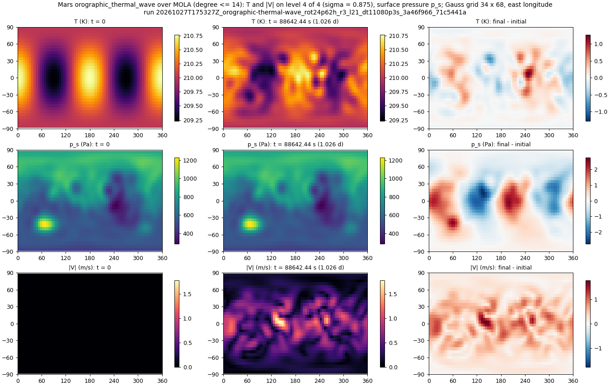
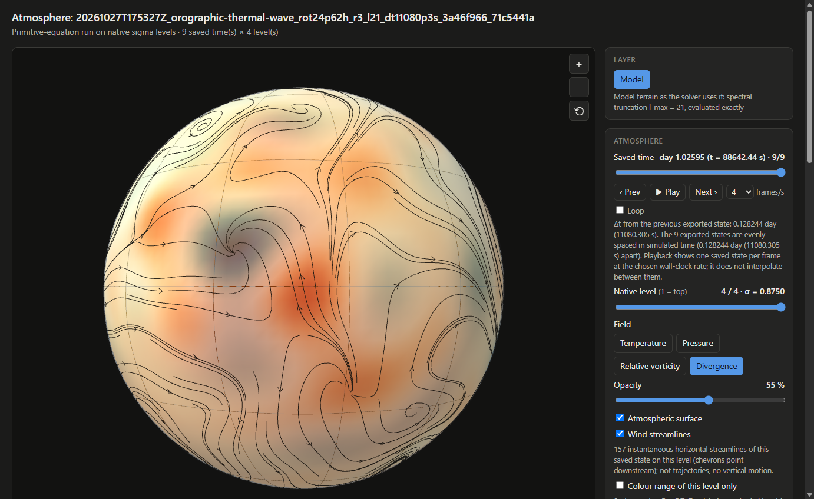

# An evolving Mars atmosphere over MOLA terrain (2026-10-27)

**An idealized dry-CO₂ perturbation experiment over MOLA terrain.** This is
not a Mars climate model. There is no radiation, no diurnal or seasonal
heating, no surface drag or heat exchange, no dust, no CO₂ condensation and no
water. The atmosphere starts in exact hydrostatic balance at rest over real
Mars relief. A small temperature perturbation then sets it moving, and it is
integrated for one Mars rotation period. This worked example demonstrates
importing terrain, evolving a small perturbation with the stated settings,
and playing the saved states in the offline atmosphere page. The checks
below measure evolution, timestep sensitivity and mass drift for this run;
they do not establish accuracy for arbitrary topographies or Mars weather.

The published run is
[`docs/runs/20261027T175327Z_orographic-thermal-wave_rot24p62h_r3_l21_dt11080p3s_3a46f966_71c5441a`](../../runs/20261027T175327Z_orographic-thermal-wave_rot24p62h_r3_l21_dt11080p3s_3a46f966_71c5441a/).
The experiment script is
[examples/mola_mars_evolving.py](../../../examples/mola_mars_evolving.py). Its
`PROTOCOL` (version 1) defines every quantity below. The numbers themselves are
stored separately in this folder.

| file | what it is |
| --- | --- |
| `results.json` | `PROTOCOL` v1 applied to the three runs: per-field evolution, control drift, floating-point floor, 60/30 s differences at every saved time, run diagnostics, timing, provenance, and the screen outcomes |
| `initial_final_difference.png` | maps at t = 0 and t = 88642.44 s and their difference, with common colour limits per row (PNG metadata: `Source`, `CoefficientsSHA256` of the main run) |
| `mars_evolving_initial_delta.png`, `mars_evolving_final_delta.png` | headless-Chrome captures of the all-times page at the first and last saved state |
| `browser_check.json` | the browser check of the three pages |

## Configuration

| | |
| --- | --- |
| initial state | `orographic_thermal_wave`: `orographic_isothermal_rest` (T = 210 K, ln p_s = ln 610 Pa − Φ_s/(R_d T)) plus a real coefficient of 1 K on the (2, 2) temperature mode at every level (pointwise peak 0.7725 K); zero vorticity and divergence |
| terrain | MOLA MEGDR 4 px/deg ([TERRAIN_IMPORT.md](../../TERRAIN_IMPORT.md#real-data-mars-from-mola)), prepared for PE at `l_max` 21 and band-limited at degree 14 (the dealiased product cut), digest `sha256:afb016d8…c35c31b8`; model range −7.6 to 8.4 km |
| planet | radius 0.53307 Earth radii (3,395,909 m), rotation period 24.6229 h, g = 3.71 m/s² |
| gas | R_d = 191.8 J/(kg K), c_p = 735 J/(kg K) |
| resolution | `l_max` 21, Gauss–Legendre grid 34 × 68, 4 uniform σ layers (full levels σ = 0.125, 0.375, 0.625, 0.875) |
| time | fixed-step RK4, 60 s (main, control) and 30 s (halved), for one rotation period, 88642.44 s; 9 saved states every 11080.305 s |

The saved interval is not a whole number of steps. The runner shortens the step
before each saved time, so the 60 s runs take 1472 steps of 60 s plus 8 of
40.305 s, and the 30 s run takes 2952 of 30 s plus 8 of 10.305 s. The `dt11080p3s`
in a run id is the saved-state interval, as in every tropoi run id. The step
is `dt_seconds` in `config.json`.

## Commands

The terrain comes first; the conversion of the PDS3 grid is described in
TERRAIN_IMPORT.md:

```bash
python examples/mola_mars.py prepare-pe mola/megt_4ppd.nc out/mola/mola_pe_l21 --lmax 21
```

The runs (CUDA). Each variant prints and records its exact `tropoi run pe`
command in `out/mola/evolving/<variant>/command.json`:

```bash
python examples/mola_mars_evolving.py run out/mola/mola_pe_l21 pilot
python examples/mola_mars_evolving.py run out/mola/mola_pe_l21 main
python examples/mola_mars_evolving.py run out/mola/mola_pe_l21 control
python examples/mola_mars_evolving.py run out/mola/mola_pe_l21 halved
```

The main run's command, for reference:

```bash
tropoi run pe --terrain out/mola/mola_pe_l21 --scenario orographic_thermal_wave \
  --radius-earth-units 0.53307 --day-hours 24.6229 --gravity 3.71 \
  --r-dry 191.8 --cp-dry 735.0 --temperature 210.0 --surface-pressure 610.0 \
  --levels 4 --dt-seconds 60.0 --days 1.0259541666666667 --n-snapshots 9 \
  --thermal-amplitude 1.0 --out out/mola/evolving/main
```

The measurements, figure, pages and browser check (CPU and headless Chromium):

```bash
python examples/mola_mars_evolving.py measure out/mola/evolving --out docs/validation/mars_evolving_2026-10-27/results.json
python examples/mola_mars_evolving.py figure out/mola/evolving --out docs/validation/mars_evolving_2026-10-27/initial_final_difference.png
python examples/mola_mars_evolving.py view out/mola/evolving --out out/mola/evolving/views
python examples/mola_mars_evolving.py browser-check out/mola/evolving/views --out docs/validation/mars_evolving_2026-10-27
```

The pages can also be rebuilt from the published run alone, with no GPU and
no terrain files. On 2026-10-27 this gave pages byte-identical to the ones
built from the local run:

```bash
python examples/mola_mars_evolving.py view docs/runs/20261027T175327Z_orographic-thermal-wave_rot24p62h_r3_l21_dt11080p3s_3a46f966_71c5441a --out views
```

## Machine and provenance

- **Hardware:** Windows 11, NVIDIA GeForce MX110 (2 GB, driver 522.06).
- **Software:** Python 3.12.12, NumPy 2.2.6, CuPy 13.4.0 (CUDA runtime
  11.8); browser checks in Chrome 156.0.8078.48, headless, with software
  WebGL (SwiftShader).
- **Code:** commit `71c5441a` of `feat/atmosphere-globe-view`. The manifests
  record `dirty: true`. `command.json` stores `git status --porcelain` at
  launch. The only modified tracked files were the two example scripts
  `examples/mola_mars.py` and `examples/mola_mars_evolving.py`, which were
  being edited for documentation and figures. `tropoi run pe` imports
  neither, and no file under `src/` was modified. The script runs `tropoi`
  in-process, so the manifest's `argv` records the script invocation
  (`examples/mola_mars_evolving.py run out/mola/mola_pe_l21 main`). The
  `tropoi run pe` arguments it passed are in `command.json` and above. The rest of the porcelain output lists
  untracked local files: plans, and the raw MOLA download.

## Results

All five screens pass. The targets are screening choices for this experiment,
not guarantees of the solver.

| screen | target | measured | |
| --- | --- | --- | --- |
| evolution ÷ max(control drift, floating-point floor) | ≥ 100 for every field | ≥ 6.7 × 10¹⁰ (surface pressure; others larger) | pass |
| 60 s vs 30 s, rms difference ÷ max evolution of the 30 s run | ≤ 5 % at every saved time | ≤ 2.6 × 10⁻⁷ (divergence; others ≤ 7.1 × 10⁻⁸) | pass |
| \|relative mass drift\| | ≤ 10⁻⁶ | 6.16 × 10⁻⁷ (60 s and 30 s alike) | pass |
| T > 0, p_s > 0, all finite | at every step | T 208.93–211.15 K, p_s 281.0–1229.6 Pa | pass |
| later wind | max \|V\| ≥ 0.01 m/s after t = 0 | 1.39–2.54 m/s at the saved times after t = 0; 1.78 m/s at the end | pass |

Per field, with rms the area-and-σ-weighted root mean square over the Gauss
grid (`PROTOCOL`):

| field | evolution, max rms over saved times | its max \|·\| | control drift (rms) | floor | 60/30 s difference ÷ evolution |
| --- | --- | --- | --- | --- | --- |
| temperature | 0.484 K | 1.75 K | 3.2 × 10⁻¹³ K | 3.0 × 10⁻¹² | 1.5 × 10⁻⁸ |
| surface pressure | 1.17 Pa | 3.65 Pa | 2.5 × 10⁻¹² Pa | 1.7 × 10⁻¹¹ | 7.1 × 10⁻⁸ |
| wind | 0.599 m/s | 2.54 m/s | 2.9 × 10⁻¹² m/s | 3.6 × 10⁻¹⁴ | 6.2 × 10⁻⁸ |
| relative vorticity | 6.5 × 10⁻⁷ s⁻¹ | 5.7 × 10⁻⁶ s⁻¹ | 9.3 × 10⁻¹⁸ s⁻¹ | 8.1 × 10⁻²⁰ | 1.5 × 10⁻⁸ |
| divergence | 5.7 × 10⁻⁷ s⁻¹ | 3.3 × 10⁻⁶ s⁻¹ | 6.2 × 10⁻¹⁹ s⁻¹ | 4.7 × 10⁻²⁰ | 2.6 × 10⁻⁷ |



*Bottom level (σ = 0.875) temperature, surface pressure and wind speed at
t = 0 and t = 88642.44 s, and the difference. Each row's first two panels share
colour limits. The initial (2, 2) wave (±0.77 K) has been reshaped into
smaller-scale structure. Surface pressure has changed by up to 3.6 Pa, well
under 1 % of the local value, while keeping the terrain-following 281–1230 Pa
field. Winds reach about 2 m/s.*

**What the numbers say.**

- **Evolution.** Every field departs from its initial state by 10¹⁰ to 10¹²
  times what the resting control does over the same terrain and time. The
  control stays at rest: max \|V\| 1.8 × 10⁻¹¹ m/s, \|T − 210 K\| ≤ 3.5 × 10⁻¹²
  K. So the motion comes from the perturbation, not from an imbalance of the
  base state over MOLA relief.
- **Timestep.** Halving the step changes the saved fields by at most 2.6 × 10⁻⁷
  of their evolution, at diagnostic Courant numbers of 0.046 (60 s) and
  0.023 (30 s). This demonstrates low sensitivity to this timestep change
  over the saved times. Two timesteps do not establish RK4 convergence
  order or an absolute error bound. Spatial accuracy at `l_max` 21 with
  terrain cut at degree 14 was not measured.
- **Mass.** `total_mass` integrates p_s = exp(ln p_s) on the grid. The drift
  oscillates between −1.7 × 10⁻⁷ and +6.2 × 10⁻⁷ over the run (every step),
  ending at its maximum. It is the same to the reported precision at 60 s
  and 30 s (6.1635 × 10⁻⁷ in both). This suggests a contribution insensitive
  to that timestep change, such as spatial discretization or quadrature;
  its cause was not isolated. The core advances ln p_s, whose tendency is
  evaluated on the grid and truncated. The ln p_s monopole is not an invariant here:
  it moves by 1.8 × 10⁻⁵ relative. The control, with no motion, drifts by
  3.3 × 10⁻¹⁶. The drift passes the 10⁻⁶ screen by a factor of 1.6 only. Longer
  runs were not tested, and nothing here says how it grows over many rotations.

## Cost

| run | steps | integration | per step | total wall | peak device memory |
| --- | --- | --- | --- | --- | --- |
| pilot (1800 s) | 30 | 18.7 s | 0.62 s | 20.7 s | 149 MiB |
| main (60 s) | 1480 | 971 s | 0.656 s | 974 s | 149 MiB |
| control (60 s) | 1480 | 998 s | 0.675 s | 1001 s | 149 MiB |
| halved (30 s) | 2960 | 2003 s | 0.677 s | 2005 s | 149 MiB |

Initialization took about 2 s, and writing the 9 states took 0.03–0.11 s.
Memory is `nvidia-smi` `memory.used` sampled every 0.25 s for the whole
device, including the CUDA context. The pilot's per-step time includes
kernel compilation. The runs went one after another, with no other GPU work.

## Offline page

Three pages were written from the main run: all 9 saved times
(`mars_evolving_all_times.html`, 5.23 MB), the first state (0.82 MB) and
the last (0.98 MB). They use a 3° mesh, divergence on the bottom level,
55 % opacity and ×10 exaggeration, centred on (0°, −100°). They were opened in
headless Chrome from `file://`, with networking disabled three ways (a dead
proxy, a host resolver that maps every name to NOTFOUND, and DevTools offline
emulation), and driven through the page's own controls
(`tools/browser_cdp.py`):

- **Offline and clean.** Each page issued exactly one request, its own file.
  There were no console errors and no exceptions. WebGL was available.
- **Nine distinct states.** The slider gave 9 different vertex-buffer digests,
  labelled `day 0 (t = 0 s) · 1/9` through `day 1.02595 (t = 88642.44 s) · 9/9`.
- **Streamlines.** Per state: 0, 160, 160, 160, 159, 159, 159, 155, 157. The
  initial state is at rest, and the page says no streamline reaches the
  drawing threshold. Every later state has them.
- **Levels and fields.** All 4 levels × 4 fields render, with 157–159
  streamlines each. Colour ranges are fixed over time: 208.95–211.14 K;
  pressure 35–1097 Pa; vorticity ±5.8 × 10⁻⁶ s⁻¹ and divergence
  ±3.4 × 10⁻⁶ s⁻¹, symmetric.
- **Terrain.** No terrain node rises above the bottom layer at any saved
  time.
- **Playback.** At 4 frames/s, from the first state, playback stopped on
  the last (index 8). The one-state pages hide the playback controls.



*`mars_evolving_final_delta.png`: the last saved state (t = 88642.44 s,
9/9). Divergence on the bottom level (σ = 0.875), 55 % opacity, ×10 relief,
157 instantaneous streamlines. The note under the playback controls gives
the 11080.305 s gap between states and says the page does not interpolate.
`mars_evolving_initial_delta.png` is the same view at t = 0: uniform zero
divergence and no streamlines.*

## Limits

- **Physics.** Idealized and dry, as stated at the top. One rotation
  period from an artificial initial perturbation. The flow is an adjustment
  and gravity-wave response over terrain, not a circulation.
- **Resolution.** `l_max` 21 with terrain cut at degree 14. The model
  terrain spans −7.6 to 8.4 km, against −8.1 to 21.1 km in the data: the
  volcanoes are broad, low swells.
  Spatial convergence was not tested: on the 2 GB MX110 the PE core fits
  `l_max` 42 at most.
- **No reference.** Nothing is compared with observations or with another
  model. The screens test that the evolution is real (above control and
  rounding), insensitive to the tested timestep change and within the
  stated mass-drift screen. They do not establish physical accuracy.
- **One machine.** One GPU, one browser build with software WebGL. The
  checks are in [ATMOSPHERE_VIEW.md](../../ATMOSPHERE_VIEW.md#limits).
