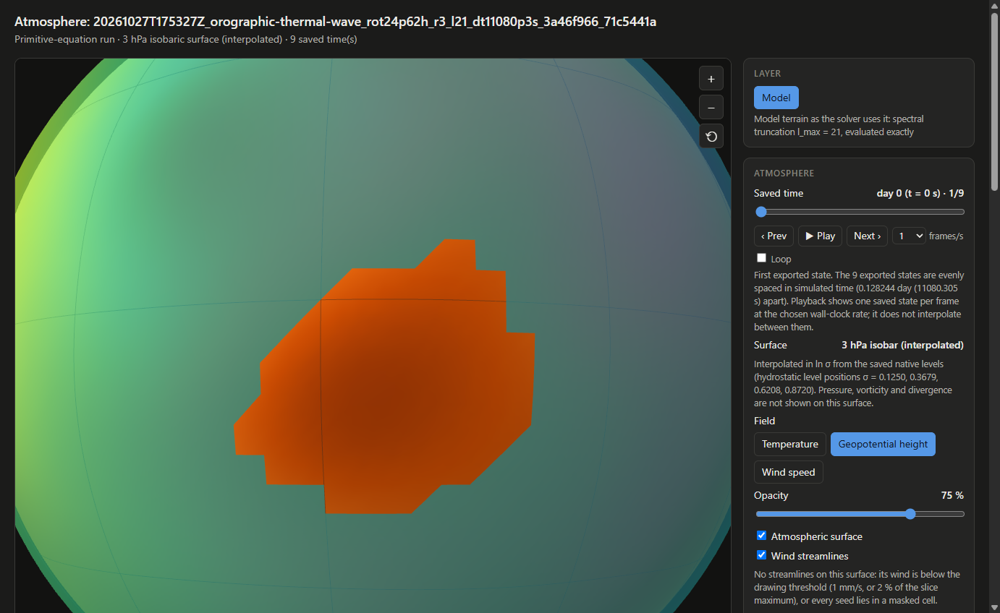
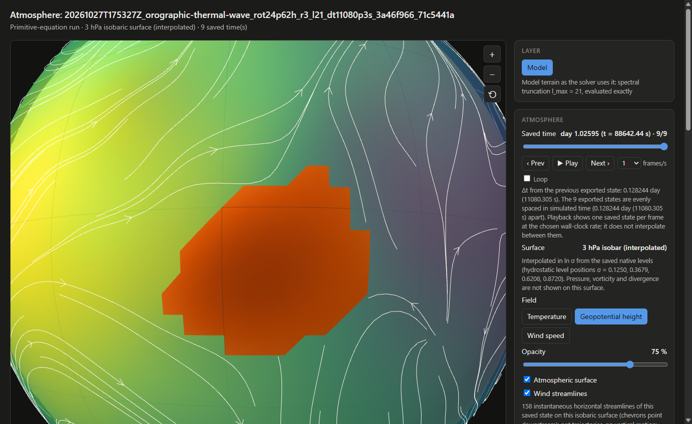

# Fixed-pressure surfaces across saved times (2026-11-07)

Measurements for the first slice of
[issue #13](https://github.com/AlexandreEros/Palintropos/issues/13): one
isobaric surface of a saved primitive-equation run per saved time, in the
offline atmosphere page (`Simulation.view(surface=("pressure", Pa))`). The
method is described in
[ATMOSPHERE_VIEW.md](../../ATMOSPHERE_VIEW.md#fixed-pressure-surfaces-across-saved-times);
the numbers below come from the committed script
[examples/isobaric_view.py](../../../examples/isobaric_view.py) on the same
laptop as the earlier atmosphere-view records (Intel Core i5-8250U class
CPU, Windows 11, Python 3.12.12, NumPy 2.2.6; no GPU is used anywhere in
this path).

This is a display of saved states. Nothing here validates the runs as
climates: the Mars run is an idealized dry-CO₂ perturbation experiment and
the Held–Suarez run an idealized forcing benchmark.

| file | what it is |
| --- | --- |
| `costs_hs-T42L20-prod-002_500hPa_2deg.json` | per-part costs of the 500 hPa export on three states of the Held–Suarez T42L20 run at 2° (`measure`) |
| `costs_mars_300Pa_3deg.json` | the same on three states of the published Mars run at 3° |
| `mars_isobar_300Pa_t0.png`, `mars_isobar_300Pa_t8.png` | headless-Chrome captures of the committed Mars page at its first and last saved state, over Tharsis |
| `mars_isobar_300Pa_browser_check.json` | the offline browser check of that page (`capture`): one request, no errors, nine distinct frames, per-frame masks and triangles, hover readouts |
| `hs_500hPa_all_2deg_browser_check.json`, `hs_500hPa_all_2deg_t119.png` | the same check on the 28.9 MB all-times Held–Suarez page (not committed; rebuilt by the command below) |

## Commands

```bash
python examples/isobaric_view.py view docs/runs/20261027T175327Z_orographic-thermal-wave_rot24p62h_r3_l21_dt11080p3s_3a46f966_71c5441a --pressure 300 --resolution 3 --out docs/runs/20261027T175327Z_orographic-thermal-wave_rot24p62h_r3_l21_dt11080p3s_3a46f966_71c5441a/assets/mars_isobar_300Pa.html
python examples/isobaric_view.py measure docs/runs/20261027T175327Z_orographic-thermal-wave_rot24p62h_r3_l21_dt11080p3s_3a46f966_71c5441a --pressure 300 --times 0 4 -1 --resolution 3 --out docs/validation/pressure_surface_2026-11-07/costs_mars_300Pa_3deg.json
python examples/isobaric_view.py capture docs/runs/20261027T175327Z_orographic-thermal-wave_rot24p62h_r3_l21_dt11080p3s_3a46f966_71c5441a/assets/mars_isobar_300Pa.html docs/validation/pressure_surface_2026-11-07 --centre -5 -115 --hover -5 -115 --hover -38 57 --hover 0 0
python examples/isobaric_view.py view runs/hs-T42L20-prod-002 --pressure 50000 --resolution 2 --out out/hs_500hPa_all_2deg.html
python examples/isobaric_view.py measure runs/hs-T42L20-prod-002 --pressure 50000 --times 0 60 -1 --resolution 2 --out docs/validation/pressure_surface_2026-11-07/costs_hs-T42L20-prod-002_500hPa_2deg.json
python examples/isobaric_view.py capture out/hs_500hPa_all_2deg.html docs/validation/pressure_surface_2026-11-07 --exaggeration 20
```

The Held–Suarez run (`runs/hs-T42L20-prod-002`, 120 states every 10 days,
[the run record](../../held_suarez/)) is local and not committed; the Mars run
is published under `docs/runs/`.

## The example: the 3 hPa isobar of the Mars run

The committed page
[`assets/mars_isobar_300Pa.html`](../../runs/20261027T175327Z_orographic-thermal-wave_rot24p62h_r3_l21_dt11080p3s_3a46f966_71c5441a/assets/mars_isobar_300Pa.html)
(1.53 MB, 1.8 s to export, 9 saved states on a 3° mesh, 7381 nodes each)
holds the 300 Pa (3 hPa) surface. The run's surface pressure ranges from
2.8 hPa over the Tharsis volcanoes to 12 hPa in Hellas, so 3 hPa is a
mid-column surface over most of the planet, under ground on the highest
peaks, and in the layer between the bottom full level (σʰ = 0.872) and the
ground around them:

| saved state | valid | under ground (1) | above top level (2) | below bottom level (3) | triangles drawn of 14,400 | streamlines |
| --- | --- | --- | --- | --- | --- | --- |
| all nine | 7334–7335 of 7381 | 10–11 | 0 | 36 | 14,278–14,281 | 0 at t = 0 (rest), then 157–158 |

The isobar's geopotential height is 7.65–7.75 km over the valid nodes, fixed
colour range over the nine states. The browser check opened the page from
`file://` with networking blocked: one request (the file itself), no console
errors, no exceptions, nine distinct frames (buffer digests differ), 1.0 s to
interactive, 23 MB of JS heap, frame switches of 9–44 ms. Hover at
(−5°, −115°), on Tharsis, reads "no sample on the 3 hPa surface: below the
surface (p0 > ps)"; at (−38°, 57°), in Hellas, "Geopotential height 7709 m ·
Z 7.709 km (interpolated)".




## Where the cost is

Per saved state, wall-clock seconds, mean over the timed states
(`seconds_per_time` in the JSON files):

| part | Held–Suarez T42L20, 2° (16,471 nodes) | Mars T21L4, 3° (7,381 nodes) |
| --- | --- | --- |
| hydrostatic coefficients (spectral) | 0.002 | 0.0002 |
| synthesis of T and Φ (2 × K fields) | 0.254 | 0.018 |
| winds (K Helmholtz syntheses) | 0.295 | 0.019 |
| `reconstruct_levels` total (the above, no ζ/δ) | 0.539 | 0.043 |
| ζ and δ syntheses the native page pays, skipped here | 0.249 | 0.018 |
| **vertical interpolation to the isobar** | **0.004** | **0.002** |
| streamlines (160 seeds, clipped) | 0.044 | 0.034 |
| whole export per state (`atmosphere_payload`) | 0.78 | 0.26 |

The vertical interpolation is 0.7 % (4 %) of the reconstruction. The cost is
spherical-harmonic synthesis on the display mesh, and it grows with the
number of saved states times the mesh nodes times the number of native
levels (every level is synthesized to bracket the target). Batching the
syntheses of one state's levels into one matrix product, as issue #13
suggests, is the obvious next step before any GPU is considered; nothing
here needs CUDA.

## All saved times

| run | surface | mesh | states | file | export time | interactive | frame switch | JS heap |
| --- | --- | --- | --- | --- | --- | --- | --- | --- |
| Mars evolving (T21L4) | 3 hPa | 3° | 9 of 9 | 1.53 MB | 1.8 s | 1.0 s | 9–44 ms | 23 MB |
| `hs-T42L20-prod-002` | 500 hPa | 3° | 120 of 120 | 15.9 MB | 73 s | — | — | — |
| `hs-T42L20-prod-002` | 500 hPa | 2° | 120 of 120 | 28.9 MB | 99 s | 1.1 s | median 25 ms, max 222 ms | 64 MB |

`times="all"` embedded every saved state in each case; the 2° export is
below the 32 MB default budget by 3 MB. Above the budget the export raises
`PayloadTooLargeError` before reconstructing anything and names the
alternatives (coarser mesh, fewer times, no streamlines, a larger `max_mb`);
it never subsamples. The 500 hPa surface is valid at all 16,471 nodes of
every Held–Suarez state (flat terrain, pₛ ≈ 1000 hPa), with 149–160
streamlines per frame and a fixed height range of 4.72–5.98 km. The page
decodes every embedded array eagerly when it opens; at 29 MB this cost
about a second and 64 MB of heap in headless Chrome, so lazy decoding is not
needed at this size and stays out of the slice.

## Correctness checks (tests)

`tests/test_pe_pressure_surface.py` and `tests/test_pressure_surface_view.py`:

- an isothermal column over flat and over sloping terrain interpolates to
  the closed-form height `hₛ + (R_d T/g) ln(pₛ/p₀)` within 1 µm at every
  valid pressure, with the default hydrostatic level positions;
- with the nominal positions (`σₖ`) the same column is off by
  `R_d T (αₖ − ln(σₖ₊½/σₖ))/g`, measured to 1 µm against that expression
  (up to 115 m on the four-layer test grid, zero for the top layer);
- a target on a level position reproduces that level's temperature,
  geopotential and winds to 1e−12 relative;
- a 4 K warming at fixed pₛ lifts the isobar by `(R_d ΔT/g) ln(pₛ/p₀)`
  (1e−9 relative) and leaves the masks unchanged;
- mask codes and brackets on synthetic columns; placeholders are finite and
  never samples; a negative layer temperature (non-monotonic Φ) and a wholly
  unavailable surface raise;
- streamlines in a zonal flow never enter a masked band of cells, and do
  cross it without the mask;
- the payload: fields, version 2, `surface` and `mask` blocks, per-time
  masks equal to the reconstruction's, colour limits and quantization over
  valid nodes only (an under-ground placeholder cannot pull a range), the
  estimate before reconstruction bounding the written file, strict
  `times="all"`, option validation, the native payload unchanged;
- in headless Chrome, offline: exactly the triangles with no masked vertex
  are drawn per frame, frames differ, hover names the mask reason, no
  streamline point falls in a cell with a masked node, one request, no
  errors.
